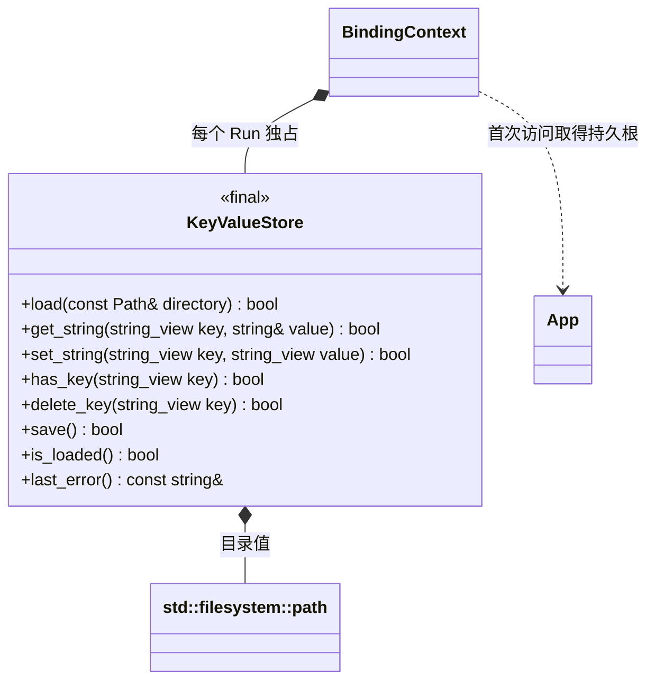

# 字符串 KV 持久存取

[类图索引](../../class-diagrams/index.md) · [App 路径](app.md) · [脚本外观](../../plugins/runtime/class-diagrams/storage-script-api.md)

此接口按首个游戏的轻量持久化需求实现；项目决定 key、JSON 内容、数据版本和保存时机。核心只提供字符串存取，不识别金币、关卡或游戏存档模型。

- `KeyValueStore` 是普通资源拥有者，不继承 System，也不引用 App、脚本或游戏。调用方显式提供目录；原生调用可独立使用。C++ 失败返回 false，`last_error()` 给出原因。
- 每个 Run 的 BindingContext 独占一个存储实例。首个有效玩法回调中的访问惰性读取 `App::persistent_data_path()/userdata/kv.json`，不在模块预检期间读取或写入；App 未初始化或读取失败时保持不可用，不能通过设置或保存覆盖旧文件。
- 文件不存在表示新的空 KV；文件损坏、版本不支持、无权限和路径错误属于失败。`GetString` 缺 key 返回 null 且错误为空；发生错误也返回 null，通过 `lastError` 区分。`HasKey` 返回存在性；无效调用、读写失败返回 false 或 null，并保留可查询状态。
- key 与 value 为 UTF-8 字符串；空字符串 value 合法。key 长度、总文件大小及输入格式有明确上限，超限失败保留原内存与磁盘数据。具体限制跟随实现和 README 说明。
- 修改先保留在本 Run 内存中；仅 `Save` 显式写入临时文件，完整写入并关闭后在同一目录替换目标。临时文件通过 C11 独占创建模式打开，Windows 平台实现使用宽字符路径；已存在的路径不会被打开或截断。普通遗留临时文件仍在保存前检查并清理。平台选择属于目标配置，文件打开函数为存储模块私有实现，不增加公开类或方法。失败不删除旧有效文件，不自动保存于销毁、停止或热重载；项目可在 OnShutdown 主动调用 Save。
- 路径不暴露给脚本。用户数据与日志、资源同步和缓存目录分离；拒绝用户数据目录及固定目标文件的符号链接。接口由宿主主线程串行使用，不承诺跨进程并发写入或断电后的存储硬件持久性。
- 停止与重载释放本 Run 的未保存变更，后续 Run 重新读取已保存数据；旧回调不能操作新 Run 的缓存。大块世界快照不通过脚本逐对象采集，本接口仅处理低频字符串存取。

此图新增的原生类与绑定不改变 Engine、System 或 App 的公开方法。脚本声明集中在 `include/engine.d.ts`，不额外建立游戏存档 Manager。
