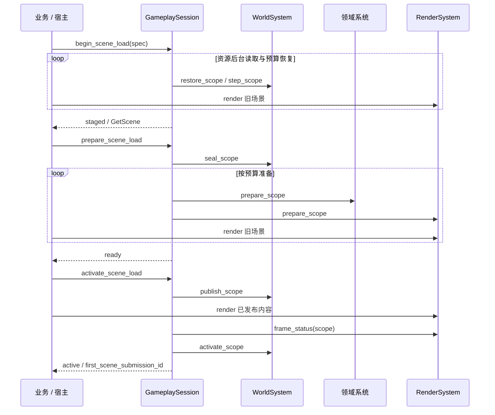

# 场景准备与连续呈现

[类图索引](../../class-diagrams/index.md) · [加载请求与领域契约](scene-loading.md) · [渲染与截图](render-readiness.md)

玩法、宿主、编辑器预览与测试复用同一个世界、资源加载器、任务域和 GPU 缓存。资源读取在后台执行，候选恢复与领域准备在所属线程按预算推进。候选准备期间继续绘制已发布内容；准备完成后显式发布，在首帧提交后允许模拟。

完整方法、状态、所有权与错误只在所属契约页维护。启动入口的脚本预检仍由 GameplaySession 组织，指定启动场景时驱动同一个 SceneLoadOperation；动态追加使用独立 scope。RenderSystem 的共享纹理、几何和程序按不可变资源身份复用，每个候选保留独立通道目标；活动材质替换完成前保留原有效绑定。

时间预算是软预算，单个上游调用不可抢占。状态查询不推进工作，不用固定等待或非黑像素作为加载完成条件。平台验证结果见[测试文档](../../testing.md)。
