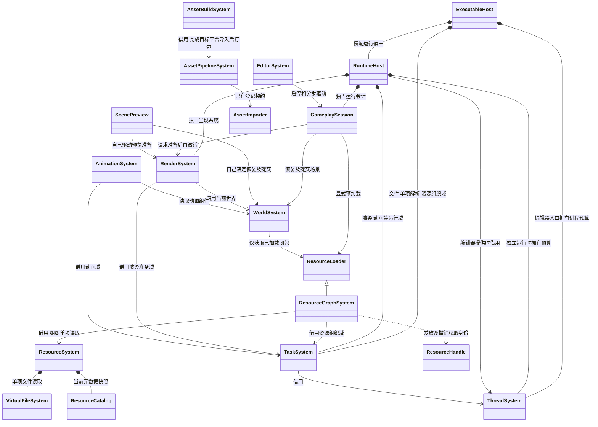
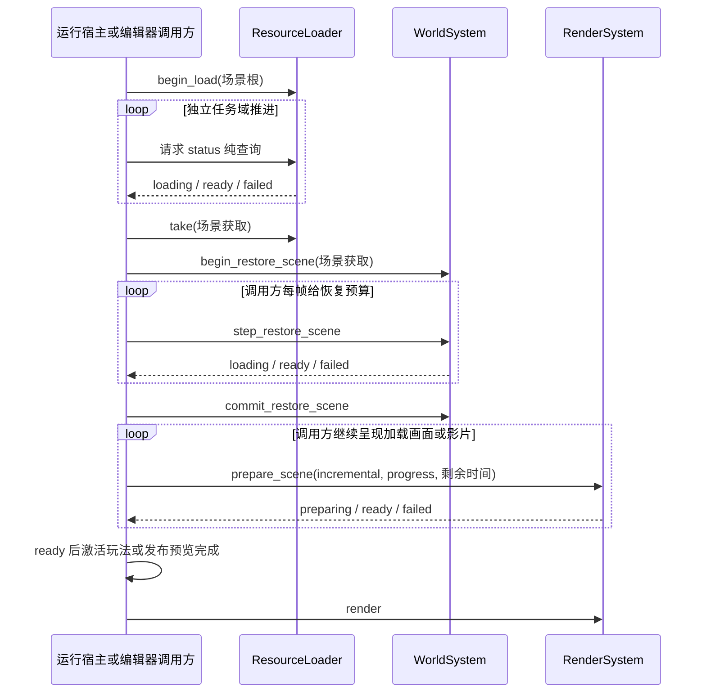

# 大场景加载与准备

[类图索引](../../class-diagrams/index.md) · [资源生命周期](resource-lifecycle.md) · [渲染系统](render-system.md#大场景分批准备)

**状态：2026-11-07 已按确认类图实现；验证范围见[测试文档](../../testing.md)。** 本页只维护跨模块关系、调用顺序和实现边界；公开方法、数据和私有结构分别定义在所属图，不重复定义类方法。

本批处理已经定位的重复查找、资源闭包容量限制、整批纹理等待，以及磁盘动画 / 纹理的运行时加工。保持一个版本，不新增通用 LoadingSystem、资源 Manager、第二套引用计数或线程池。

## 职责与所有权

图中的 `TaskSystem` 表示多个域，ThreadSystem 的两条拥有关系对应不同宿主模式，同一进程只初始化一个并行预算。文件、解码、资源组织和渲染分别使用自己的域，底层共享 oneTBB；任务不保存 ECS 列或活动组件指针。核心不依赖 ResourceGraphSystem 或编辑器导入器。

| 所属模块 | 本批设计 | 所属类图 |
| --- | --- | --- |
| 资源目录核心 | 值复制共享只读快照，赋值发布新快照 | [ResourceCatalog](resource-catalog.md) |
| 高层加载契约 | 闭包内按 GUID / 路径取得独立获取，不读文件 | [ResourceLoader](resource-loader.md) |
| 资源图插件 | 请求计划、闭包索引、在途窗口、反向完成通知和引用卸载 | [ResourceGraphSystem](../../plugins/runtime/class-diagrams/resource-graph.md) |
| 世界 / 组件 | 继续分步恢复 ECS；复用加载结果，不再重复整项 Mesh 校验或遍历资源图 | [WorldSystem](world-system.md)、[资源消费者](resource-consumers.md) |
| 渲染 | 实例直接定位、唯一资源准备、预算化提交、取消与延迟收尾 | [RenderSystem](render-system.md#大场景分批准备) |
| 动画与编辑器导入 | 固定动画离线采样数据；运行时缓存与目标骨架映射 | [动画模型](model-resources.md#离线采样产物)、[AnimationSystem](animation-system.md) |
| 贴图导入 | 显式 native 产物可直接上传；默认 basis 保留体积取向 | [TextureImporter](../../editor/class-diagrams/texture-importer.md#目标平台产物) |

## 调用方与完成边界

- **资源 ready**：不可变 CPU 数据与必要依赖可用，不包含 ECS、GPU、VM、声部或影片首帧。
- **场景恢复 ready**：候选 ECS 结构可提交，不推进文件 / 资源任务，也不证明领域系统已完成首帧工作。
- **渲染 ready**：本次准备范围的资源创建 / 上传命令已按 bgfx 顺序安排，可供后续绘制消费；不表示 GPU 已执行完，也不表示动画、物理已预热。
- 资源请求状态、渲染状态查询均不推进工作。宿主驱动模块、决定等待和呈现策略；核心不读取项目设置来自动加载或跳过失败资源。
- 保留当前 WorldSystem 提交边界：ECS 提交在 GPU 准备之前。本批不承诺跨这两个模块的原子场景切换；提交后 GPU 失败由会话停止 / 调用方恢复处理，不能声称旧场景仍完整保留。
- 常驻 UI、旧场景或加载影片是否继续显示，由调用方按其仍然有效的已准备资源决定；没有可用画面时宿主呈现既有启动清屏。`preparing` 不作为项目渲染失败处理。每次渲染只使用仍有效且就绪的对象，不拿旧实例填补新身份。
- 正常帧顺序为明确修改场景、刷新派生状态、增量准备、绘制。调用方控制准备期间的调度；运行宿主在会话激活前不推进玩法系统，编辑器继续驱动自己的准备步骤；渲染器不自行暂停世界。
- `GameplaySession::start` 保留真实同步语义，显式选择 synchronous 模式；`step_prepare`、交互式宿主、预览及热重载选择 incremental。两种模式复用同一内部准备过程，不保留旧 bool 重载。交互式路径不得循环调用 synchronous 或忙等 preparing。

## 格式与装配边界

渲染配置经 `RuntimeParallelConfig.rendering` 与运行设置部署；`ResourceGraphConfig` 由宿主装配具体插件时提供，核心运行配置不依赖插件类型。资源加载、场景恢复和渲染准备各自提供当前唯一契约，不保留旧签名、旧键或兼容别名。

Schema 默认版本写 0，生产者显式写当前版本；旧缓存 / 旧运行包重建，原 meta 和 GUID 保留。动画结构化内存生成是当前版本明确支持的另一种输入，不是识别不到新字段时的旧格式回退。

普通图片 storage 默认 basis 保持现有体积取向，只对显式选择 native 的资源提前转码。需要比较启动 CPU、读取量和包体后再决定项目采用范围，不在未测收益时把所有贴图强制展开。索引和分批准备不以全项目采用 native 为前提。

## 验收范围与限制

- 资源数超过 1024 的必要闭包在预算允许时逐步完成；同时覆盖同根请求合并、取消、目录换代和最后引用卸载。不能只把常量调大。
- 场景实例准备与查询不出现按实例数平方增长的查找；绑定同一已校验 Mesh 不再反复扫描全部顶点 / 索引。保留实体代次、组件实例身份及资源获取校验。
- 用现有探针观察协调线程耗时、准备帧数、暂存峰值及 GPU 提交；loading 帧不等待未完成 future。预算是可中断工作单元之间的软上限，单次驱动调用不是硬实时可抢占操作。
- 同步 / 分步模式产生相同绘制数据；取消和失败不回写新场景；关闭时先停止接收，再回收本模块任务，最后关闭 GPU 和借用加载器。
- 固定动画与现有事件、缺省轨道、骨架重用、重定向、IK / 挂点语义一致；目标平台纹理保持颜色空间、mip / face、HDR 精度及材质采样约定。
- 本批不建立世界分区或自动流式加载，不改物理形状的首帧构建，也不宣称解决 UI / 字体 / 插件内部的所有同步原子步骤。WorldSystem 既有节点 / 时间预算仍需由宿主按场景规模配置；评估整条启动链时单独计量这些成本。

参考为本地 `references/ant-master` 的 `mesh_idx`、贴图创建队列与 Ozz 离线产物，以及 `references/NoGraphicsAPI-main` 的有界上传和完成回收。Ant 的隐式占位加载不进入本项目契约；NoGraphicsAPI 队列满会等待，当前增量路径须改为让出执行。保留现有 bgfx 和平台后端，不把它的裸 GPU 指针、类型系统或分配器直接带入核心。
