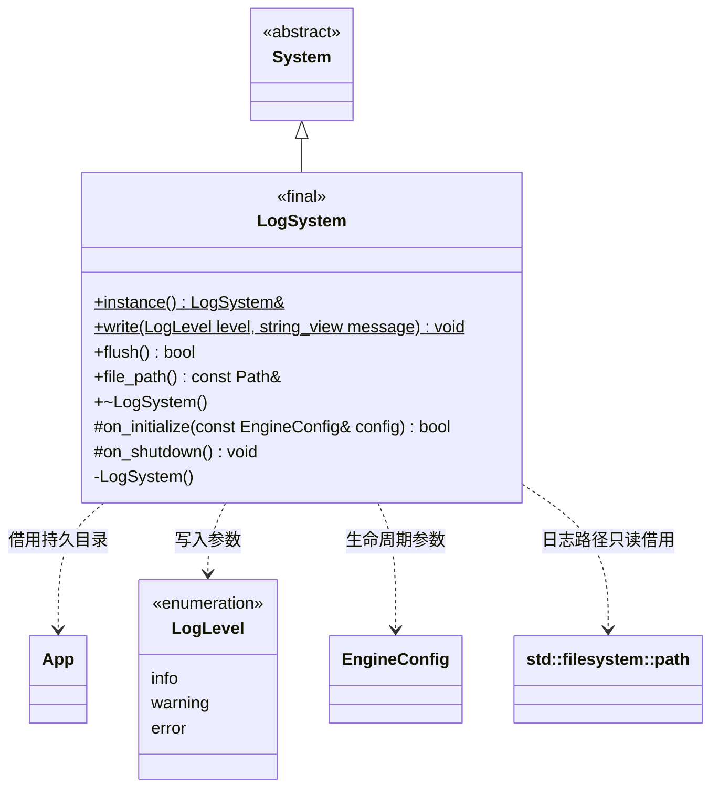

# 日志系统

[类图索引](../../class-diagrams/index.md) · [引擎与系统](engine-system.md) · [应用平台目录](app.md)

状态：本轮实现；继承的生命周期只在 System 总图维护。

- `LogSystem` 是独立根系统及进程单例，构造私有，禁止复制与移动。宿主借用 `instance()` 的唯一实例，不把它交给引擎系统树的 `unique_ptr`。
- App 先就绪，然后宿主调用继承的 `initialize(config)`；项目检查和引擎初始化都在其后。所有引擎系统和工作线程退出后，宿主刷新并关闭日志，再关闭 App。
- 默认同时输出到标准错误与 `App::persistent_data_path()/logs/engine.log`，不写标准输出；文件使用追加模式。每条记录包含 UTC 时间、级别和正文。
- `write()`、`flush()` 及内部文件打开和关闭使用同一互斥量。宿主负责串行调用 System 生命周期；`file_path()` 的借用只可在初始化后、关闭前由宿主读取。
- 初始化或日志文件创建失败返回 `false` 并清理本次状态。初始化前和关闭后的写入仍输出标准错误。运行期写盘或轮换失败保留标准错误输出，并使后续 `flush()` 返回 `false`，直到重新初始化。
- 单个文件上限约 4 MiB，保留三个编号历史文件。单条正文最多 64 KiB，过长正文明确标记截断，防止单条记录越过容量约定。错误级别立即刷新，普通记录可由宿主显式刷新。
- 退出刷新与关闭失败会报告到标准错误；关闭可重复调用。静态析构只作兜底，正常流程显式关闭，避免依赖静态析构顺序。

`LogLevel` 使用明确宽度的简单枚举。构造、析构、关闭和路径访问器为 `noexcept`；返回状态的方法标注 `[[nodiscard]]`。无需逐帧任务，沿用 System 默认空更新。
