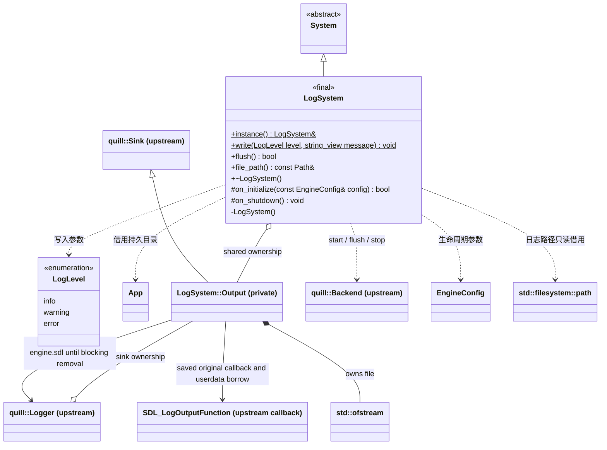

# 日志系统

[类图索引](../../class-diagrams/index.md) · [引擎与系统](engine-system.md) · [应用平台目录](app.md)

继承的生命周期只在 System 总图维护。

- `LogSystem` 是独立根系统及进程单例，构造私有，禁止复制与移动。宿主借用 `instance()` 的唯一实例，不把它交给引擎系统树的 `unique_ptr`。
- App 先就绪，然后宿主调用继承的 `initialize(config)`；项目检查和引擎初始化都在其后。所有引擎系统和工作线程退出后，宿主刷新并关闭日志，再关闭 App。
- Quill 13.1.0 承担正常运行时的异步队列、后台线程、时间/级别格式和 logger 生命周期。仅私有 `Output` 实现上游正式 `Sink` 接口，对接已有的无异常文件轮换和 SDL 平台输出；不新增公开日志包装层。上游内置 FileSink/StreamSink 在 `QUILL_NO_EXCEPTIONS` 下遇 I/O 错误会终止进程，因此不用于本系统要求返回 `false` 的 I/O 链路。
- 默认保留 SDL 平台日志输出（桌面标准错误、Android logcat），同时写入 `App::persistent_data_path()/logs/engine.log`，不写标准输出；文件使用追加模式。每条文件记录包含 UTC 时间、级别和正文。
- 初始化成功后通过 SDL 官方 `SDL_SetLogOutputFunction()` 安装私有桥，现有 `SDL_Log*` 调用点无需更换。桥首先直接调用保存的原输出，保留 SDL category、priority、既有过滤和同步平台可见性，再入队 Quill `engine.sdl` logger；对应 sink 只写文件，不重复平台输出。`LogSystem::write()` 使用 `engine` logger，由同一 sink 输出到平台和文件。
- 原输出和 userdata 在桥存活期间借用；私有输出互斥量序列化 SDL 调用线程与 Quill 后台线程对原 callback 的调用，保持自定义 SDL callback 的单线程约定。原 callback 的上下文必须存活到日志关闭。运行期失败与 Quill notifier 都直接调用原输出，不经过 `SDL_Log*`，也不重新入队。
- `write()` 入队、`flush()` 及文件初始化/关闭由同一生产端互斥量保护。SDL 官方 callback 入口不获取这个互斥量，SDL 回调的获取、安装与恢复均在它之外执行，避免与 SDL 内部日志锁逆序。运行期仅 Quill 后台线程访问文件；`Output` 回调不获取该互斥量，也不调用 `LogSystem::write()`，文件故障直接报告 SDL，避免刷新/关闭死锁或递归。失败状态使用原子字段供同步刷新查询。宿主负责串行调用 System 生命周期；`file_path()` 的借用只可在初始化后、关闭前由宿主读取。
- 初始化或日志文件创建失败返回 `false` 并清理本次状态。初始化前和关闭后的写入仍输出平台日志。运行期写盘或轮换失败保留平台日志输出，并使后续 `flush()` 返回 `false`，直到重新初始化。
- 单个文件上限约 4 MiB，保留三个编号历史文件。单条正文最多 64 KiB，过长正文明确标记截断，防止单条记录越过容量约定。错误级别调用 Quill 的同步 `flush_log()`；普通记录保持异步，不逐条强制刷新。`flush()` 等待本次调用之前已提交的记录完成写入并刷新，再返回文件状态。
- 宿主先停止并加入全部生产线程，然后关闭日志；日志先恢复原 SDL callback，SDL 自身的锁保证在途桥回调结束，再同步排空并通过 `remove_logger_blocking()` 移除两个 logger、停止 Quill 后台线程，最后关闭文件、清理共享 sink 与路径。恢复后排空期间不允许宿主生产线程继续写日志，否则已恢复的 callback 不再受私有输出互斥量保护。退出刷新与关闭失败报告到平台日志，关闭可重复调用。Quill 管理器在 LogSystem 构造时先准备，静态退出兜底只在后台线程仍运行时刷新，避免等待已停止的线程或使用已销毁的线程本地队列；正常流程仍显式关闭。

Quill 固定上游 [v13.1.0](https://github.com/odygrd/quill/tree/v13.1.0)，通过 vcpkg `quill::quill` 私有接入；其 MIT 许可由 port 安装。只在日志目标定义 `QUILL_NO_EXCEPTIONS` 与 `QUILL_DISABLE_NON_PREFIXED_MACROS`，不改变其他目标的异常或宏配置。

`LogLevel` 使用明确宽度的简单枚举。构造、析构、关闭和路径访问器为 `noexcept`；返回状态的方法标注 `[[nodiscard]]`。无需逐帧任务，沿用 System 默认空更新。
