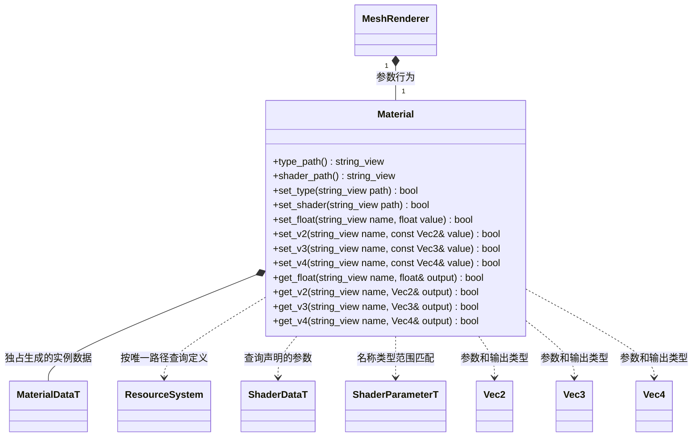

# 材质

[类图索引](../../class-diagrams/index.md) · [组件](component.md) · [资源系统](resource-system.md) · [共享数据模型](scene-data.md)

- 材质类型与 Shader 均通过包含来源的字符串唯一路径标识：`builtin/...` 是引擎内置，`project/...` 是项目资源。同相对名字可在两个空间独立存在；没有额外来源枚举或冗余状态。资源定义可自定义组合，内置定义由引擎注册，项目资源从管线生成的独立 FlatBuffers 缓存加载。
- `set_type()` 查找材质定义，合并其 Shader 的可修改默认参数与材质定义覆盖值。换型重建实例参数；相同材质路径保持当前实例值和 Shader 选择。未知资源返回 false，不改变状态。
- `set_shader()` 保留材质路径；切换到不同 Shader 时重新建立其可修改默认参数，旧参数和材质覆盖值不带入新组合。设置同一 Shader 路径保留已有实例参数。
- 参数名区分大小写；setter 同时验证声明的类型、`exposed`、有限数值、GPU float 可表示范围及声明的上下限。未知参数、隐藏参数、类型不匹配和非法值均返回 false，不新增未知字段、不改变旧值。
- `set_v2("pos", Vec2(0, 0))` 在选定 Shader 声明了公开的 Vec2 参数 `pos` 时成功。Vec3、Vec4 与 float 同样按声明匹配；不是仅支持内置参数的固定映射。
- `get_*()` 读取同一实例数据，失败输出零值。隐藏参数由渲染器读取 Shader 定义中的默认值，不允许通过材质接口覆盖。
- Material 由 MeshRenderer 独占，持有生成 `MaterialDataT` 的唯一运行时实例。字符串返回值和组件引用均为借用，切换材质或删除节点后不能继续使用旧借用。
- 默认 MeshRenderer 初始化选择 `builtin/materials/default-pbr`；资源定义不存在时通过组件初始化返回 false，Node 不发布半初始化组件。ResourceSystem 必须先于使用材质的场景初始化、晚于场景和 GPU 资源关闭。

- 项目材质定义可引用内置或项目 Shader；内置材质定义不能引用项目 Shader。项目结束先释放场景，再清理 `project/` 定义，保留 `builtin/` 定义供下一次项目启动。GPU 已复制资源字节且不借用定义，允许在下次场景 prepare 时退役。
