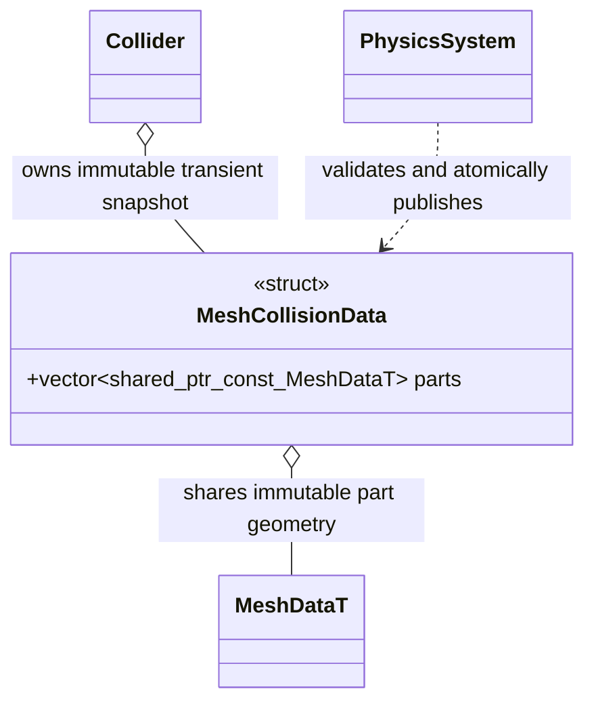

# 分段静态网格碰撞

`engine::MeshCollisionData` 表示瞬时几何所有权；几何继续使用 FlatBuffers `MeshDataT`，不增加持久资源模型。

`parts` 是完整列表，索引为稳定槽位，nullptr 表示空槽；列表可以清空以移除全部几何。每个网格均为拥有的不可变快照，发布后不得通过可变别名修改；更新必须创建新的 `shared_ptr<const MeshDataT>` 替换槽位。调用方可释放或修改自己的列表，Collider 复制列表并共享其中的不可变网格，不借用调用栈。全部顶点使用 Collider 的局部坐标，不增加子节点或独立刚体。

`PhysicsSystem::set_mesh_parts(Collider&, const MeshCollisionData&) -> bool` 在原静态网格安全点验证并原子发布。私有缓存复用未变网格指针及对应缩放下的 Jolt MeshShape，变化块采用官方快速 BVH 构建；StaticCompoundShape 组合这些子形状，全部候选成功后才替换现有 Body 的形状。新增、替换和清空均失败保留旧组件与碰撞。无变化不重建根树，配置/变换/缩放变化仍须处理。局部提交保守唤醒变化块旧/新区域，完整替换保持全区域唤醒。

Collider 的单网格 `mesh_data()` 在分段模式返回 nullptr，不能虚构一个合并网格；分段数据和普通瞬时网格一样不能单独序列化为带空 GUID 的资源。分段/资源网格/单瞬时网格/普通形状相互切换时释放过期来源；失败不提前清理。禁用、再次启用、物理世界清理及组件替换都可从现存几何恢复。一个 Collider 仍对应一个 Body，查询与撞击的节点身份不变。所有 Jolt 类型留在核心私有实现中。

各叶沿用 Jolt 官方退化面清理，清理后没有有效面的叶子保留来源但不产生碰撞，避免原合并网格可正常清理的极小三角在细分后导致整批失败。空指针是显式空槽；非空输入仍须有顶点和完整三角索引，错误 schema、非有限顶点及越界索引使整批失败。全批清理后为空与全空槽的行为一致。

私有缓存按连续 64 个槽位组成一个官方 StaticCompoundShape 分组，根再组合各组；未变叶子与分组都共享，仅重建变化组和根。不引入新的树算法或公开分组模型。小列表直接退化为单组/单叶。缓存记录实际烘入形状的缩放，连续小步缩放达到容差后必须重建，不能逐帧推进比较基准而永久复用旧形状。

上游依据和性能目标见[局部碰撞研究](../../plugins/runtime/terrain-collision-plan.md)。
