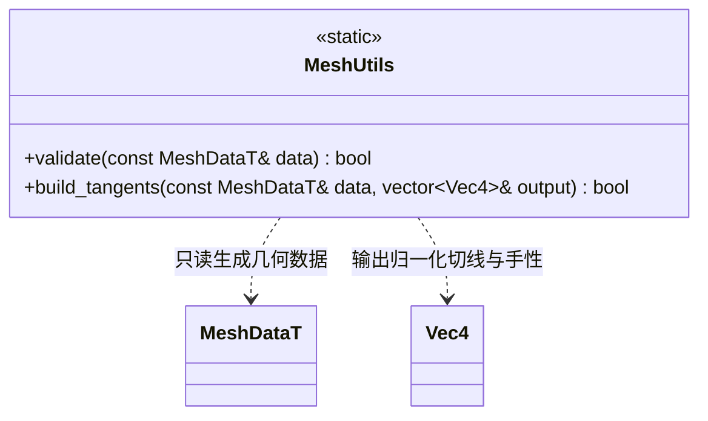

# 网格工具

[类图索引](../../class-diagrams/index.md) · [节点组件](component.md)

- 公共静态方法只校验或转换几何，不访问 GPU、项目设置或文件；数据均由 FlatBuffers 生成。资源层另外校验路径身份，动态网格允许空路径。
- 顶点位置与非零法线必须有限，三角索引合法。UV、切线、颜色可省略，存在时长度必须等于顶点数。切线 xyz 非零、w 为正负 1；颜色在 0..1。
- 子网格可省略，省略表示完整索引与材质槽 0；存在时按顺序完整覆盖索引，范围为三角形倍数，槽号小于 16。
- 切线构建采用 bgfx examples/common/bgfx_utils.cpp 的 calcTangents 思路：三角 UV 梯度累计、Gram–Schmidt 正交化及手性。实现使用 double 中间值和 uint32 索引；退化 UV 或没有 UV 时建立稳定正交基，不产生 NaN。已有切线保持其方向并归一化。失败输出为空。

方法返回值标记 [[nodiscard]]；validate 为 noexcept。
