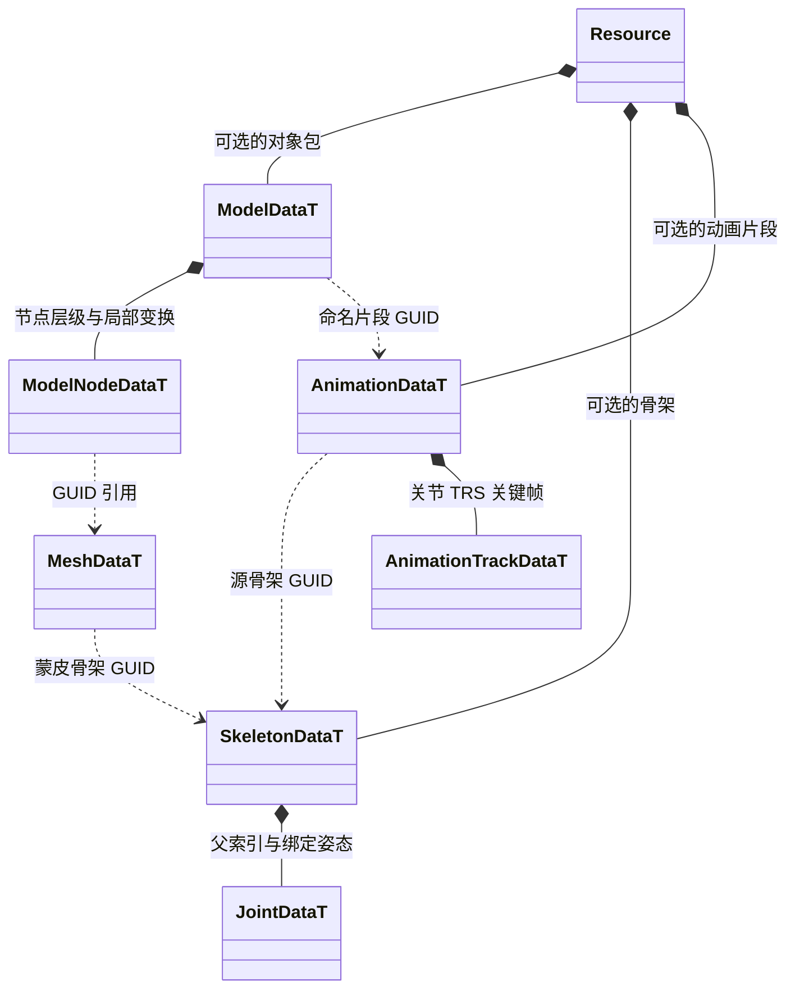
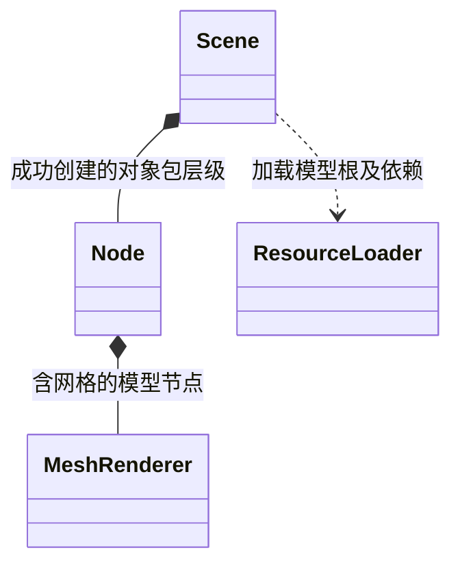
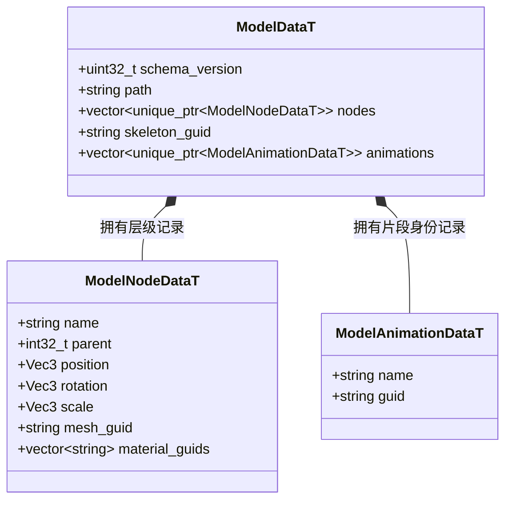
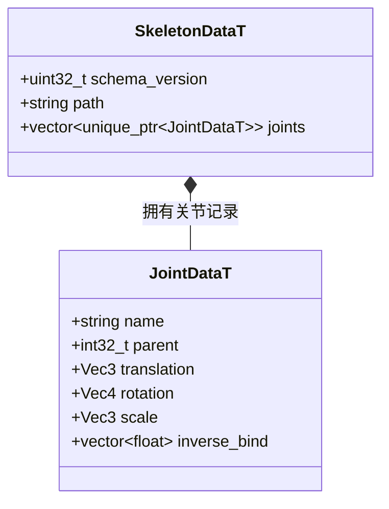
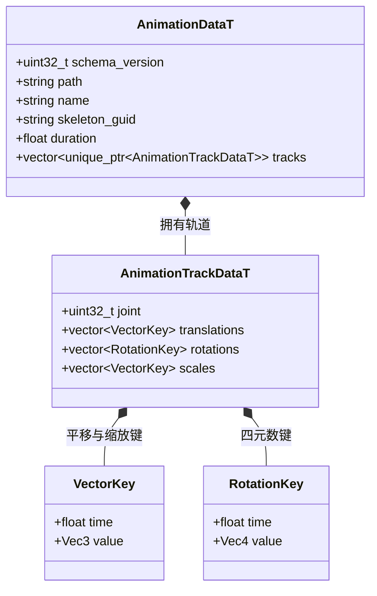

# 模型包、骨骼与动画资源

[类图索引](../../class-diagrams/index.md) · [场景](scene.md) · [动画系统](animation-system.md)

格式导入器属于编辑器插件。FBX、USD 及后续格式通过同一导入接口生成以下运行时数据，核心不读取源格式。资源描述以 FlatBuffers 为唯一模型，每个主资源和子资源各有稳定 GUID。

`instantiate_model` 返回本场景拥有的根节点借用；失败删除本次候选节点，保留场景原对象。模型包不是另一种场景对象，实例化后仍是 Node、Transform 与 MeshRenderer；动画由调用方添加 Animator 并选择片段。

骨架使用父索引与局部 TRS、模型空间 inverse_bind；网格保存四个最大权重并归一，以及 mesh_to_skeleton 绑定矩阵。动画轨道使用源骨架索引。播放不同文件的动画时按骨骼名称与父层级匹配，不能以 GUID 相同为前提。

模型、骨架、动画分别由独立的 ModelResourceCodec、SkeletonResourceCodec、AnimationResourceCodec 解码，继承 ResourceCodec。它们只检查单项结构及显式依赖，依赖闭包仍由可选资源图插件负责。

Resource 查询方法仅在[资源实体](resource.md)维护，Scene 的实例化契约仅在[场景](scene.md)维护。Schema 位于 `include/schemas/runtime/{model,skeleton,animation}.fbs`；编辑器格式插件输出它们，运行时 `resource/codecs/` 解析它们，不将源格式 SDK 链接到核心。

## 生成数据字段

ModelNode 的 rotation 为角度制 Euler XYZ，Joint 和 RotationKey 为四元数 xyzw；inverse_bind 与 mesh_to_skeleton 均为 16 项列主序矩阵。父索引 -1 表示根，其余必须指向已有父记录。上述结构均来自 Schema 生成，导入器不定义另一套手写持久模型。
