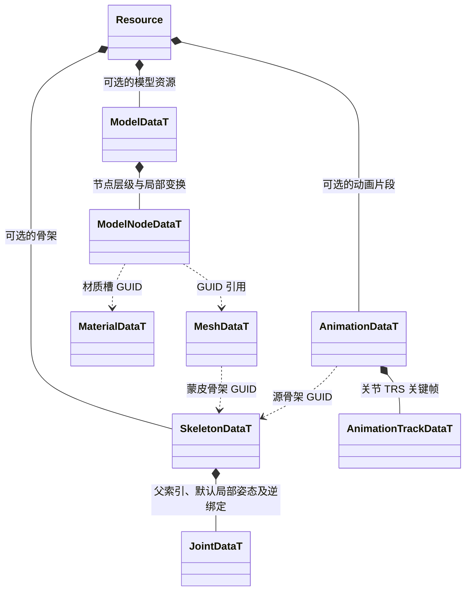
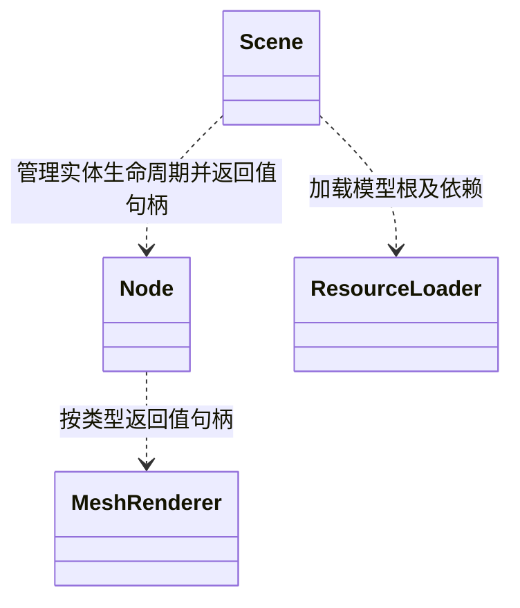
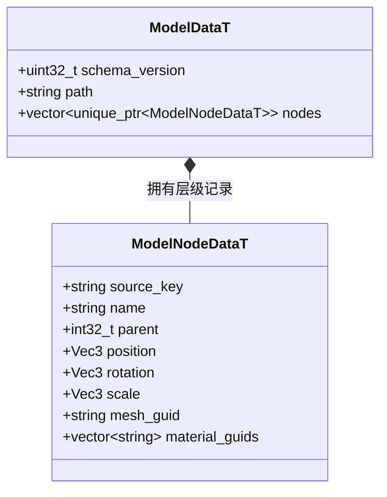
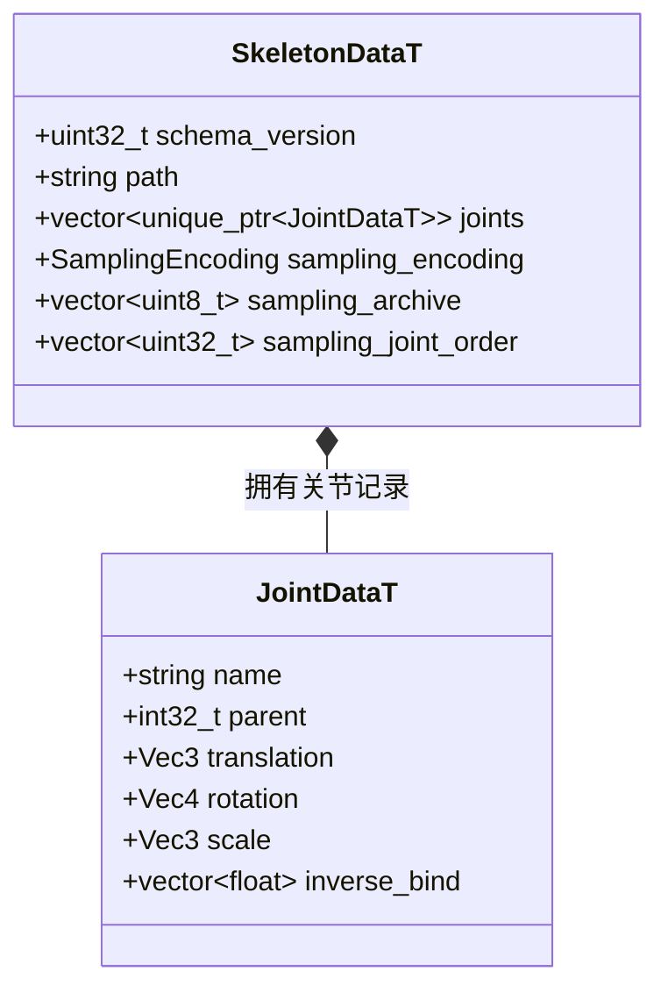
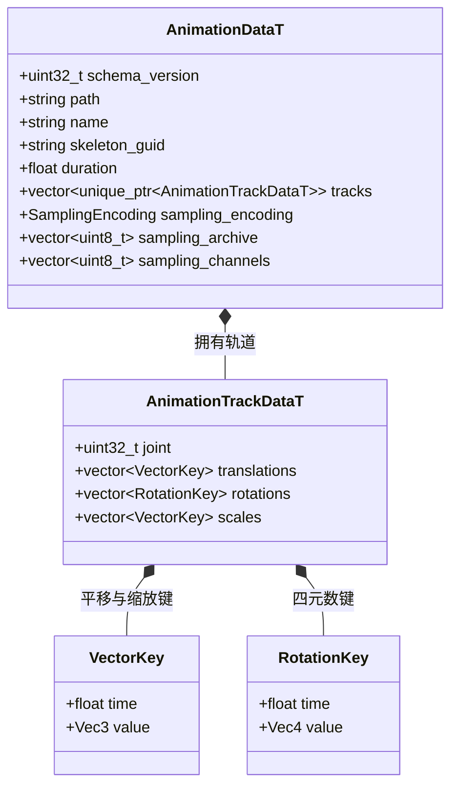
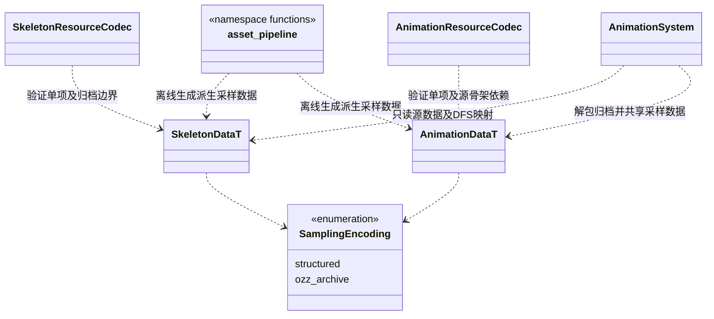

# 模型资源（Model）、骨骼与动画

[类图索引](../../class-diagrams/index.md) · [场景](scene.md) · [动画系统](animation-system.md)

格式导入器属于编辑器插件。FBX、USD 及后续格式通过同一导入接口生成以下运行时数据，核心不读取源格式。资源描述以 FlatBuffers 为唯一模型，每个主资源和子资源各有稳定 GUID。

**2026-11-07：Skeleton / Animation 的离线采样字段及格式 2 已实现。** 其余模型关系保持；新增派生数据及内存输入边界见[离线采样产物](#离线采样产物)。

编辑器“对象包”是一个美术源文件及其 meta 子资源目录的虚拟组织方式，不是运行时容器。Model、Mesh、Skeleton、Animation 各自是独立 GUID 资源；Model 仅保存可实例化节点层级及节点引用的 Mesh/Material，Mesh 自己引用蒙皮骨架，Animation 自己引用动作骨架，材质自己引用贴图。加载 Model 不会隐式加载同源动画。实例化将 Model 展开为 `Node + Component`；构建系统按所选根与真实依赖裁剪，散文件或合并“资源包”只改变存储位置。

`instantiate_model` 返回本场景拥有的根节点借用；失败删除本次候选节点，保留场景原对象。实例化后使用 Node、Transform 与 MeshRenderer 表达模型；动画由调用方添加 Animator 并选择片段。

骨架保存父索引、默认局部 TRS 和模型空间 inverse_bind；默认局部姿态与蒙皮绑定矩阵分别记录，不能假定两者总是同一姿态。网格保存四项已归一化骨骼影响及 mesh_to_skeleton 绑定矩阵；FBX 导入器负责选择最高四项并归一，运行时解码器只校验，不替调用方排序或归一。

动画轨道使用源骨架索引。当前目标骨架每个关节都必须在源骨架有完整名称和父层级对应，GUID 与数组次序可以不同；仅缺整条轨道时使用目标默认局部姿态，缺骨或坏轨道失败。已有轨道直接使用源局部 TRS，不做参考姿态、骨轴或比例补偿，详见[当前动画能力](../animation.md)。

模型、骨架、动画分别由独立的 ModelResourceCodec、SkeletonResourceCodec、AnimationResourceCodec 解码，继承 ResourceCodec。它们只检查单项结构及显式依赖，依赖闭包仍由可选资源图插件负责。

Resource 查询方法仅在[资源实体](resource.md)维护，Scene 的实例化契约仅在[场景](scene.md)维护。Schema 位于 `include/schemas/runtime/{model,skeleton,animation}.fbs`；编辑器格式插件输出它们，运行时 `resource/codecs/` 解析它们，不将源格式 SDK 链接到核心。

## 生成数据字段

ModelNode 的 rotation 为角度制 Euler XYZ，Joint 和 RotationKey 为四元数 xyzw；inverse_bind 与 mesh_to_skeleton 均为 16 项列主序矩阵。父索引 -1 表示根，其余必须指向已有父记录。上述结构均来自 Schema 生成，导入器不定义另一套手写持久模型。

Model 只维护当前格式 2，生成器必须显式写入版本；Schema 默认值 0 表示未声明格式并由解码器拒绝。删除已废弃的 `skeleton_guid`、`animations` 字段及 ModelAnimationData 表，不保留历史槽位或兼容模型。Schema 指纹变化触发编辑器重新导入缓存，旧运行包重新构建；运行解码器只接受当前格式。

`ModelNodeDataT.source_key` 是源文件稳定层级路径，在同一 Model 内必须非空且唯一：FBX 使用已消歧的节点路径，USD 使用 prim 路径；预制体用它保留模板节点身份，不使用数组下标。Codec 与 Prefab 导入均拒绝缺失或重复的身份，不从节点名或父级关系补造旧版身份。

## 离线采样产物

新增字段仍由 `include/schemas/runtime/` 的 FlatBuffers Schema 生成；不建立另一份手写持久 Skeleton / Animation 类。现有 joints、tracks、events、socket 和 IK 数据保留为语义数据，采样归档是同一实体中由它们生成的派生结果。

- SkeletonData / AnimationData 统一升级为格式 2，Schema 版本默认 0，生产者显式写 2；旧格式拒绝并重建。归档只接受本次锁定 ozz 版本及约定的类型 / 版本，不做多版本转换。工具版本、Schema、源内容和设置共同进入导入指纹。
- **磁盘实体必须为 ozz_archive**，归档非空；缺失 / 无效归档明确失败，不能运行时调用 Builder 补齐。Skeleton 的 sampling_joint_order 是 DFS 槽到原 joints 索引的完整排列。Animation 的 sampling_channels 按源骨架 joints 顺序保存 TRS 有效位，长度等于源关节数，未知位拒绝。
- 编译器按源骨架生成动画归档。单项解码校验字节、版本、数值范围，依赖校验再验证关节 / 轨道数、duration、映射及源骨架匹配。同一接纳过程不重复 Builder；资源 ready 不表示已创建动画实例或完成首帧采样。
- 无重定向 profile 的跨骨架重用仍按完整关节路径 / 层级映射。采样后按 sampling_channels 把缺失通道还原为**目标骨架**默认值，不能因为离线归档填入了源默认值而改变现有结果。profile 路径继续按源姿态和已有重定向契约处理，不把运行时重定向挪到导入器。
- **显式内存候选允许 structured**，用于当前版本的动态骨架 / 动画生成；此时 archive、joint_order / channels 派生数组必须为空，仍经完整结构与依赖校验。AnimationSystem 按既有运行时生成路径建立自己的采样缓存。该成本不属于磁盘快速启动保证，不能以缺字段自动选择此分支；磁盘 decode 无条件拒绝 structured。
- 内存 ozz_archive 候选与磁盘归档做同样检查。两种来源都沿用 load_memory / load 的统一引用计数，不能原位改动已发布 joints、tracks 或采样字节。
- 编辑器公共函数归 [extension-tools](../../editor/class-diagrams/extension-tools.md)，FBX 导入插件在子资源发布前调用；固定程序化源也在编辑器阶段调用。USD 当前仍不接纳骨骼 / 动画，后续启用时遵守同一产物契约。核心与运行包不链接这些编辑器函数。
