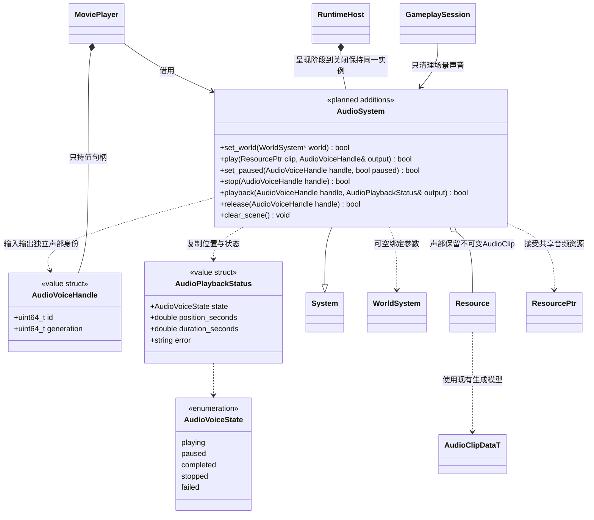

# 影片复用音频（设计契约，尚未实现）

[类图索引](../../class-diagrams/index.md) · [当前音频系统](audio-system.md) · [影片播放器](movie-player.md) · [启动装配](movie-startup.md) · [影片资源](movie-data.md)

本页只定义现有 `AudioSystem` 的规划增量，当前代码尚不支持这些无场景声部接口。[现行音频类图](audio-system.md)继续描述已经实现的 AudioSource、监听器和 SDL 输出，不将此设计误作已实现接口。

Movie 与现有场景声音共用一个 AudioSystem、同一设备及现有 Voice/SDL 混音机制。`MoviePlayer` 只持有音频播放身份，不创建 SDL_AudioStream、不运行独立音频回调，也不通过临时 Node/AudioSource 启动片头。

## 独立声部与接口

本图只列同一个 `AudioSystem` 的规划增量；现有 System 继承和公开 `clear()/set_paused(bool)/paused()/voice_count()/last_error()` 的完整说明仍归现行音频图。值类型属于 `engine`，SDL 类型留在私有实现。

新增返回状态的方法标注 `[[nodiscard]]`；`playback()` 为 `const`，只复制查询结果，不推进播放。AudioVoiceHandle 默认零值无效，AudioPlaybackStatus 默认值只作为失败输出，调用方必须检查查询返回状态。

- `set_world()` 借用已就绪世界，空值解除；不重建设备，不清除独立声部。更换世界先清旧场景声部，旧世界销毁前必须解除借用。
- `play()` 接受已校验的 AudioClip `ResourcePtr`，非循环、原速、非空间播放；成功才返回句柄并保留共享资源，失败清空输出并使用现有 `last_error()`。首次实际播放打开设备，设备或流失败明确返回，不能用 dummy 输出代替成功。
- 声部身份校验 AudioSystem 实例代次与 ID，不能与裸节点 ID 共用身份；停止、重播、世界切换或旧脚本清理不得操作另一声部。
- `set_paused(handle, bool)` 只改变该独立声部；现有设备级 `set_paused(bool)` 继续用于窗口/应用整体暂停。世界暂停只影响场景声部，不因片头阶段没有世界就把整个设备暂停。
- 独立声部的 `set_paused()` 仅接受 playing/paused，重复设置当前值成功；无效身份或终态返回 false。`stop()` 将活动声部变为 stopped，终态或无效身份返回 false 且不改写已有结局。
- 自然完成、显式停止和失败均保留查询结果到 `release()`；活动声部先停止后释放。停止重复调用保持原终态，不把 `completed` 改写成 `stopped`。位置查询失败清空输出。
- `release()` 只接受有效终态，成功后身份失效；活动、失效或重复释放返回 false。独立声部不借用场景节点身份，世界清理不能使旧句柄指向后来创建的声音。
- `clear_scene()` 同步结束场景 AudioSource 对应声部，保留独立声部及设备。GameplaySession 的场景释放改用它；`clear()` 仍表示调用方显式停止全部声音，宿主整体停止时使用。
- 无世界/无发布场景时仅清理失效场景声部；仍更新独立声部。设备首次打开后保留到明确全部清理或关闭，避免切场景和流结束截断尾音。

## 时间、线程与关闭

所有公开控制和查询由主线程调用；控制改变与位置读取使用现有 SDL 流同步方式。音频线程只消费声部持有的驻留 PCM 与已发布标量，不访问 World、MoviePlayer、文件、任务队列或脚本。复用现有声音处理，不在音频回调中分配、转码、等待 worker 或执行完成业务。

播放位置以样本计数为基础，区分已提交样本和仍在 SDL 流中等待的样本，不能把现有 `Voice.frame` 直接当播放头。固定输入格式下扣除尚未消费的输入样本并保持位置单调；暂停期间冻结。该位置是音频服务的消费时间，不等于扬声器 DAC 的精确时间，硬件缓冲延迟必须纳入实际音画同步验收。

仅所有样本已提交、流末尾 flush 完成且待消费数据排空后，才报告服务级自然完成；设备缓冲尾音不因流销毁而提前截断。具体补偿采用实际平台可提供的信息，不能凭空声称零延迟。无音轨影片由 MoviePlayer 使用可暂停的单调时钟。

停止影片先停止并释放其 AudioVoiceHandle；流销毁同步 SDL 回调后，才释放声部共享的 AudioClip。宿主关闭时先结束影片与玩法，取消并收尾读取/解码，再清场景声音、解除世界借用并关闭世界，最后销毁所有音频流与设备。异常退出和部分初始化走同一反序清理；不在 worker 上销毁音频设备。
