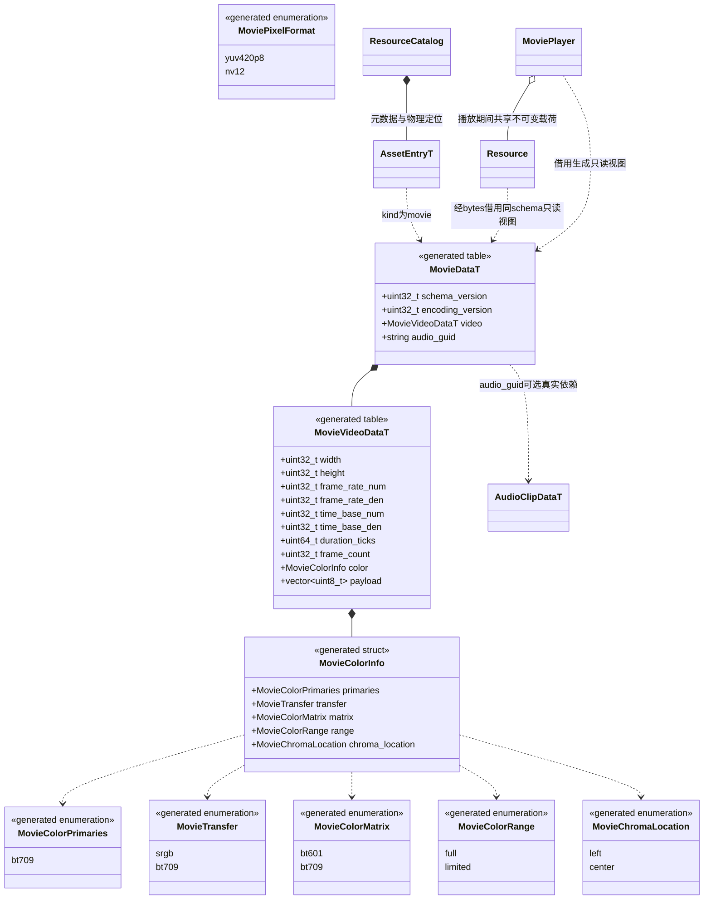
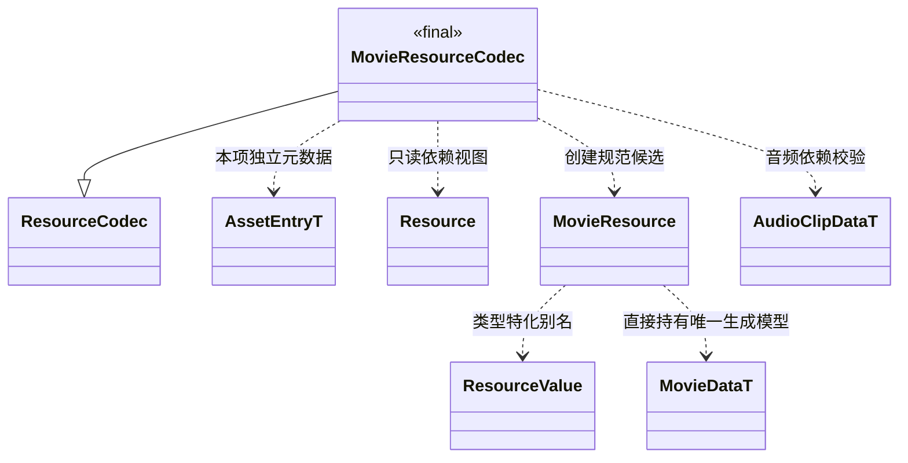

# 影片资源

[类图索引](../../class-diagrams/index.md) · [播放器](movie-player.md) · [导入器](../../plugins/editor/class-diagrams/movie-importer.md) · [资源解码器](resource-codecs.md) · [资源目录](resource-catalog.md)

本页定义影片资源与单项校验契约。Movie 按现有资源类型登记，新增 `AssetKind::movie`；它不是项目启动配置、场景组件或媒体管理系统。唯一持久模型位于 `include/schemas/runtime/movie.fbs`，生成 C++ 与其他语言结构。

## 运行编码选择

首版 `encoding_version = 1` 固定为 VP9 Profile 0、8 位 YUV 4:2:0，载荷为 IVF 文件；运行时使用 libvpx 解码，编辑器通过 FFmpeg 离线转码并剥离音频。IVF 头部和每帧长度、时间戳均须检查，禁止越界；首版固定帧率、从零开始顺序递增，帧数量、尺寸和帧率须与 schema 一致。实际解码时仍须验证图像格式与尺寸，不能只信任 IVF 头部。音轨独立存储为 AudioClip。libvpx 是 VP8/VP9 参考实现，有 vcpkg port；[官方解码接口](https://github.com/webmproject/libvpx/blob/main/usage_dx.dox)与 [vcpkg 包](https://vcpkg.io/en/package/libvpx.html)为选型依据。各目标平台的编译和运行仍需分别验证。

## 生成模型与资源归属

`MovieDataT`、`MovieVideoDataT` 及色彩/像素类型属于 `engine::schema`；图中 `T` 表示 FlatBuffers 对象 API 的生成模型。运行时可借用同一 schema 的零拷贝视图，不另外维护一份手写持久结构。`MoviePixelFormat` 描述解码输出而非资源的编码后端，瞬时平面视图见[播放器图](movie-player.md)。

- 原始文件如 `assets/movies/lcals.mov` 保留；邻接 `.meta` 的主 GUID 对应 Movie，音轨子 GUID 稳定保存在同一 meta，移动不改变身份。运行时继续按原始逻辑路径定位导入产物。
- 缓存为 `cache/gen/<完整GUID>`，运行包为标准 `catalog.bin` 与 `gen/` 或 `packs/`。资源信封、摘要、目录代际、共享缓存与发布机制继续沿用现有链路，不新建影片路径或缓存。
- 启动影片由规划中的启动配置纳入构建入口；业务影片沿用项目使用清单，选择性构建时须显式列入。`Movie.Play()` 的动态路径字符串不能被当作已经实现的脚本静态依赖推断。两者都按真实依赖自动包含可选 AudioClip，不把全部源素材加入运行包。
- 音频只存在独立 `AudioClip` 资源，Movie 的 `audio_guid` 是依赖引用，不把同一音轨再次塞进 `payload`。无音轨时为空且不声明音频依赖；AudioClip 不反向依赖 Movie。
- `payload` 是最终选定的单一运行编码载荷，不是任意源文件。实际视频编码、内部索引和 profile 由 `encoding_version` 固定；不在每个 meta 中开放运行时后端选择，也不因 opaque 载荷而略过校验。

## 校验与加载

**本节资源承载与处理器接口已按确认契约实现；上述持久模型与影片格式约束不变。**

完整方法继承并 override [ResourceCodec 契约](resource-codecs.md#最小扩展接口)，不重复定义另一组签名。MovieResource 是 ResourceValue<MovieDataT, AssetKind::movie> 的特化别名，不复制持久字段。decode 创建独占候选，validate_data 校验本项，validate_dependencies 校验提供的 AudioClip；不使用集中 store 或 Resource::bytes 旁路。

处理器不读取原素材、不加载依赖、不创建播放器。宿主以 add<MovieResourceCodec>() 登记；状态通过返回值和错误文本表达，失败输出安全空值。

校验包括 FlatBuffers 结构、版本、编码标识、载荷大小、非零有理数分母、尺寸/帧率/时长范围和算术溢出。audio_guid 必须与本项声明及提供的 audio 类型依赖一致；PCM 数据由 AudioResourceCodec 校验。首次视频解码还需核对真实描述与声明，不能仅信任扩展名或元信息。

首版限定 SDR 8 位、无透明通道、方形像素、正向画面，最高 1920×1080、60fps；帧率由导入参数给出。时间轴从零开始，导入统一旋转、像素宽高比、VFR、edit-list 和音轨起点，输出固定帧率；音频按同一时间轴裁切/补静音，时长误差不超过一个采样。HDR 或不支持的输入明确失败。

依赖校验按 AudioClip 实际采样率和样本帧数检查一采样容差，视频帧数、帧率、timebase 与声明时长必须自洽。片尾时钟行为见[播放器](movie-player.md#解码simd-与任务生命周期)。

加载由业务显式请求，默认资源插件组织完整必要闭包。MoviePlayer 只接受已加载 Movie 句柄，并通过 retain_dependency 获取同代音轨；不调用 find/begin_load 补读。旧 ready 闭包允许继续播放，当前目录的新加载使用新代际。

本设计继续整项资源读取，单项大小上限由资源读取配置给出，超限明确失败；没有把长影片流式读取描述为已有能力。

## 音频体积与选型边界

当前 `AudioClipDataT` 保存交错 float32 PCM，5 秒、48kHz、双声道的样本约 1,920,000 字节。复用 AudioSystem 不自动压缩这些样本，合并包也不等于压缩音频。

如果该成本不能满足总包体目标，应在统一 AudioClip 模型和音频系统内另行评审压缩载荷，所有声音共同受益；Movie 不另建音频格式、AAC 播放通道或音频设备。本设计不预先声称自有视频编码或精简 FFmpeg 哪个更小，正式选型必须比较程序、视频和音频的合计大小与运行开销。
