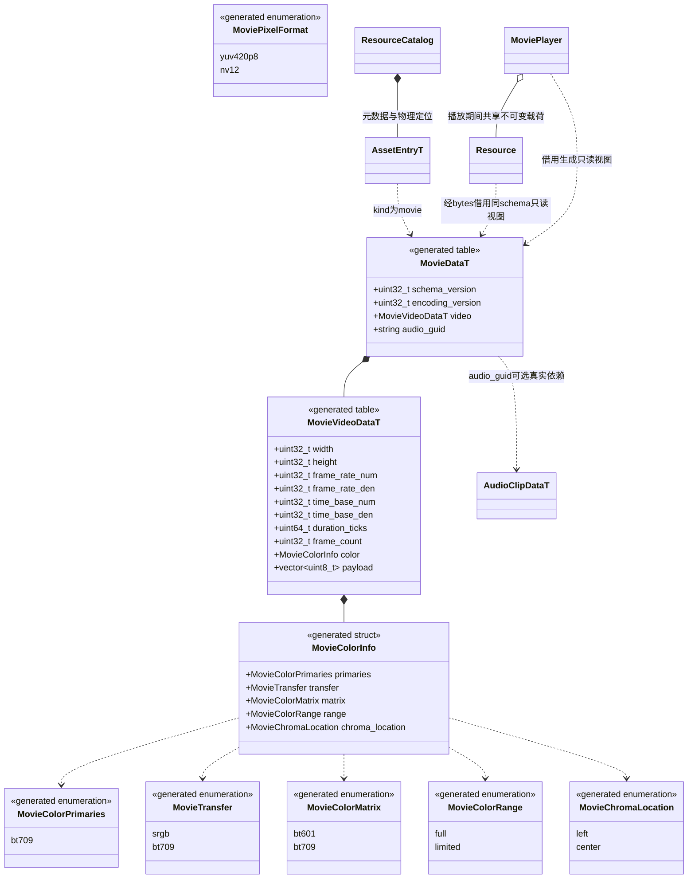
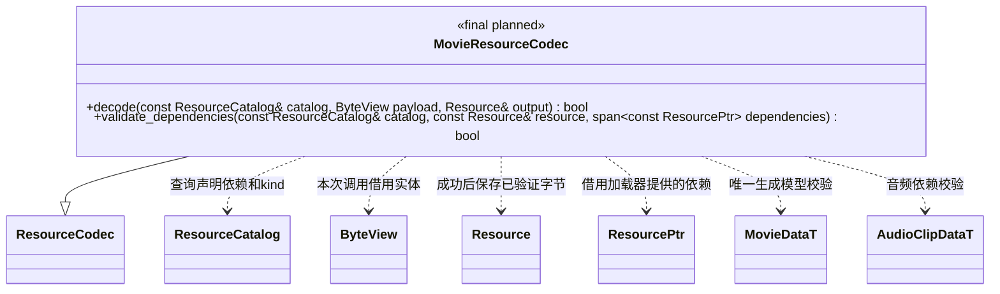

# 影片资源（设计契约，尚未实现）

[类图索引](../../class-diagrams/index.md) · [播放器](movie-player.md) · [导入器](../../plugins/editor/class-diagrams/movie-importer.md) · [资源解码器](resource-codecs.md) · [资源目录](resource-catalog.md)

本页定义规划中的资源与单项校验契约。Movie 按现有资源类型登记，新增 `AssetKind::movie`；它不是项目启动配置、场景组件或媒体管理系统。唯一持久模型拟放入 `include/schemas/runtime/movie.fbs`，生成 C++ 与其他语言结构；本轮只设计，不创建 schema 或实现。

## 生成模型与资源归属

`MovieDataT`、`MovieVideoDataT` 及色彩/像素类型属于 `engine::schema`；图中 `T` 表示 FlatBuffers 对象 API 的生成模型。运行时可借用同一 schema 的零拷贝视图，不另外维护一份手写持久结构。`MoviePixelFormat` 描述解码输出而非资源的编码后端，瞬时平面视图见[播放器图](movie-player.md)。

- 原始文件如 `assets/movies/lcals.mov` 保留；邻接 `.meta` 的主 GUID 对应 Movie，音轨子 GUID 稳定保存在同一 meta，移动不改变身份。运行时继续按原始逻辑路径定位导入产物。
- 缓存为 `cache/gen/<完整GUID>`，运行包为标准 `catalog.bin` 与 `gen/` 或 `packs/`。资源信封、摘要、目录代际、共享缓存与发布机制继续沿用现有链路，不新建影片路径或缓存。
- 启动影片由规划中的启动配置纳入构建入口；业务影片沿用项目使用清单，选择性构建时须显式列入。`Movie.Play()` 的动态路径字符串不能被当作已经实现的脚本静态依赖推断。两者都按真实依赖自动包含可选 AudioClip，不把全部源素材加入运行包。
- 音频只存在独立 `AudioClip` 资源，Movie 的 `audio_guid` 是依赖引用，不把同一音轨再次塞进 `payload`。无音轨时为空且不声明音频依赖；AudioClip 不反向依赖 Movie。
- `payload` 是最终选定的单一运行编码载荷，不是任意源文件。实际视频编码、内部索引和 profile 在选型验证后随 `encoding_version` 固定；不在每个 meta 中开放运行时后端选择，也不因 opaque 载荷而略过校验。

## 校验与加载

`MovieResourceCodec` 属于 `engine`，沿用 `ResourceCodec::store(Resource&, ByteView)` 和 `Resource::bytes()`，不扩一份手写 `Resource::movie_` 模型。它只处理单项结构与已提供依赖，不读取原素材、不装配播放器，也不加载依赖树；静态登记遵守现有 `find_resource_codec()` 契约。

两个方法均为 `const override` 并标注 `[[nodiscard]]`，析构为 `noexcept override`；失败不发布半成品，输出遵守现有 ResourceCodec 的安全空状态契约。

校验包括 FlatBuffers 结构、版本、编码标识、载荷大小、非零有理数分母、尺寸/帧率/时长范围和算术溢出。`audio_guid` 必须存在于目录、kind 为 audio，并与本项声明及加载器提供的依赖一致；PCM 数据仍由原 AudioResourceCodec 校验。首次解码还需核对真实视频描述与声明，不信任仅靠扩展名或元信息。

首版限定 SDR 8 位、无透明通道、方形像素、正向画面，最高 1920×1080、60fps；具体帧率由导入参数给出。时间轴从零开始，导入时统一旋转、像素宽高比、源 VFR、edit-list 和音轨起点；输出采用固定帧率。音频按该时间轴裁切/补静音到影片时长，误差不超过一个音频采样。HDR 源或其他不支持情况明确报告，不能运行时猜测或静默丢失含义。

依赖校验使用 AudioClip 的实际采样率和样本帧数验证上述一采样容差，不只比较浮点元信息；视频的帧数、帧率、timebase 与声明时长必须自洽。合法采样舍入在片尾的时钟处理见[播放器](movie-player.md#解码simd-与任务生命周期)，超过容差的音视频组合直接失败。

影片实体沿用当前不超过 64MiB 的整项读取与校验；播放前只准备所选影片及其真实依赖。ResourceGraph 插件继续负责共享和依赖闭包，播放器持有已接受请求的资源快照。目录换代不替换正在播放的载荷，新播放使用新的目录。超限输入报告失败，本期不把长影片流式范围读取画成已存在能力。

快照在 preparing 中完整建立：Movie 与可选 AudioClip 必须来自请求记录的同一目录代次，加载期间换代则失败。现有 ResourceLoad 只交付根资源；播放器通过注入加载器的 `find()` 或显式第二次 `begin_load()` 取得同代 AudioClip 引用，并核对两项 Resource::generation 与依赖后才起播。该过程不新增核心依赖树加载能力，也不借用插件私有 Bundle；具体控制契约见[播放器](movie-player.md#解码simd-与任务生命周期)。

## 音频体积与选型边界

当前 `AudioClipDataT` 保存交错 float32 PCM，5 秒、48kHz、双声道的样本约 1,920,000 字节。复用 AudioSystem 不自动压缩这些样本，合并包也不等于压缩音频。

如果该成本不能满足总包体目标，应在统一 AudioClip 模型和音频系统内另行评审压缩载荷，所有声音共同受益；Movie 不另建音频格式、AAC 播放通道或音频设备。本设计不预先声称自有视频编码或精简 FFmpeg 哪个更小，正式选型必须比较程序、视频和音频的合计大小与运行开销。
