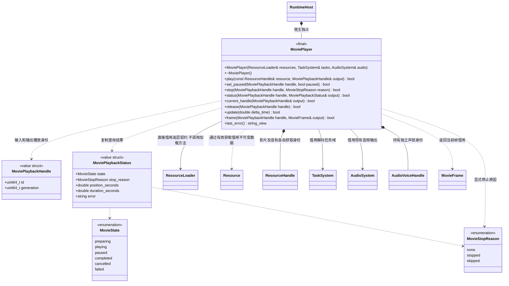
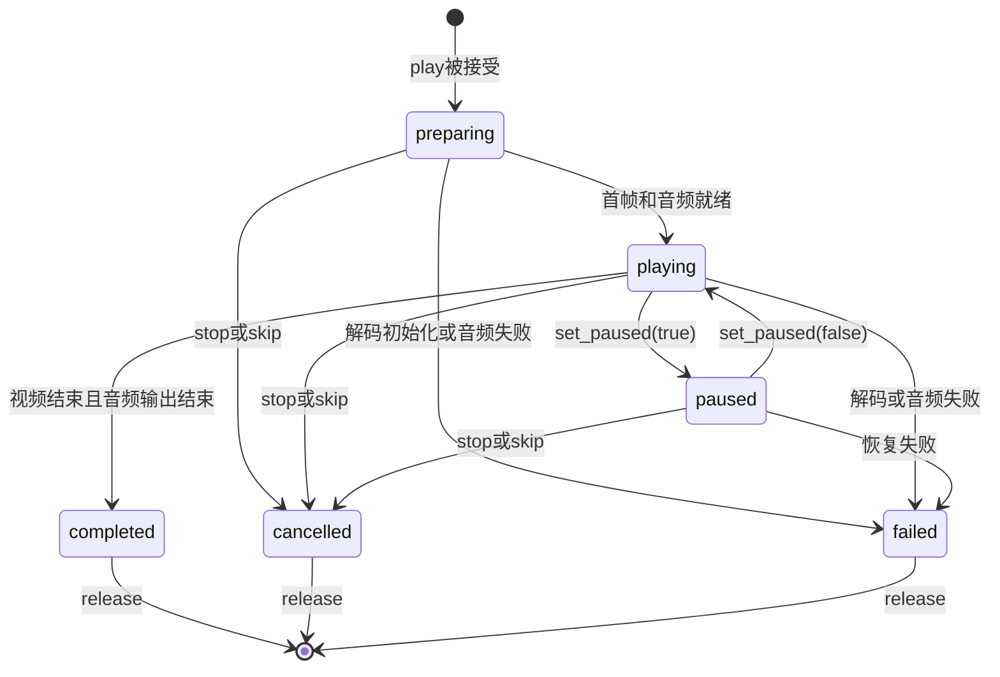
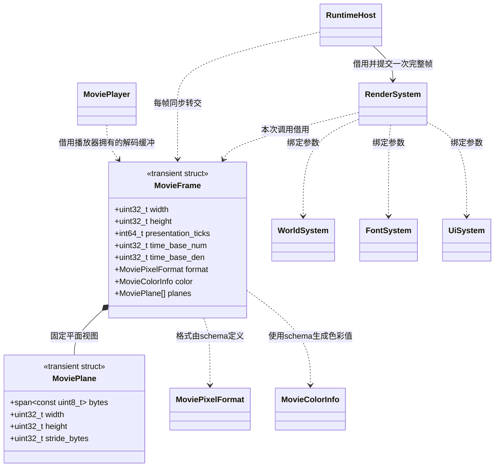

# 影片播放器

[类图索引](../../class-diagrams/index.md) · [影片资源](movie-data.md) · [音频复用](movie-audio.md) · [启动与业务装配](movie-startup.md) · [脚本接口](../../plugins/runtime/class-diagrams/movie-script-api.md) · [影片导入](../../plugins/editor/class-diagrams/movie-importer.md) · [编辑器命令](../../plugins/editor/class-diagrams/movie-mcp-tools.md)

播放器只保活传入的已加载句柄；调用规则见[统一资源生命周期](resource-lifecycle.md)。`MoviePlayer` 属于 `engine`，是具有独立播放状态的普通工具；不继承 `System`，不需要 Scene、Node、UiComponent 或脚本环境。启动宿主、原生业务、脚本 Controller 和编辑器预览使用同一契约。

首版按全屏、非循环、SDR 8 位影片设计。源素材差异在编辑器归一化；运行时使用 libvpx 解码 VP9 Profile 0 的 IVF 载荷，离线由 FFmpeg 转码。不会引入多后端工厂或专有实现。

## 公开契约

- `resource` 是调用方通过 ResourceLoader 显式加载并取得的 Movie 类型句柄。未加载、失效或类型不符立即失败，输出空播放身份；play 不接受路径、不发起文件读取。调用方仍用目录逻辑路径加载，不引入 movie:// 或原生文件业务接口。
- 构造建立安全空状态，资源与任务域、音频系统必须先初始化且覆盖播放器生命周期。构造/析构为 `noexcept`，禁止复制和移动；可能失败的公开操作标注 `[[nodiscard]]`，所有控制和查询由所属协调线程调用。
- `play()` 先校验句柄并 retain 自己的 Movie 获取，有音轨时通过 retain_dependency 取得同一闭包中的 AudioClip；失败回滚自己的获取。成功只表示接受播放请求，首先进入 `preparing`。首帧、必要音频和播放时钟全部就绪后才进入 `playing`。立即拒绝时返回 `false`、清空输出句柄，并通过 `last_error()` 说明原因。
- 一个实例同一时刻仅保留一个未释放请求，包括终态结果；忙碌时明确拒绝，不自动抢占、排队或遗失旧结果。调用方先结束并释放旧请求，再开始下一项。
- `generation` 包含播放器实例代次；同一实例重用、销毁后重建或编辑器另一个播放器，都不能使旧句柄复活。所有输入句柄均重新校验所属实例、代次与 ID。
- `status()` 复制状态与错误文本；无效句柄返回 `false` 并清空输出。`frame()` 返回瞬时只读借用，失败同样清空输出。`last_error()` 只借用到下一次修改操作。
- `status()`、`frame()` 和 `last_error()` 为 `const`，其中 `last_error()` 另为 `noexcept`；查询不推进解码、音频或播放状态。
- `current_handle()` 为 `const noexcept`，返回唯一未释放请求的身份副本，包括终态；无请求返回 `false` 并清空输出，不推进状态或转移控制权。它供原生宿主取得当前帧与状态，不向脚本暴露，也不代替调用方保存自己的句柄。
- `release()` 仅接受终态请求；活动请求先 `stop()` 再释放。重复释放失败且不影响其他请求。析构内部安全取消活动请求，不要求调用方先释放。

## 状态和调用方流程

- 自然播完才是 `completed`；停止与跳过均为 `cancelled`，通过 `stop_reason` 区分。`none` 不是合法的停止请求。终态不会被后续 `stop()` 改写，已终结请求的停止返回 `false`。
- 首版只在 `playing/paused` 接受暂停切换，重复设置相同暂停值成功；准备阶段仍响应停止。窗口后台时宿主冻结播放并暂停音频，恢复后以原进度继续。
- `completed` 保留末帧到 `release()`，供启动宿主等待主页准备；取消或失败不继续输出旧画面。是否允许跳过、暂停世界、显示按钮、恢复玩法和进入主页都由调用方决定。
- 单个请求的资源、解码和音频错误转入该句柄的 `failed`，`update()` 仍可正常返回 `true`，业务查询后自行处理。`update(false)` 仅表示调用或服务级失败，例如非法时间值或借用服务不再就绪，不能把一段业务影片的失败自动扩大成引擎退出。
- `update()` 接受有限且非负的 delta_time；调用方必须传所属宿主单调时钟采样的真实、未缩放间隔，不能传玩法 time_scale 后的时间。静音影片使用这些间隔累计可暂停媒体时钟，paused 时不累计；它不是未经扣除暂停的 `now-start` 墙钟差值。窗口暂停时宿主不调用 update，恢复第一帧间隔置零，preparing 也直到恢复才提交起播结果。
- 核心不直接执行完成回调。调用方查询并复制终态后释放句柄，再执行跳页等逻辑；脚本转换为回调时只能在绑定层既有 Run 队列和有效 Run ID 下派发。

## 帧视图与呈现

本图只引用 `RenderSystem`；公开方法统一由[渲染系统图](render-system.md)维护，不新增另一种渲染器类型。色彩与格式类型唯一在[影片数据图](movie-data.md)定义；本图不重复持久模型。

`planes` 的实际类型为 `std::array<MoviePlane, 3>`；每个 MoviePlane 的 bytes 都是借用视图，不拥有解码内存。数组未使用的项为空。

- `MovieFrame` 顶左原点、正行距；解码器负行距、旋转及像素宽高比在内部或导入时归一化。YUV420 色度尺寸按向上取整计算，NV12 只使用 Y 与交错 UV 两平面，其余平面为空。校验每平面行距、行数、可读长度及整数溢出。
- MoviePlane 的 width/height 是该平面的 texel 数。yuv420p8 每 texel 一字节；NV12 的 UV 宽为 `ceil(frame.width/2)`，每 texel 含 U/V 两字节。最小可读长度为 `(height-1)*stride_bytes + row_bytes`，先检查非零尺寸、`stride_bytes >= row_bytes` 和全部乘加溢出，不要求最后一行携带额外填充字节。
- 视图仅在本次同步呈现调用中借用；任何下一次播放器修改操作都可能使其失效。GPU 资源由 Renderer 拥有，`present_movie_frame()` 返回前完成 CPU 数据复制/上传入队，不把解码器内存直接交给延迟 GPU 回调。
- worker 只写自己独占的待发布缓冲，不能改写当前已发布或正在被借用的帧；完成结果由协调线程收取后换帧。已发布缓冲只有在借用结束后才能回收用于后续解码。
- `present_movie_frame()` 使用同一窗口、平台固定后端和交换链，完成黑边填充、YUV 转色与一次帧提交。它不推进播放、不调用业务、不创建 Scene/Camera，不经过场景曝光或 Bloom；颜色转换和显示编码不得重复执行。
- 宿主一帧只选择正常 `render()` 或 `present_movie_frame()`，避免两次推进 GPU 帧。无场景时也可呈现；全屏业务播放时世界是否更新仍由调用方决定。
- `bind_world()` 在主线程绑定就绪借用，不重建 GPU；世界为空时另外两个参数也必须为空，表示解除全部场景借用。重绑前释放旧场景 GPU 状态，不影响仍在显示的影片。
- `present_movie_frame(false)` 表示未成功提交，例如非法帧、暂停/无可绘制表面或设备恢复失败。宿主先查询窗口状态，暂停不算影片损坏；恢复、resize 或设备重建后重新提交当前仍有效的解码帧。

## 解码、SIMD 与任务生命周期

- 文件读取、资源解析及依赖闭包全部在业务预加载阶段完成；播放器只使用驻留 Movie/AudioClip。视频解码借用独立 movie_tasks，仍共享 ThreadSystem/oneTBB，不增加线程池。本设计继续整项资源读取，不声称支持长影片流式加载；单项读取预算由资源服务配置并明确报告超限。
- preparing 只做解码器、首帧和音频声部准备，不拥有 ResourceLoad，不再次校验或加载依赖树。资源插件已经验证闭包；播放器通过 get 的规范类型视图访问。音频系统接受 AudioClip 句柄并取得自己的引用。
- 播放器仅要求加载器遵守 get/retain/retain_dependency/release 契约，不认识具体插件或底层读取。ready 的旧代际资源允许播放，音轨沿该资源的旧闭包获取；目录更新不使有效获取失效。
- 播放器拥有压缩源资源快照、解码状态、当前帧和有限解码缓冲。后台只持有不可变资源与可取消的内部作业状态，不保存播放器、World、脚本或解码回调接收者的裸指针。停止在当前调用内发布本请求终态、标记内部解码作业取消并停止音频；worker 在每个压缩包边界检查取消。释放播放器不等待追帧；独立作业持有自己取得的资源获取至退出；协调线程收尾后释放，晚到完成只能丢弃。
- 主线程负责音频控制、结果发布与 GPU 提交；音频设备回调只消费音频系统拥有的驻留样本。后台解码失败通过结果返回所属线程，不从 worker 调用脚本。
- 单个请求只允许一个推进解码状态的在途任务，保持参考帧与时间顺序；输出最多保留当前帧、下一帧和一个解码中的槽。压缩参考帧等后端私有内存也纳入选型峰值指标，不能把整段视频预解成图像序列。解码器自带线程须禁用或纳入现有并行预算，不能无界叠加 worker。
- 按公共时间轴选择当前应显示的帧；协调线程把目标帧索引按片尾截断后提交给唯一在途任务。worker 顺序解码到目标帧，跳过过期画面的复制与发布，仍完成参考帧需要的解码；任务结束只交回目标帧，不以每宿主帧只解码一个压缩包限制追帧速度。没有逾期帧时最多预解下一帧；不阻塞事件循环等待赶帧。暂未获得新帧时保留当前帧。只有末帧对应的显示时长已到、视频输入结束且可选音频自然排空，才进入 completed；提前读到 EOF 不代表影片已经播放完。
- x64 必须有可验证的 SSE2 基线与 AVX/AVX2 加速路径；ARM64 对应 NEON，标量实现作为结果对照。复用已有 SDL CPU 能力检测，在初始化时选择实际内核。AVX 编译配置限制在对应实现文件，不能提高整个引擎的最低 CPU 要求。
- 若选中的成熟解码器已提供 SIMD 路径，验证其真实构建、分派和执行；若采用自有专用解码，逆量化、块逆变换、差分恢复和饱和裁剪分别实现并对照。仅配置 `/arch:AVX2` 不算完成，SIMD 也不替代异步 I/O、正确时钟或数据布局。
- 有音频时使用[AudioSystem 的播放位置](movie-audio.md)推进视频；无音频时使用可暂停的单调时间。大 `delta_time` 不得令声音假快进。视频 EOF 与音频完成均成立才发布自然完成；精确扬声器输出时间不由 SDL 输入队列计数直接保证。
- CFR 视频时长不一定整除音频采样率。仅在音轨已 completed、视频已 EOF 且差值不超过已验证的一采样容差时，将尾端媒体时钟钳到视频声明时长，避免向下取整的音轨导致永久等待；超出容差的时长矛盾报告 failed，不能用无界尾等掩盖。
- 后端选型和验收均计算最终程序增量、影片与音频总大小、首帧、解码/上传耗时及峰值内存。使用同源 lcals 5 秒样片，并覆盖后台加载、主线程停顿、暂停恢复、资源换代、重复播放和中途关闭；本页不承诺尚未实测的数字。
