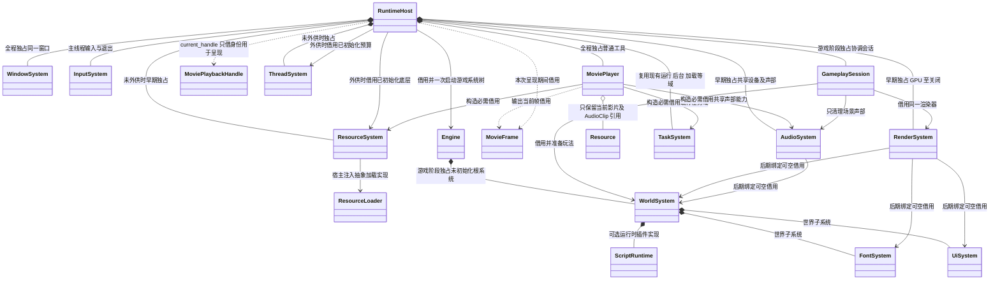
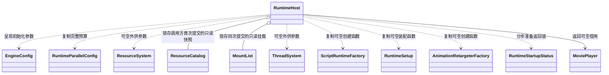
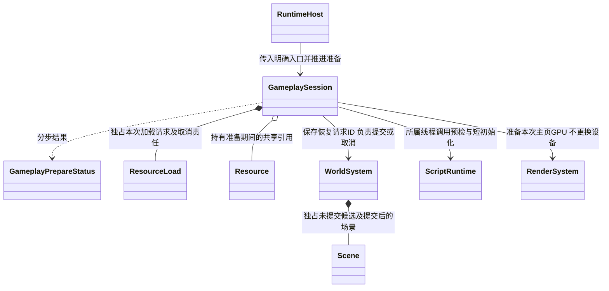
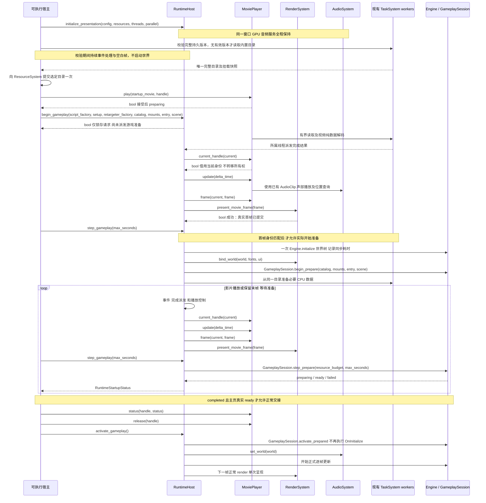

# 影片启动与宿主分阶段装配

本页描述现有分阶段启动的关系与执行契约。公开方法分别在[运行宿主](runtime-host.md)
和[玩法会话](gameplay-session.md)维护。2026-11-06 修复统一发布版本选择和真实媒体时钟。

[类图索引](../../class-diagrams/index.md) · [当前运行宿主](runtime-host.md) ·
[播放器契约](movie-player.md) · [影片音频复用](movie-audio.md) ·
[影片资源](movie-data.md) · [影片脚本接口](../../plugins/runtime/class-diagrams/movie-script-api.md)

## 类与所有权

以下跨图类型只标关系，不重复其方法。RuntimeHost 在片头、空场景和正式玩法阶段始终使用
同一个 WindowSystem、RenderSystem、AudioSystem 和 MoviePlayer。

- RenderSystem、AudioSystem 由 RuntimeHost 直接初始化、更新及关闭，后续不移交 Engine，
  也不再作为 WorldSystem 子系统重复登记。它们仍继承 System，遵守一次初始化及反序释放。
  当前 Engine/System 无需增加热挂接、接管已初始化对象或重复初始化接口。
- 未外供 ResourceSystem 时，Host 在呈现阶段独占该服务；外供资源与线程预算只借用，必须已经
  初始化，并覆盖播放器、世界、异步操作及宿主关闭。资源插件仍由可执行宿主显式装配及注入，
  核心不 include 具体 ResourceGraph 插件。
- 呈现阶段不创建 Flecs world、项目 VM、物理世界或 RmlUi 上下文。Window、必要输入、图形设备、
  资源单项读取和任务域只提供起播所需能力；配置中没有片头时仍可走同步初始化便利入口。
- MoviePlayer 不借用 Renderer、不创建 GPU 纹理或交换链。它输出 MovieFrame，Host 调用
  `RenderSystem::present_movie_frame(const MovieFrame&) -> bool` 完成本帧呈现；与正常 `render()`
  每帧二选一，不能先渲染场景再调用一次完整影片呈现，造成两次提交。
- 片头句柄由可执行入口的 Caller 持有，业务句柄由相应 Native 调用者或 Run 持有；Host 不接管
  它们的停止 / release 权限。Host 通过 `MoviePlayer::current_handle(MoviePlaybackHandle&)`
  获取当前唯一未释放请求的身份副本，只用于 status / frame 和呈现；该查询不向 TS 暴露。
  因此 Native 与 MovieBinding 对同一播放器接受的请求，都能进入同一全屏呈现路径。
- AudioSystem 不再属于世界子系统链，Host 每帧只调度它一次。准备阶段只更新独立声部；
  正式玩法在世界更新后发布最终空间参数，再查询影片时钟。空世界不关闭共享设备，窗口后台
  暂停整个设备，单影片暂停只影响对应声部；不能在准备阶段把未激活世界的暂停值套给片头。

## RuntimeHost 分阶段契约

同步 `initialize()` 复用同一分阶段装配路径；本页不重复定义公开方法。

- 所有方法由宿主主线程调用，可能失败方法及查询标注 `[[nodiscard]]`。`movie_player()`
  返回可修改借用，函数为 `noexcept`；只在呈现阶段成功至关闭前返回非空。
  不暴露编解码器、SDL、bgfx 或 VM 对象。
- `initialize_presentation()` 的 resources / threads 可空且由调用方显式传入；parallel 不补隐式
  预算。成功仅代表可派发事件、执行任务和呈现，不能据此认为玩法或主页就绪；重复初始化失败。
- `begin_gameplay()` 只受理并锁存一次准备请求，可在影片首帧之前调用；成功不表示已经派发游戏
  任务或初始化世界。catalog / mounts 是调用方已经提交给 ResourceSystem 的同一不可变快照，
  必须非空；Host 复制共享引用，不在首帧前复制整份目录。调用方须保证它们确为首次提交的同一
  目录和挂载，提交后不得修改。entry / scene 立即复制，默认空；retargeter_factory 默认 nullptr，script_factory
  和 setup 由调用方显式传入可空值。重复受理失败，不能悄悄替换请求。不得从完成委托里关闭 Host。
  scene 仅是调用方本次请求的初始场景逻辑路径，不自动发现主页、不新增另一套场景配置；空值
  保持由脚本入口选择场景的原语义，此时同步项目不因此获得平滑加载保证。
- `step_gameplay(max_seconds)` 的预算必须是有限正数；非法参数、未发起请求或准备失败返回
  failed。它只领取就绪结果和推进一个受控主线程阶段，不等待后台 future、文件或整批任务。
  正式准备尚未开始且存在当前影片时，必须先确认该 id / generation 的真实首帧已成功提交；
  未满足时仅返回 preparing，不派发游戏任务。没有当前影片时第一次 step 即可开始。
  开始后不因影片状态改变而重复初始化；ready 和 failed 是本次准备终态。
- 影片在尚未出首帧时失败或取消，Host 保留锁存请求，等待 Caller 查询、处理并 release；
  释放只清理播放，不代替继续启动的决定。Caller 选择继续时显式再次推进 step_gameplay，
  选择退出时关闭 Host。Host 帧循环不自动代替 Caller 推进游戏准备或跳页。
- 游戏候选初始化失败清理候选；呈现服务仍由 Host 统一关闭。`tick()` 支持呈现阶段，
  负责 Player 更新和单次呈现，并记录成功提交的影片身份；游戏准备只由 Caller 的 step 请求推进。
- `activate_gameplay()` 仅接受 ready，决定下一帧开始正式玩法更新和场景音频；不得在此补做
  整场景读取、VM 编译或大批 GPU 上传。无脚本工厂仍支持明确请求的原生世界或空场景，不伪造
  主页已存在。重新启动的生命周期由调用方明确组织，不因新资源到达自动进入主页。

## GameplaySession 准备契约与阶段

这些方法只协调一次显式启动准备，沿用现有热重载事务。Host 世界树初始化成功后将 entry / scene 转交会话，预算和操作结果仍由调用方驱动。

三个准备方法为 `[[nodiscard]]`，begin_prepare 复制调用方已提交的 catalog / mounts 建立候选快照，
不再次调用 update_catalog，不改变目录代次；目录与挂载必须是调用方首次提交的同一快照，
目录修订与目标平台必须匹配当前目录，否则拒绝。entry / scene 默认空并立即复制，其他预算由调用方显式给出。
begin_prepare 拒绝仍在正式运行或已有准备请求的会话；先由调用方显式 stop，不能自动停止他人
玩法。step_prepare 的 max_seconds 为有限正数，resource_budget 为本次资源完成额度；0 只查询，
未开始请求或失败返回 failed，不等待 worker。Host 的 preparing 还包括世界树装配，只有会话
ready 且所有必要系统就绪时才报告 Host ready。
Host 将现有 parallel.resources.completion_budget 作为资源推进额度显式传入会话，并使用既有
scene_restore 节点 / 时间预算，不暗加一套默认加载预算。

首版实际执行以下受限阶段；每次 step 至多进入一个新的不可抢占同步阶段。准备期间不调度
正式 World / Gameplay.Update，不向未激活主页投递 UI 输入，也不接入场景音频。已有接口的
同步性质必须明示，不以 step 方法名伪装为可中断流程。

| 阶段 | 执行与完成条件 | 首版预算边界 |
| --- | --- | --- |
| Host 装配世界树 | 影片首帧提交后，在主线程构造系统并一次调用 Engine.initialize。Render / Audio / Resource 已由 Host 初始化，不再登记到 Engine。 | 允许这一同步步骤超过软预算，记录总耗时；不把整个现行 RuntimeHost.initialize 放进 step。 |
| 完整版本与资源 | 后台校验完整部署版本；通过已有 ResourceLoad 推进入口脚本及明确 scene 所需资源，保留引用。 | 在途数量、字节及完成额度受已有配置约束；使用宿主注入的分步依赖加载实现，不在核心重写依赖树。 |
| VM 预检 | 在所属主线程调用现有 ScriptRuntime.prepare_gameplay，完成编译和链接。 | 单次不可抢占，现行候选源码读取也不伪装成异步；测量其总耗时，不承诺任意模块规模均平滑。 |
| 明确场景恢复 | scene 非空时，World.begin_restore_scene 建立候选，逐帧 step_restore_scene，ready 后才 commit_restore_scene。 | 使用现有节点数与时间预算；请求身份及资源代次失效则取消，不能提交半成品。 |
| 项目短初始化 | 主线程调用现有 start_prepared_gameplay 一次，执行模块及 OnInitialize；尚不调度 Update。 | 非抢占，项目必须短小或自行分批。显式 scene 已恢复时，OnInitialize 应短接线，不再同步装载同一大场景。 |
| 主页 GPU | 使用同一 Renderer 准备初始化后的实际场景及 UI，检查所需 GPU 资源可用于首帧；未就绪仍 preparing。 | 首版现行 prepare_scene 调用本身仍同步，按已有上传预算配置并实测每次耗时；不声称已支持严格可抢占的 GPU 初始化。 |
| 正式激活 | activate_prepared 仅从 ready 切换正式驱动资格；Host 接入场景音频，下一帧更新并绘制主页。 | 不再运行 OnInitialize，不重新编译、恢复场景或上传整批资源。 |

scene 为空时不猜测 TS 会打开哪张场景：项目可以沿用同步 OnInitialize 决定入口，但该调用的
读取、场景恢复及脚本耗时均属于不可抢占步骤，必须计入日志，首版不承诺它平滑。要获得上述
分步恢复，调用方须显式提供 scene 或项目自身按已有分步接口组织；不能只准备 CPU 后提前报 ready。

会话拥有准备操作、资源引用及提交 / 取消责任，未提交 Scene 对象仍由 WorldSystem 独占。
恢复成功后由会话调用 commit；停止、失败或目录代次改变时取消恢复并释放本次请求。已经提交
且归本次准备 / Run 的场景在失败时按已有会话清理路径释放，不保留半启动主页。取消统一走
现有 `GameplaySession::stop(reason)`，必须幂等，同时取消后台 / ResourceLoad、候选恢复和本次
Run；清场景只调用 AudioSystem.clear_scene，不能停止 Caller 的片头。

项目初始化期间 Run 已创建，不代表 Host 已开始正式游戏帧；只有 activate 后才调度逐帧业务。
接近 ready 的测试必须验证实际所选主页及 GPU，而不是只检查脚本编译成功或资源加载数。

## 起播、准备与交接

首帧必须有实际 `present_movie_frame()` 成功证据；仅创建 SDL 窗口、初始化完整 Host 后才播放，
或只记录“影片已打开”，都不满足这个启动顺序。启动媒体使用宿主已明确提交的目录与挂载，
只预加载该 Movie 和可选 AudioClip。播放器不自行选择部署版本，不对缺失单项回退其他包。
起播前，由可执行宿主在后台选择完整持久版本，失败时回退完整内置版本。选定目录只提交一次，
片头与玩法共用该快照；首帧后不能再切换目录使当前影片失效。选择期间持续响应窗口和呈现空白帧。

current_handle 可能返回 preparing 或终态，不能据此假定存在可呈现帧。Host 在 playing / paused
取得帧，completed 取得保留末帧；preparing 尚无帧时走正常 render 路径，无世界时为空白，业务中
仍是原游戏画面。cancelled / failed 不继续输出旧影片。只有影片帧提交成功才记录该请求已出首帧，
空白或游戏帧不能解除游戏准备门槛。控制与
释放仍由 Caller 执行，Host 不能凭借该只读身份查询抢走脚本或 Native 请求。

准备阶段不启动正式 Gameplay.Update、场景模拟和场景声部。世界、字体与 UI 就绪后，Renderer
通过 `bind_world(WorldSystem*, FontSystem*, UiSystem*) -> bool` 借用它们以准备主页 GPU；
AudioSystem 通过 `set_world(WorldSystem*) -> bool` 在正式交接时接入场景声部，影片声部始终存在于
同一 AudioSystem。必要的项目初始化也必须达到可交接安全点，不能延到 activate 中一次性阻塞。

ready 必须同时表示：必要系统已初始化、项目 VM 已完成所需预检及初始化、所请求主页的 ECS
状态已完成准备、渲染资源可提交首帧。只有文件、哈希、FlatBuffers、音频 PCM 或脚本源码就绪，
仍是 preparing，不能称为主页 ready。对原生空场景请求，调用方须明确没有主页场景需求。

初版沿用单实体最多 64 MiB 的有界读取；不宣称已支持长影片范围读取、长音轨流式解码或无限
时长。影片资源 / AudioClip 的具体格式与依赖只在资源图维护，后端固定为 libvpx VP9，不建立多后端
工厂层。首版只做全屏播放，不创建 MovieComponent、UI 动态贴图或场景内视频材质接口。

## 主线程与后台预算

| 工作 | 执行位置与约束 |
| --- | --- |
| 窗口、事件、GPU 设备和影片帧提交 | 主线程；窗口 / GPU 初始化仅一次，切入玩法只更换呈现内容。平台 Surface 丢失另按现有恢复协议处理。 |
| 影片读取及解码 | 当前 Movie 与 AudioClip 的 ResourceLoad 使用既有加载域；纯视频解码借用既有 TaskSystem，不访问 World、VM 或 GPU。 |
| 游戏部署和 CPU 准备 | 复用后台 / 加载域及同一 oneTBB worker 预算；只提交路径、不可变快照和可取消结果，不捕获 Host / Scene 裸指针。 |
| VM、ECS 和主页 GPU 准备 | 所属主线程按首版阶段表推进；场景恢复复用 begin / step / commit，同步 VM / GPU 步骤允许超软预算并计时，不宣称可抢占。 |
| 完成派发 | 沿用现有域间轮转、数量及总时间预算；不得在委托中同步等整批工作。 |

窗口不可绘制时，Host 保存全局后台冻结状态并暂停共享 AudioSystem 设备，仍处理必要事件及
完成委托，但不调用 MoviePlayer::update，不推进世界 / 游戏主线程准备，也不提交画面。
这同样覆盖 preparing：已有纯读取 / 解码任务可以完成，播放状态提交、起播和媒体时钟留待恢复，
不能因 `set_paused()` 不接受 preparing 而丢掉冻结意图。Host 不借此改写调用方的单影片暂停状态；
恢复后保留原 paused，playing 按原进度继续，第一帧 delta_time 从 0 重新计，不累计后台墙钟。
首次在恢复后就绪的影片也从起点建立时钟，不跳过后台期间未呈现的内容。

静音影片只累计 Host 提供的未缩放真实单调帧间隔：paused 不累计，suspend 期间不 update，
恢复首帧传 0。不得在 Player 内改用未扣暂停的 now-start，也不得传世界缩放时间或截断后的
物理 delta；带音轨时钟则来自已整体暂停 / 恢复的 AudioSystem，不靠 delta 快进。

每帧先保证事件和影片呈现，再给游戏准备可配置的软预算；初始讨论值约 2 ms，不是硬实时保证。
首版按上表支持资源 / 明确场景的实际分步以及同步阶段的可测量执行，允许世界树初始化、VM、
短 OnInitialize 和现行 prepare_scene 单步超预算，不能承诺任意脚本、场景规模下无卡顿。
验收须记录每个同步阶段及最长 step、片头首帧、开始后台准备、真实 ready、切入主页首帧时间。
超出目标的外围阶段只能依据样片实测再在所属领域拆分，不在本规划额外引入框架或继续增加 API。

业务中播放与启动共用同一能力。正式游戏是否继续更新由调用方决定；影片不修改 World 暂停值，
不决定输入屏蔽、跳页、语言选择或自动恢复游戏。业务控制见[脚本接口规划](../../plugins/runtime/class-diagrams/movie-script-api.md)。

## 完成、取消、失败与关闭

- 正常片尾是 completed，保留末帧；游戏准备不足时继续显示，不循环音频。完成且真实 ready 后，
  调用方先复制终态、release 自己的片头句柄，再显式 activate 并提交主页第一帧。
- 跳过使用 `stop(handle, skipped)`，停止使用 `stop(handle, stopped)`，两者都是 cancelled。
  是否在取消后继续等待 / 进入主页由宿主决定，不能当作自然完成。任何失败都不得伪装 completed。
- 播放 / 控制立即拒绝时，调用方查询 MoviePlayer::last_error；接受后的单项资源、解码或音频
  失败通过句柄 failed 及复制错误文本报告，不自动停止 Engine。update 返回 false 只表示调用 /
  服务级失败，由宿主在安全点处理。release 仅接受终态，活动请求必须先 stop；尚未 release 的
  completed 也继续占用唯一请求槽。
- 关闭或帧数上限期间，Caller 沿既有 request_exit / shutdown 正常路径取消准备，并 stop / release
  自己的播放请求；任务只保留独立数据，
  旧代结果不应用。MoviePlayer 析构仍兜底取消尚未释放的请求，不赋予 Host 业务接管权。
  影片帧也计入帧数上限。不能在播放器 update、完成派发或脚本回调栈中销毁当前拥有者。
- 先停止 GameplaySession 和全部候选 / 活动 Run，取消并释放各自电影句柄；MoviePlayer 必须
  活到这些 Run 的 VM 销毁及绑定清理完成。再释放渲染场景、解除 Renderer / Audio 的 world 借用，
  由 Engine 反序关闭游戏系统树。
- 最后取消并销毁 MoviePlayer，关闭 AudioSystem 的声部及设备、RenderSystem 的 GPU，然后关闭
  Input / Window 和资源异步服务。资源使用者先于所借用 ResourceSystem 释放，全部 CPU 作业在
  对应 TaskSystem 关闭时收尾，TaskSystem 先于自有 ThreadSystem 关闭；外供服务由外部拥有者最后关闭。
  销音频流须先同步 SDL 回调再释放 AudioClip；清理场景只调用 clear_scene，不影响独立影片声部。

## 启动配置

`settings/runtime-game.toml` 的 `[common]` 及目标平台覆盖中可选 `startup_movie`，
聚合到 `game.startup_movie`，对应 RuntimeSettings 的字符串字段；播放器按所选完整目录读取；资源构建按目标平台自动收集影片与音轨，见[构建类图](../../plugins/editor/class-diagrams/asset-build-system.md#启动影片入口)。
值是目录中的影片逻辑路径，缺项 / 空字符串表示无片头，不是原生文件路径。资源构建须自动将
该 Movie 及其 AudioClip 依赖加入使用集合，保持原有 GUID、catalog、gen / packs 契约。
该配置只选择启动媒体，不把主页跳转或业务完成回调写进影片资源。
