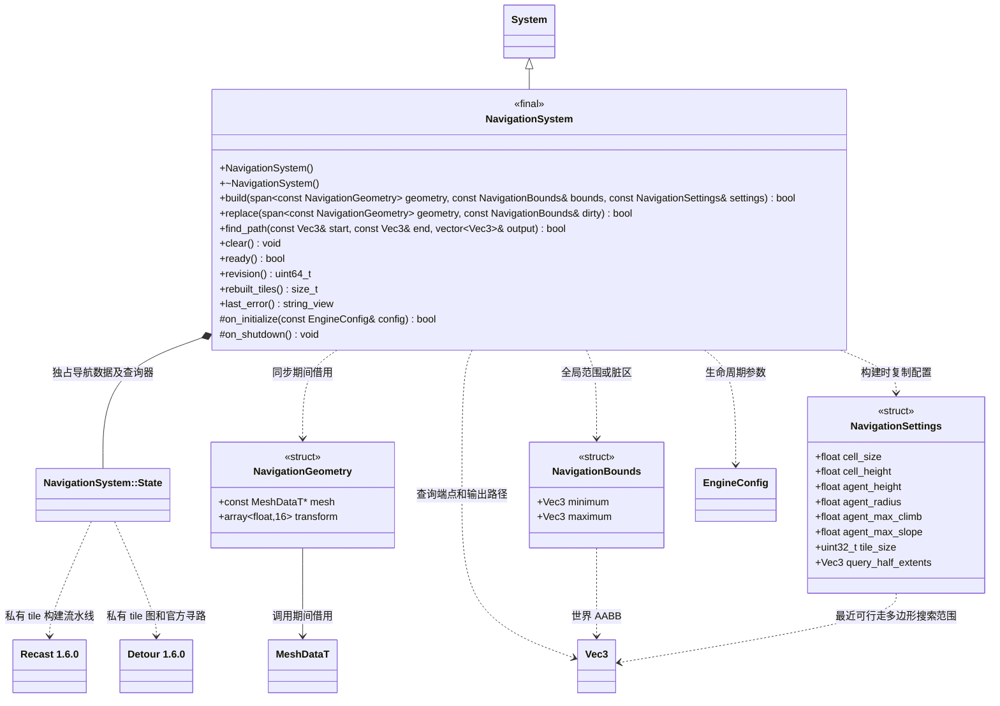

# 导航系统

[类图索引](../../class-diagrams/index.md) · [导航模块](../navigation.md)

核心提供同步导航网格构建、指定区域重建与寻路；调用方提交全部当前几何，核心不扫描场景，不识别地形、破坏、角色或编辑器。

- NavigationGeometry 借用 MeshData，列主序仿射矩阵默认为单位矩阵，输入只需位置及索引；同步返回后不保留源指针。允许空几何集合，表示区域内没有可行走表面。反射矩阵反转三角形索引保持源面朝向；退化变换、非有限坐标、越界索引失败。
- build 固定导航范围、代理参数及 tile 网格；沿用官方 Sample_TileMesh 的光栅化、低障碍/台阶/净高过滤、侵蚀、分区、轮廓、PolyMesh、DetailMesh 和 Detour tile 发布流程。每个 tile 高度覆盖全局 Y 范围，支持多个高度层。
- replace 必须收到全部当前几何及覆盖新旧变更的世界 dirty AABB，只重新光栅化与 dirty 加边界相交的 tile。边界为 ceil(agent_radius/cell_size)+3 个 cell，来自官方范例，用于跨 tile 接缝及障碍侵蚀。未变化 tile 不重新生成。
- 先完整准备候选 tile，再发布。replace 失败会明确移除所有受影响旧 tile，保留范围外导航，递增 revision；无法确定合法 dirty 区时清空导航。完整构建失败清空旧导航。不得继续使用失败区域的陈旧路径。
- revision 在成功发布、失效或清空已有导航时递增，clear 不复用旧编号；rebuilt_tiles 是最近一次成功构建/替换重新光栅化的 tile 数量（包含合法空 tile），失败或 clear 为 0。ready 表示存在有效网格容器，空导航同样 ready，但没有可达路径。
- find_path 复用 Detour findNearestPoly、findPath 和 findStraightPath。仅返回完整路径；端点不在搜索范围、不可达、部分路径或固定缓冲容量不足均失败且 output 为空。路径为导航表面折线，不负责代理移动、避让、物理或动画。路径持有方用 revision 检测失效并重查。
- 所有修改、查询在调用方主线程安全点同步执行，不能彼此并发；不创建线程或自动重建任务。后续可拆 tile 计算与安全点发布，当前不提前建立任务框架。
- 明确上限：最多 4096 个输入几何、100 万顶点/100 万三角形、1024 个 tile、每 tile 4096 个导航多边形；tile_size 为 8..128 cell，带边界宽度最多 256 cell。每次查询最多 8192 个搜索节点、1024 个走廊多边形和 1024 个输出点；其余参数范围见导航模块文档。

构造、析构、clear 及只读状态查询为 noexcept；第三方对象只在私有实现中出现。初始化和操作通过返回值表达失败，last_error 给出上下文；无逐帧自动业务。
