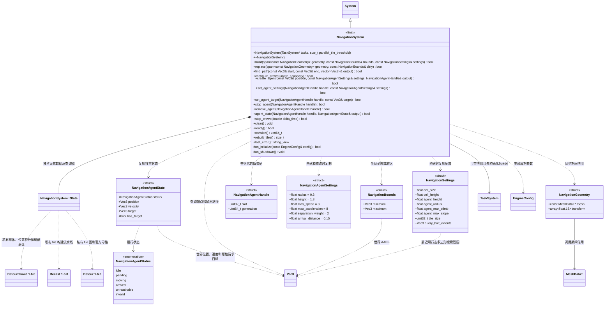

# 导航系统

[类图索引](../../class-diagrams/index.md) · [导航模块](../navigation.md)

核心提供导航网格构建、指定区域重建、寻路及 DetourCrowd 群体避让；调用方提交全部当前几何，核心不扫描场景，不识别地形、破坏、角色或编辑器。构建接口同步返回，可注入任务域并行准备 tile，统一在调用线程发布。

`tasks` 默认空，`parallel_tile_threshold` 默认 4、范围 1..1024。达到阈值时各 tile 独占 Recast 工作数据、Detour 编码结果和错误文本，几何与构建配置只读共享；通过任务域的 `submit_batch` 执行，并只等待这一批。域饱和拒绝整批提交时同步准备，不丢失本次请求。域借用须覆盖导航生命周期，未初始化域或非法阈值使初始化失败。任务域并发额度决定同时准备的数量，阈值只用于避免小批次的调度开销。

全部准备成功后，调用线程按既有 tile 顺序执行 `addTile` / `removeTile`，失败仍遵守原来的脏区失效规则。`dtNavMeshQuery`、`dtCrowd`、代理句柄表和活动网格不被 worker 修改；寻路与 Crowd 更新仍有序。`build` / `replace` 返回时已完成本次任务和发布，仍不可与查询、场景修改或关闭并发；这属于同步接口的内部并行，不是跨帧异步请求。

- NavigationGeometry 借用 MeshData，列主序仿射矩阵默认为单位矩阵，输入只需位置及索引；同步返回后不保留源指针。允许空几何集合，表示区域内没有可行走表面。反射矩阵反转三角形索引保持源面朝向；退化变换、非有限坐标、越界索引失败。
- build 固定导航范围、代理参数及 tile 网格；沿用官方 Sample_TileMesh 的光栅化、低障碍/台阶/净高过滤、侵蚀、分区、轮廓、PolyMesh、DetailMesh 和 Detour tile 发布流程。每个 tile 高度覆盖全局 Y 范围，支持多个高度层。
- replace 必须收到全部当前几何及覆盖新旧变更的世界 dirty AABB，只重新光栅化与 dirty 加边界相交的 tile。边界为 ceil(agent_radius/cell_size)+3 个 cell，来自官方范例，用于跨 tile 接缝及障碍侵蚀。未变化 tile 不重新生成。
- 先完整准备候选 tile，再发布。replace 失败会明确移除所有受影响旧 tile，保留范围外导航，递增 revision；无法确定合法 dirty 区时清空导航。完整构建失败清空旧导航。不得继续使用失败区域的陈旧路径。
- revision 在成功发布、失效或清空已有导航时递增，clear 不复用旧编号；rebuilt_tiles 是最近一次成功构建/替换重新光栅化的 tile 数量（包含合法空 tile），失败或 clear 为 0。ready 表示存在有效网格容器，空导航同样 ready，但没有可达路径。
- find_path 复用 Detour findNearestPoly、findPath 和 findStraightPath。仅返回完整路径；端点不在搜索范围、不可达、部分路径或固定缓冲容量不足均失败且 output 为空。路径为导航表面折线；独立的 crowd API 负责代理移动与避让，不驱动物理或动画。路径持有方用 revision 检测失效并重查。
- 所有修改、查询在调用方主线程安全点同步执行，不能彼此并发；不创建线程或自动重建任务。后续可拆 tile 计算与安全点发布，当前不提前建立任务框架。
- 明确上限：最多 4096 个输入几何、100 万顶点/100 万三角形、1024 个 tile、每 tile 4096 个导航多边形；tile_size 为 8..128 cell，带边界宽度最多 256 cell。每次查询最多 8192 个搜索节点、1024 个走廊多边形和 1024 个输出点；其余参数范围见导航模块文档。

构造、析构、clear 及只读状态查询为 noexcept；第三方对象只在私有实现中出现。初始化和操作通过返回值表达失败，last_error 给出上下文；无逐帧自动业务。

## 群体代理契约

- `configure_crowd` 要求已构建网格，容量 1..4096；相同容量重复调用不重置代理，有代理时不能改变容量。完整 build（成功或失败）、clear、shutdown 使全部旧句柄失效，并清除群体配置和目标；调用方可依据自己的组件数据重新注册。局部 replace 保留句柄与原始目标，先销毁旧路径队列，再从当前位置恢复群体并重新排队请求路径；当前位置无法投影时状态 invalid，目标请求在后续步进确认断路时 unreachable，均停止旧运动。
- 句柄 `generation=0` 无效；槽位复用、系统重启和跨系统实例均不复用旧世代。`create_agent` 失败清空输出句柄，`agent_state` 失败输出默认 invalid 状态。成功查询复制数据，不暴露 Detour 句柄或内部指针。
- 半径 0.01..10、高度 0.01..100、速度/加速度 0.01..1000、分离权重 0..100、到达距离 0.01..10；全部有限，且半径/高度不能超过已烘焙的净空。单网格仅有一份净空；小代理可以使用保守路线，大代理需要调用方另建相应网格。
- `set_agent_target` 只投影端点并交给 DetourCrowd 排队，不重复执行同步完整寻路；返回成功只表示接受请求，初始状态 pending。上游队列完成后 moving；仅完整走廊终点在到达距离内才 arrived。部分路径、不可达或预算不足报告 unreachable，不把局部走廊末端当作目的地。原始 target 与 has_target 保留用于查询；无效新目标也会先停止旧请求。群体路径最多 256 个走廊多边形；DetourCrowd 队列受上游 4096 节点/8 排队请求限制，每次 update 最多推进 100 次搜索迭代，不承诺任意大路径。独立 find_path 继续使用 8192 节点同步严格查询。
- `stop_agent` 清除目标及瞬时速度，状态 idle；remove 释放槽位。停止/到达代理仍参与局部避让，邻近代理的重叠修正可能推动其位置。参数修改即时影响后续积分，不能改变网格净空。
- `step_crowd` 由调用方显式调用，每次按 1/60 秒固定步长累计，最多 8 步并丢弃超额时间；零时间不推进，负数/非有限值失败。核心不 tick、不保存 Node，不扫描 Scene。群体独占其代理的位置积分；场景组件、动画、朝向及与物理的互斥由调用方组织。
- 使用官方 CrowdTool 的 anticipate turns、visibility/topology 优化、障碍避让和 separation；邻域半径 12 倍代理半径、路径优化范围 30 倍半径，采用中等自适应采样（5 divisions / 2 rings / 2 depth）。上游邻居与查询预算仍然有效，容量不等于实测性能承诺。
