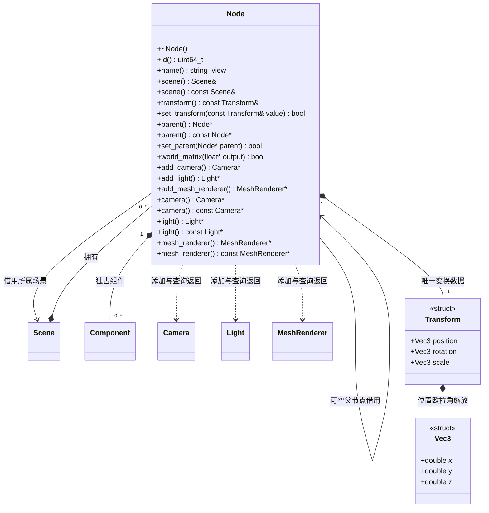

# 节点

[类图索引](../../class-diagrams/index.md) · [场景](scene.md) · [组件](component.md)

- Node 是所有场景对象的身份、层级与组件容器；Transform 是每个节点固有的普通数据结构，不额外制造变换实体或第二份 ECS 状态。
- 位置和欧拉角使用 double；欧拉角单位为度，矩阵为 `T * Rz * Ry * Rx * S`。Y 向上，相机和灯光局部前向为 -Z。
- 设置变换必须全部有限，缩放各分量非零；失败保持原值。允许负缩放。
- `set_parent()` 保持局部变换；空指针解除父子关系。拒绝其他场景节点、自身及循环父链。
- `world_matrix()` 写 16 个列主序 float；父链变换累乘出现溢出返回 false，输出保持单位矩阵；空输出返回 false。
- 每个节点当前每类内置组件至多一个，重复添加返回空指针。组件独占于节点、不可单独转移。本阶段不增加通用类型注册或模板分派。
- 节点析构删除底层 flecs 实体；删除层级统一走 Scene，调用方不得销毁借用。
