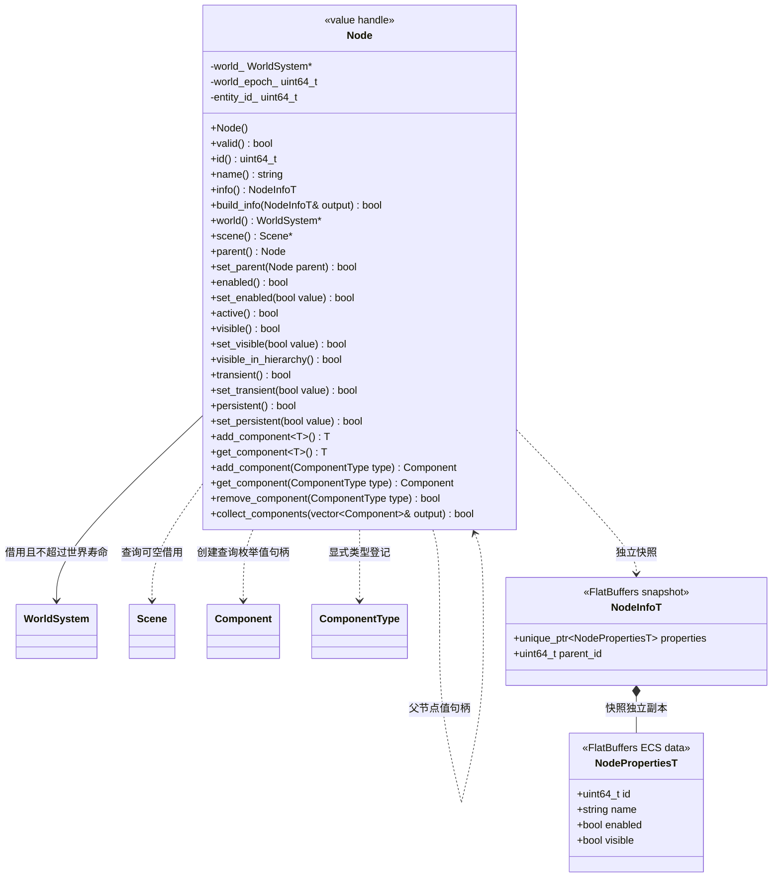

# 节点值句柄

[类图索引](../../class-diagrams/index.md) · [场景](scene.md) · [组件](component.md) · [ECS 场景](ecs-scene.md)

- Node 只保存世界借用、世界生命周期代次和完整 Flecs 实体 ID。复制或析构句柄不创建或销毁实体；删除必须显式调用 `Scene::destroy_node()`。
- `valid()` 同时检查世界代次与实体代次。WorldSystem 对象须活过句柄的使用；shutdown/reinitialize 后旧句柄失效，不承诺世界对象析构后仍能解引用裸借用。
- 真实节点属性为 ECS 列中的生成 `NodePropertiesT`；父子关系只存 Flecs `ChildOf`。`info()` 与 `build_info()` 临时组装独立 `NodeInfoT`，其中 `properties.id` 与 `parent_id` 为落盘局部身份，不能与 `id()` 的运行实体 ID 混用。`name()` 返回字符串副本。
- `add_component<T>()` / `get_component<T>()` 返回具名组件值句柄，动态类型版本返回 Component 值句柄。每类至多一份；重复添加、缺失或初始化失败返回空句柄。Node 没有组件对象列表、具体类型指针或虚函数分派。
- 类型登记表负责 ECS 列、运行字段和初始化/保存/恢复操作，生成枚举作为唯一类型标识。`collect_components()` 仅为编辑、保存与诊断生成身份快照；原生热路径直接做有类型的 ECS 查询。
- `set_parent()` 保持局部变换。默认 `Node{}` 解除关系；过期非空、跨世界、跨场景、自身或循环父链均失败并保留旧关系。直接标记常驻的根拒绝非空父节点。
- `remove_component()` 移除真实 ECS 数据，旧组件实例身份立即失效；重新添加不会复活旧句柄。节点自身身份不变。

## 子树状态与常驻

本地 `enabled` 与 `visible` 默认 true，写入生成的 NodePropertiesT 并随场景保存。有效激活和可见状态为派生缓存，由 `WorldSystem::refresh_scene_state()` 在安全点更新；修改父子/状态后查询不能使用旧帧缓存。隐藏继续模拟，停用暂停系统消费；父级恢复保留后代本地设置，Transform 仍用于层级计算。

`set_transient()` 设置运行标志，后代继承有效瞬态状态，保存跳过相应子树。`set_persistent()` 只接受根节点，重复设置幂等；后代继承常驻性。普通关卡卸载保留常驻实体、组件实例与原场景身份，显式删除、停止项目及世界关闭仍释放。瞬态与常驻互相独立，均不进入 schema；完整清理规则见[常驻节点](persistent-nodes.md)。

所有修改检查有效性与结构修改阶段并返回 bool；无效句柄状态查询为 false。结构修改及原生列借用的规则见 [ECS 场景](ecs-scene.md)。
