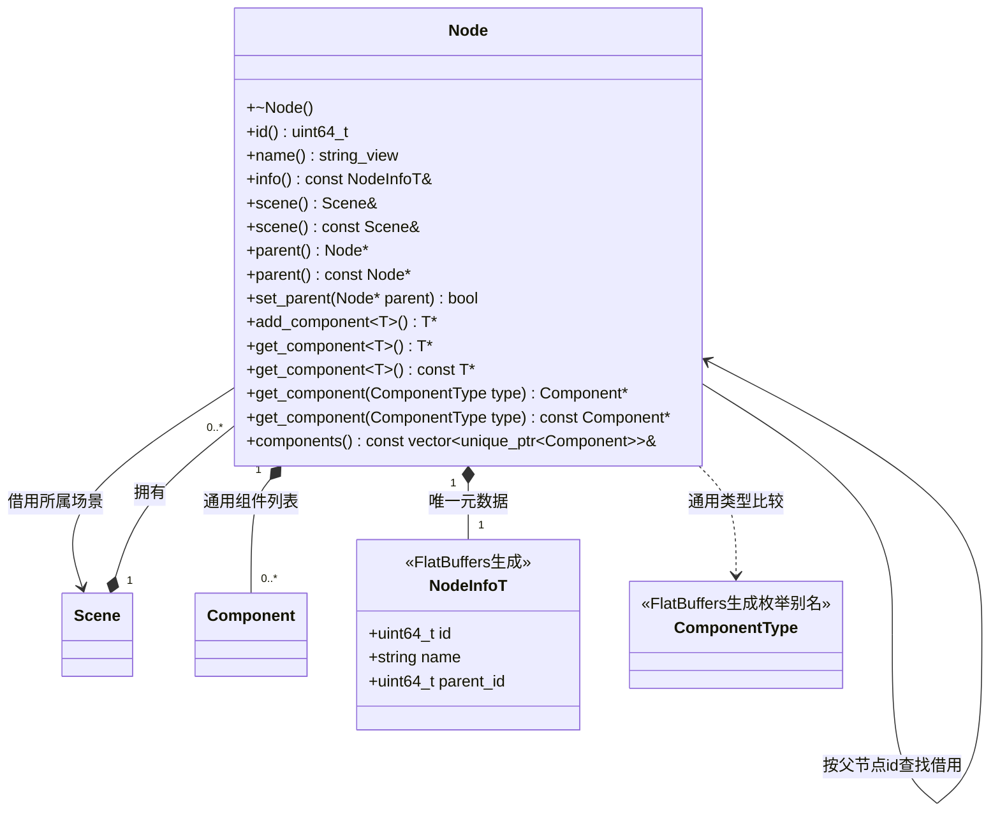

# 节点

[类图索引](../../class-diagrams/index.md) · [场景](scene.md) · [组件](component.md)

- Node 只负责身份、父子关系与组件所有权，不知道 Transform、Camera、Light、MeshRenderer 的具体数据或字段；没有专用组件成员、方法或类型分支。
- `add_component<T>()` 创建组件并检查通用初始化返回值，成功才转入唯一的 `vector<unique_ptr<Component>>`。`get_component<T>()` 是通用类型查询后的静态转换；非模板版本返回 Component 借用，由调用者按类型转换。均不依赖 RTTI。
- 每类组件至多一个，重复添加返回空指针；查询不存在的类型返回空指针。组件的静态类型标记来自 FlatBuffers 生成枚举，不另外维护类型编号。四个内置原生组件均为 final，构造由 Node 控制；新增原生组件须在 schema 增加独立载荷并声明其唯一类型标记，不能复用其他组件标记。
- `NodeInfoT` 由 `include/schemas/runtime/scene.fbs` 生成，保存场景内稳定的局部 id、名称和父局部 id；不并行维护手写数据对象。父指针按需在所属场景中解析。`id()` 返回单独维护的运行时 flecs 实体 ID；`info().id` 是落盘局部 ID，两者不可混用。
- `set_parent()` 保持局部变换；空指针解除关系，拒绝其他场景节点、自身及循环父链。
- 节点析构删除底层 flecs 实体；删除层级统一走 Scene，调用方不得销毁借用。
