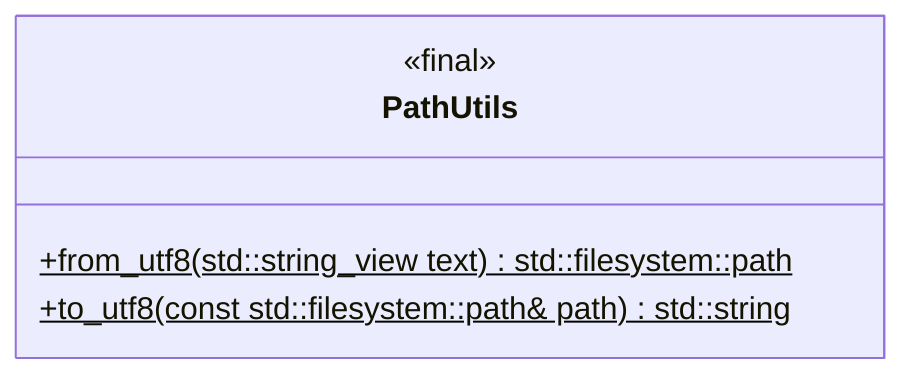

# 路径编码工具

[类图索引](../../class-diagrams/index.md) · [完整引用关系](../../class-diagrams/references.md)

运行时公共工具，头文件为 `runtime/utils/path_utils.hpp`，实现位于 `src/engine/runtime/utils/path_utils.cpp`。

- PathUtils 是不可构造的静态工具类，不继承 System，不持有实例、文件或其他资源。
- `from_utf8()` 将 UTF-8 文本转换为原生文件系统路径，保留输入内容；空输入返回空路径。
- `to_utf8()` 将原生路径转换为 generic UTF-8 文本，目录分隔符统一为正斜杠。
- 两个方法返回新值，不借用输入缓冲区；均标注 `[[nodiscard]]`，构造函数私有并删除。
- 工具只处理编码，不执行 canonical、目录存在性、权限、越界或符号链接检查；这些检查仍归调用者。
- App、ScriptSystem、ProjectSystem、AssetPipelineSystem、AssetSyncSystem、McpSystem，以及编辑器和 MCP 宿主复用该工具。运行时不因此依赖编辑器或插件。
- ResourceSystem 保留自身向 SDL 文件接口传递原生路径编码的处理，不依赖 generic 正斜杠输出，避免改变 Windows 扩展路径语义。

类型声明见 [include/engine/runtime/utils/path_utils.hpp](../../../include/engine/runtime/utils/path_utils.hpp)；本工具不属于 TypeScript 运行 SDK 的公开绑定。
