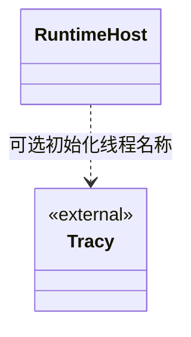

# 性能观测接入

[类图索引](../../class-diagrams/index.md) · [性能采样](../performance.md)

运行宿主初始化时设置 Tracy 主线程名称；不创建独立的 PerformanceSystem。Tracy 客户端按上游进程生命周期存活，各模块在实现内通过私有 `runtime/performance/profiling.hpp` 提交 zone、帧标记及 plot。

`ENGINE_ENABLE_TRACY` 默认 OFF，关闭时不查找、编译或链接客户端，采样宏不求值；开启时显式目标私有链接官方客户端。Engine/System 框架无性能接口或第三方依赖。运行时、编辑器与插件分别拥有自己的采样点，不新增通用统计管理器。bgfx Stats 叠加仍由 RenderSystem 控制，独立于 Tracy 开关。

GPU 统计可能延迟或不受设备支持；资源内存估算不等于进程 RSS。捕获、导出与结果限制见性能文档。
