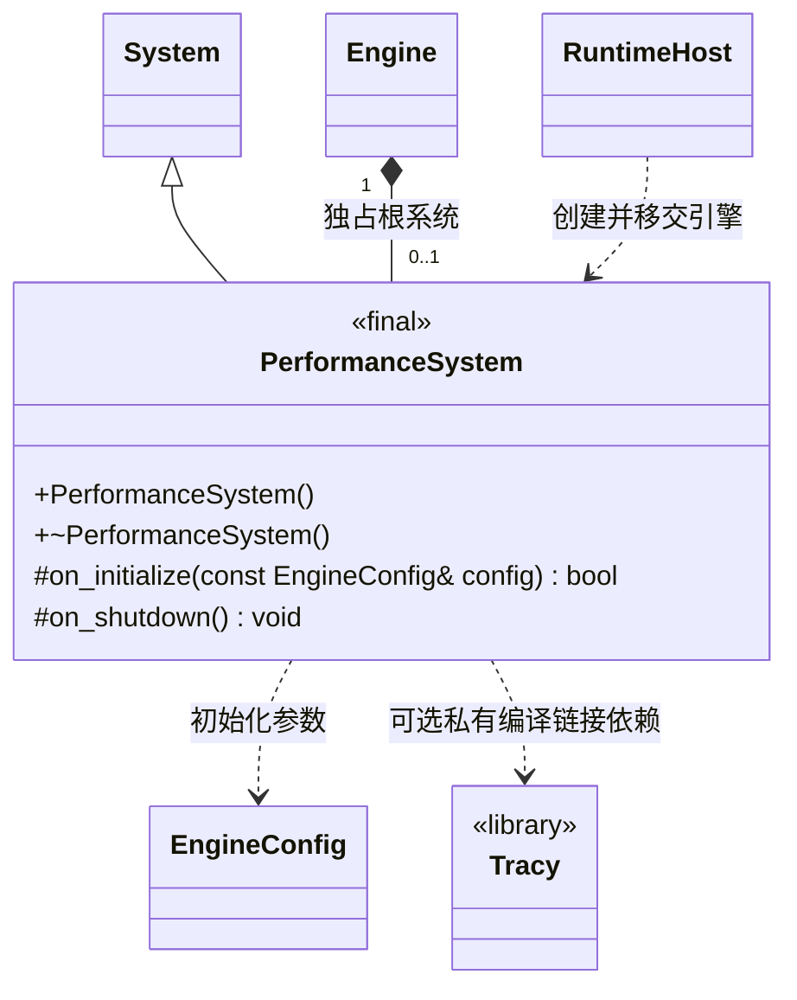

# 性能系统

[类图索引](../../class-diagrams/index.md) · [完整引用关系](../../class-diagrams/references.md)

- 运行时核心 `runtime/performance/` 提供独立根系统，覆盖整个宿主生命周期；不属于场景，不区分玩法或预览。Engine 仅通过 System 管理它。
- `PerformanceSystem` 继续管理可选客户端的生命周期接点，不增加数据查询或跨领域统计接口；沿用 System 的空更新。
- 具体模块在实现文件中通过私有 `runtime/performance/profiling.hpp` 宏提交官方 Tracy CPU zone、帧标记及 plot。地形、破坏、物理、导航、脚本和渲染各自拥有采样点，不把插件类型或项目策略引入核心。没有新增采样类、存储格式或通用调度器。
- `ENGINE_ENABLE_TRACY` 默认 `OFF`。开启时仅采样目标私有定义同名宏并链接 Tracy；关闭时宏不求值，不查找、编译或链接客户端，第三方头不进入公开接口。Engine/System 框架不添加第三方依赖。
- 渲染实现提交 bgfx 自带 CPU/GPU 时长及资源内存估算；GPU 数据可能有延迟且设备可能不支持，不将提交耗时冒充 GPU 耗时。内存估算不等于进程 RSS 或逐次堆分配记录。进程 RSS 由外部采样脚本记录，不拦截全局分配器。
- 采样使用官方 capture/csvexport 工具导出 `.tracy` 和 CSV，包含层级及 self time；父子 zone 的 inclusive 耗时不能相加作为总消耗。并行工作另报每线程执行、任务排队与主线程等待，不能将 worker 累计墙钟当成帧关键路径；流程与历史基线见[性能采样](../performance.md)。
- Tracy 使用 vcpkg 的 `on-demand` 功能，关闭默认崩溃处理器，不安装分析器 GUI。客户端按上游默认进程生命周期管理，系统关闭不销毁全局客户端；按需模式仍会有客户端线程及连接监听。
- bgfx 自带状态面板由 RenderSystem 独立控制，默认关闭；与此构建开关无关。

C++ 限定符：构造、析构及 `on_shutdown()` 为 `noexcept`；析构和生命周期钩子为 `override`，初始化返回值为 `[[nodiscard]]`。第三方类型不进入公开头文件。
