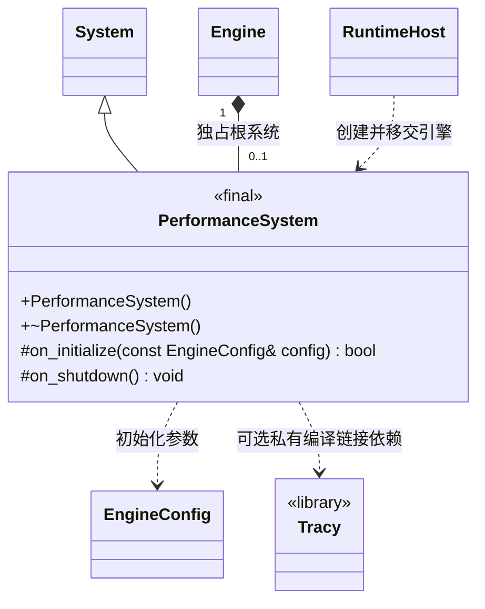

# 性能系统

[类图索引](../../class-diagrams/index.md) · [完整引用关系](../../class-diagrams/references.md)

- 运行时核心 `runtime/performance/` 提供独立根系统，覆盖整个宿主生命周期；不属于场景，不区分玩法或预览。Engine 仅通过 System 管理它。
- 当前为占位实现，没有采样、逐帧分析、内存跟踪或数据查询接口；沿用 System 的空更新。
- `ENGINE_ENABLE_TRACY` 默认 `OFF`。开启时只在本模块私有定义同名宏并链接 Tracy 客户端；初始化查询一次客户端连接状态，以触达实际链接的实现，不产生采样事件。关闭时不查找、编译或链接 Tracy。
- Tracy 使用 vcpkg 的 `on-demand` 功能，关闭默认崩溃处理器，不安装分析器 GUI。客户端按上游默认进程生命周期管理，系统关闭不销毁全局客户端；按需模式仍会有客户端线程及连接监听。
- bgfx 自带状态面板由 RenderSystem 独立控制，默认关闭；与此构建开关无关。

C++ 限定符：构造、析构及 `on_shutdown()` 为 `noexcept`；析构和生命周期钩子为 `override`，初始化返回值为 `[[nodiscard]]`。第三方类型不进入公开头文件。
