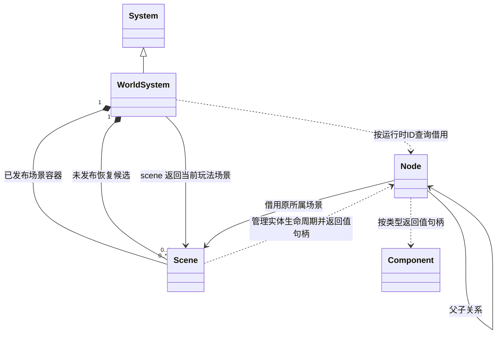
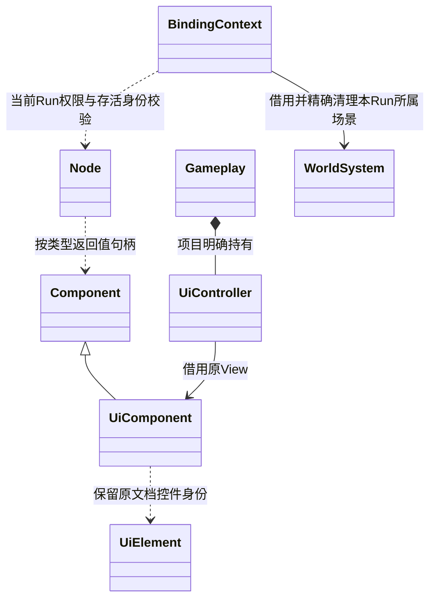

# 常驻节点与场景切换

[类图索引](../../class-diagrams/index.md) · [节点](node.md) · [世界](world-system.md) · [场景界面](ui-system.md) · [脚本绑定](../../plugins/runtime/class-diagrams/script-bindings.md)

根节点可在同一次游戏运行中标记为常驻，保留原节点、组件和子树。Loading、菜单等 UI 因此可以跨玩法场景复用原文档与 Controller。它们继续使用普通 Node、Component、UiComponent 和项目 MVC；常驻标记只改变场景卸载策略。

## 所有权与卸载

本图只描述跨模块关系。公开方法分别维护在[节点](node.md)、[世界](world-system.md)和[场景](scene.md)类图中。

- `set_persistent(bool)` 只允许根节点设置；非根节点返回 false，状态不变，重复设置幂等。`persistent()` 返回包含祖先标记的有效状态，默认 false。
- 标记作用于整棵子树，由项目在初始化时明确设置。它不写入场景 schema，与 `transient` 的保存策略独立。
- 已直接标记常驻的根节点，`set_parent(non-null)` 返回 false；先取消标记才能改变其根身份。子节点可以按既有规则移出常驻子树，移出后不再继承常驻；不会因此立即销毁，下次卸载按当时的层级清理。
- 取消根标记不会立即销毁对象；下一次场景卸载/切换清理它。已有 `Node.Destroy()` / `Scene::destroy_node()` 仍可立即销毁常驻根及子树。
- 既有 `load_scene()` 和 `commit_restore_scene()` 只在候选验证成功后发布新场景；失败、取消或资源换代拒绝不影响当前节点、常驻内容或暂停状态。
- `unload_scene()` 卸载当前玩法场景并保留所有有效常驻子树，同时清理以前保留但已取消常驻的节点、取消未发布恢复候选并复位暂停；完成后 `scene()` 为 null，常驻节点继续存在。脚本 `Scene.Destroy()` 使用此能力。
- 无参 `destroy_scene()` **完整清理**活动场景、常驻内容及候选，用于停止项目、释放玩法会话、热重载换 Run 和世界关闭。
- `destroy_scene(id)` 无条件释放指定的已发布场景及全部节点，包括常驻节点；不存在返回 false，不按 ID 删除恢复候选。仅删除当前玩法场景时清空 `scene()` 并复位暂停；删除保留容器不改变另一活动场景、暂停或加载请求。调用方用它精确清理自己拥有的场景。
- `scenes()` 返回已发布场景容器的只读借用，不含恢复候选。迭代器不能跨场景增删持有；业务系统每次调度重新遍历。`find_node(id)` 只查询已发布节点，缺失返回 null。运行时 flecs ID 包含实体代际，不按名字找回旧对象。

## 保留原对象与资源释放

保留子树时不迁移、不序列化重建 Node。World 保留其原 Scene 容器，删除容器内不再需要的节点；场景不再活动时释放 `Scene::resource_`，空的保留容器在卸载、切换或下一次世界更新时回收，避免节点销毁方法在执行途中删除所属 Scene。原 Node 地址、组件实例、flecs ID、场景局部 ID 和父关系均不变化。这样无需给父节点、角色相机和目标节点引用另写重映射规则。

保留 Scene 容器不等于保留旧关卡：它不再是 `scene()` 的结果，不参加活动关卡保存，不保留旧场景根资源闭包。存活组件按已有契约持有自身实际需要的资源；GPU 缓存也必须按存活对象裁剪，不能为保住 Loading 留住整关模型和贴图。当前关卡的相机、环境、后处理及导航几何仍由调用方和当前场景明确选择，不由旧场景残留值覆盖。

普通引用不扩大保留范围。引用子树外的对象，目标卸载后按既有失效规则处理；跨 Scene 的 `set_parent()` 继续拒绝。插件生成的独立根对象不因为名字、来源资源或普通 ID 引用就自动常驻。地形/破坏等插件必须同步清理失效的派生节点记录，不能留下悬空缓存；若某派生对象本来就应随源对象存活，由该插件明确组织其节点生命周期，核心不识别插件类型。

## 脚本与 UI

脚本方法由既有 NodeBinding 登记，见[脚本绑定](../../plugins/runtime/class-diagrams/script-bindings.md)；UI 方法与订阅归[UI 脚本接口](../../plugins/runtime/class-diagrams/ui-script-api.md)。

- `SetPersistent(true)` 使用 Unity 风格的显式调用语义；只保留这次运行的根节点及子树。项目示例只需在创建 UI 根时调用一次，并检查返回值。
- Scene 句柄仍只代表当前玩法场景；卸载后 `IsValid()` 返回 false，即使其底层容器为常驻节点暂时保留，也不能通过旧 Scene 句柄修改新关卡。
- Node、Component、UiElement 与事件校验不再要求其所属场景等于当前活动关卡。仍必须校验活动 Run、其拥有的节点范围、真实 Node ID，以及组件/文档/控件实例；不能全局放宽为任意 ID 可访问。
- 插件内部 `BindingContext::find_node(scene_id, node_id)` 集中检查本 Run 所属场景、已发布节点和实际归属，返回可空借用；Node/Component 解析、UI 和物理绑定共用此检查。
- 同一次 Run 内，Node 的实际所属 Scene 不变，既有 `sceneId` 保持准确。保留原文档 ID、element ID、UiComponent view ID 及 revision，重建同名控件仍不会复活旧句柄。
- UiSystem 按存活 UiComponent 同步文档；无活动玩法场景也继续更新、绘制和派发常驻 UI 事件。常驻文档位于普通关卡 UI 之上，输入按相反顺序命中；已有隐藏、模态、焦点和 capture 契约继续生效。
- 场景切换不调用常驻 Controller 的 Unbind，不重建 Rml Context，不丢弃其 Model、控件状态或有效订阅。Controller 由项目 Gameplay 正常持有，无需序列化 JS 对象。
- 项目停止/换 Run 沿用 `OnShutdown → 清理绑定和订阅 → 释放 VM → 原生会话清理` 的流程。BindingContext 在既有 `set_scene_id()` 中登记本 Run 成功创建、加载或提交的 Scene ID；当前活动 ID 和全部仍存活的所属 ID 分开记录，不增加脚本外观或核心 Run 类型。节点校验要求实际所属 Scene 在本 Run 的记录内；取消常驻、调整父子关系不会丢失所有权记录。
- BindingContext 关闭时先取消自己的加载请求，再用 `destroy_scene(id)` 精确释放仍存在的所属场景，清空记录并支持重复关闭；平时在场景变更时裁剪已释放的 ID。仅预检的候选 Run 没有已发布场景，不能清理活动 Run；旧 Run 也不能删除后来由原生宿主或其他 Run 创建的场景。GameplaySession 和宿主明确结束整个会话时仍使用无参完整清理。
- 异步请求继续遵守现有 Run、场景和资源代际校验及取消规则；设置常驻不自动延长已有请求的寿命，不复活旧关卡结果。Loading 观察现有场景加载操作的进度。

## 系统与项目接入

| 范围 | 行为与职责 |
| --- | --- |
| UI / 字体 / 渲染资源 | 同步所有已发布节点；存活文档与 GPU 资源不因活动场景 ID 变化而全量释放，删除对象的资源正常回收 |
| 物理 / 动画 / 音频 / 特效 | 按真实节点及组件实例保留运行状态；删除对象增量清理，完整停止才全量释放 |
| 角色 / 相机 / Crowd | 不用活动 Scene ID 代替存活校验；保留有效对象，外部目标或导航版本改变时按已有契约失效/更新 |
| 物理查询与接触 | 查询范围为已发布世界，命中及接触双方分别携带准确节点归属；不能把常驻对象错误标成当前关卡对象 |
| 地形 / 破坏 | 保留有效源组件状态，清理已卸载节点与过期发布；派生节点按实际所有权处理，无 UI/项目特例 |
| showcase | 常驻 UI 实验室验证同一 Loading 文档反复换关、取消、失败、空窗输入和显式销毁 |
| 停止 / 热重载 / 预览 | 使用明确的完整清理路径，编辑器恢复空白；不把常驻内容写进另一个场景或项目 |

## 物理事件身份

查询、接触与撞击统一使用 `PhysicsObject`，分别记录双方的 `scene_id`、`node_id`、`kind` 和 `instance_id`。`PhysicsImpact` 通过 `a`、`b` 表达跨场景双方归属，不保留旧的单场景身份字段。原生定义见[物理系统](physics-system.md)，脚本定义见[物理与音频接口](../../plugins/runtime/class-diagrams/physics-audio-script-api.md)。

- `a`、`b` 各自记录真实所属 Scene 和组件实例；`normal` 由 a 指向 b，其余物理量与 `GetImpacts()` 入口保持原语义。
- `frame` 仍为当前 PhysicsSystem 生命周期内单调递增的批次号，用于消费去重；不增加世界代际或事件版本。对象有效性复用现有组件 `instance_id`，相同节点移除再添加组件不能接收旧撞击。
- 收集撞击与现有接触事件共用已提交物理对象身份；聚合按完整双方身份保留一帧内最大估算撞击。常驻对象与新场景对象的接触不会被错误标成同一场景。
- 普通切换不清空仍存活对象的物理状态；已卸载对象参与的接触按现有删除规则生成 `end`，可携带失效对象的历史身份。撞击快照只返回仍有效的双方；完整清理才清空全部状态。
- 常驻接收者继续收到旧关卡对象卸载产生的接触退出通知；不能因对方已失效就过滤 `end`，也不能因换关清除常驻订阅。历史身份可报告，但不得借此访问已删除对象。
- `PhysicsQueryHit`、`PhysicsContactEvent` 及其脚本结构无需增加字段。发布快照和查询在既有主线程安全点执行，不改变线程边界。

## 回归边界

- 原 Node/Component 地址、文档/控件 ID、Controller 和事件订阅跨同步/分步切换不变；新场景加载完成后同一 Loading 可隐藏再显示。
- 普通节点、旧 Scene 句柄和旧关卡异步回调失效；旧关卡根资源及无关 Mesh/Texture 的弱引用释放，常驻 UI 必需资源仍存活。
- 嵌套子树、重复设置、取消常驻、非根拒绝、重新设置父子关系、显式 Destroy、加载失败/取消与没有活动关卡时的 UI 输入均覆盖。
- 常驻刚体、动画、声源及特效不因换关重置；查询与接触能区分常驻对象和新关卡对象。
- 停止、热重载、重复启停和世界关闭无常驻残留，包含已脱离常驻根的子节点；候选或旧 Run 关闭不影响其他调用方的场景，旧句柄不会命中新一次运行创建的对象。

实际构建、脚本与实窗验证范围统一维护在 [测试与范例](../../testing.md)，不由本契约推断其他平台已经验收。

## 官方参考

- [Unity DontDestroyOnLoad](https://docs.unity.com/en-us/engine/6000.0/script-reference/unityengine/object/dontdestroyonload)：根对象及子树保留。
- [Godot Autoload](https://docs.godotengine.org/en/stable/tutorials/scripting/singletons_autoload.html)：常驻节点生命周期独立于当前玩法场景。
- [Unreal FGameViewportWidgetSlot](https://dev.epicgames.com/documentation/en-us/unreal-engine/API/Runtime/UMG/FGameViewportWidgetSlot)：Viewport 控件可选择 World 移除时是否自动移除。
- [RmlUi Contexts](https://mikke89.github.io/RmlUiDoc/pages/cpp_manual/contexts.html)：Context 独立拥有文档，显式更新、输入、绘制和释放；本方案复用既有能力。

ECS 迁移后常驻保留的是原实体与列数据。Node/Component 的值句柄保持身份，Scene 不再独占节点对象；Published 查询跨所有已发布场景消费常驻实体，候选不参与。UI 的明确层级顺序使用节点创建顺序，不依赖 Flecs archetype 行顺序。
