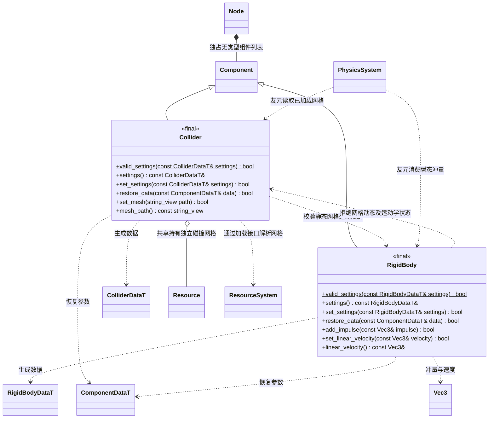

# 物理组件

[物理系统](physics-system.md) · [节点](node.md) · [组件](component.md)

组件位于 `engine`，编入场景模块；数据来自 FlatBuffers，组件不调用 Jolt。

设置失败保持已有数据。冲量只接受启用的动态刚体；静态刚体拒绝非零速度。`valid_settings` 可由编辑器导入器复用。所有尺寸、质量和速度必须有限并处于校验范围；瞬态冲量不进入持久数据。

`ColliderShape::mesh` 以 `ColliderDataT::mesh_guid` 引用独立 Mesh 资源，不依赖同节点的 MeshRenderer。`set_mesh(path)` 选择静态三角网格并同步加载资源，路径不存在或类型错误时保持旧设置；`mesh_path()` 返回当前持有网格的逻辑路径。切回基本形状须清空 mesh_guid 并释放引用。网格仅允许无 RigidBody 或 static_body；Collider 和 RigidBody 两端的设置操作都拒绝动态、运动学组合，物理同步再次校验。网格是资源中的静态顶点，不随蒙皮动画变形。
