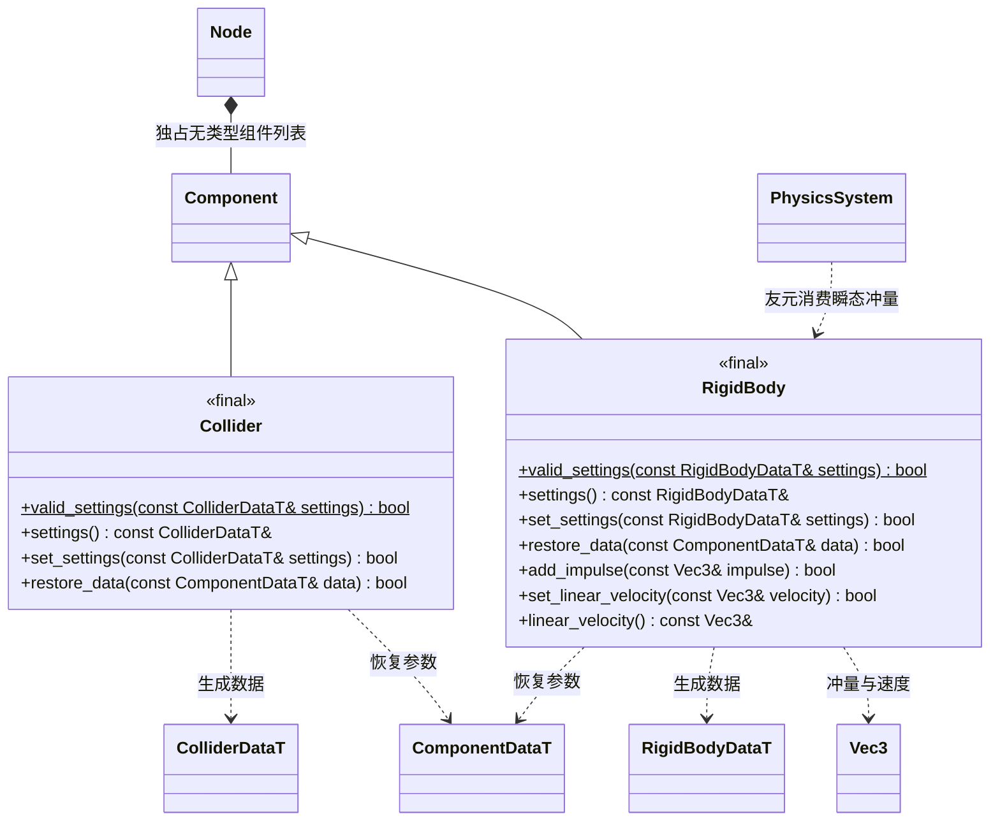

# 物理组件

[物理系统](physics-system.md) · [节点](node.md) · [组件](component.md)

组件位于 `engine`，编入场景模块；数据来自 FlatBuffers，组件不调用 Jolt。

设置失败保持已有数据。冲量只接受启用的动态刚体；静态刚体拒绝非零速度。`valid_settings` 可由编辑器导入器复用。所有尺寸、质量和速度必须有限并处于校验范围；瞬态冲量不进入持久数据。
