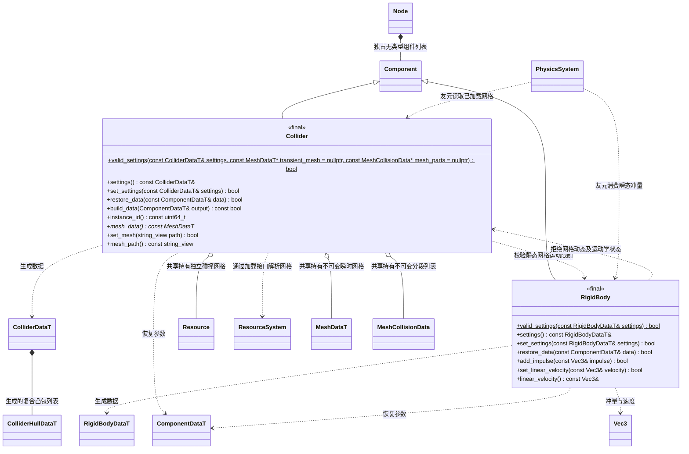

# 物理组件

[物理系统](physics-system.md) · [节点](node.md) · [组件](component.md)

组件位于 `engine`，编入场景模块；数据来自 FlatBuffers，组件不调用 Jolt。

设置失败保持已有数据。冲量只接受启用的动态刚体；静态刚体拒绝非零速度。`valid_settings` 可由编辑器导入器复用。所有尺寸、质量和速度必须有限并处于校验范围；瞬态冲量不进入持久数据。

`Collider::instance_id()` 是组件只读且不复用的进程内身份，不进入 FlatBuffers 持久数据。物理快照保留此身份；同节点移除并重新添加 Collider 后，未清理的旧物理体不能被查询当成新组件。最近命中结果结合场景、节点与此身份检查有效性，位置或设置变化不创建新实例身份。

`ColliderShape::mesh` 以 `ColliderDataT::mesh_guid` 引用独立 Mesh 资源，不依赖同节点的 MeshRenderer。`set_mesh(path)` 选择静态三角网格并同步加载资源，路径不存在或类型错误时保持旧设置；`mesh_path()` 返回当前持有网格的逻辑路径。切回基本形状须清空 mesh_guid 并释放引用。网格仅允许无 RigidBody 或 static_body；Collider 和 RigidBody 两端的设置操作都拒绝动态、运动学组合，物理同步再次校验。网格是资源中的静态顶点，不随蒙皮动画变形。

瞬时静态网格通过 `PhysicsSystem::set_mesh_data(collider, mesh)` 提交：系统先复制生成数据、校验并构建碰撞形状，成功后才更新组件与当前物理世界。`mesh_data()` 借用当前资源或瞬时网格；瞬时网格的 `mesh_guid` 与 `mesh_path()` 为空，不反向依赖生成它的插件。默认 `valid_settings(settings)` 继续要求资源 GUID；可空的瞬时几何参数仅供运行时验证已持有的网格。`build_data()` 遇到瞬时网格返回失败并清空输出，`restore_data()` 拒绝缺少 GUID 的网格描述，不能静默丢失运行时几何。切回资源或基本形状释放瞬时引用。

分段静态几何通过 `PhysicsSystem::set_mesh_parts(collider, data)` 原子提交。Collider 复制完整槽位列表并共享其中的不可变 MeshDataT；空槽表示无几何，全部为空时保留来源并移除碰撞，禁用后恢复或清理物理世界后仍能重建。分段模式的 `mesh_data()` 返回 nullptr，`build_data()` 同样拒绝序列化并清空输出。与单瞬时网格、资源网格或普通形状切换时只在成功后释放旧来源；完整契约见[分段静态网格碰撞](mesh-collision-data.md)。

`ColliderShape::compound` 使用 ColliderData 的 hulls，每个 ColliderHullData 只保存所属节点局部空间 vertices；现有 center 对整体再偏移。描述允许 1–4096 个凸包、每个至少 4 点、累计最多 1M 点，点必须有限且有界；非 compound 不携带 hulls，compound 不引用 mesh_guid。几何凸包和最终 256 个凸包顶点的上游限制由 Jolt 构建验证，退化或超限返回失败，不以包围盒静默替代。多个凸包共用一个 RigidBody，质量来自该组件，惯量及质心由 Jolt 计算。普通 set_settings 仍在下一次物理同步生效，需要同步确认创建/替换结果时使用 PhysicsSystem::set_collider_data。
