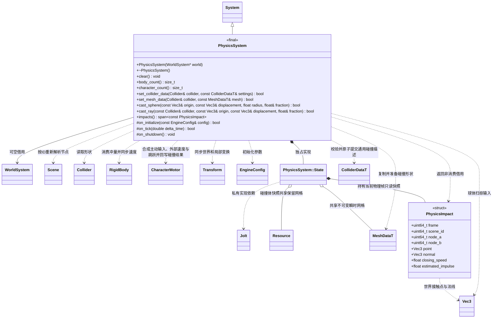

# 物理系统

[类图索引](../../class-diagrams/index.md) · [物理组件](physics-components.md) · [物理模块](../physics.md)

`engine::PhysicsSystem` 借用世界并拥有 Jolt 碰撞世界；场景行为类和公开头不依赖 Jolt。

世界有效期须覆盖系统。无世界时仍可初始化和关闭空碰撞世界。`clear()` 和 `body_count()` 为 `noexcept`；状态返回值不可忽略。场景切换、对象禁用及删除在下一次更新同步，停止玩法由宿主显式清理。固定步进与变换限制见[物理模块](../physics.md)。

角色的待消费速度增量只在固定步取出，无步帧保留，多子步帧不会重复叠加。外部水平速度与主动移动分离，按组件阻尼衰减，垂直速度继续使用 Jolt 已求解的速度；碰撞由 CharacterVirtual 的 ExtendedUpdate 处理。恢复组件或重建 Jolt 对象不能继承旧瞬态速度。

静态网格由独立 Mesh 资源的顶点与三角形索引构建 Jolt MeshShape；正的非均匀世界缩放与 Collider center 在构建时应用，沿用现有刚体位置和旋转同步。无有效三角形、索引越界或非静态刚体返回失败。网格参与同一物理世界，角色胶囊、台阶检测及相机球扫共用这些碰撞体，不另建碰撞查询系统。

`set_mesh_data` 是通用的同步静态网格入口，不识别地形、模型生成器或项目。调用者在主线程帧边界、无物理步进和查询并发时提交当前世界的 Collider。内部先准备完整候选形状，再提交组件与 Jolt 世界；几何、缩放、场景归属或运动类型校验失败时，旧组件和旧碰撞仍有效。已存在的兼容静态碰撞使用 Jolt `BodyInterface::SetShape` 替换，其他重建先创建候选碰撞体再删除旧体；变更区域唤醒动态物体，挖掉支撑后不会继续悬停。禁用组件可保留几何，物理体仍遵守启用状态；删除、切场景和关闭按原同步契约清理。该入口当前把准备与提交放在同一次同步调用内，后续异步只拆计算阶段，不把线程策略加入组件。

顶点与索引同时为空的 `MeshDataT` 表示显式清空碰撞；系统立即移除原碰撞体并唤醒接触区域动态物体，组件仍保持原启用状态，下一次同步不会生成默认 Box。后续提交非空网格可恢复碰撞。只有顶点或索引之一为空仍是输入错误。

`set_collider_data` 在相同主线程安全点同步准备通用 ColliderData，再提交碰撞体和组件；无效凸包、缩放或创建失败保留旧设置和旧碰撞。复合碰撞使用 Jolt ConvexHullShapeSettings 与 StaticCompoundShapeSettings，每组形成一个刚体；子凸包仅包含节点局部顶点，不识别碎块、建筑或第三方破坏类型。初版 compound 要求正等比世界缩放。单个凸包直接使用，多个以零平移/单位旋转组合，由 Jolt 计算质心和惯量；StaticCompound 指子形状不可变，支持动态、运动学和静态刚体。

`set_collider_data` 对禁用 Collider、禁用 RigidBody 或禁用变换层级只检查数据与变换，立即移除已有碰撞并提交描述，不做凸包 cook。恢复启用后在提交/下一次物理同步时构建形状。调用方可先禁用再用当前 settings 调用此 API，在不推进模拟的情况下立即回收碰撞；销毁 Node 的普通路径仍在下一次同步清理。

`cast_ray` 只查询调用方指定、属于当前世界的 Collider，射线由世界起点和完整位移表示，复用 Jolt NarrowPhaseQuery。命中返回 `true` 和 `[0,1]` 比例，无命中或已禁用/尚未生成物理体返回 `true/1`；归属或参数错误返回 `false/0`。忽略 sensor，其他 Collider 不会遮挡目标，三角形双面可命中；不加载资源或推进模拟。

`PhysicsImpact` 是通用瞬时数据，不保存 Node 指针、Jolt 类型或具体破坏组件。每次 `on_tick` 清除前帧快照（没有固定子步也清除），`frame` 在当前系统生命周期内单调递增；多个固定子步与复合形状接触按节点对保留估算冲量最大的撞击，同值时保留接近速度更大的一条。`point` 为代表接触点，`normal` 从 `node_a` 指向 `node_b`，`closing_speed` 为包含角速度的碰前法向接近速度（m/s），`estimated_impulse` 为 Jolt 官方 `EstimateCollisionResponse` 给出的该接触面的估算法向冲量（N·s），不是求解器实际冲量，多体堆叠时尤其不能视为精确值。

Jolt ContactListener 回调只读取传入 body 并收集数值，不访问 Scene、不调用带锁的 BodyInterface、不修改物理或场景。仅收集非 sensor 且法向接近速度为正的接触，在全部子步完成、姿态和速度写回后发布。`impacts()` 返回非消费快照，调用方只能在主线程物理步进外读取；下一次物理 tick、clear、场景切换或查询时清理已删除/禁用节点会使此前借用失效。清理和场景切换不重置 `frame`。调用方负责伤害阈值、冷却与具体业务，核心不将静置接触自动转换为伤害。CharacterVirtual 的专用接触不在本次刚体事件范围。
