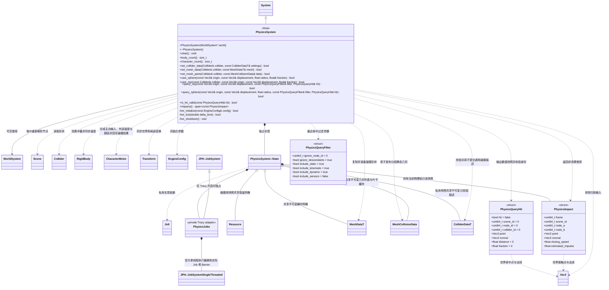

# 物理系统

[类图索引](../../class-diagrams/index.md) · [物理组件](physics-components.md) · [物理模块](../physics.md)

`engine::PhysicsSystem` 借用世界并拥有 Jolt 碰撞世界；场景行为类和公开头不依赖 Jolt。

世界有效期须覆盖系统。无世界时仍可初始化和关闭空碰撞世界。`clear()` 和 `body_count()` 为 `noexcept`；状态返回值不可忽略。场景切换、对象禁用及删除在下一次更新同步，停止玩法由宿主显式清理。固定步进与变换限制见[物理模块](../physics.md)。

物理阶段诊断仅在 `ENGINE_ENABLE_TRACY` 开启时使用实现私有的 `physics_detail::PhysicsJobs`，继承官方 `JPH::JobSystem` 契约并独占 `JPH::JobSystemSingleThreaded`。`Init`、并发数查询及 Barrier 创建/等待/销毁全部转发；`CreateJob` 只包装原任务函数，保留依赖数与官方单线程执行顺序。实际 Job 的 owner 始终是内层官方执行器，外层 `QueueJob` / `QueueJobs` / `FreeJob` 不可到达，误入按内部不变量失败终止；不另建任务队列、线程池或调度策略。关闭 Tracy 时私有类型直接别名到官方单线程类型，没有包装或名称分配。

任务执行时使用 `Physics.jolt.<上游任务名>` 的 Tracy transient source location；包装函数拥有名称字符串，Tracy 复制动态 source location，避免把动态名称写入静态 source location 或借用失效指针。单线程任务解除依赖可立即递归执行后继任务，因此 zone 会嵌套，阶段独占成本使用 self 耗时，不能将 inclusive 相加。`Physics.jolt_step` 继续覆盖整个 `Update`，保留任务创建、临时分配和未拆分部分；Jolt 内部更细函数与无活动刚体的短路路径不能由此细分。此适配不启用 `JPH_EXTERNAL_PROFILE` / `JPH_PROFILE_ENABLED`，不改变 Jolt ABI，也不要求重编依赖。

刚体只改变线速度/角速度时，下一次同步复用已有形状及 BodyID，通过 Jolt `BodyInterface::SetLinearAndAngularVelocity` 原地提交，仅在速度实际变化时调用；非零速度由官方接口唤醒物体。质量、运动类型、阻尼、重力因子或碰撞形状等结构设置变化仍走原有候选重建流程。速度仍属于同一 FlatBuffers 设置与快照，冲量在同步后按原契约消费；不增加项目专用物理接口，也不因碎块增量复用而丢失速度变更。

物理准备阶段的 `BodySnapshot` 私有共享不可变 `ColliderDataT`：每帧按值比较组件描述（含各凸包顶点），仅在描述变化时深复制；只有描述及网格资源/瞬态网格引用都未变化时才复用已校验结果。组件地址不是有效性依据，同节点移除重建、嵌套数据修改、网格换代仍会被检查；形状复用还需原有世界缩放检查。显式 `set_collider_data` / `set_mesh_data` 保留校验及完整候选准备，失败不改旧组件和旧物理体。

`State` 复用每帧刚体/角色快照数组容量，同步结束即清空其中资源引用；清理、场景切换及失败路径也释放候选引用。活动记录用当前物理 frame 标记保留项，在全部输入校验后先移除缺失项、再发布本帧快照，替代每帧临时集合；删除、禁用、重新启用和满容量替换顺序不变。这些只减少单线程准备阶段的复制/分配，不增加公开 API、组件 dirty 机制、异步任务或新调度层。

角色的待消费速度增量只在固定步取出，无步帧保留，多子步帧不会重复叠加。外部水平速度与主动移动分离，按组件阻尼衰减，垂直速度继续使用 Jolt 已求解的速度；碰撞由 CharacterVirtual 的 ExtendedUpdate 处理。恢复组件或重建 Jolt 对象不能继承旧瞬态速度。

静态网格由独立 Mesh 资源的顶点与三角形索引构建 Jolt MeshShape；正的非均匀世界缩放与 Collider center 在构建时应用，沿用现有刚体位置和旋转同步。无有效三角形、索引越界或非静态刚体返回失败。网格参与同一物理世界，角色胶囊、台阶检测及相机球扫共用这些碰撞体，不另建碰撞查询系统。

`set_mesh_data` 是通用的同步静态网格入口，不识别地形、模型生成器或项目。调用者在主线程帧边界、无物理步进和查询并发时提交当前世界的 Collider。内部先准备完整候选形状，再提交组件与 Jolt 世界；几何、缩放、场景归属或运动类型校验失败时，旧组件和旧碰撞仍有效。已存在的兼容静态碰撞使用 Jolt `BodyInterface::SetShape` 替换，其他重建先创建候选碰撞体再删除旧体；变更区域唤醒动态物体，挖掉支撑后不会继续悬停。禁用组件可保留几何，物理体仍遵守启用状态；删除、切场景和关闭按原同步契约清理。该入口当前把准备与提交放在同一次同步调用内，后续异步只拆计算阶段，不把线程策略加入组件。

顶点与索引同时为空的 `MeshDataT` 表示显式清空碰撞；系统立即移除原碰撞体并唤醒接触区域动态物体，组件仍保持原启用状态，下一次同步不会生成默认 Box。后续提交非空网格可恢复碰撞。只有顶点或索引之一为空仍是输入错误。

`set_collider_data` 在相同主线程安全点同步准备通用 ColliderData，再提交碰撞体和组件；无效凸包、缩放或创建失败保留旧设置和旧碰撞。复合碰撞使用 Jolt ConvexHullShapeSettings 与 StaticCompoundShapeSettings，每组形成一个刚体；子凸包仅包含节点局部顶点，不识别碎块、建筑或第三方破坏类型。初版 compound 要求正等比世界缩放。单个凸包直接使用，多个以零平移/单位旋转组合，由 Jolt 计算质心和惯量；StaticCompound 指子形状不可变，支持动态、运动学和静态刚体。

复合形状的私有构建可将严格盒形凸包规范化为官方 `BoxShape`：先原样创建并校验 `ConvexHullShape`，仅当缩放后的 8 个输入点恰为各轴 min/max 的全部不同组合，且中心加减半边长能精确还原边界时替换，不使用 epsilon 或包围盒近似。圆角半径、密度和材质取已构建凸包的实际值，局部偏移使用官方 `RotatedTranslatedShape` 保留；任一检测或候选创建不满足时继续使用有效原凸包。体积、质量和惯性保持相同数学几何，浮点求和及棱角接触选择不承诺逐位一致。成功替换计入 `Physics.box_hull`，不改变资源 schema、公开 API 或求解迭代数。

`set_collider_data` 对禁用 Collider、禁用 RigidBody 或禁用变换层级只检查数据与变换，立即移除已有碰撞并提交描述，不做凸包 cook。恢复启用后在提交/下一次物理同步时构建形状。调用方可先禁用再用当前 settings 调用此 API，在不推进模拟的情况下立即回收碰撞；销毁 Node 的普通路径仍在下一次同步清理。

`cast_ray` 只查询调用方指定、属于当前世界的 Collider，射线由世界起点和完整位移表示，复用 Jolt NarrowPhaseQuery。命中返回 `true` 和 `[0,1]` 比例，无命中或已禁用/尚未生成物理体返回 `true/1`；归属或参数错误返回 `false/0`。忽略 sensor，其他 Collider 不会遮挡目标，三角形双面可命中；不加载资源或推进模拟。

`query_ray` / `query_sphere` 查询当前场景已提交碰撞世界中的最近 Collider，保持上述两个旧查询契约。输入为世界起点和非零完整位移；所有数值须有限，起点各轴绝对值不超过 1e7，位移各轴不超过 1e5，球半径为 0.0001..1000。未初始化、无当前场景、物理世界尚未同步到当前场景、忽略节点不属于当前场景或参数无效时返回 false 并清空 hit。有效但没有命中返回 true 和空 hit；命中返回 true 且 hit.hit 为 true。查询只读，不推进模拟、不隐式同步，须在主线程物理步进及场景修改之外调用。

`PhysicsQueryFilter` 默认包含静态、运动学和动态实体并忽略 sensor；类别按已提交物理体判断，sensor 还须通过对应运动类别。ignore_node_id 为零表示不忽略节点，非零时可连同其子树一起忽略。过滤在 Jolt BodyFilter 内执行，同时按 body 的节点映射、当前 Collider 实例及启用状态排除删除、重建或禁用对象，失效前景不会遮挡后方有效对象。类别不是业务碰撞 layer，不改变碰撞层矩阵或资源格式。CharacterVirtual 不属于 Collider，不进入结果。

`PhysicsQueryHit` 是值快照，不保存借用指针或 Jolt 类型。scene_id、node_id 和 collider_id 共同标识命中对象；Collider 的实例身份不进入持久数据。fraction 为 [0,1]，distance 为位移长度乘 fraction；球扫 distance 是球心行程，point 是被命中 Collider 上的世界接触点，normal 朝向扫掠球。射线 point 为起点加 fraction 倍位移，普通命中 normal 为表面外法线，网格双面可命中。射线从凸体内部出发返回 fraction/distance 为零、point 为起点、normal 为反向单位位移，此时 normal 表示退回方向。球扫初始重叠同样返回零距离，多个重叠由 Jolt 选择最深接触；退化接触法线使用反向单位位移。

`is_hit_valid` 只检查当前场景、节点、Collider 实例身份及碰撞组件、刚体和变换层级的启用状态；删除、同节点重建 Collider 或切换场景后旧快照失效。位置或形状变化不重算历史命中，不使仍存活的对象身份失效；调用者需要当前命中时须重新查询。

`PhysicsImpact` 是通用瞬时数据，不保存 Node 指针、Jolt 类型或具体破坏组件。每次 `on_tick` 清除前帧快照（没有固定子步也清除），`frame` 在当前系统生命周期内单调递增；多个固定子步与复合形状接触按节点对保留估算冲量最大的撞击，同值时保留接近速度更大的一条。`point` 为代表接触点，`normal` 从 `node_a` 指向 `node_b`，`closing_speed` 为包含角速度的碰前法向接近速度（m/s），`estimated_impulse` 为 Jolt 官方 `EstimateCollisionResponse` 给出的该接触面的估算法向冲量（N·s），不是求解器实际冲量，多体堆叠时尤其不能视为精确值。

Jolt ContactListener 回调只读取传入 body 并收集数值，不访问 Scene、不调用带锁的 BodyInterface、不修改物理或场景。仅收集非 sensor 且法向接近速度为正的接触，在全部子步完成、姿态和速度写回后发布。`impacts()` 返回非消费快照，调用方只能在主线程物理步进外读取；下一次物理 tick、clear、场景切换或查询时清理已删除/禁用节点会使此前借用失效。清理和场景切换不重置 `frame`。调用方负责伤害阈值、冷却与具体业务，核心不将静置接触自动转换为伤害。CharacterVirtual 的专用接触不在本次刚体事件范围。

根动态刚体的私有快照还记录最后一次成功写回的 `TransformSettings` 和 Jolt 原始姿态。下一帧仅当节点仍为根动态刚体、组件 TRS 与该写回值精确相同时复用原始姿态；调用方改位置、旋转或缩放均重新走正常世界变换检查。此缓存不放宽精度容差，避免自身 Euler 往返造成四元数翻号、重复更新 BroadPhase 与重置睡眠。父级变换、静态和运动学刚体继续使用原同步路径。

临时物理内存复用 Jolt 官方 `TempAllocatorImplWithMallocFallback` 预留的 10 MiB 栈式分配缓冲区，超出后使用其官方 malloc 分配；不改变物体上限或求解设置。静态形状替换复用 `SetShape` 已完成的空间树通知，位姿没有变化时不重复提交位置/旋转；动态速度读取用 `GetLinearAndAngularVelocity` 合并锁操作。
