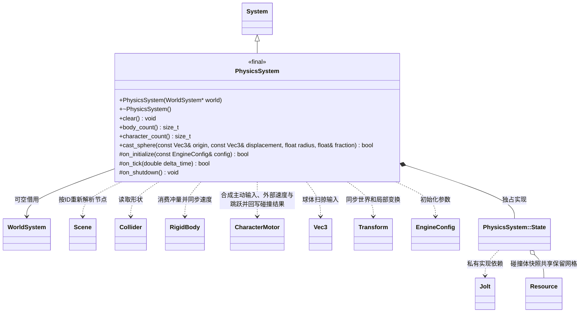

# 物理系统

[类图索引](../../class-diagrams/index.md) · [物理组件](physics-components.md) · [物理模块](../physics.md)

`engine::PhysicsSystem` 借用世界并拥有 Jolt 碰撞世界；场景行为类和公开头不依赖 Jolt。

世界有效期须覆盖系统。无世界时仍可初始化和关闭空碰撞世界。`clear()` 和 `body_count()` 为 `noexcept`；状态返回值不可忽略。场景切换、对象禁用及删除在下一次更新同步，停止玩法由宿主显式清理。固定步进与变换限制见[物理模块](../physics.md)。

角色的待消费速度增量只在固定步取出，无步帧保留，多子步帧不会重复叠加。外部水平速度与主动移动分离，按组件阻尼衰减，垂直速度继续使用 Jolt 已求解的速度；碰撞由 CharacterVirtual 的 ExtendedUpdate 处理。恢复组件或重建 Jolt 对象不能继承旧瞬态速度。

静态网格由独立 Mesh 资源的顶点与三角形索引构建 Jolt MeshShape；正的非均匀世界缩放与 Collider center 在构建时应用，沿用现有刚体位置和旋转同步。无有效三角形、索引越界或非静态刚体返回失败。网格参与同一物理世界，角色胶囊、台阶检测及相机球扫共用这些碰撞体，不另建碰撞查询系统。
