# 物理系统

[类图索引](../../class-diagrams/index.md) · [物理组件](physics-components.md) · [物理模块](../physics.md)

`engine::PhysicsSystem` 借用世界和可选任务域，拥有 Jolt 碰撞世界；场景行为类和公开头不依赖 Jolt。

```mermaid
classDiagram
    class PhysicsSystem {
        <<final>>
        +PhysicsSystem(WorldSystem#42; world, TaskSystem#42; tasks)
        +~PhysicsSystem()
        +clear() void
        +body_count() size_t
        +character_count() size_t
        +set_collider_data(Collider collider, const ColliderDataT& settings) bool
        +set_mesh_data(Collider collider, const MeshDataT& mesh) bool
        +set_mesh_parts(Collider collider, const MeshCollisionData& data) bool
        +cast_sphere(const Vec3& origin, const Vec3& displacement, float radius, float& fraction) bool
        +cast_ray(Collider collider, const Vec3& origin, const Vec3& displacement, float& fraction) bool
        +query_ray(const Vec3& origin, const Vec3& displacement, const PhysicsQueryFilter& filter, PhysicsQueryHit& hit) bool
        +query_sphere(const Vec3& origin, const Vec3& displacement, float radius, const PhysicsQueryFilter& filter, PhysicsQueryHit& hit) bool
        +overlap_sphere(const Vec3& center, float radius, const PhysicsQueryFilter& filter, vector~PhysicsObject~& objects) bool
        +overlap_box(const Vec3& center, const Vec3& half_extents, const PhysicsQueryFilter& filter, vector~PhysicsObject~& objects) bool
        +is_object_valid(const PhysicsObject& object) bool
        +is_hit_valid(const PhysicsQueryHit& hit) bool
        +contacts() span~const PhysicsContactEvent~
        +impacts() span~const PhysicsImpact~
        #on_initialize(const EngineConfig& config) bool
        #on_tick(double delta_time) bool
        #on_shutdown() void
    }
    class System
    class WorldSystem
    class TaskSystem
    class Scene
    class Collider
    class RigidBody
    class CharacterMotor
    class Vec3
    class Transform
    class EngineConfig
    class PhysicsState["PhysicsSystem::State"]
    class Jolt["Jolt"]
    class PhysicsJobs {
        <<private task adapter>>
        +wait_for_wrappers() void
    }
    class JoltJobSystem["JPH::JobSystemWithBarrier"]
    class JoltJobs["JPH::FixedSizeFreeList~Job~"]
    class Resource
    class MeshDataT
    class MeshCollisionData
    class ColliderDataT
    class PhysicsQueryFilter {
        <<struct>>
        +uint64_t ignore_node_id = 0
        +bool ignore_descendants = true
        +bool include_static = true
        +bool include_kinematic = true
        +bool include_dynamic = true
        +bool include_sensors = false
        +bool include_characters = true
    }
    class PhysicsObjectKind {
        <<enumeration>>
        collider
        character
    }
    class PhysicsObject {
        <<struct>>
        +uint64_t scene_id = 0
        +uint64_t node_id = 0
        +PhysicsObjectKind kind
        +uint64_t instance_id = 0
    }
    class PhysicsContactPhase {
        <<enumeration>>
        begin
        stay
        end
    }
    class PhysicsContactEvent {
        <<struct>>
        +uint64_t frame
        +uint64_t step
        +PhysicsContactPhase phase
        +PhysicsObject a
        +PhysicsObject b
        +Vec3 point
        +Vec3 normal
        +bool is_trigger
    }
    class PhysicsQueryHit {
        <<struct>>
        +bool hit = false
        +PhysicsObject object
        +Vec3 point
        +Vec3 normal
        +float distance = 0
        +float fraction = 0
    }
    class PhysicsImpact {
        <<struct>>
        +uint64_t frame
        +PhysicsObject a
        +PhysicsObject b
        +Vec3 point
        +Vec3 normal
        +float closing_speed
        +float estimated_impulse
    }
    System <|-- PhysicsSystem
    PhysicsSystem --> WorldSystem : 可空借用
    PhysicsSystem --> TaskSystem : 可空借用且先初始化后关闭
    PhysicsSystem *-- PhysicsState : 独占实现
    PhysicsState ..> Jolt : 私有实现依赖
    PhysicsState *-- PhysicsJobs : 拥有任务及完成跟踪
    JoltJobSystem <|-- PhysicsJobs
    PhysicsJobs *-- JoltJobs : 官方任务对象存储
    PhysicsJobs --> TaskSystem : 线程安全非等待投递
    PhysicsState o-- Resource : 碰撞体快照共享保留网格
    PhysicsState o-- MeshDataT : 共享不可变瞬时网格
    PhysicsState o-- ColliderDataT : 私有快照共享不可变已校验描述
    PhysicsSystem ..> MeshDataT : 复制并准备碰撞形状
    PhysicsSystem ..> MeshCollisionData : 原子发布分段静态几何
    PhysicsState o-- MeshCollisionData : 共享不可变几何列表与叶子缓存
    PhysicsSystem ..> ColliderDataT : 校验并原子提交通用碰撞描述
    PhysicsSystem ..> PhysicsQueryFilter : 最近命中过滤参数
    PhysicsSystem ..> PhysicsQueryHit : 输出数值快照并校验身份
    PhysicsQueryHit *-- PhysicsObject : 命中身份值
    PhysicsObject ..> PhysicsObjectKind : 区分组件身份空间
    PhysicsSystem ..> PhysicsObject : 重叠列表与有效性查询
    PhysicsSystem ..> PhysicsContactEvent : 返回只读事件快照
    PhysicsState *-- PhysicsContactEvent : 拥有当前帧事件
    PhysicsContactEvent *-- PhysicsObject : 双方身份值
    PhysicsContactEvent ..> PhysicsContactPhase : 子步生命周期
    PhysicsContactEvent ..> Vec3 : 最后接触点和A到B法线
    PhysicsQueryHit ..> Vec3 : 世界命中点与法线
    PhysicsState *-- PhysicsImpact : 持有当前物理帧只读快照
    PhysicsSystem ..> PhysicsImpact : 返回非消费借用
    PhysicsImpact *-- PhysicsObject : 双方原场景和组件实例身份
    PhysicsImpact ..> Vec3 : 世界接触点与法线
    PhysicsSystem ..> Scene : 按ID重新解析节点
    PhysicsSystem ..> Collider : 读取形状
    PhysicsSystem ..> RigidBody : 消费冲量并同步速度
    PhysicsSystem ..> CharacterMotor : 合成主动输入、外部速度与跳跃并回写碰撞结果
    PhysicsSystem ..> Vec3 : 球体扫掠输入
    PhysicsSystem ..> Transform : 同步世界和局部变换
    PhysicsSystem ..> EngineConfig : 初始化参数
```

世界有效期须覆盖系统。无世界时仍可初始化和关闭空碰撞世界。`clear()` 和 `body_count()` 为 `noexcept`；状态返回值不可忽略。对象禁用、删除及普通场景卸载在下一次更新同步；常驻节点保留原 Scene、组件和 Jolt 实例，完整关闭由宿主显式清理。系统遍历 `WorldSystem::scenes()` 的已发布节点，恢复候选不参与模拟。固定步进与变换限制见[物理模块](../physics.md)。

物理任务复用 Jolt v5.6.0 官方 `JobSystemWithBarrier` 与 `FixedSizeFreeList`，只桥接任务对象创建、释放和 `TaskSystem::enqueue`。任务域与引擎其他域共享 oneTBB worker；不创建物理专用线程池。任务域先初始化并存活到物理关闭后；不传任务域时由 Barrier 在调用线程串行执行，传入未初始化域则初始化失败。域的并发额度控制后台执行数，Jolt 的并发数另计参与 Barrier 的调用线程。包装在途数由原子预留限制为域并发额度与额外存储容量的较小值；满额直接留给已登记的官方 Barrier，投递被拒绝则释放桥接引用及预留。不在当前 Jolt Job 内递归运行后继，保留上游每任务 BodyAccess 作用域约束。

`WaitForJobs` 只等待官方 Barrier 完成真实求解。迟到包装仍保留 Job 引用，调用上游 `Execute()` 不会重复运行已完成函数；先释放引用，再减少完成计数。官方 free-list 为跨步保留引用增加一页，页大小仍为原 `max_jobs`，不改变其二次幂要求。`State::clear` 与析构体在物理世界释放前调用 `wait_for_wrappers()`，适配器析构再次兜底；不主动等待任务域内其他工作。完成计数由包装共享持有，避免归零后的最后通知访问已销毁状态。

每个物理 tick 仍在返回前完成刚体求解、结果回写与接触快照发布，查询与场景修改仍只能在主线程步进外进行。角色使用的 `CharacterVsCharacterCollisionSimple` 和临时分配器保持串行，未将角色循环直接分发到多个 worker。回归在单 worker 被占用时连续执行多次更新，并覆盖清理等待、完全拒绝投递和同域重启，确保包装积压不耗尽任务存储、不丢失真实求解。

开启 `ENGINE_ENABLE_TRACY` 且分析器已连接时，任务执行使用 `Physics.jolt.<上游任务名>` 的 transient source location；名称由包装拥有并由 Tracy 复制。`Physics.barrier` 记录真实求解等待，`Physics.drain_wrappers` 单独记录清理/关闭的包装回收。分析时区分 worker 总工作量和调用线程 `Physics.jolt_step` 的墙钟耗时，不能将并行任务 inclusive 耗时相加当作帧时长。关闭 Tracy 不分配分析名称。此适配不启用 `JPH_EXTERNAL_PROFILE` / `JPH_PROFILE_ENABLED`，不改变 Jolt ABI，也不要求重编依赖。

刚体只改变线速度/角速度时，下一次同步复用已有形状及 BodyID，通过 Jolt `BodyInterface::SetLinearAndAngularVelocity` 原地提交，仅在速度实际变化时调用；非零速度由官方接口唤醒物体。质量、运动类型、阻尼、重力因子或碰撞形状等结构设置变化仍走原有候选重建流程。速度仍属于同一 FlatBuffers 设置与快照，冲量在同步后按原契约消费；不增加项目专用物理接口，也不因碎块增量复用而丢失速度变更。

物理准备阶段的 `BodySnapshot` 私有共享不可变 `ColliderDataT`：每帧按值比较组件描述（含各凸包顶点），仅在描述变化时深复制；只有描述及网格资源/瞬态网格引用都未变化时才复用已校验结果。组件地址不是有效性依据，同节点移除重建、嵌套数据修改、网格换代仍会被检查；形状复用还需原有世界缩放检查。显式 `set_collider_data` / `set_mesh_data` 保留校验及完整候选准备，失败不改旧组件和旧物理体。

`State` 复用每帧刚体/角色快照数组容量，同步结束即清空其中资源引用；清理、场景切换及失败路径也释放候选引用。活动记录用当前物理 frame 标记保留项，在全部输入校验后先移除缺失项、再发布本帧快照，替代每帧临时集合；删除、禁用、重新启用和满容量替换顺序不变。这些只减少单线程准备阶段的复制/分配，不增加公开 API、组件 dirty 机制、异步任务或新调度层。

角色的待消费速度增量只在固定步取出，无步帧保留，多子步帧不会重复叠加。外部水平速度与主动移动分离，按组件阻尼衰减，垂直速度继续使用 Jolt 已求解的速度；碰撞由 CharacterVirtual 的 ExtendedUpdate 处理。恢复组件或重建 Jolt 对象不能继承旧瞬态速度。

静态网格由独立 Mesh 资源的顶点与三角形索引构建 Jolt MeshShape；正的非均匀世界缩放与 Collider center 在构建时应用，沿用现有刚体位置和旋转同步。无有效三角形、索引越界或非静态刚体返回失败。网格参与同一物理世界，角色胶囊、台阶检测及相机球扫共用这些碰撞体，不另建碰撞查询系统。

`set_mesh_data` 是通用的同步静态网格入口，不识别地形、模型生成器或项目。调用者在主线程帧边界、无物理步进和查询并发时提交当前世界的 Collider。内部先准备完整候选形状，再提交组件与 Jolt 世界；几何、缩放、场景归属或运动类型校验失败时，旧组件和旧碰撞仍有效。已存在的兼容静态碰撞使用 Jolt `BodyInterface::SetShape` 替换，其他重建先创建候选碰撞体再删除旧体；变更区域唤醒动态物体，挖掉支撑后不会继续悬停。禁用组件可保留几何，物理体仍遵守启用状态；删除、切场景和关闭按原同步契约清理。该入口当前把准备与提交放在同一次同步调用内，后续异步只拆计算阶段，不把线程策略加入组件。

顶点与索引同时为空的 `MeshDataT` 表示显式清空碰撞；系统立即移除原碰撞体并唤醒接触区域动态物体，组件仍保持原启用状态，下一次同步不会生成默认 Box。后续提交非空网格可恢复碰撞。只有顶点或索引之一为空仍是输入错误。

`set_collider_data` 在相同主线程安全点同步准备通用 ColliderData，再提交碰撞体和组件；无效凸包、缩放或创建失败保留旧设置和旧碰撞。复合碰撞使用 Jolt ConvexHullShapeSettings 与 StaticCompoundShapeSettings，每组形成一个刚体；子凸包仅包含节点局部顶点，不识别碎块、建筑或第三方破坏类型。初版 compound 要求正等比世界缩放。单个凸包直接使用，多个以零平移/单位旋转组合，由 Jolt 计算质心和惯量；StaticCompound 指子形状不可变，支持动态、运动学和静态刚体。

复合形状的私有构建可将严格盒形凸包规范化为官方 `BoxShape`：先原样创建并校验 `ConvexHullShape`，仅当缩放后的 8 个输入点恰为各轴 min/max 的全部不同组合，且中心加减半边长能精确还原边界时替换，不使用 epsilon 或包围盒近似。圆角半径、密度和材质取已构建凸包的实际值，局部偏移使用官方 `RotatedTranslatedShape` 保留；任一检测或候选创建不满足时继续使用有效原凸包。体积、质量和惯性保持相同数学几何，浮点求和及棱角接触选择不承诺逐位一致。成功替换计入 `Physics.box_hull`，不改变资源 schema、公开 API 或求解迭代数。

`set_collider_data` 对禁用 Collider、禁用 RigidBody 或禁用变换层级只检查数据与变换，立即移除已有碰撞并提交描述，不做凸包 cook。恢复启用后在提交/下一次物理同步时构建形状。调用方可先禁用再用当前 settings 调用此 API，在不推进模拟的情况下立即回收碰撞；销毁 Node 的普通路径仍在下一次同步清理。

`cast_ray` 只查询调用方指定、属于当前世界的 Collider，射线由世界起点和完整位移表示，复用 Jolt NarrowPhaseQuery。命中返回 `true` 和 `[0,1]` 比例，无命中或已禁用/尚未生成物理体返回 `true/1`；归属或参数错误返回 `false/0`。忽略 sensor，其他 Collider 不会遮挡目标，三角形双面可命中；不加载资源或推进模拟。

`query_ray` / `query_sphere` 查询已发布场景集合中已提交碰撞世界的最近 Collider 或 CharacterMotor，保持上述两个旧查询契约。输入为世界起点和非零完整位移；所有数值须有限，起点各轴绝对值不超过 1e7，位移各轴不超过 1e5，球半径为 0.0001..1000。未初始化、已发布场景均未同步过、clear 后未重新同步、忽略节点不属于已发布世界或参数无效时返回 false 并清空 hit。只有常驻节点、没有活动玩法 Scene 时仍可查询。有效但没有命中返回 true 和空 hit；命中返回 true 且 hit.hit 为 true。查询只读，不推进模拟、不隐式同步，须在主线程物理步进及场景修改之外调用。

`PhysicsQueryFilter` 默认包含静态、运动学和动态实体并忽略 sensor；类别按已提交物理体判断，sensor 还须通过对应运动类别。ignore_node_id 为零表示不忽略节点，非零时可连同其子树一起忽略。过滤在 Jolt BodyFilter 内执行，同时按 body 的节点映射、当前 Collider 实例及启用状态排除删除、重建或禁用对象，失效前景不会遮挡后方有效对象。类别不是业务碰撞 layer，不改变碰撞层矩阵或资源格式。CharacterMotor 通过 Jolt 官方 CharacterVirtual inner body 进入同一查询空间；include_characters 独立控制角色，不受 include_kinematic 约束。

`PhysicsQueryHit` 是值快照，不保存借用指针或 Jolt 类型。object 中 scene_id、node_id、kind 和 instance_id 共同标识命中对象；Collider 的实例身份不进入持久数据。fraction 为 [0,1]，distance 为位移长度乘 fraction；球扫 distance 是球心行程，point 是被命中 Collider 上的世界接触点，normal 朝向扫掠球。射线 point 为起点加 fraction 倍位移，普通命中 normal 为表面外法线，网格双面可命中。射线从凸体内部出发返回 fraction/distance 为零、point 为起点、normal 为反向单位位移，此时 normal 表示退回方向。球扫初始重叠同样返回零距离，多个重叠由 Jolt 选择最深接触；退化接触法线使用反向单位位移。

`is_object_valid` / `is_hit_valid` 按对象的原 Scene、节点、对应 Collider 或 CharacterMotor 实例身份及启用状态检查；删除、同节点重建组件或普通节点卸载后旧快照失效。常驻节点不因活动 Scene 更换而失效。位置或形状变化不重算历史命中，不使仍存活的对象身份失效；调用者需要当前命中时须重新查询。

`PhysicsImpact` 是通用瞬时数据，不保存 Node 指针、Jolt 类型或具体破坏组件。每次 `on_tick` 清除前帧快照（没有固定子步也清除），`frame` 在当前系统生命周期内单调递增；多个固定子步与复合形状接触按完整物理对象身份对保留估算冲量最大的撞击，同值时保留接近速度更大的一条。`point` 为代表接触点，`a`/`b` 各保存实际原属 Scene、节点、类型和组件实例 ID，`normal` 从 `a` 指向 `b`，`closing_speed` 为包含角速度的碰前法向接近速度（m/s），`estimated_impulse` 为 Jolt 官方 `EstimateCollisionResponse` 给出的该接触面的估算法向冲量（N·s），不是求解器实际冲量，多体堆叠时尤其不能视为精确值。

Jolt ContactListener 回调只读取传入 body 并收集数值，不访问 Scene、不调用带锁的 BodyInterface、不修改物理或场景。仅收集非 sensor 且法向接近速度为正的接触，在全部子步完成、姿态和速度写回后发布。`impacts()` 返回非消费快照，调用方只能在主线程物理步进外读取；下一次物理 tick、clear 或查询时清理已删除/禁用/替换组件会使此前借用失效。跨 Scene 碰撞保留双方各自的身份，不用单一活动场景 ID 表达。清理和场景切换不重置 `frame`。调用方负责伤害阈值、冷却与具体业务，核心不将静置接触自动转换为伤害。CharacterVirtual 的专用接触不在本次刚体事件范围。

根动态刚体的私有快照还记录最后一次成功写回的 `TransformSettings` 和 Jolt 原始姿态。下一帧仅当节点仍为根动态刚体、组件 TRS 与该写回值精确相同时复用原始姿态；调用方改位置、旋转或缩放均重新走正常世界变换检查。此缓存不放宽精度容差，避免自身 Euler 往返造成四元数翻号、重复更新 BroadPhase 与重置睡眠。父级变换、静态和运动学刚体继续使用原同步路径。

临时物理内存复用 Jolt 官方 `TempAllocatorImplWithMallocFallback` 预留的 10 MiB 栈式分配缓冲区，超出后使用其官方 malloc 分配；不改变物体上限或求解设置。静态形状替换复用 `SetShape` 已完成的空间树通知，位姿没有变化时不重复提交位置/旋转；动态速度读取用 `GetLinearAndAngularVelocity` 合并锁操作。

## 范围与接触事件契约

球形范围和轴对齐盒形范围使用 Jolt NarrowPhaseQuery.CollideShape，按 PhysicsObject 去重并稳定排序；全部结果返回 vector，没有“最近一个”的替代。失败清空输出，成功空列表表示没有重叠。查询复用最近命中的身份、生命周期和过滤规则，不推进模拟。接触点不属于对象范围名单，需要接触位置时读取射线/球扫或接触事件。

PhysicsContactEvent 仅保存值，a/b 使用与查询相同的身份。每个固定子步发布 begin/stay/end，frame 标识宿主物理 tick，step 标识单调固定子步；同一 tick 内开始和结束均保留，按子步顺序读取。sleeping 的持续接触仍报告 stay；没有固定步时不生成 stay。删除或禁用在同步时生成 end，保留已失效的历史身份，读取方可用 is_object_valid 判断，不因对象已消失而漏掉退出。clear 和关闭清空事件与接触集合；普通场景卸载在下一次同步为保留的接触者发布 end。常驻双方的接触持续；双方原属 Scene 均已销毁时直接退役旧接触，不向新的 Scene 发布旧 end。完整销毁后的失效对象不能复活订阅或命中。end 的点和法线取最后有效接触，不是新求解结果。

sensor 与 CharacterMotor 纳入接触生命周期；is_trigger 表示至少一方是 sensor。GetImpacts 保留原有非 sensor 撞击估算语义，不扩为伤害或持续触发。Jolt 回调只收集物理身份和数值，事件在主线程安全点发布，脚本显式读取上一物理 tick 的快照，不从回调修改场景。

同一物理组件在接触中切换 Trigger 类型时，旧类型 end 先于新类型 begin；对象实例不变，两个事件仍属于各自的接触区间。
