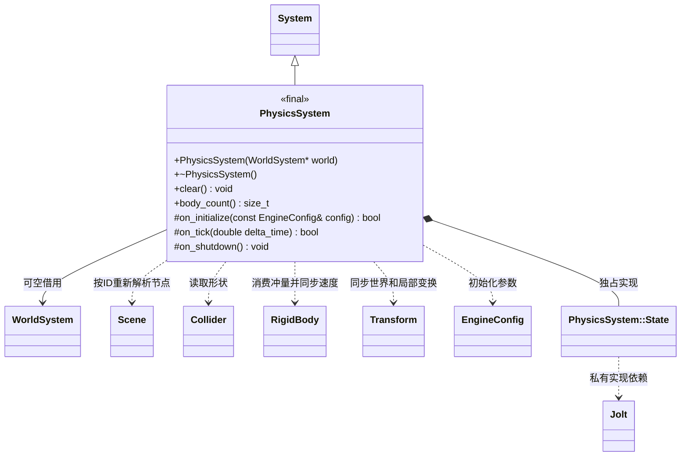

# 物理系统

[类图索引](../../class-diagrams/index.md) · [物理组件](physics-components.md) · [物理模块](../physics.md)

`engine::PhysicsSystem` 借用世界并拥有 Jolt 碰撞世界；场景行为类和公开头不依赖 Jolt。

世界有效期须覆盖系统。无世界时仍可初始化和关闭空碰撞世界。`clear()` 和 `body_count()` 为 `noexcept`；状态返回值不可忽略。场景切换、对象禁用及删除在下一次更新同步，停止玩法由宿主显式清理。固定步进与变换限制见[物理模块](../physics.md)。
