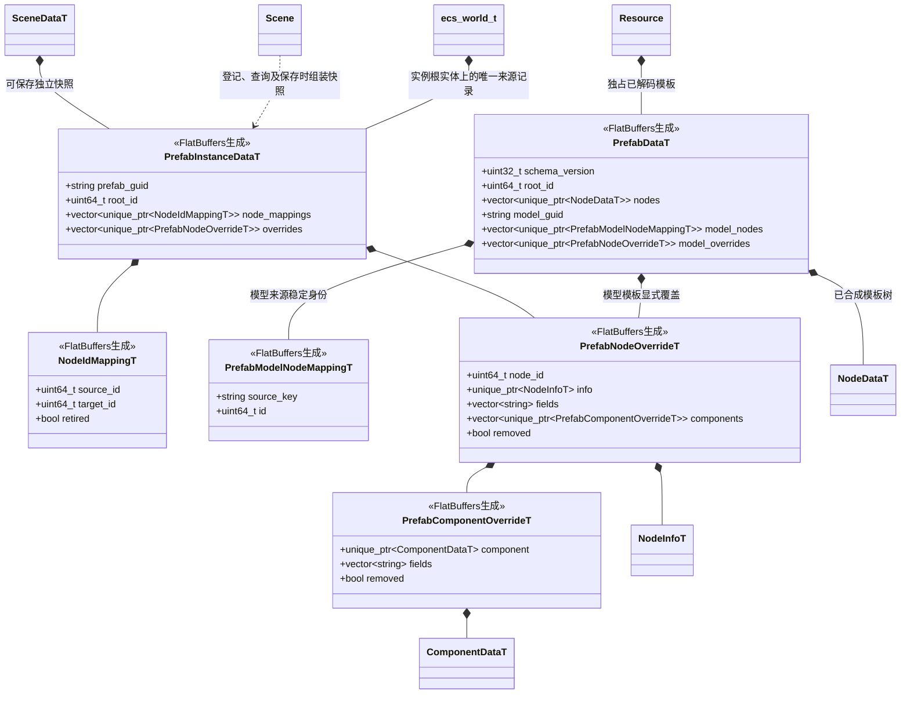

# 预制体资源与实例

[类图索引](../../class-diagrams/index.md) · [场景](scene.md) · [编辑与导入](../../editor/class-diagrams/prefab.md)

状态：按已确认的“模板更新未覆盖属性、实例修改互不影响”契约实施。预制体沿用普通 Node 与 Component，不新增 PrefabSystem，不改变当前 ECS 所有权。

- 模板与实例节点 ID 分属不同空间；映射到场景持久 local ID，绝不使用运行时实体句柄。FBX 的稳定源层级路径映射到模板 ID；节点重排不改变身份，新增节点不复用删除身份。
- 模板只读共享，实例拥有独立节点、组件和运行状态。实例化失败清理本次所有候选节点；原场景及其他实例保持有效。
- 编辑器将模板已删除节点的映射标为 `retired`，保留目标 ID 防止复用。运行时不为校验墓碑额外加载模板依赖；普通运行时删节点不会自动生成编辑覆盖。
- 模板节点引用由具体组件的 `remap_node_references` 契约转换，核心不枚举插件字段。0 是空引用，模板子树外非零引用明确失败。实例覆盖中的引用已经是场景 local ID；模型模板覆盖中的引用是模板 local ID。
- 覆盖由明确字段列表表达，值复用生成的 NodeInfo/ComponentData。字段是组件源编解码的顶层属性名，向量或数组是一个属性；显式设置同值、0 或 false 仍保留覆盖。组件添加/删除与节点删除使用明确结构记录。
- 场景中的新节点可作为普通节点挂在实例下；首版不做嵌套预制体和预制体变体。材质按资源 GUID 覆盖整项绑定，暂不提供跨模板逐 Shader 参数合并。
- 运行时只加载合成后的 FlatBuffers 树，不解析源描述、不进行字段合并、不每帧扫描模板。物理/动画/脚本普通 setter 不登记编辑覆盖。
- 编辑器保存保留来源、稳定映射及显式覆盖；模板增量重建后，依赖它的场景重新合成并通过现有候选场景发布流程生效。删除或缺失引用明确失败，不能静默丢失覆盖。

当前 PrefabData 格式版本为 3，默认版本 0 无效；旧布局必须重新导入，与 SceneData 一起更新，不保留废弃角色字段。
