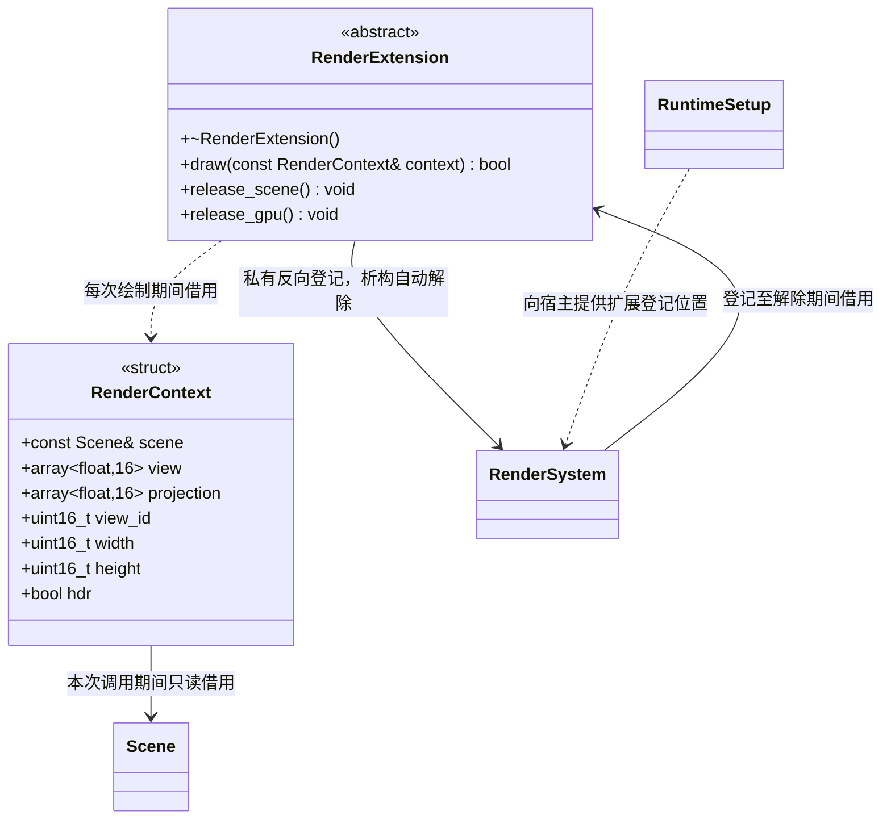

# 渲染扩展

[类图索引](../../class-diagrams/index.md) · [渲染系统](render-system.md) · [运行宿主](runtime-host.md)

核心提供一个场景透明绘制位置和 GPU 生命周期通知；具体特效、第三方运行时和资源缓存属于插件。宿主拥有或向世界移交插件实例，再向渲染器登记借用，不建立第二套渲染图。

- `draw()` 返回失败使当前场景绘制失败；不留下假成功。`RenderContext` 只在调用期间有效，矩阵来自本次实际观察镜头，包括编辑器隐藏预览镜头，不能留存 Scene 或节点借用。`hdr=true` 时扩展输出线性颜色；所有效果绘制先于 HDR/Bloom，再由已有后处理统一处理。
- 渲染器为扩展设置独立 View 134，复用透明绘制后的线性颜色和深度附件，不清屏，按 `Sequential` 保留提交次序。核心不暴露 bgfx 类型，扩展使用本次 RenderContext 的 view_id，不写死编号。主场景为 View 113，HDR 提取、模糊和合成为 View 135、136、137；UI 保留 View 200。当前管线始终使用线性场景目标，扩展收到 hdr=true；显示效果是否启用 HDR 由后续 resolve 决定。
- `RenderSystem::add_extension(RenderExtension&)` 拒绝重复登记和已属于其他渲染器的实例；`remove_extension(RenderExtension&) noexcept` 仅移除本渲染器的登记并通知释放场景及 GPU 资源。两者返回 `bool`、标注 `[[nodiscard]]`，不转移所有权。
- 全部操作在渲染主线程；绘制和释放回调期间不能登记、解除或销毁扩展。扩展不能复制和移动，`release_scene()` 与 `release_gpu()` 为 `noexcept`，必须支持重复调用、部分初始化和没有 GPU 的状态。
- 场景切换、显式停止和设备暂停均通知 `release_scene()`；此时旧节点可能已经销毁，扩展只清理自身状态。设备关闭前通知 `release_gpu()`，确保第三方纹理、缓冲和程序先于 `bgfx::shutdown()` 销毁；恢复后由下一次 `draw()` 按需重建，不把设备重建策略写入玩法。
- 宿主推荐由 WorldSystem 独占具体插件，RenderSystem 仅借用。Renderer 析构先关闭 GPU，再清空全部扩展的反向登记；随后世界插件关闭时不访问已销毁的渲染器。若扩展先销毁，派生析构负责释放资源，基类析构仅自动撤销登记，不调用纯虚方法。基类反向指针只用于登记安全，插件不另存 renderer 借用用于析构。
