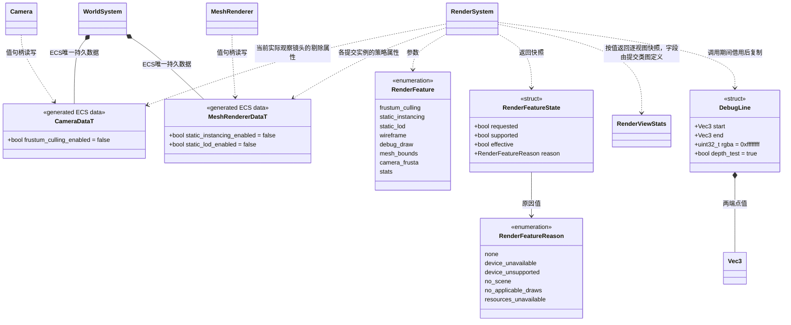
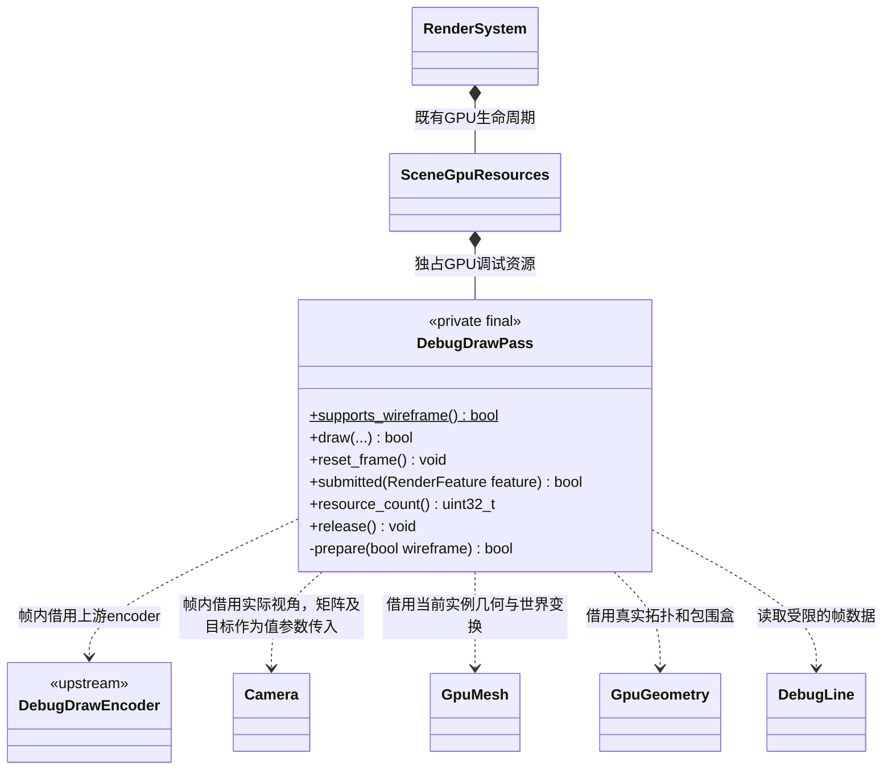

# 渲染能力与调试控制

运行配置由 Camera / MeshRenderer / Environment / Material 各自保存，新增可选能力默认关闭，诊断显示及提交统计仅通过 MCP 访问；项目脚本通过组件组合运行能力。实际构建与运行结果单独记录。系统入口见[渲染系统](render-system.md)，统一编辑入口见[渲染功能 MCP](../../plugins/editor/render-feature-controls.md)。

## 数据归属

统一入口统一发现、编辑和查询，不建立另一份效果状态。

| 内容 | 唯一状态及写入位置 | 生命周期 |
| --- | --- | --- |
| 自动视锥剔除 | `CameraData.frustum_culling_enabled`，默认 false | 场景/预制体持久化，Camera 原 set_settings 提交 |
| 静态实例化与静态 LOD | `MeshRendererData.static_instancing_enabled/static_lod_enabled`，默认 false | 逐对象属性，随场景/预制体保存；不改源资源 |
| 线框、通用调试线、包围盒、相机视锥、统计显示 | `RenderSystem` 的 MCP 临时调试请求 | 默认关闭，不写场景，不暴露 TS 系统接口 |
| 大气天空及太阳参数 | 活动场景的 `EnvironmentComponent` 生成数据 | 随场景保存、导入、撤销与重载 |
| 太阳光方向、颜色、强度和阴影 | 指定 `Light` | 随场景；天空读取调用方明确指定的太阳，不修改其他灯 |
| Hex-Tiling 及其尺度/混合参数 | 指定材质槽的具名参数 | 随材质/实例覆盖；仅声明此能力的 Shader 支持 |
| 离线减面参数和生成 LOD | 源资源邻接 `.meta` 与正式 Mesh 资源 | 导入时生成；不会被运行时开关重写 |
| Frame/View uniform | GPU Program 与 Uniform 的真实频率声明 | 后端固定实现；查询可见，不作为画质开关 |
| 帧提交/剔除/实例化/LOD 计数 | 渲染器最近提交的只读帧快照 | 不持久化；不是项目统计或全引擎 Profiler 的替代 |

`RenderSettings` 继续只读地汇总场景组件，不加入全局覆盖写入口。天空与 Hex 的具体字段由各自能力图定义，本图只规定路由与所有权。

## 功能数据与调用关系

系统方法见[RenderSystem](render-system.md)，组件属性方法见[基础组件](component.md)；本图统一定义功能枚举、状态快照和调试线数据，不重复定义已有类的方法。

- `set_debug_feature()` 主线程调用，只允许 `wireframe/debug_draw/mesh_bounds/camera_frusta/stats` 五个诊断项；传入前三种运行功能一律失败。临时状态不进入场景保存、预制体或 TS 写接口。不存在第二份渲染器全局优化请求。
- Camera 用既有 `settings()/set_settings()` 完整生成数据接口修改 `frustum_culling_enabled`；MeshRenderer 两项专用 bool setter 校验值句柄身份并更新对应 ECS 列。它们均默认 false，支持保存、恢复、预制体属性覆盖；剔除使用该观察镜头字段，实例化与 LOD 逐 MeshRenderer 读取，不要求所有对象使用相同策略。
- `feature_state()` 不修改状态：前三项的 `requested` 是当前活动场景相机及当前世界已发布可渲染对象的只读汇总（相机剔除属性，以及是否有 MeshRenderer 请求该能力），包含常驻场景，与真实提交范围一致；其他项读取临时诊断请求。`supported` 是当前设备和实现是否具有能力；`effective` 由最近实际提交的帧派生。`requested` 改变后，`effective` 保留最近成功提交帧的状态，直到下帧发布；两者暂时不同表示尚待应用。未请求且未生效时 `effective=false, reason=none`。未就绪、无场景、无可用资源或没有适用物体分别报告原因，不能把请求接受报告为画面生效，也不能把整个世界的合批结果归因到某个被选中的 MeshRenderer。`effective` 不要求每一物体都走同一路径：实例化有单画回退、LOD 无资源使用 LOD0，帧计数明确列出实际使用量。
- `stats` 复用现有 `set_stats_visible()/stats_visible()` 的唯一状态。现有方法是宿主临时诊断入口，与 MCP 的 stats 读写同一临时字段；不得同时保存 `stats_visible_` 与新开关副本。
- `mesh_bounds` 和 `camera_frusta` 各自是完整可开关诊断项；其内部可以调用同一调试通道，不要求用户另开 `debug_draw`。`debug_draw` 只控制调用方提交的通用线数据，避免隐式开关依赖。
- `submission_stats()` 只在主线程返回独立值快照；没有可用提交时返回空数组。`RenderViewStats` 的完整字段与计数定义由渲染提交类图统一维护：按 view_id 列出候选、剔除、可见 mesh、实际 draw、实例批次/数量和三角形。它统计本模块逐视图的 scene mesh 提交，包括 depth/surface/opaque 等，不包含 UI 或任意外部扩展，也不冒充 bgfx 全设备计数/GPU 完成回执。反射和烘焙按各自 view_id 隔离；不同 view 的 visible_meshes 不能求和当成唯一对象数。
- `draw_debug_lines()` 只接收有限数值，检查条数和受控预算，主线程复制后不保留调用方内存。`lifetime_frames` 限定为 1..600，随成功提交的主场景帧递减；不开通用调试时拒绝新请求，不积压隐藏队列。重复调用追加，预算不足整批失败。世界/场景代次改变、释放场景、关闭 GPU 时清空。无场景时拒绝，不把一次编辑器调试绘制永久写入 `.scene`。
- 所有状态/资源操作标注 `[[nodiscard]]`。`feature_state()` 为 `const noexcept`；按值复制 vector 的 `submission_stats()` 为 `const`，不额外承诺无分配。接口不暴露 bgfx handle、第三方类型或容器内部视图。`Vec3` 采用现有引擎值类型。

逐视图提交快照只是基准和正确性验证直接需要的数据，不增加采样线程、测试作业系统或第二套 Profiler。CPU/GPU 耗时继续使用现有 Tracy/bgfx 统计链，独立标注来源与采样语义；禁止把不同帧的计时包装为提交快照里的同步样本。现有 `profile_renderer_stats()` 已明确 `cpuTimeFrame` 包含玩法与等待，不能当作渲染 CPU 耗时。

## 28 线框与 29 调试绘制

采用同一固定版本的 bgfx 上游源码及 Shader，不链接完整 example-common/entry/ImGui 框架。`DebugDrawPass` 是现有 `passes/` 内部 GPU 资源拥有者，不是新系统、插件或公共 Manager。

1. **线框**布尔开关在主视图的正式表面上叠加线框，采用 `28-wireframe` 的 vertex pulling 与屏幕空间边展开。直接读取同一几何的真实 32 位索引、80 字节打包顶点，以及当前变形/蒙皮输出；使用 `selected_lods(instance_id, main_view)` 的同帧 LOD 索引，不逐帧 CPU 展开三角形，不修改正式 PBR 顶点。缓冲显式带 `BGFX_BUFFER_COMPUTE_READ`；设备要求 compute 与至少两个 buffer binding，API 167 的现代后端不再提供旧 `VERTEX_ID` 能力位。这个引擎的正式 Mesh 索引统一为 32 位，上游示例的 16 位读取已按契约修改，不宣称额外支持没有实现的 16 位 GPU 路径。
2. **通用调试线、AABB 与视锥**复用 `examples/common/debugdraw` 的 `DebugDrawEncoder`。`ddInit/ddShutdown` 的上游全局上下文只能由当前图形设备生命周期初始化/关闭一次；GPU 暂停和恢复完整重建，所有资源在 `bgfx::shutdown()` 前销毁。
3. **画面范围**只对实际主场景视图绘制诊断：透明/扩展之后、HDR resolve 之前；使用主视图矩阵、viewport 和相同颜色/深度目标。使用独立的 `debug_view=134`，在 `extension_view=133` 之后、HDR/Bloom views 135..138 之前，不穿透覆盖 UI，不把线框传播到阴影、SSR/深度、反射或烘焙视图。
4. **颜色和深度**`DebugLine.rgba` 使用引擎既有 `0xRRGGBBAA` 约定，适配时显式转成上游 ABGR，不能默默交换红蓝。Overlay 在相应 HDR/SDR 空间使用正确颜色语义；depth-test 逐批保留。关闭不改变正式材质或资产内容。
5. **边界来源**AABB 来自当前几何与真实世界矩阵，包含变形/蒙皮的保守边界；剔除前保存只读诊断候选，屏外包围盒可用于验证。相机视锥使用相机自身参数；正在观察的相机视锥可在第二相机查看，镜像相机不得替代场景持久相机。
6. **领域模块**碰撞、导航、骨骼、体素等由所属系统/插件把自己实际数据转换为 `DebugLine` 后提交。渲染核心不 include Jolt、Recast 或建模插件，也不把全部领域枚举堆进 RenderFeature。

正式线框走独立诊断视图；`BGFX_DEBUG_WIREFRAME` 会影响非主场景与全屏通道，不用于这条路径。统计显示使用现有唯一状态，不与诊断通道保存重复开关。

## 基准与验收

- `17-drawstress` 可借鉴固定几何/相机、明确提交数及 `bgfx::getStats()` 计时换算。它的 entry 窗口、私有线程和动态调对象数不接入正式引擎。showcase 现有 `ECS many objects` 是实体生命周期功能用例，保持其职责，新增独立渲染对照用例。
- 同一正式场景/资源、固定分辨率与相机，分别修改观察 Camera 剔除属性、测试对象的 MeshRenderer 实例化/LOD 属性；每次只切一项，记录请求、能力、有效路径、实际帧号和原生提交计数，以功能是否真实启用为验收依据。
- 必测剔除边界、近裁面、负/非均匀缩放、未就绪边界保守保留；关闭剔除不改变手动隐藏、节点/组件激活。
- 线框检查本引擎正式 32 位索引、反向缩放、当前 LOD、静态实例化和脱离碎块；未支持的动态几何不得假报覆盖。
- MCP 开关后读取真实状态，再截图检查；验证 stats 与线框不互相关闭，关闭后零调试提交，场景往返和 GPU 重建不残留调试资源。
- C++ 完成受影响 Debug/Release 构建，测试及实窗只跑 Release。无其他平台实测时不宣称跨平台已通过。

## 上游来源

- 固定版本：bgfx.cmake `1.167.9605-606` 所含 bgfx `b2513038f`，与当前 overlay 一致。
- [17-drawstress](https://github.com/bkaradzic/bgfx/tree/b2513038f/examples/17-drawstress)、[28-wireframe](https://github.com/bkaradzic/bgfx/tree/b2513038f/examples/28-wireframe)、[29-debugdraw](https://github.com/bkaradzic/bgfx/tree/b2513038f/examples/29-debugdraw)、[debugdraw 实现](https://github.com/bkaradzic/bgfx/tree/b2513038f/examples/common/debugdraw)。
- [bgfx 许可](https://github.com/bkaradzic/bgfx/blob/b2513038f/LICENSE)：保留 BSD-2-Clause 版权与许可；引入时单独记录上游路径和最小兼容改动。当前 vcpkg port 关闭 examples，不会自动安装 debugdraw；所需固定源码与上游嵌入式 Shader 位于 `third_party/upstream/bgfx-debugdraw/`，构建副本只移除未使用的 `bgfx_utils.h` 包含，不引用本机 build 路径。版权与本地适配见 `third_party/notices/bgfx-debugdraw.md`。
