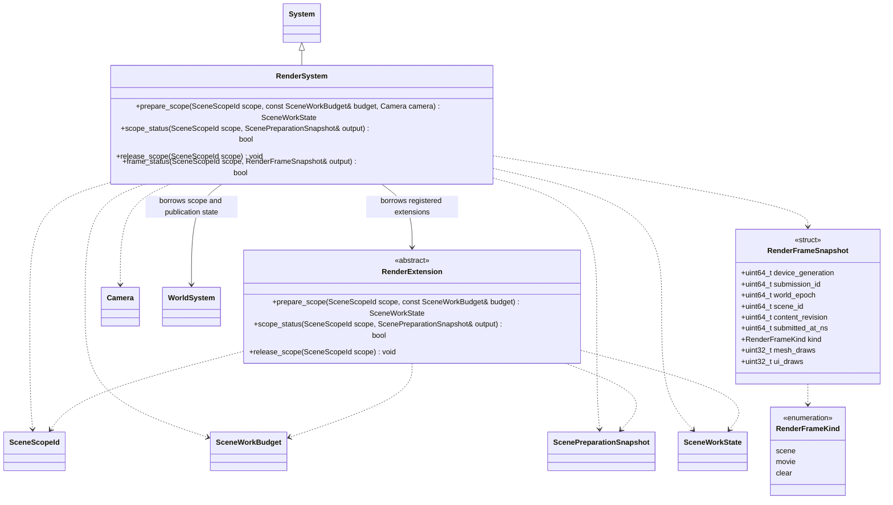
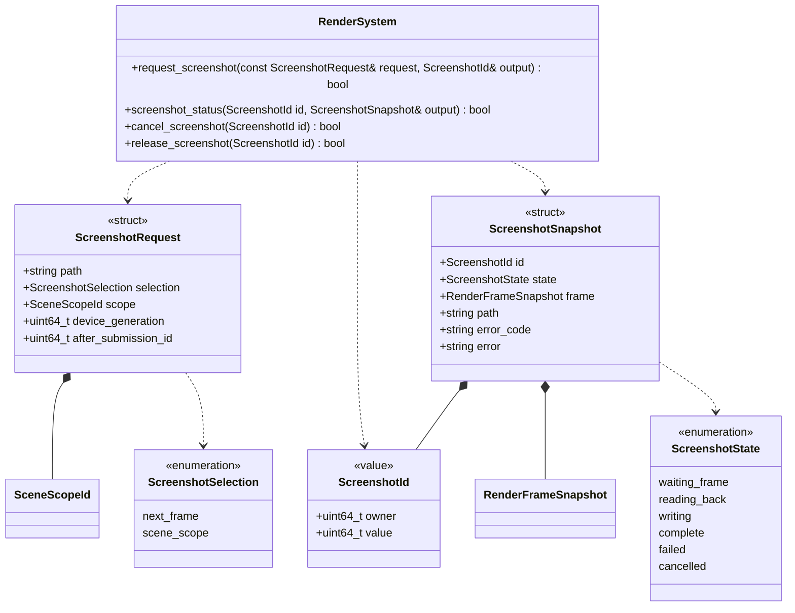

# 按范围准备、首帧与截图

[类图索引](../../class-diagrams/index.md) · [场景加载与状态](scene-loading.md) · [当前渲染系统](render-system.md) · [运行时 MCP 测试](../../plugins/runtime/class-diagrams/mcp-runtime-test.md)

场景切入、失败收尾及截图共用普通运行时的范围准备和实际帧身份；平台验证与限制集中见[测试文档](../../testing.md)。

## 准备范围与已发布内容

- SceneScopeId、SceneWorkBudget、ScenePreparationSnapshot、SceneWorkProgress 和 SceneWorkState 唯一定义在[场景加载](scene-loading.md)。准备接口标注 nodiscard，状态查询为 const；无效或已释放身份查询返回 false 并清空输出。
- prepare_scope 的 camera 默认空，表示目标场景的活动镜头；非空时借用调用方的实际观察镜头，以保留编辑器隐藏预览镜头。镜头身份失效必须报错，不能回退到另一个场景镜头。
- 每个范围独立准备和失败。RenderSystem 保留已发布且可用的绘制数据，同时维护候选范围的私有准备状态；共享 Mesh、Texture、Program 继续按不可变资源身份复用。
- prepare_scope 只为明确范围发起或推进工作，可以访问 WorldSystem 提供的已封存候选；它不把候选发布成玩法对象，不等待后台任务，不绘制半就绪对象。
- scope_status 可报告 discovering、decoding、uploading、programs、targets、extensions 等实际阶段。资源总量与在途数从真实队列取得；失败原因保存在该范围，不只保留一个容易被覆盖的全局 last_error。
- ready 表示范围需要的几何、材质、纹理、目标、扩展及可支持的管线准备完成，上传与后续绘制之间已有正确的提交依赖。它不表示 GPU 全部空闲或屏幕已经显示。
- 追加批次 preparing 时继续绘制已有范围。封存范围内任意一个必需对象失败时整批不发布；独立批次可以分别完成。
- 发布只接入已准备的实例和绑定，不在 render 中同步读取文件、解码贴图、恢复节点或构建整批资源。原有同步 prepare_scene 与全局 preparation_status 调用方迁移为范围请求及显式驱动；不保留全局就绪门槛。
- 普通逐帧变换、动画姿态和相机变化只更新已有实例，不使范围全部退回准备。替换材质/网格等资源时保留旧的有效绘制版本至替换完成；删除的对象立即从后续提交中移除，不能借旧缓存恢复已删除身份。
- RenderExtension 新增与范围对应的 prepare/status/release 方法，draw 继续使用原来的明确绘制位置。核心只调其已登记契约，不扫描插件或创建通用插件管理器。释放 GPU/解除登记时仍遵守原有双向登记和关闭顺序。
- 首次资源准备、设备恢复、窗口尺寸变化分别记录原因与代次。设备恢复确实使旧 GPU 对象无效时，不能假装仍能继续显示；按设备新代次重新准备，业务加载请求的身份不能被另一个场景复用。

各阶段计数单位固定为：discovering 是已发现的待准备实例，decoding 是贴图子资源块，uploading 是字节，programs 是唯一程序，targets 是渲染目标，extensions 是登记的准备参与项。阶段尚未完成发现时 total_known=false；同一快照可同时包含多个 working 阶段。

## 帧证据

RenderFrameSnapshot 是成功提交后的值快照。submission_id 为渲染器拥有的 64 位单调提交序号，在同一渲染器生命周期内不因设备重建重置，不直接暴露可能回绕的底层帧号。device_generation 在设备重建时变化；kind 与 scope 已能区分场景帧，不另设重复的场景帧计数。加载快照的 first_scene_submission_id 引用该同一序号。

- frame_status 在 scope 为空时返回最近一次成功提交的帧，非空时仅返回包含指定范围的最近场景帧；kind 分为 scene、movie、clear。没有符合条件的帧时返回 false 并清空输出，失败尝试不递增成功计数。只有这一个查询入口，不保留全局和范围两个重叠方法。
- 非空 scope 的归属通过世界发布身份与本帧实际收集的数据确认，不能只填入“当前 sceneId”；范围已退休或身份失效时失败，不拿历史帧证明当前对象仍存在。
- scene_id 是本帧主玩法场景，content_revision 是该场景已发布内容的单调版本。追加批次只增加对应内容版本；每个范围登记首次被该版本纳入的帧，不必在每个快照重复全部节点。
- 即使某个批次被视锥或遮挡剔除，也可以确认它已参与本场景帧的正常收集；这证明纳入渲染，不证明它在像素中可见。测试还需设置镜头并做本用例的视觉断言。
- 合法纯 UI 场景可以产生 scene 帧，mesh_draws 为 0；只有 clear 或影片不能满足“目标场景首帧”。绘制次数用于辅助诊断，不作为所有场景统一的通过标准。
- submitted_at_ns 记录提交时间；GPU 回读通过截图请求单独确认。这里不承诺操作系统合成或显示器扫描输出已完成。
- 相机或世界身份在提交前变化时重新校验。世界重建、范围卸载和设备换代后旧的帧观察条件不能用于证明新画面已经生成。

## 截图请求与所有权

- 接口属于普通 RenderSystem 能力，原生图形测试可以直接使用，业务截图功能也可复用；MCP 只转换参数，不另造截图实现。公开头不暴露 bgfx 对象。
- request_screenshot 返回 true 仅表示受理，输出非零 ScreenshotId。查询为 const、纯读取；旧身份返回 false。请求本身持有结果和错误直至 release，不使用一个全局“上一次截图”状态。
- selection=next_frame 获取请求之后可取得的下一帧，用于影片、清屏测试或失败现场；selection=scene_scope 等待该范围对应的场景帧。后者必须给出非空 scope。
- device_generation 与 after_submission_id 共同定义下界；0/0 表示在受理时捕获当前设备及提交序号作为下界。显式旧设备代次立即拒绝，设备在等待期间变化则使请求失败，调用方读取新状态后显式重新请求。
- 实际截图帧的 submission_id 必须严格大于 after_submission_id；查询到旧的 scope 首帧并不授权回收一张之前的图片。截图请求始终绑定满足下界的新提交。
- 请求可以在场景仍 preparing 时提交。等待只登记条件，不占住游戏线程；目标帧满足条件时，把 GPU 截图回调与该帧的不可变元数据绑定。PNG 回读完成后仍报告实际绑定帧，不改写成随后一帧的 sceneId。
- 帧归属必须与实际回读的输出一致。现有窗口用例在直接调用 bgfx 截图前先提交若干帧，并记录了 DX12 可能读取前次呈现缓冲的约束；不能把发起请求时的帧号直接贴在回调上。实现须在现有 bgfx/RendererCallbacks 链路中确认后端实际捕获的缓冲及帧，必要时从同一渲染管线的最终合成输出显式异步回读。该输出包含后处理与 UI，不能另绘一份测试画面或用加几帧等待替代身份校验。
- reading_back 表示已安排回读，writing 表示异步编码/落盘，complete 表示本次文件已成功发布；未 complete 不能仅凭同名文件存在判定成功。失败和取消写入独立 error_code/error。
- 文件发布使用本请求的临时路径和原子替换；目标文件已存在时明确拒绝，测试使用独立请求目录，避免把旧 PNG 当新结果。后台编码复用现有任务域，不能捕获 ECS/VM 借用。
- 底层只支持有限在途截图时，接口显式返回 busy 或在有界队列中等待，不能覆盖前一个请求。由宿主配置容量，不无限积压显存或像素缓冲。
- cancel_screenshot 撤销未提交请求；已提交回读的取消只使结果不再对外发布，后台和 GPU 生命周期仍安全收尾。release_screenshot 仅释放终态记录，重复释放或失效身份明确返回 false。
- 无可用窗口、设备丢失、目标已卸载、路径写入错误均单独报告。没有新帧时无法保证取得新截图，错误归档保留最后状态和已有截图。
- 原生接口接受调用方明确提供的 PNG 路径；MCP 进一步限制为该测试目标 cache 下的相对路径，拒绝越界和符号链接。截图文件始终不进入 Git。

## 场景切入顺序

1. 原场景继续模拟/绘制或由业务显式暂停；候选资源和各领域数据按预算准备。
2. 请求 ready 后，业务调用 Activate。协调安全点按[发布顺序](scene-loading.md#发布顺序与失败收尾)取得资格，验证身份、候选仍封存、全部必要领域就绪；等待资格不阻塞主线程。
3. WorldSystem 发布完整新场景或整批内容；新范围尚不模拟。RenderSystem 使用已经准备好的资源提交目标场景帧。
4. 提交成功且帧属于当前设备代次、世界、目标和范围后记录 scope 首帧，在下一模拟安全点成功激活该范围，将请求置为 active 并释放该目标的发布资格。业务之后开始关卡计时和行为；不补算加载期间经过的时间。
5. 替换场景旧内容开始有界退休；追加批次不影响原有内容。旧资源一直保留到实际最后引用和 GPU 消费结束。

GPU 准备失败发生在发布前时不改变已有画面。发布后按[RenderSubmitStatus](render-system.md#渲染提交结果)区分暂缓与真实故障：deferred 保持 activating，保留新旧场景拥有关系；failed 由宿主锁存故障，会话先保存请求终态再清理实际内容。清屏或影片提交不能完成场景请求。首帧等待期间目标失效直接结束对应请求，不继续排队等待旧身份。设备换代使旧帧证据失效，已安排的截图按原请求契约报告失败，调用方显式取得新代次后重新请求。

## 测试适配

| 用例 | 等待及归档条件 |
| --- | --- |
| 原生窗口/渲染用例 | 用同一 scope 准备与提交，ScreenshotId 完成后保存 PNG 和帧快照；不要求 MCP |
| 编辑器实窗/独立运行用例 | 通过 MCP 查询 SceneLoadId 和 scope，等待目标首帧，再请求 scene_scope 截图 |
| 动态追加 | 等待追加期间持续观察原场景提交序号；新批次首帧后截图，验证整批加入 |
| 影片、纯 UI、清屏用例 | 显式选择适合的 next_frame 或 scene_scope，保留 kind，不套用“必须有网格”判断 |
| 加载/渲染失败 | 保存错误状态及最后进展，尝试 next_frame 采集现场；不能截图时记录明确原因 |
| 不创建图形设备的纯逻辑用例 | 归档状态/日志并标记没有图形输出，不伪造截图成功 |

共享测试辅助只负责等待条件、超时、收集和归档，不替代引擎准备逻辑。超时停止测试等待，不自动重放脚本、取消引擎请求或重新加载场景。像素全黑只能作为视觉诊断；预期黑色、夜景或全屏 UI 由具体用例解释。

测试接入位置与持续维护的契约如下；具体交付结果只在测试文档记录，本表不替代修复后的验收：

| 现有入口 | 适配点 |
| --- | --- |
| [窗口渲染用例](../../../tests/runtime/render/window_render_test.cpp) | screenshot 辅助移除直接 bgfx 截图与固定补帧，改用正式请求和 captureId；保持原有像素断言与归档 |
| [字体与 UI 渲染用例](../../../tests/runtime/ui/font_ui_render_test.cpp) | 将全局 pending/complete 查询改为本次截图身份，验证完整 UI 合成输出 |
| [Python MCP 会话辅助](../../../scripts/editor_mcp_session.py) | 共用状态等待、captureId 和回执查询，替换 capture_when_visible 的非黑重试判据 |
| [独立运行 MCP 用例](../../../projects/showcase/tests/runtime_mcp_test.py) | 用 loadId/scope/目标帧替换全局 renderPreparation.ready，继续验证同一 Run 注入和真实 PNG |
| [公开项目交互用例](../../../projects/showcase/tests/mcp_interaction_test.py) | 复用更新后的会话辅助，保留业务交互步骤和断言 |

正常截图的通过条件同时包含：请求和目标身份正确、像素确实来自满足条件的实际帧、GPU 回读/文件发布成功，以及原用例的画面断言通过。原生与 MCP 两条调用入口均需验证；尤其要覆盖连续两帧不同颜色或内容，检查 Metal/DX12 没有错取前一帧。设计条款本身不代表修复已经通过验收。

每次归档保留 case、目标/Run/请求身份、scope、设备代次、提交与截图身份、状态采样、构建版本、目录资源版本、明确的输入步骤、PNG 和错误。项目测试源码与私有资产的关联资料仅保存在对应项目 cache；公开测试可以记录公开夹具路径。归档不把全部私有资源复制进公共仓库。

验收复用现有窗口渲染、场景、GameplaySession 与 MCP 测试：检查截图不会误认旧文件/旧帧、UI-only 与 clear 区分、scope 失效、连续呈现、单批失败及设备不可绘制。实际结果和未验证边界统一见[测试文档](../../testing.md)。
