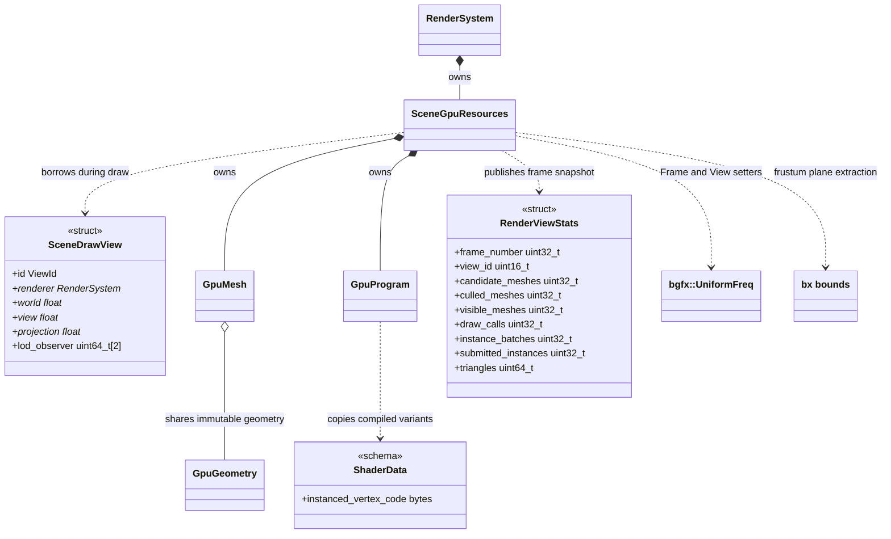
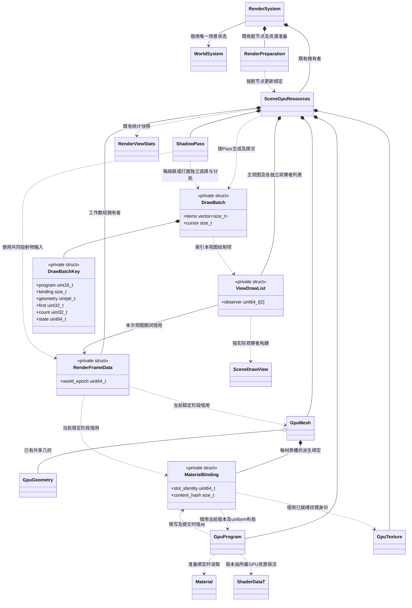
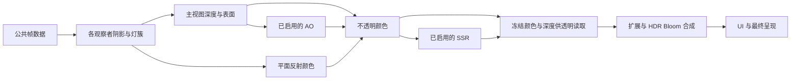

# 视图提交、剔除与静态实例化

[统一接入方案](../upstream-rendering-features.md) · [现行渲染类图](render-system.md) · [统一功能接口](render-feature-controls.md)

状态：最小契约已获用户评审并接入实现。真实构建、像素和提交计数的验收结果集中在[测试文档](../../testing.md)。

**2026-11-08：** [提交管线优化设计](#提交管线优化设计)已按确认契约实现，[对比测试记录](../../testing.md#渲染管线优化对比方案)集中维护实际结果。Shader / PSO 预热不在本批范围。

不增加 VisibilitySystem、BatchManager 或独立渲染框架。复用现有 GPU 拥有者、ECS 查询、正式 Shader/Mesh 资源及上游 bgfx/bx。

SceneGpuResources、GpuMesh、GpuGeometry 与 GpuProgram 的方法只在[渲染主图](render-system.md)维护，本页引用其职责关系。RenderViewStats 为普通值快照，不拥有 GPU、场景或组件；RenderSystem 的按值查询契约统一在功能控制图定义。

## 自动视锥剔除

- Camera::mesh_visible() 保留原有“手动隐藏名单”语义。自动剔除在场景提交阶段按实际 SceneDrawView 执行，不往 Camera 写可见列表。
- 使用固定 bx 的 buildFrustumPlanes，从实际 view/projection 和设备 homogeneousDepth 提取裁剪平面；覆盖透视、正交、偏心和反射斜近裁面。
- 几何边界使用 GpuMesh 已有 minimum/maximum；蒙皮采用现有 skinning_bounds，变形采用已更新的边界。世界边界转换必须保守支持负缩放、非均匀缩放和父子仿射变换。
- 边界不确定或数值退化时保守保留，不把视锥测试失败当作“不可见”。近面穿越、相机位于包围盒内部、裁剪平面相切均不得误删。
- 主视图、反射视图和每个捕获视图分别剔除；不能用主相机可见集剔掉阴影投射物或反射物。
- 深度/表面/颜色通道使用同一观察者矩阵作保守裁剪。此阶段不增加遮挡剔除、Hi-Z 可见性系统或 GPU 间接提交。

## Frame / View uniform

采用 [bgfx API 167 的正式 UniformFreq](https://github.com/bkaradzic/bgfx/blob/b2513038f4b753ebeced40821c193978daa0492f/include/bgfx/bgfx.h)，不建立自己的 UBO 管理框架。

| 频率 | 参数归属 |
| --- | --- |
| Frame | 仅同一 GPU 帧、所有视图真正相同的数据，例如分离后的时间参数 |
| View | 相机、viewport、雾、环境、IBL 参数、该视图的阴影/集群参数、捕获模式 |
| Draw | 模型/法线变换、材质、当前物体平面反射投影、逐物体贴图有效性、Lightmap/Probe 绑定 |

频率在 createUniform 时确定，同名 uniform 必须统一来源与频率；创建共享 handles 必须早于 Shader 反射并核对上游同名复用规则。不能保留另一处默认 Draw 创建同名 View handle。

每个 view 首次提交前使用 setViewUniform；Frame 参数每帧使用已安装 API 167 的 setFrameUniform。共同参数不能在每物体循环重复上传。材质与模型参数继续每 draw 绑定。

主视图的深度、表面和颜色是不同 bgfx view，均须建立各自值；反射及编辑器烘焙不得继承主视图值。仅在一次实际 GPU 帧内复用公共时间，不能在多个 draw_meshes 调用分别取时钟导致颜色/表面不同步。

这是后端参数频率契约升级，不作为可切换的画质效果；MCP 查询报告实际频率路径，不暴露无实现的布尔开关。

## 静态实例化

- 参照 [05-instancing](https://github.com/bkaradzic/bgfx/tree/b2513038f4b753ebeced40821c193978daa0492f/examples/05-instancing) 的 InstanceDataBuffer、能力检测和不足时回退；保留现有逐 draw 路径。
- ShaderData schema 追加可选 instanced_vertex_code；原 vertex_code、fragment_code 和 surface_fragment_code 不变。实例顶点变体与对应原变体输出相同 varying，复用原颜色/表面片元。未声明变体的项目 Shader 自动逐 draw，不按资源名字猜测能力。
- 正式 .shader 描述提供可选实例顶点源，经同一 shaderc、工具指纹、GUID 和缓存管线编译。引擎内置 PBR 提供标准变体；其他 Shader 可沿同一契约扩展。
- 批次须相同几何资源版本、所选 LOD/子网格索引区间、完整材质有效值与纹理、管线状态、兼容的 Lightmap 绑定/变换或实际 Probe SH 系数；相同材质路径不足以证明可合批。
- InstanceDataBuffer 保存每实例真实模型矩阵及法线变换。负行列式的剔面状态必须分批，不能直接把不同镜像方向混在一起；非均匀缩放仍保持标准 PBR 法线正确。
- 实例化覆盖不透明静态网格和内置阴影；蒙皮/变形、透明、捕获保持普通提交路径。主视图深度/表面/颜色必须选同一实例顶点语义，不能只优化颜色而使深度不一致。
- 逐帧瞬态缓冲不足时分块或将剩余对象逐 draw，不丢对象。支持查询同时考虑设备能力、Shader 变体与当前对象兼容性。
- 调试线框路径不兼容实例变体时仅该诊断视图回退，不能修改正式材质或篡改提交统计。将对应 MeshRenderer 的 `static_instancing_enabled` 设为 false 恢复该对象的逐 draw 提交。

## 提交统计和基准

RenderViewStats 每帧清零并按 view_id 发布；frame_number 为该快照对应的实际 bgfx 提交帧号，不表示 GPU 已完成。候选/可见/剔除数是每观察者 MeshRenderer 数，draw_calls 是该 view 各实际子网格提交数，submitted_instances 为提交中累计的实例数，triangles 按真实选层和实例数量累计。多通道合计不等于独立对象数，UI、扩展和上游总 draw 不混入这些字段。

查询与 MCP 给出采样提交帧，并明确不代表 GPU 完成；不将 CPU 墙钟帧间隔当作 GPU 工作时间。既有 bgfx/Tracy 的 CPU/GPU 数值另标来源、单位与有效性。

基准在公开 showcase 增加独立 TS 功能用例，通过现有项目脚本 MCP 调用；不把基准场景、对象数量、自动驾驶或计时业务放入渲染核心。保持相同相机、分辨率和资源，固定对象数量、预热后采样，每次只改变对应 Camera 或 MeshRenderer 的一项运行属性；诊断另由 MCP 临时控制。关闭 VSync 或调整呈现策略必须明确记录，不能自适应减少对象制造改善。

LOD 滞回使用稳定相机与反射组件身份区分观察者；临时 view id 复用会重置相应选择，相机连续移动则保留滞回。对象/组件回收时同时清理选择历史。

必测：视锥边界和变换、逐视图隔离、手动隐藏不变、实例与逐 draw 像素一致、材质覆盖/光照不兼容不合批、缓冲耗尽回退以及切场景/停机释放。

## 提交管线优化设计

**状态：2026-11-08 已按确认设计实现，Windows / DirectX 12 定向验收完成。** 目标是减少实际绘制链路的重复收集、材质解析和提交开销。已先扩展现有测试保存优化前二进制，再按本节阶段实现和比较；结果与未采集项目见[测试记录](../../testing.md#功能验收与结果)。资源加载速度、世界更新、脚本和动画只作为输入条件，不扩大为这些模块的优化。

### 优化前问题与实现范围

| 优化前实现 | 当前实现 | 保持的行为 |
| --- | --- | --- |
| [draw_meshes](../../../src/engine/runtime/render/scene_draw.cpp) 每次调用查询 MeshRenderer、读取变换和材质；[draw_scene](../../../src/engine/runtime/render/render_scene.cpp) 对主视图的深度、表面、颜色、透明分别调用 | 每次 render 收集一次公共数据（见 [scene_collect.cpp](../../../src/engine/runtime/render/scene_collect.cpp)）；同一观察视图只建立一次可见项与 LOD 选择 | 反射、阴影、捕获有独立可见集；透明保持子网格深度顺序 |
| sample_probe 为每个绘制项重建探针查询并重复求烘焙变换逆矩阵 | 帧内收集启用探针及逆矩阵、边界和体积；所有物体复用这些只读数据 | 最小有效体积优先、同体积按稳定节点身份选择、无效探针权重处理不变 |
| append_material_key 每个 Pass 重读具名参数、拼接字符串；GpuProgram 再次解析材质绑定 | 在现有脏节点准备流程解析材质绑定；使用结构化批次键 | 按 Shader 声明的有效值与实际资源版本匹配，不按材质路径猜测等价 |
| 主通道已有静态实例化，[ShadowPass](../../../src/engine/runtime/render/passes/shadow_pass.cpp) 逐投射物提交 | 统一静态实例的分批与不足时逐 draw 处理，扩展到阴影 | 对象显式启用实例化、alpha 裁切、镜像剔面、投影开关及设备能力限制保持 |
| Pass 各自拥有目标，部分 prepare 在绘制中调用 | 在现有准备入口根据实际视图尺寸与已启用效果准备目标；描述不变时复用 | 开关默认值、效果计算、bgfx 视图顺序与 GPU 资源拥有者不变 |

本批扩展 `SceneGpuResources`、`GpuMesh`、`GpuProgram`、`ShadowPass`，新增的组织数据均为渲染私有普通 struct。不增加 System、Manager、渲染后端、资源加载入口或业务设置。公开 `prepare_scene / render / release_scene` 及脚本 API 保持；改变的私有方法签名只在[渲染主图契约](render-system.md#提交管线私有契约)定义。

### 数据分层与所有权

新增 struct 均归 `engine::render_detail`；SceneGpuResources 仍为 RenderSystem 的私有嵌套类型，其他既有类只作跨图引用。以上字段标注身份与索引，不表示可以只凭这些字段合批。完整数据与相等规则如下：

| 数据 | 保存内容 | 有效期 |
| --- | --- | --- |
| MaterialBinding | 槽实例身份、Shader 资源版本、按声明布局打包的数值、采样器和纹理身份、CullMode/BlendMode；标准阴影所用 alpha/UV 数据从同一具名参数解析 | 由 GpuMesh 拥有，随槽或依赖变化重建；不拥有场景材质、不自行加载或增加第二套引用计数 |
| RenderFrameData | 已发布网格的身份、模型/法线矩阵、更新后的边界、几何与材质绑定借用；灯、探针及其变换的只读记录 | 一次 render 的稳定结构阶段；退出即失效，工作数组容量可以复用 |
| ViewDrawList | 帧数据索引、视图可见性、实际 LOD/子网格范围、透明子网格深度、捕获筛选结果；保存值，不复制完整材质或几何 | 同一观察视图的深度/表面/颜色/透明使用；观察者或矩阵不同则独立构建 |
| DrawBatchKey | 实际 Program/顶点语义、几何版本与索引区间、LOD、完整有效状态、规范化材质绑定编号、Lightmap/Probe 或当前 Pass 实际使用的照明绑定 | 当前 Pass 内比较，不能把主颜色的键直接用于阴影 |
| DrawBatch | 完整键和有序绘制项索引；瞬态容量不足时按游标分块 | 当前 Pass 提交；不跨帧保存 bgfx 瞬态地址 |

`MaterialBinding` 的数值按 GpuProgram 的 uniform 布局保存为 `std::vector<std::array<float, 4>>`，采样器按同一声明顺序保存来源、真实纹理身份和标志；GpuUniform 继续只拥有声明与句柄，删除其旧 `values` 临时字段，避免再维护一份材质数值。标准阴影的 alpha/UV 绑定在同次解析中生成。

`content_hash` 仅用于快速定位；共享绑定编号必须在完整数值、类型、纹理与 Shader 版本相等后分配。`DrawBatchKey::binding` 是颜色 Pass 的完整材质规范化编号；阴影不比较颜色编号，直接比较其实际 alpha/UV/纹理字段。哈希冲突不能合并对象；不得直接哈希含未初始化 padding 的 struct。动态帧纹理按既有 sampler source 在视图提交时补齐，不能把上一帧颜色、深度或平面反射句柄固化进跨帧缓存。

`RenderFrameData` 是派生快照，ECS 仍是唯一持久场景状态。几何、程序和纹理继续由既有 GPU 拥有者管理；帧数据不借用可跨结构修改的 ECS 列地址。所有 GPU/材质借用在 `prepare_scene` 完成后建立，在本次同步提交结束前使用完；资源回收、绑定表修改和结构发布不得插入这段消费过程。扩展回调沿用现有只读提交边界。

### 收集、更新与失效

1. `prepare_scene` 复用现有 Published + Node/Component 通知与脏节点集合，准备唯一 GPU 资源并更新受影响的材质槽绑定。现有 Material setter 已通知 MeshRenderer 修改，不新增公开 revision getter 或第二套全世界监听器。
2. `render` 先更新已有变形/蒙皮缓冲和边界，再收集一次公共帧数据。世界矩阵、层级激活与可见性读取当前安全点结果；本批不引入跨帧对象变换缓存，所以父节点移动不依赖新增失效通知。
3. 灯和探针从已发布 ECS 列各收集一次。探针逆矩阵、体积和资源有效性在收集时求出；逐物体只做选择与插值。同一静态物体在主视图多个 Pass 的采样结果复用。
4. 主观察视图只做一次手动隐藏、视锥、LOD 与子网格筛选。反射、阴影和捕获独立建列表；主相机看不到的阴影投射物不能被提前丢弃。阴影保持现有拓扑/选层语义，不顺带改变 LOD 策略。
5. 每个 Pass 从列表选择所需项，用有效状态键建立批次并提交。透明按原子网格深度稳定排序，保持普通提交；不以不透明批次排序改变透明混合结果。

| 变化 | 处理 |
| --- | --- |
| 材质参数、纹理、Shader、材质槽变化 | 现有脏节点准备重建对应槽绑定；帧内规范化绑定编号随之更新 |
| Mesh 资源、子网格、蒙皮或变形变化 | 原 GPU 几何/姿态路径处理；重新取得范围和边界，禁止复用旧实例身份 |
| 父子变换、激活、可见性、灯或探针变化 | 下一次公共帧收集读取最新值；本帧之后不保留 ECS 数据指针 |
| 相机移动、镜面变化、捕获请求变化 | 为实际观察者重建列表；LOD 滞回继续用相机/反射组件稳定身份 |
| 分辨率、MSAA、效果开关变化 | 原准备入口检查受影响目标描述，只重建变化目标；旧目标不当作当前结果 |
| 场景移除、组件删除重建、世界换代、设备重建 | 先撤销相关绑定与帧工作数据，再按现有资源引用和 bgfx 规则释放；老索引不能复活 |

失败采用现有 bool / RenderPrepareStatus：生成输出失败时输出清空，已发布的 GPU 资源仍由原拥有者清理；不发布半份可见列表。已变更却未完成准备的内容继续拒绝绘制，避免以旧材质缓存掩盖调用顺序错误。

### 合批范围

- 实例化仍由 MeshRenderer 的已有 `static_instancing_enabled` 显式启用。支持同一几何版本与索引范围的静态实例；具名材质参数不同，只有其当前 Pass 实际绑定完全一致时才能合批。
- 主深度、表面和颜色复用相同实例变换与选层结果，分别使用对应 Program。Lightmap、Probe 系数、镜像剔面、alpha 裁切、纹理和 sampler 状态都参与需要它们的 Pass 的兼容性判断。
- 阴影扩展引擎内置阴影 Shader 的实例顶点变体，并沿用正式 Shader 工具构建。每个级联/灯面单独筛选投射物；批次键使用该阴影 Pass 的几何、剔面、alpha/UV/纹理状态，不因为颜色不同而拆分完全等价的阴影。
- 蒙皮、变形、透明和烘焙捕获继续使用其当前正确路径；缺少实例能力或瞬态缓冲不足时完整提交剩余对象。这是当前设备与内容的能力处理，不是历史版本兼容代码。
- 批次采用连续索引和推进游标，避免每提交一个块从组头重复扫描。单对象组直接普通提交，不创建多余实例缓冲；保留本轮所需工作数组容量，不按每对象分配临时容器。
- 本批沿用现有 Frame/View uniform、共享几何和变形 revision。材质只在脏节点准备时重新解析，每次实际 draw 仍按 bgfx 契约绑定必要状态。不引入 Bindless、GPU 指针、间接绘制或新的持久 GPU 对象数据表。

### Pass 资源与顺序

本批先把已有 Pass 的需求收敛为明确顺序和目标描述检查，复用各 Pass 的 prepare/release；不新增通用渲染图编译器或跨 Pass 显存别名分配器。

图表示已有算法的数据关系；落实时以现行 bgfx view 顺序和附件语义为准。AO、SSR、Bloom 未开启时跳过对应步骤，但深度/表面可能仍被透明或其他消费者使用，不能仅凭一个开关删除共享输入。反射、捕获与主视图独立拥有需要同时存活的目标。

必需目标的创建纳入 `prepare_scene` 的既有预算与失败契约，稳定尺寸和设置下不在逐对象/逐 Pass 提交循环重复分配。实际读写、MSAA resolve、尺寸变更和并行在途帧须满足现有 bgfx 生命周期；CPU 一帧结束不构成 GPU 已完成的证明。跨 Pass 临时目标池与完整渲染图是否值得加入，等本批目标数量、显存和耗时证据再单独评审。

这里的资源准备不包含 Shader/PSO 预热、管线磁盘缓存，也不承诺首次驱动管线创建已经消除。

### 实施顺序与替换清单

| 阶段 | 实施内容 | 必须先取得的证据 |
| --- | --- | --- |
| 0 基线 | 扩展现有 render_submission_test，建立固定大场景、原始计时与图像/提交计数输出；保留当前实现二进制 | 相同 Release 配置下的稳定帧基线与输出画面 |
| 1 数据复用 | 公共帧/探针收集、按观察者建立列表、材质绑定缓存与结构化键 | 同一场景画面一致；渲染调用耗时改善超过测量波动。具体 CPU 子阶段收益须另有同配置 Tracy 证据 |
| 2 阴影合批 | 同一帧数据供阴影消费，实例化变体与批次提交 | 阴影画面、投射物、alpha/镜像语义一致，真实 draw 数减少 |
| 3 Pass 资源 | 必需目标统一在准备阶段推进，稳定描述复用 | 稳态资源创建次数、显存与帧耗时的对比；无释放/尺寸变化回归 |

每阶段独立比较，只保留有实测收益或明确消除重复职责的改动。已一次更新主视图、反射、漫反射捕获及阴影调用方，删除旧 `draw_meshes(world, ...)` 与旧 Material 绑定路径，不保留可切换的新旧实现作为兼容层。优化前后由保存的两个二进制对照；实例化开关只用于现有功能正确性检查。

基准场景、采样口径、运行顺序和实际结果统一在[测试文档](../../testing.md#渲染管线优化对比方案)。本页不写未经采集的提升比例。
