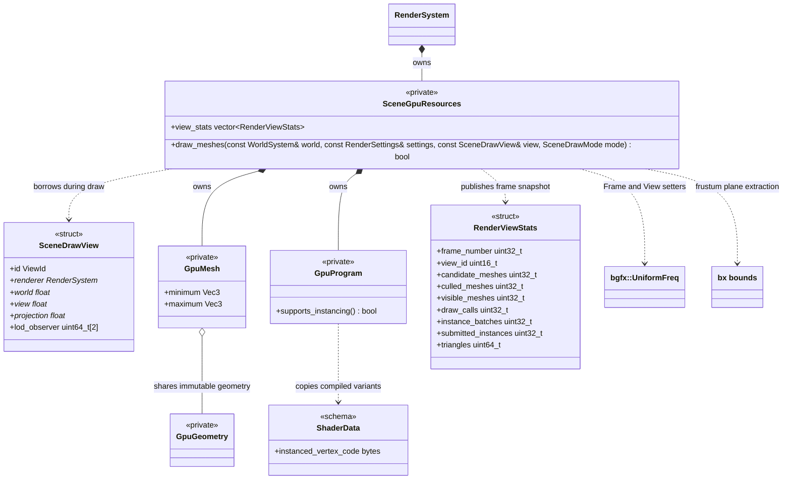

# 视图提交、剔除与静态实例化

[统一接入方案](../upstream-rendering-features.md) · [现行渲染类图](render-system.md) · [统一功能接口](render-feature-controls.md)

状态：最小契约已获用户评审并接入实现。真实构建、像素和提交计数的验收结果集中在[测试文档](../../testing.md)。

不增加 VisibilitySystem、BatchManager 或独立渲染框架。复用现有 GPU 拥有者、ECS 查询、正式 Shader/Mesh 资源及上游 bgfx/bx。

图中方法按阅读宽度简写；现有 draw_meshes 的引用签名保持不变。新增的私有 supports_instancing() 为 const noexcept bool 查询。RenderViewStats 为普通值快照，不拥有 GPU、场景或组件；RenderSystem 的按值查询契约统一在功能控制图定义。

## 自动视锥剔除

- Camera::mesh_visible() 保留原有“手动隐藏名单”语义。自动剔除在场景提交阶段按实际 SceneDrawView 执行，不往 Camera 写可见列表。
- 使用固定 bx 的 buildFrustumPlanes，从实际 view/projection 和设备 homogeneousDepth 提取裁剪平面；覆盖透视、正交、偏心和反射斜近裁面。
- 几何边界使用 GpuMesh 已有 minimum/maximum；蒙皮采用现有 skinning_bounds，变形采用已更新的边界。世界边界转换必须保守支持负缩放、非均匀缩放和父子仿射变换。
- 边界不确定或数值退化时保守保留，不把视锥测试失败当作“不可见”。近面穿越、相机位于包围盒内部、裁剪平面相切均不得误删。
- 主视图、反射视图和每个捕获视图分别剔除；不能用主相机可见集剔掉阴影投射物或反射物。
- 深度/表面/颜色通道使用同一观察者矩阵作保守裁剪。此阶段不增加遮挡剔除、Hi-Z 可见性系统或 GPU 间接提交。

## Frame / View uniform

采用 [bgfx API 167 的正式 UniformFreq](https://github.com/bkaradzic/bgfx/blob/b2513038f4b753ebeced40821c193978daa0492f/include/bgfx/bgfx.h)，不建立自己的 UBO 管理框架。

| 频率 | 参数归属 |
| --- | --- |
| Frame | 仅同一 GPU 帧、所有视图真正相同的数据，例如分离后的时间参数 |
| View | 相机、viewport、雾、环境、IBL 参数、该视图的阴影/集群参数、捕获模式 |
| Draw | 模型/法线变换、材质、当前物体平面反射投影、逐物体贴图有效性、Lightmap/Probe 绑定 |

频率在 createUniform 时确定，同名 uniform 必须统一来源与频率；创建共享 handles 必须早于 Shader 反射并核对上游同名复用规则。不能保留另一处默认 Draw 创建同名 View handle。

每个 view 首次提交前使用 setViewUniform；Frame 参数每帧使用已安装 API 167 的 setFrameUniform。共同参数不能在每物体循环重复上传。材质与模型参数继续每 draw 绑定。

主视图的深度、表面和颜色是不同 bgfx view，均须建立各自值；反射及编辑器烘焙不得继承主视图值。仅在一次实际 GPU 帧内复用公共时间，不能在多个 draw_meshes 调用分别取时钟导致颜色/表面不同步。

这是后端参数频率契约升级，不作为可切换的画质效果；MCP 查询报告实际频率路径，不暴露无实现的布尔开关。

## 静态实例化

- 参照 [05-instancing](https://github.com/bkaradzic/bgfx/tree/b2513038f4b753ebeced40821c193978daa0492f/examples/05-instancing) 的 InstanceDataBuffer、能力检测和不足时回退；保留现有逐 draw 路径。
- ShaderData schema 追加可选 instanced_vertex_code；原 vertex_code、fragment_code 和 surface_fragment_code 不变。实例顶点变体与对应原变体输出相同 varying，复用原颜色/表面片元。未声明变体的项目 Shader 自动逐 draw，不按资源名字猜测能力。
- 正式 .shader 描述提供可选实例顶点源，经同一 shaderc、工具指纹、GUID 和缓存管线编译。引擎内置 PBR 提供标准变体；其他 Shader 可沿同一契约扩展。
- 批次须相同几何资源版本、所选 LOD/子网格索引区间、完整材质有效值与纹理、管线状态、兼容的 Lightmap 绑定/变换或实际 Probe SH 系数；相同材质路径不足以证明可合批。
- InstanceDataBuffer 保存每实例真实模型矩阵及法线变换。负行列式的剔面状态必须分批，不能直接把不同镜像方向混在一起；非均匀缩放仍保持标准 PBR 法线正确。
- 首期仅不透明静态网格，蒙皮/变形、透明、捕获和阴影保持原路径。主视图深度/表面/颜色必须选同一实例顶点语义，不能只优化颜色而使深度不一致。
- 逐帧瞬态缓冲不足时分块或将剩余对象逐 draw，不丢对象。支持查询同时考虑设备能力、Shader 变体与当前对象兼容性。
- 调试线框路径不兼容实例变体时仅该诊断视图回退，不能修改正式材质或篡改提交统计。将对应 MeshRenderer 的 `static_instancing_enabled` 设为 false 恢复该对象的逐 draw 提交。

## 提交统计和基准

RenderViewStats 每帧清零并按 view_id 发布；frame_number 为该快照对应的实际 bgfx 提交帧号，不表示 GPU 已完成。候选/可见/剔除数是每观察者 MeshRenderer 数，draw_calls 是该 view 各实际子网格提交数，submitted_instances 为提交中累计的实例数，triangles 按真实选层和实例数量累计。多通道合计不等于独立对象数，UI、扩展和上游总 draw 不混入这些字段。

查询与 MCP 给出采样提交帧，并明确不代表 GPU 完成；不将 CPU 墙钟帧间隔当作 GPU 工作时间。既有 bgfx/Tracy 的 CPU/GPU 数值另标来源、单位与有效性。

基准在公开 showcase 增加独立 TS 功能用例，通过现有项目脚本 MCP 调用；不把基准场景、对象数量、自动驾驶或计时业务放入渲染核心。保持相同相机、分辨率和资源，固定对象数量、预热后采样，每次只改变对应 Camera 或 MeshRenderer 的一项运行属性；诊断另由 MCP 临时控制。关闭 VSync 或调整呈现策略必须明确记录，不能自适应减少对象制造改善。

LOD 滞回使用稳定相机与反射组件身份区分观察者；临时 view id 复用会重置相应选择，相机连续移动则保留滞回。对象/组件回收时同时清理选择历史。

必测：视锥边界和变换、逐视图隔离、手动隐藏不变、实例与逐 draw 像素一致、材质覆盖/光照不兼容不合批、缓冲耗尽回退以及切场景/停机释放。
