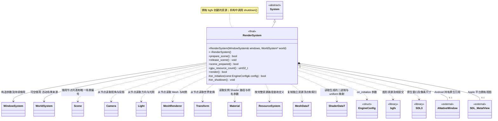

# 渲染系统

[类图索引](../../class-diagrams/index.md) · [引擎与系统](engine-system.md) · [完整引用关系](../../class-diagrams/references.md)

状态：本轮最小场景与 PBR 渲染契约。本图先于实现更新，只定义 `RenderSystem` 的方法，其他节点为跨图引用或第三方库。

- 构造时借用窗口系统，以及可空的世界系统；两者必须比渲染系统存活更久。世界系统为空时只显示空白。初始化时检查窗口已就绪，不创建项目 Mesh、Shader 和材质资源。
- `prepare_scene()` 在主线程按当前场景引用的独立 Mesh 资源准备顶点和索引缓冲，并按材质引用的 Shader 路径创建程序，失败返回 `false` 并清理部分初始化。无场景或无可绘制组件时释放已有项目 GPU 资源并成功返回。
- `release_scene()` 释放本次场景的全部 GPU 句柄并清除场景编号，可以重复调用；保持共享 bgfx 设备和窗口。随后 `render()` 在无场景时提交空白以覆盖上一帧。
- `scene_prepared()` 与 `gpu_resource_count()` 为只读运行状态；资源数是本系统当前拥有的有效逻辑句柄数，不代表驱动端已经完成异步回收。切换场景前释放旧资源，bgfx 按帧安全完成实际销毁。
- `render()` 按场景唯一编号识别热重载造成的场景替换；场景节点由 `Scene` 管理，渲染器不缓存组件借用指针。相机、灯光、方块均从 `Node + Component` 读取，不在渲染器内创建隐藏场景对象。
- 相机和灯光以节点局部 `-Z` 为前向；节点世界矩阵使用列主序。相机从世界 `-Z` 和 `+Y` 正交化构建视图，忽略缩放大小，避免节点非均匀缩放扭曲投影。法线使用模型矩阵的逆转置，支持非均匀缩放。
- Android 通过 SDL 窗口属性取得原生窗口，调用 `ANativeWindow_acquire()` 持有原生引用，bgfx 完全关闭后配对 `ANativeWindow_release()`；底层窗口由平台共享，不由渲染系统独占。
- Android 宿主在 Activity 暂停及 Surface 销毁前同步请求 SDL 主线程关闭 bgfx，并等待后台渲染线程退出；确认后才允许 SDL 释放 Surface。宿主不直接调用 bgfx，具体协议见 [Android 宿主](android-host.md)。
- Android 暂停期间保留系统对象，GPU 初始化可推迟；Activity 与 Surface 均就绪后按需重建当前最小渲染资源。系统生命周期就绪与 GPU 暂时关闭是两个不同状态，公共系统接口不变。
- 初始化、继承的更新、`render()` 和关闭均由 `SDL_main` 所在线程（见[线程约定](engine-system.md)）调用；窗口指针及原生句柄借用不跨线程传递。
- 继承 `System` 的公共生命周期入口及默认 `on_tick()`；它管理的子系统随统一入口更新。
- `render()` 在本帧系统及子系统更新完成后检查窗口尺寸和表面状态，完成图形资源适配及一帧提交。成功返回 `true`，无法完成返回 `false`。若宿主暂停在本帧中途到达，引擎重新检查窗口可绘制性并返回 `paused`；项目场景渲染失败时，引擎停止项目并尝试恢复空白，只有无法恢复的渲染失败才锁定引擎失败状态。
- 引擎在提交前检查窗口退出和暂停状态。恢复和表面重建由渲染系统与[窗口系统](window-system.md)协作处理。
- 拥有 bgfx 创建的资源，使用对应 API 释放；不拥有窗口系统，也不拥有第三方库本身。初始化、清理和复制移动限制遵守[系统约定](engine-system.md)。

- 当前使用 SDL3 提供原生窗口句柄，macOS / iOS 选择 Metal、Windows 选择 Direct3D12、Android / Linux 选择 Vulkan；拒绝 Noop 和回退到其他图形后端。待机清屏，无调试文字。窗口像素尺寸变化时重置交换链并更新相机宽高比。
- 默认内置 Mesh 为 24 顶点、36 索引方块；项目 Mesh 来自独立缓存定义，可提供其他顶点和 uint32 索引。内置 PBR/无光照 Shader 的程序数据由固定版本 bgfx `shaderc` 编译并交给 ResourceSystem 注册。渲染器按 `builtin/...` 或 `project/...` 路径查找 ShaderData，不通过材质种类或路径分支选择效果。
- 每个在用 Shader 路径拥有一套 Program 和参数 Uniform；多个组件可使用不同 Shader。按生成数据中的 uniform 名称、偏移及数值类型映射参数，上传实例值和隐藏默认值。反射双向核对全部非引擎 Uniform，缺失声明或不存在的声明均拒绝，失败清理本次场景 GPU 资源。
- 材质变更 Shader 或 Mesh 后释放已无人使用的程序或网格缓冲。项目停止释放场景和 GPU 句柄并清理 project 定义；热重载时 GPU 通过 bgfx::copy 拥有独立字节，允许在旧场景已销毁后更换 CPU 目录，再于下次 prepare 按场景 ID 退役旧 GPU。builtin 定义继续保留。编译后的 Shader 必须符合当前渲染后端、顶点和内置引擎 Uniform 契约；暂不提供任意 Shader 源码运行时编译。
- Android 暂停关闭 bgfx 时同时释放场景 GPU 资源；恢复后根据仍存活的场景重新建立资源。本轮实际运行验证限定桌面，Android 后续单独验证。
- Android Surface 处理代码集中在平台实现中；APK、模拟器暂停恢复和真机验证范围见根 [README.md](../../../README.md)。

C++ 限定符：构造为 `explicit` 且 `noexcept`，`world` 默认为 `nullptr`；析构、`release_scene()`、只读状态方法和 `on_shutdown()` 为 `noexcept`；只读状态方法为 `const`。析构及受保护钩子标注 `override`，状态返回值标注 `[[nodiscard]]`。
