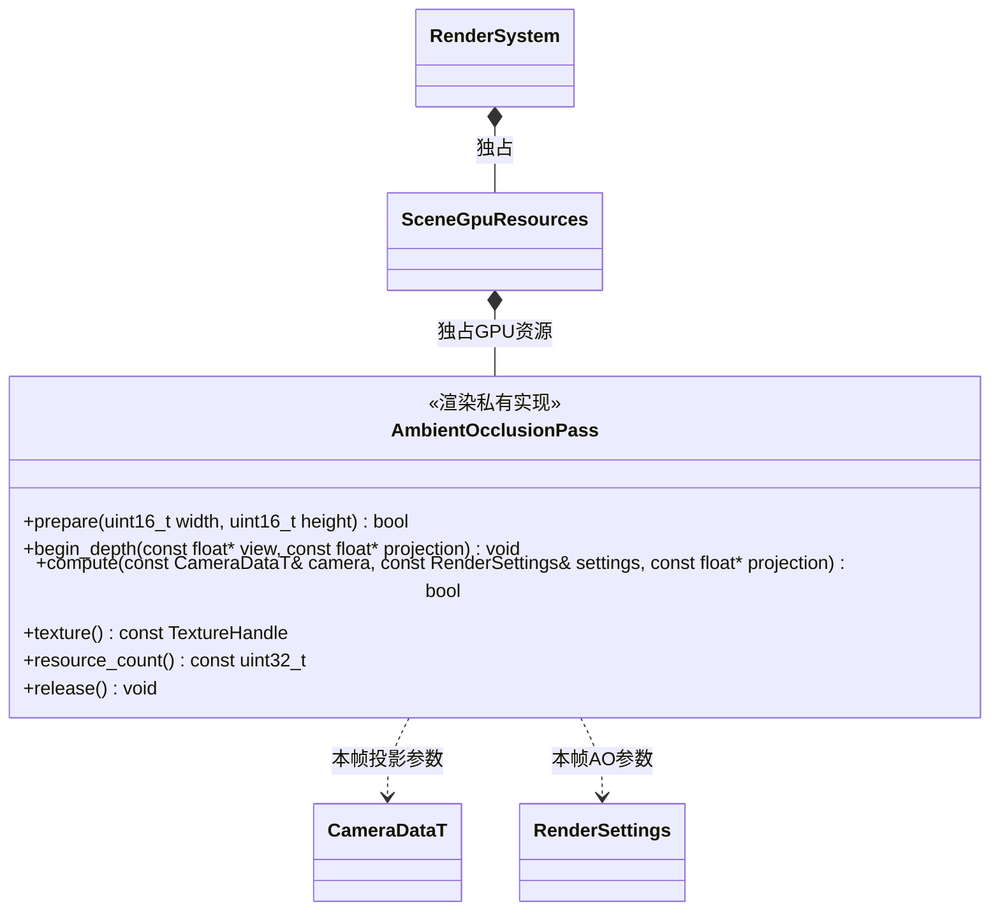
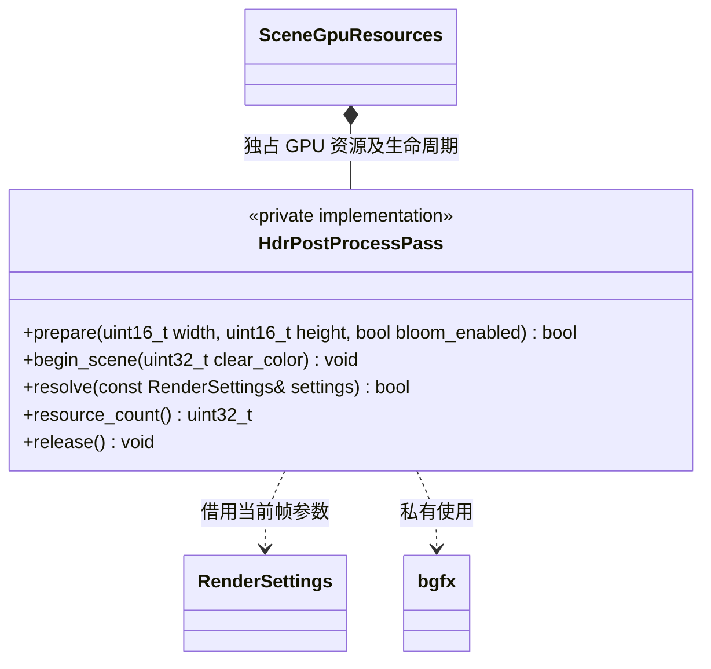

# 渲染系统

[类图索引](../../class-diagrams/index.md) · [引擎与系统](engine-system.md) · [完整引用关系](../../class-diagrams/references.md)

本图只定义 `RenderSystem` 的方法，其他节点为跨图引用或第三方库。

```mermaid
classDiagram
    direction TB
    class RenderSystem {
        <<final>>
        +RenderSystem(WindowSystem& windows, WorldSystem#42; world, FontSystem#42; fonts, UiSystem#42; ui)
        +~RenderSystem()
        +prepare_scene(const Camera#42; camera) bool
        +release_scene() void
        +scene_prepared() bool
        +gpu_resource_count() uint32_t
        +gpu_ready() bool
        +frame_number() uint32_t
        +set_settings(const RenderSettings& settings) bool
        +settings() RenderSettings
        +set_stats_visible(bool visible) void
        +stats_visible() bool
        +request_screenshot(string_view utf8_png_path) bool
        +screenshot_status() ScreenshotStatus
        +render(const Camera#42; camera) bool
        #on_initialize(const EngineConfig& config) bool
        #on_shutdown() void
    }
    class System {
        <<abstract>>
    }
    class WindowSystem
    class WorldSystem
    class Scene
    class Camera
    class Light
    class EnvironmentComponent
    class PostProcessComponent
    class MeshRenderer
    class Transform
    class Material
    class ResourceSystem
    class MeshDataT
    class ShaderDataT
    class TextureDataT
    class Resource
    class MeshUtils
    class EngineConfig {
        <<struct>>
    }
    class RenderSettings {
        <<struct>>
        +ambient_color : float[3]
        +ambient_intensity : float
        +ambient_tricolor : bool
        +ambient_sky_color : float[3]
        +ambient_equator_color : float[3]
        +ambient_ground_color : float[3]
        +fog_mode : FogMode
        +fog_color : float[3]
        +fog_start : float
        +fog_end : float
        +fog_density : float
        +exposure : float
        +filmic_tonemap : bool
        +hdr_enabled : bool
        +bloom_enabled : bool
        +bloom_threshold : float
        +bloom_intensity : float
        +bloom_radius : float
        +ao_enabled : bool
        +ao_radius : float
        +ao_strength : float
        +ao_power : float
        +ao_fade_start : float
        +ao_fade_end : float
        +ibl_enabled : bool
        +ibl_intensity : float
        +directional_shadows : bool
        +shadow_resolution : uint16_t
        +shadow_bias : float
        +shadow_cascades : uint8_t
        +shadow_distance : float
        +shadow_split_lambda : float
        +shadow_cascade_blend : float
        +clear_color : uint32_t
    }
    class FogMode {
        <<enumeration>>
        none
        linear
        exponential
        exponential_squared
    }
    RenderSettings --> FogMode : 雾模式值
    class ScreenshotStatus {
        <<enumeration>>
        idle
        pending
        complete
        failed
    }
    class bgfx {
        <<library>>
    }
    class SDL3 {
        <<library>>
    }
    class ANativeWindow {
        <<external>>
    }
    class SDL_MetalView {
        <<external>>
    }
    System <|-- RenderSystem
    RenderSystem --> WindowSystem : 构造参数及持续借用
    RenderSystem --> WorldSystem : 可空借用 活动场景来源
    RenderSystem --> FontSystem : 可空借用 3D 文字绘制
    RenderSystem --> UiSystem : 可空借用 场景后的 UI 通道
    RenderSystem ..> Scene : 借用节点列表和唯一场景编号
    RenderSystem ..> Camera : 调用期间借用显式视角或场景活动镜头
    RenderSystem ..> Light : 从节点读取方向与光照
    RenderSystem ..> EnvironmentComponent : 借用场景唯一启用环境
    RenderSystem ..> PostProcessComponent : 借用场景活动相机画面参数
    RenderSystem ..> MeshRenderer : 读取源Mesh和瞬态变形及材质
    RenderSystem ..> Transform : 从节点读取世界变换
    RenderSystem ..> Material : 读取实例 Shader 路径与命名参数
    RenderSystem ..> ResourceSystem : 内置资源注册及身份查询
    RenderSystem ..> Material : 借用其当前Shader数据
    RenderSystem ..> MeshDataT : 读取组件持有几何并组装 GPU 顶点
    RenderSystem ..> MeshUtils : 几何校验与切线生成
    RenderSystem o-- Resource : 在用 GPU 纹理持有 CPU 引用
    RenderSystem ..> TextureDataT : Basis 转码与 mip 上传
    RenderSystem ..> ShaderDataT : 读取生成的二进制与 uniform 映射
    RenderSystem ..> EngineConfig : on_initialize 参数
    RenderSystem *-- RenderSettings : 仅拥有无场景时的清屏默认配置
    RenderSystem ..> ScreenshotStatus : 截图回执
    RenderSystem ..> bgfx : 图形资源及帧提交
    RenderSystem ..> SDL3 : 原生窗口及像素尺寸
    RenderSystem "1" o-- "0..1" ANativeWindow : Android 持有原生引用
    RenderSystem "1" *-- "0..1" SDL_MetalView : Apple 平台拥有视图
    note for RenderSystem "拥有 bgfx 创建的资源；析构中调用 shutdown()"
```

- 构造时借用窗口系统，以及可空的世界、字体和 UI 系统；借用必须覆盖渲染系统生命周期。世界系统为空时不绘制项目场景。初始化时检查窗口已就绪，不创建项目 Mesh、Shader 和材质资源。
- 3D 文字与网格使用同一场景相机，由 FontSystem 按普通文字组件绘制；UI 由 UiSystem 在场景之后的有序视图提交。Renderer 只协调通道，不复制字体排布或 RmlUi 文档业务。关闭 GPU 前先释放 UI 和字体 GPU 数据。
- `prepare_scene(camera)` 在主线程按当前场景引用的独立 Mesh 资源准备顶点和索引缓冲，并按材质引用的 Shader 路径创建程序，失败返回 `false` 并清理部分初始化。无场景或无可绘制组件时释放已有项目 GPU 资源并成功返回。
- `prepare_scene` 与 `render` 的 `camera` 默认空，使用世界场景的活动镜头；显式传入时仅在本次调用借用。镜头可来自调用方独立场景，其 Node、Transform 和 Camera 必须在调用期间有效。渲染器不保存镜头指针、不改变项目场景的活动镜头，也不判断调用方用途。
- 显式视角只替换观察位置与投影。环境始终读取世界场景的唯一启用 `EnvironmentComponent`，曝光与色调映射始终读取场景活动 Camera 同节点的启用 `PostProcessComponent`，独立预览相机不会覆盖场景的画面参数。
- `release_scene()` 释放本次场景的全部 GPU 句柄并清除场景编号，可以重复调用；保持共享 bgfx 设备和窗口。随后 `render()` 在无场景时提交空白以覆盖上一帧。
- `scene_prepared()` 与 `gpu_resource_count()` 为只读运行状态；资源数是本系统当前拥有的有效逻辑句柄数，不代表驱动端已经完成异步回收。切换场景前释放旧资源，bgfx 按帧安全完成实际销毁。
- `gpu_ready()` 表示当前图形设备可用；`frame_number()` 返回唯一帧提交入口 `bgfx::frame()` 的返回值，设备关闭后归零，不能当作 CPU 时间或 GPU 完成时间。调用方可以据此检查 bgfx 纹理读回的目标帧，不能自行提交第二条全局帧循环。阴影使用 View 0..3，AO 深度预通道与计算使用 4/5，主场景使用 6，UI 使用 200，编辑器 GPU 作业保留 240..255；这些作业在主线程提交并在渲染设备关闭前销毁，不把编辑器任务状态放入渲染核心。
- `render()` 按场景唯一编号识别热重载造成的场景替换；场景节点由 `Scene` 管理，渲染器不缓存组件借用指针。相机、灯光、方块均从 `Node + Component` 读取，不在渲染器内创建隐藏场景对象。
- 相机和灯光以节点局部 `-Z` 为前向；节点世界矩阵使用列主序。相机从世界 `-Z` 和 `+Y` 正交化构建视图，忽略缩放大小，避免节点非均匀缩放扭曲投影。法线使用模型矩阵的逆转置，支持非均匀缩放。
- Android 通过 SDL 窗口属性取得原生窗口，调用 `ANativeWindow_acquire()` 持有原生引用，bgfx 完全关闭后配对 `ANativeWindow_release()`；底层窗口由平台共享，不由渲染系统独占。
- Android 宿主在 Activity 暂停及 Surface 销毁前同步请求 SDL 主线程关闭 bgfx，并等待后台渲染线程退出；确认后才允许 SDL 释放 Surface。宿主不直接调用 bgfx，具体协议见 [Android 宿主](android-host.md)。
- Android 暂停期间保留系统对象，GPU 初始化可推迟；Activity 与 Surface 均就绪后按需重建场景所需的渲染资源。系统生命周期就绪与 GPU 暂时关闭是两个不同状态，公共系统接口不变。
- 初始化、继承的更新、`render()` 和关闭均由 `SDL_main` 所在线程（见[线程约定](engine-system.md)）调用；窗口指针及原生句柄借用不跨线程传递。
- 继承 `System` 的公共生命周期入口及默认 `on_tick()`；它管理的子系统随统一入口更新。
- `render()` 在本帧系统及子系统更新完成后检查窗口尺寸和表面状态，完成图形资源适配及一帧提交。成功返回 `true`，无法完成返回 `false`。若宿主暂停在本帧中途到达，RuntimeHost 重新检查窗口可绘制性并返回 `paused`；项目场景渲染失败时，RuntimeHost 通过 GameplaySession 停止玩法并尝试恢复空白，无法恢复时进入宿主失败状态。
- RuntimeHost 在提交前检查窗口退出和暂停状态。恢复和表面重建由渲染系统与[窗口系统](window-system.md)协作处理。
- 拥有 bgfx 创建的资源，使用对应 API 释放；不拥有窗口系统，也不拥有第三方库本身。初始化、清理和复制移动限制遵守[系统约定](engine-system.md)。

- 使用 SDL3 提供原生窗口句柄，macOS / iOS 选择 Metal、Windows 选择 Direct3D12、Android / Linux 选择 Vulkan；拒绝 Noop 和回退到其他图形后端。默认待机清屏，无调试文字。窗口像素尺寸变化时重置交换链并更新相机宽高比。
- `set_stats_visible()` 在主线程控制 bgfx 自带的 `BGFX_DEBUG_STATS` 面板，默认关闭，`stats_visible()` 返回保存的开关。开关独立于场景与渲染效果配置，适用于待机、预览及玩法；切换场景、释放场景资源和临时重建图形设备均保留设置，设备恢复后重新应用。该面板只显示上游可提供的统计，不另外启用 `BGFX_DEBUG_PROFILER`。
- 默认内置 Mesh 为 24 顶点、36 索引方块；项目 Mesh 来自独立缓存定义，可提供其他顶点和 uint32 索引。内置 PBR/无光照 Shader 的程序数据由固定版本 bgfx `shaderc` 编译并交给 ResourceSystem 注册。材质按 `builtin/...` 或 `project/...` 路径取得资源，渲染器通过 `Material::shader_data()` 借用该材质实际持有的 ShaderData，不经过全局缓存查询或按材质路径分支选择效果。
- 每个在用 Shader 路径拥有一套 Program 和参数 Uniform；多个组件可使用不同 Shader。按生成数据中的 uniform 名称、偏移及数值类型映射参数，上传实例值和隐藏默认值。反射双向核对全部非引擎 Uniform，缺失声明或不存在的声明均拒绝，失败清理本次场景 GPU 资源。
- 材质变更 Shader 或 Mesh 后释放已无人使用的程序或网格缓冲。显式停止项目时，GameplaySession 协调释放场景、脚本资源引用和 GPU 句柄，CPU 资源随最后一个使用者释放。热重载由 GameplaySession 通过 ScriptRuntime 契约停止旧运行，再提交新目录并启动；RenderSystem 在下一次 prepare_scene 根据场景标识释放旧 GPU 资源并建立新资源。GPU 通过 bgfx::copy 持有独立字节，不借用已替换的 CPU 定义；builtin 定义保留至资源系统关闭。编译后的 Shader 必须符合当前渲染后端、顶点和内置引擎 Uniform 契约；不提供 Shader 源码运行时编译。
- Android 暂停关闭 bgfx 时同时释放场景 GPU 资源；恢复后根据仍存活的场景重新建立资源。平台运行验证范围见根 README。
- Android Surface 处理代码集中在平台实现中；APK、模拟器暂停恢复和真机验证范围见根 [README.md](../../../README.md)。

C++ 限定符：构造为 `explicit` 且 `noexcept`，`world` 默认为 `nullptr`；析构、`release_scene()`、只读状态方法和 `on_shutdown()` 为 `noexcept`；只读状态方法为 `const`。析构及受保护钩子标注 `override`，状态返回值标注 `[[nodiscard]]`。

## 几何、纹理与照明

- 几何支持 UV0、切线、顶点色和子网格；GPU 顶点以明确 float 布局组装，不依赖 FlatBuffers struct 的内存布局。网格按所属节点完整 ID 与 mesh_revision 更新，仅改变的几何重新上传。
- 每个子网格按材质槽独立提交，空子网格表绘制完整索引与槽 0。所有材质槽遵循相同 Shader 与命名参数规则。
- 主 pass 与阴影 pass 共用材质面剔除状态和 alpha 裁切语义；cast_shadows=false 的组件不进入阴影边界拟合和投射，仍保留主绘制。UV 变换、基础色和纹理 alpha 在两个 pass 保持一致。
- 纹理来自 ResourcePtr 持有的 TextureData，Basis Universal 转码后上传全部 mip。auto 按实际 GPU 能力与 Basis 转码器支持情况选择 BC7、ASTC 4x4、ETC2 或 RGBA8；显式请求不支持的格式返回失败。sRGB 只用于颜色纹理，法线及 ORM 使用线性采样。
- GPU 纹理按 ResourcePtr 对象身份共享并只保留当前可绘制材质实际引用，停止项目、场景替换及设备关闭统一释放。Shader sampler 名称、类型及数量与反射双向验证。bgfx 公共反射不提供绑定槽，元数据中的 stage 必须与源码 SAMPLER2D 的绑定一致；运行时另外检查槽唯一及设备上限。纹理包含单层或完整 mip 链，转码工作集上限为 512 MiB。
- HDR IBL 使用 KTX1 容器的 RGBA16F 立方图和 RG16F 二维查找表；运行时验证格式与设备能力后直接上传，不在运行时重新烘焙。环境引用的三个 GUID 是独立纹理资源，随资源代际变化重新加载；失败不悄悄回退旧图。未烘焙的全空引用允许启用 IBL，但本帧采用关闭状态和内置黑色回退纹理；任一非空引用要求三项齐全、存在且格式正确。
- AO 保留纹理槽 11，IBL 漫反射、预过滤反射、BRDF 查找表分别保留 12/13/14，阴影保留 15；项目材质使用 0..10。IBL 采样适配 Ant 的 split-sum 和 bgfx 18-ibl，使用线性 HDR 值、法线方向漫反射、反射方向与粗糙度 mip，最后结合当前材质反射率和环境强度。IBL 只消费烘焙结果，GPU 烘焙及文件发布归编辑器插件；AO 消费当帧深度，无资源落盘。许可与修改说明保留于 Shader 和 third_party/notices。
- 内置 PBR 采样 baseColorTexture、normalTexture、ormTexture（R=AO、G=roughness、B=metallic）；顶点色与 baseColor 相乘。切线空间参考 bgfx 06-bump，PBR 核心直接适配 The Forge ShaderUtilities.h.fsl 的 GGX、Smith 与 Schlick 函数，保留来源和许可。
- 最多 64 个启用灯光，方向、点光、聚光均由节点组件表达；超出限制明确失败，不静默丢灯。相机支持透视和正交投影。
- `settings()` 返回当前场景组件组成的瞬时快照，不持有组件指针或保存场景覆盖值。每帧重新读取组件；没有相应组件时使用固定引擎默认值，默认环境光为 0、曝光为 1、Reinhard 色调映射、AO 与阴影关闭。切换、销毁场景或禁用组件不会继承上一场景的参数。
- `set_settings()` 在存在场景时只修改已经存在的组件；变更环境域要求唯一启用环境，变更后处理域要求活动 Camera 同节点的启用后处理组件，变更阴影域要求方向灯。缺失组件、重复启用环境、多个启用投影方向灯或非法参数均失败且不遗留部分写入，不在渲染器创建节点。没有场景时只修改空白窗口的默认配置，后续场景不会继承该配置。非法场景的兼容快照查询记录错误并返回默认值，而 `prepare_scene()` 和 `render()` 明确返回失败。
- 聚合快照和修改阴影域时，优先使用唯一启用的投影方向灯；没有投影灯时使用第一个启用方向灯。关闭第二个方向灯的投影后，快照可返回第一个方向灯的分辨率和偏移，这些值在阴影关闭时不参与绘制。需要精确修改或撤销指定灯时使用该 `Light` 的生成数据，不以组合快照代替各组件身份。
- 环境光、雾和曝光变化只更新帧 Uniform，不重建场景 Mesh、材质程序或纹理；阴影分辨率变化仅重建阴影通道资源，修改偏移、级联数量、距离或混合参数复用已有 atlas，并在本帧重新计算级联投影。
- 可选 `ambient_tricolor` 根据世界法线 Y 在天空、赤道与地面线性颜色间插值，仍乘 `ambient_intensity`；关闭时使用原有 `ambient_color`。`fog_mode` 选择关闭、线性、指数或平方指数雾。线性模式保留相机到片元的世界距离，在 `fog_start` 到 `fog_end` 间混合；指数模式用相机前向深度减近裁面，透过率分别为 `exp(-density*d)` 与 `exp(-(density*d)^2)`，density 为非负有限数。颜色均为线性 `fog_color`，要求 `0 <= start < end`。两者默认关闭，数据由调用方明确提交，不识别 Unity 或具体项目。
- 方向光阴影从启用方向灯的 `cast_shadows`、`shadow_resolution`、`shadow_bias` 及下述 CSM 参数读取，当前支持一个投影方向灯；多个投影方向灯明确失败。灯的变换仍来自节点。每级根据本次镜头视锥拟合正交投影，深度范围纳入相交投射物，复用 bgfx `15-shadowmaps-simple` 的 packed-depth 路径与 16 点 PCF 采样；没有投影方向灯不产生阴影。RGBA8 深度编码与 D16 深度附件避免依赖硬件比较采样；纹理、帧缓冲及程序随场景释放，设备不支持附件格式时返回失败，不假报开启。阴影使用保留纹理槽 15，项目材质不得占用该槽。ACES 色调映射直接适配 bgfx `shaderlib.sh` 的曲线，保留来源。
- `request_screenshot()` 仅接受调用方提供的绝对 UTF-8 `.png` 路径，父目录必须存在；核心不选择项目目录、不创建目录。返回 `true` 表示已排队，后续帧经 bgfx 回调写入 PNG 后 `screenshot_status()` 才变为 `complete`；失败为 `failed`，等待期间拒绝第二个请求。回调处理 pitch、BGRA 与 Y 翻转；不借用桌面截图权限。关闭时完成或取消等待中的请求。请求和查询由主线程调用，回调状态跨线程同步。

## CSM 级联阴影契约

方向光在 `LightData` 中保存级联数量 `shadow_cascades`（1、2、4，默认 4）、阴影距离 `shadow_distance`（默认 150，范围 `(0, 100000]`）、对数/均匀混合比例 `shadow_split_lambda`（默认 0.6，范围 `[0, 1]`）及交界混合比例 `shadow_cascade_blend`（默认 0.1，范围 `[0, 0.3]`）。`RenderSettings` 只是对应组件的快照，不保存另一份场景策略。MCP 编辑这些值仍使用已有可撤销渲染命令；普通编辑器预览以显式相机决定级联，光照参数仍来自世界场景。

渲染内部参考实际依赖 [bgfx `16-shadowmaps`](https://github.com/bkaradzic/bgfx/tree/7a70927d2af7ffcc5cef9c9e8f4c821e31fcb099/examples/16-shadowmaps)（commit `7a70927d2af7ffcc5cef9c9e8f4c821e31fcb099`）的混合距离划分、视锥分段及纹素对齐思路，复用现有 packed-depth/PCF 阴影 pass。四级放入同一 2×2 atlas，`shadow_resolution` 表示完整 atlas 的边长（4096 即每级 2048），只占原有纹理槽 15；View 0..3 为阴影，AO 使用 4/5，主场景使用 6，UI 与编辑器 GPU 作业范围保持独立。单级使用完整 atlas；两级使用两个半边长 tile。

每级使用镜头视锥段的包围球保持旋转时范围稳定，中心对齐纹素，深度范围包含相应投射物。Shader 按正向相机深度选级，在每级最后一段混合区采样下一层；下一级投影向前扩展以覆盖该混合区，PCF 每个采样点限制在本级 tile 的半纹素内边界。最后一级按相同比例淡出至全可见；混合比例为 0 时硬切换。实际阴影远端取相机远裁面与 `shadow_distance` 的较小值，远端不超过近裁面时不提交阴影。

相对于上游分别使用多张纹理及 UV 覆盖选级的示例，这里适配为单 atlas、深度选级、包围球稳定范围及跨级混合，保留 Dario Manesku 的版权和 BSD-2-Clause 许可。关闭阴影、场景停止、设备重建或失败时按既有生命周期释放 atlas。级联数据和算法仅为渲染私有实现，不新增框架系统或场景隐藏节点。

## 环境遮蔽通道

AmbientOcclusionPass 位于渲染私有实现目录，拥有深度附件、法线、半尺寸深度 mip、AO 中间纹理和计算程序，按需初始化；关闭效果、切换场景、设备重建和失败时完整释放。窗口变化只重建尺寸相关纹理。RenderSystem 组织通道顺序，不向 Engine 增加功能接口，不增加通用后处理管理框架。

AO 默认关闭，由活动场景相机的 PostProcessDataT.ao_enabled 控制，可随时关闭并保留半径、强度与淡出参数。只有参数随场景保存；遮蔽结果每帧在 GPU 计算，不产生贴图源文件、meta 或 GUID 资源，不加入烘焙任务。预览隐藏镜头不持有另一份 AO 配置。

算法适配固定 bgfx commit `7a70927d2af7ffcc5cef9c9e8f4c821e31fcb099` 的 `39-assao`，固定 Q2 与两次边缘保持模糊。View 0..3 为 CSM，4 为相机深度预通道，5 为依次提交的 AO compute，6 为主场景，UI 仍为 200。预通道复用材质原有程序，仅开启深度写入，关闭颜色输出，给 AO 绑定白色回退并关闭采样；因此保留项目天空、自定义顶点、alpha 裁切和动态变形行为。普通 unlit 物体仍提供遮挡，天空的自定义远平面语义保持。

内部 AO 视口向上对齐 16 并采用真实窗口宽高比的投影，计算结果按归一化屏幕坐标采样；透视与正交分别重建位置和采样半径。主场景只将线性 AO 乘入环境光和 IBL，不影响直接光、自发光、天空或 UI。系统保留 sampler 11，IBL 为 12..14，阴影为 15，项目材质可使用 0..10；资源校验、导入与 Shader 反射使用同一约定。功能启用后缺少所需计算或纹理能力时返回失败，不将未执行的 AO 报告为成功。

## HDR 与 Bloom 通道

相机 `PostProcessDataT` 与渲染快照增加 `hdr_enabled`、`bloom_enabled`，默认均关闭；Bloom 依赖 HDR，提交 `bloom_enabled=true` 且 `hdr_enabled=false` 返回失败。亮部阈值默认 1、范围 `[0,100]`，强度默认 0.15、范围 `[0,10]`，模糊半径倍数默认 1、范围 `[0.25,4]`，均要求有限。HDR / Bloom 参数随组件持久化，不进入 Engine。HDR 关闭保留原 SDR 路径。

采用固定 bgfx `7a70927d2af7ffcc5cef9c9e8f4c821e31fcb099` 的 `09-hdr` 通道组织、全屏三角形和归一化 blur9。适配为真正 RGBA16F 线性场景目标，替代上游 RGBE8 与提前 gamma；沿用显式曝光，不加入自动测光。View 6 为场景，7 为半尺寸亮部提取，8 为八分之一尺寸纵向 blur9，9 为横向 blur9、HDR 合成与一次色调映射/gamma；UI View 200 后绘制，不受 Bloom 影响。亮部阈值使用曝光前线性颜色，模糊结果与场景先相加，再一起曝光与映射。关闭 Bloom 只保留 HDR 合成并释放两个中间目标；关闭 HDR、停止场景、设备重建均释放该通道，尺寸变化只重建尺寸相关目标。

场景 Shader 通过既有 `u_tonemap.z` 获知目标：为 1 时输出未曝光、未 tone map、未 gamma 的线性颜色；为 0 保持 SDR 输出。内置材质与项目天空共用这一契约，HDR 路径对无光照材质也统一执行最终画面映射。自定义 Shader 必须遵守该输出语义。3D 字体保留场景深度与预乘 alpha，调用方显式请求线性输出；UI 字体维持显示色输出。
