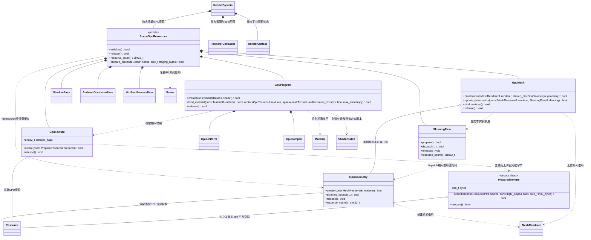
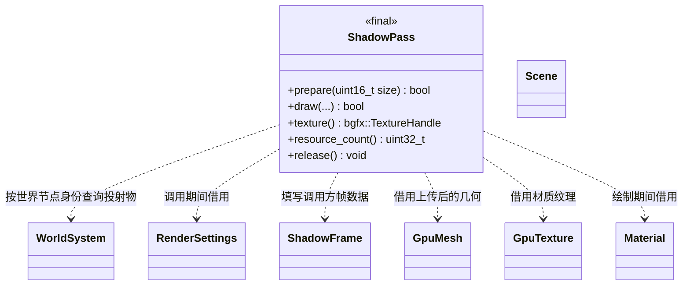
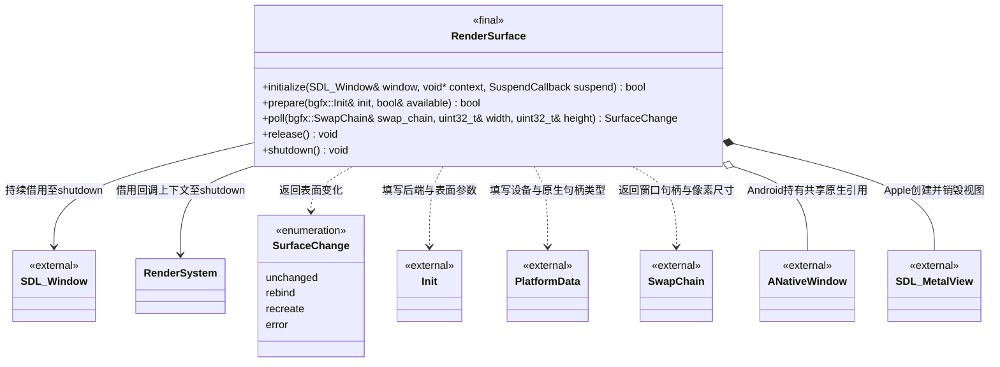
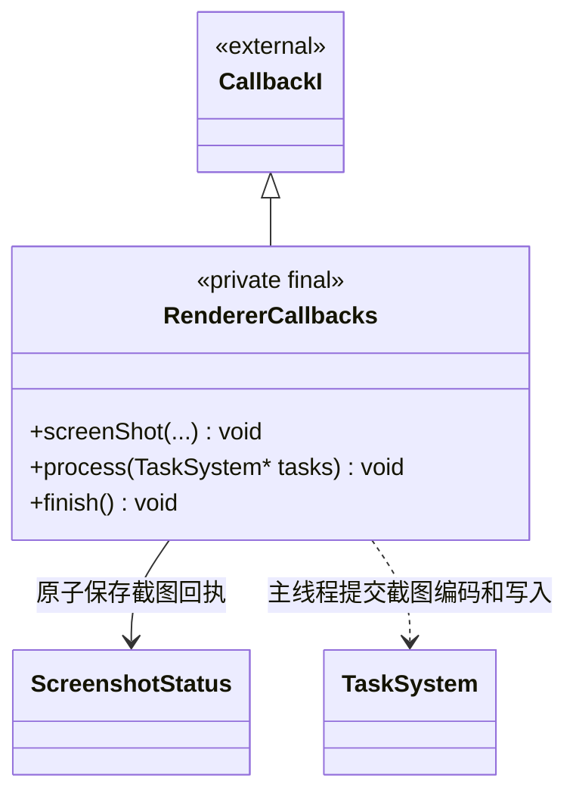
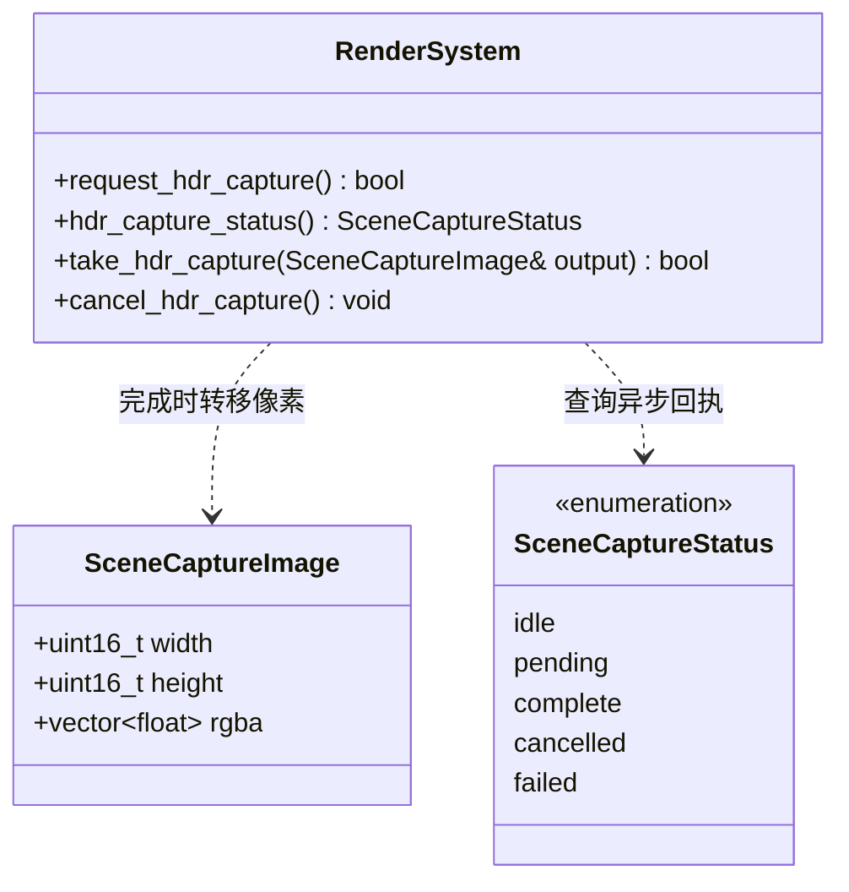
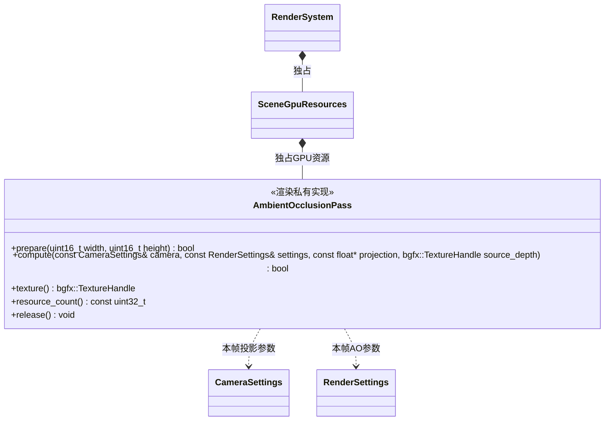
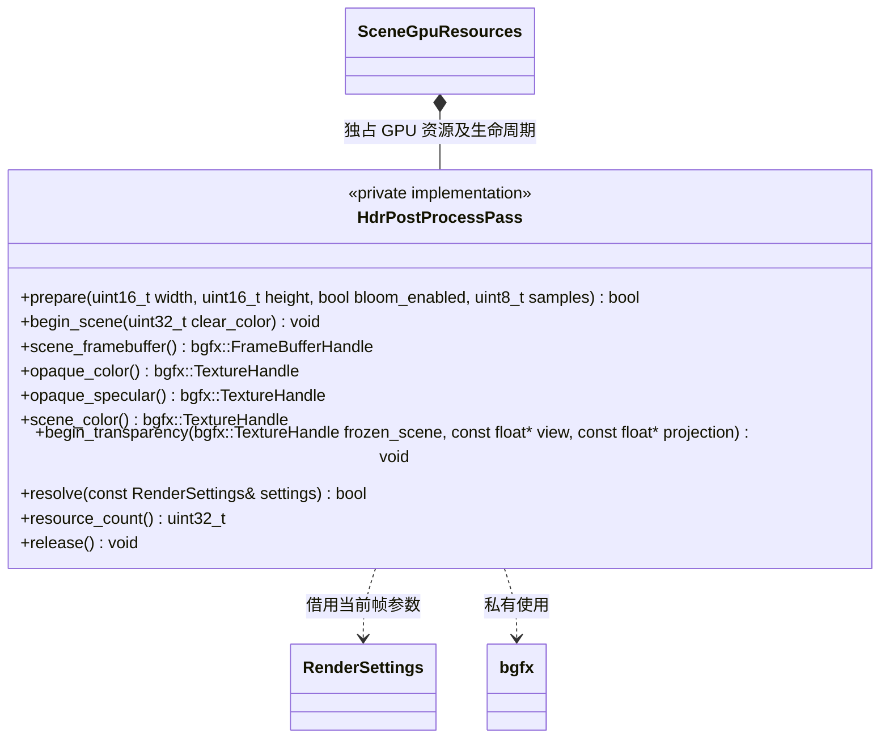

# 渲染系统

[类图索引](../../class-diagrams/index.md) · [引擎与系统](engine-system.md) · [完整引用关系](../../class-diagrams/references.md)

公开图定义 `RenderSystem` 的方法；私有实现另列职责与所有权，其他节点为跨图引用或第三方库。

分簇前向、反射、局部阴影及离屏漫反射捕获的现行契约见[分簇光照与反射](forward-lighting-reflections.md)。本页维护系统入口及基础通道；两页共同描述当前实现，实际验证范围以测试文档为准。

VSync 请求在下一次可提交的帧应用。场景纹理准备和截图编码可借用宿主任务域，GPU 对象仍由主线程创建与提交；平台后端执行复用 bgfx 自有渲染线程。

## 私有实现边界

`RenderSystem` 保持系统生命周期、帧提交与调用方入口。场景准备、场景绘制和参数读写分文件实现；GPU 类型、渲染通道与平台表面独立维护，不增加新的渲染管理框架。公开头只暴露引擎类型，bgfx、SDL 和纹理转码器留在私有实现。



图中两个蒙皮方法的完整签名如下；矩阵 span 仅在调用期间借用，边界通过输出参数返回。`dispatch` 不接管缓冲所有权，源几何、palette 及输出缓冲由现有 GPU 拥有者管理，并遵守 bgfx 异步提交生命周期：

```cpp
// GpuGeometry
[[nodiscard]] bool skinning_bounds(std::span<const std::array<float, 16>> palette,
                                   std::array<float, 3>& minimum,
                                   std::array<float, 3>& maximum) const noexcept;
// SkinningPass
[[nodiscard]] bool dispatch(const GpuGeometry& geometry,
                            bgfx::DynamicVertexBufferHandle palette,
                            bgfx::DynamicVertexBufferHandle output, std::uint32_t joint_count);
```

- `resources/` 保存逐类型 GPU 上传、绑定和释放；`passes/` 保存蒙皮、阴影、AO、HDR/Bloom。渲染私有辅助类型置于 `engine::render_detail`，不导出到核心根命名空间。
- 视图顺序、保留纹理槽和灯光数量集中在私有常量头；数学函数集中在私有数学文件。新增通道沿用同一编号约定，不能在不同文件重复定义数值。
- 平台实现位于 `platforms/<platform>/`，由 CMake 为当前目标选择。`RenderSurface` 负责原生句柄取得、保留、变更策略与 Android 暂停握手；渲染调度不分支判断平台。先停止 bgfx，再释放原生表面。GPU 暂停后可恢复，场景 CPU 数据仍由世界拥有。
- GPU 拥有者禁用复制，移动必须转移并清空源句柄，析构兜底；全部 GPU 对象在 bgfx 关闭前销毁。参数结构独立于系统头，不改变场景、脚本或 MCP 的公开契约。

`SceneGpuResources` 与 `RendererCallbacks` 是 `RenderSystem` 的私有嵌套类型。前者独占场景通用 Uniform、回退纹理、三张 IBL 纹理、逐类型 GPU 集合及渲染通道；`initialize()` 创建通用资源，`release()` 支持部分初始化和重复清理，`resource_count()` 汇总有效句柄。`prepare_ibl()` 只在调用期间借用活动场景，不保留组件指针；空指针清理 IBL 并使用默认环境。`SceneGpuResources` 不可复制或移动，析构兜底；计数查询为 `const noexcept`，释放为 `noexcept`，状态返回值为 `[[nodiscard]]`。

### 阴影通道



为避免单行签名撑宽类图，`draw()` 的完整参数单列如下；其中所有引用和句柄均仅在调用期间借用：

```cpp
bool draw(const WorldSystem& world, const RenderSettings& settings,
          ShadowFrame& frame, const std::vector<GpuMesh>& meshes,
          const std::vector<GpuTexture>& textures,
          bgfx::TextureHandle fallback, bgfx::UniformHandle depth_uniform,
          const RenderConfig& config, std::span<const LocalShadowLight> local_lights,
          std::span<ClusterLight> lights, const float* camera_world,
          bgfx::ViewId base_view,
          const std::span<const std::uint64_t>* caster_ids = nullptr);
```

`ShadowPass` 独占 atlas 的颜色纹理、深度纹理、Framebuffer、Shader/Program 及 alpha 裁切和 UV Uniform。`prepare()` 按分辨率准备资源，`draw()` 组织逐级阴影绘制，`texture()` 返回借用句柄；调用方不得销毁它。对象不可复制或移动，析构兜底释放；`release()` 支持重复调用。两个只读查询为 `const noexcept`，释放为 `noexcept`，状态与句柄返回值标注 `[[nodiscard]]`。AO 和 HDR/Bloom 的完整接口见本文后续独立图。

### 平台表面



图中的 `Init`、`PlatformData` 和 `SwapChain` 均来自 `bgfx`。`SuspendCallback` 为 `void (*)(void*) noexcept`。窗口和回调上下文借用持续到 `shutdown()`，所有操作在 SDL 主线程；本系统用回调通知 `RenderSystem` 暂停 GPU，表面对象不执行场景绘制。`prepare()` 只写入 `bgfx::Init` 的后端、`platformData` 和 `swapChain` 的原生句柄及像素尺寸，保留其他配置；成功且 `available=false` 表示暂时无可用表面，调用方等待恢复后重试。平台后端显式固定，初始化禁用 bgfx 自动回退。

`poll()` 借用并填写 `bgfx::SwapChain`，不调用 bgfx；句柄不变仍返回最新尺寸及保留的交换链设置。`rebind` 要求调用方通过 `bgfx::reset(global_flags, &swap_chain)` 提交交换链，`recreate` 要求先关闭 GPU 再准备表面；Android 原生窗口或 Apple Metal layer 身份变化均使用完整重建，避免使用 bgfx 内部强制 reset 标志。原生 display 或类型变化返回 `error`，失败时清空输出。VSync 与各向异性属于设备设置，继续通过 reset 全局 flags 提交。`release()` 必须在 bgfx 关闭后调用，释放平台句柄但保留观察器和窗口借用；`shutdown()` 先撤销回调，再释放并清除借用，不触发暂停回调。对象不可复制或移动，析构调用可重复的 `shutdown()`；释放与关闭为 `noexcept`，状态返回值为 `[[nodiscard]]`。

### 渲染回调



`CallbackI` 来自 `bgfx`。关键重写接收完整帧数据：

```cpp
void screenShot(const char* path, uint32_t width, uint32_t height,
                uint32_t pitch, bgfx::TextureFormat::Enum format,
                const void* data, uint32_t size, bool yflip) override;
```

回调实现 bgfx 的日志和截图契约，用互斥量同步待写路径、原子状态同步回执，通过 bimg 和 SDL3 IO 写出截图。PNG 截图当前只接受 `BGRA8`，其他格式报告已有失败状态，避免将 HDR 或浮点输出误读为 SDR 像素。其他 profiler、缓存与视频捕获回调保持契约空实现，缓存查询报告缺失；不在此引入性能采样或视频录制业务。

统一策略、逐视图提交统计及临时调试绘制的公开契约见[渲染功能控制](render-feature-controls.md)；渲染器只保存临时诊断请求，运行策略与场景/材质功能由对应组件/材质独占状态。

## 公开接口

### 场景线性 HDR 帧捕获

现有 PNG 截图是经过色调映射的 SDR 图像；漫反射捕获使用独立烘焙视角与通道，不能代表实际画面。此通用场景帧捕获契约不改变现有截图或烘焙捕获。



- 主线程请求下一次成功提交的场景帧；读取正常场景透明合成及扩展之后、Bloom、曝光和色调映射之前的颜色。它包含直接光、IBL、透明及现有场景效果，不包含后续 UI、Bloom 或显示输出转换。调用方继续提交帧并轮询回执。
- 捕获当前目标实际像素尺寸，返回自上而下、紧密排列的线性 RGBA 浮点数组，RGB 可大于 1；源目标精度为 RGBA16F，读取时转换为 float，不做归一化、曝光或显示色域转换。Alpha 保留源目标值，不宣称为最终透明度。
- 一次只接受一个未取走的请求；无活动场景或设备、请求已占用时返回 false。相机可能由后续 `render(camera)` 指定，包括独立场景中的相机，因此接受请求时不依赖活动相机；实际提交帧若无有效相机或可绘制内容则取消请求。有效帧已提交后，后续帧临时失去相机或重建 MSAA 目标不会丢弃该帧的读回。设备不支持颜色目标解析/异步回读、目标分配或 GPU 提交失败时置 failed，禁止静默降级为 SDR；MSAA 必须读取正确 resolve 后结果。
- `complete` 后 `take_hdr_capture` 将结果移动给调用方并回到 idle；其他状态取图返回 false 并清空输出。取消、场景释放、设备重置或关闭时安全退役 GPU 资源并报告 cancelled，失效异步结果不能覆盖后续请求；尚未完成时不得访问结果缓冲。捕获和既有漫反射捕获各自保持独立状态，不改变原接口。
- 上述接口已获用户评审确认。它使用 bgfx 的 `TextureRegion`、`blit` 和异步 `read`，借用现有帧号确定回读完成；RGBA16F 转换使用 bx 半浮点转换，行方向按 bgfx `originBottomLeft` 归一化。

```mermaid
classDiagram
    direction TB
    class RenderSystem {
        <<final>>
        +RenderSystem(WindowSystem& windows, WorldSystem#42; world, FontSystem#42; fonts, UiSystem#42; ui, TaskSystem#42; tasks = nullptr, const RenderConfig& config = {})
        +~RenderSystem()
        +add_extension(RenderExtension& extension) bool
        +remove_extension(RenderExtension& extension) bool
        +prepare_scene(Camera camera) bool
        +release_scene() void
        +scene_prepared() bool
        +gpu_resource_count() uint32_t
        +gpu_ready() bool
        +frame_number() uint32_t
        +viewport_size(Vec2& output) bool
        +set_vsync(bool enabled) bool
        +vsync() bool
        +set_msaa_samples(uint8_t samples) bool
        +msaa_samples() uint8_t
        +supports_msaa_samples(uint8_t samples) bool
        +set_max_anisotropy(bool enabled) bool
        +max_anisotropy() bool
        +supports_max_anisotropy() bool
        +set_debug_feature(RenderFeature feature, bool enabled) bool
        +feature_state(RenderFeature feature) RenderFeatureState
        +submission_stats() vector~RenderViewStats~
        +draw_debug_lines(span~const DebugLine~ lines, uint16_t lifetime_frames = 1) bool
        +set_idle_clear_color(uint32_t rgba) void
        +idle_clear_color() uint32_t
        +settings() RenderSettings
        +set_stats_visible(bool visible) void
        +stats_visible() bool
        +request_screenshot(string_view utf8_png_path) bool
        +screenshot_status() ScreenshotStatus
        +request_hdr_capture() bool
        +hdr_capture_status() SceneCaptureStatus
        +take_hdr_capture(SceneCaptureImage& output) bool
        +cancel_hdr_capture() void
        +render(Camera camera) bool
        #on_initialize(const EngineConfig& config) bool
        #on_shutdown() void
    }
    class System {
        <<abstract>>
    }
    class WindowSystem
    class RenderConfig {
        <<struct>>
        +size_t texture_batch_size = 4
        +size_t texture_staging_bytes = 67108864
        +uint8_t msaa_samples = 1
        +bool max_anisotropy = false
    }
    class WorldSystem
    class Scene
    class Camera
    class Vec2
    class Light
    class EnvironmentComponent
    class PostProcessComponent
    class MeshRenderer
    class Transform
    class Material
    class ResourceSystem
    class MeshDataT
    class ShaderDataT
    class TextureDataT
    class Resource
    class MeshUtils
    class EngineConfig {
        <<struct>>
    }
    class RenderSettings {
        <<struct>>
        +ambient_color : float[3]
        +ambient_intensity : float
        +ambient_tricolor : bool
        +ambient_sky_color : float[3]
        +ambient_equator_color : float[3]
        +ambient_ground_color : float[3]
        +fog_mode : FogMode
        +fog_color : float[3]
        +fog_start : float
        +fog_end : float
        +fog_density : float
        +exposure : float
        +filmic_tonemap : bool
        +hdr_enabled : bool
        +bloom_enabled : bool
        +bloom_threshold : float
        +bloom_intensity : float
        +bloom_radius : float
        +ao_enabled : bool
        +ao_radius : float
        +ao_strength : float
        +ao_power : float
        +ao_fade_start : float
        +ao_fade_end : float
        +ibl_enabled : bool
        +ibl_intensity : float
        +directional_shadows : bool
        +shadow_resolution : uint16_t
        +shadow_bias : float
        +shadow_cascades : uint8_t
        +shadow_distance : float
        +shadow_split_lambda : float
        +shadow_cascade_blend : float
        +clear_color : uint32_t
    }
    class FogMode {
        <<enumeration>>
        none
        linear
        exponential
        exponential_squared
    }
    RenderSettings --> FogMode : 雾模式值
    class ScreenshotStatus {
        <<enumeration>>
        idle
        pending
        complete
        failed
    }
    class bgfx {
        <<library>>
    }
    class SDL3 {
        <<library>>
    }
    System <|-- RenderSystem
    RenderSystem *-- RenderConfig : 保存配置值
    RenderSystem --> WindowSystem : 构造参数及持续借用
    RenderSystem --> WorldSystem : 可空借用 活动场景来源
    RenderSystem --> FontSystem : 可空借用 3D 文字绘制
    RenderSystem --> UiSystem : 可空借用 场景后的 UI 通道
    RenderSystem --> TaskSystem : 可空借用 纹理准备及截图任务域
    RenderSystem --> RenderExtension : 登记期间借用，独立透明通道
    RenderSystem ..> Scene : 借用节点列表和唯一场景编号
    RenderSystem ..> Camera : 调用期间借用显式视角或场景活动镜头
    RenderSystem ..> Vec2 : 当前绘制目标像素尺寸输出
    RenderSystem ..> Light : 从节点读取方向与光照
    RenderSystem ..> EnvironmentComponent : 借用场景唯一启用环境
    RenderSystem ..> PostProcessComponent : 借用场景活动相机画面参数
    RenderSystem ..> MeshRenderer : 读取源Mesh和瞬态变形及材质
    RenderSystem ..> Transform : 从节点读取世界变换
    RenderSystem ..> Material : 读取实例 Shader 路径与命名参数
    RenderSystem ..> ResourceSystem : 内置资源注册及身份查询
    RenderSystem ..> Material : 借用其当前Shader数据
    RenderSystem ..> MeshDataT : 读取组件持有几何并组装 GPU 顶点
    RenderSystem ..> MeshUtils : 几何校验与切线生成
    RenderSystem o-- Resource : 在用 GPU 纹理持有 CPU 引用
    RenderSystem ..> TextureDataT : Basis 转码与 mip 上传
    RenderSystem ..> ShaderDataT : 读取生成的二进制与 uniform 映射
    RenderSystem ..> EngineConfig : on_initialize 参数
    RenderSystem ..> RenderSettings : 返回组件组成的只读帧快照
    RenderSystem ..> ScreenshotStatus : 截图回执
    RenderSystem ..> bgfx : 图形资源及帧提交
    RenderSystem ..> SDL3 : 原生窗口及像素尺寸
    note for RenderSystem "拥有 bgfx 创建的资源；析构中调用 shutdown()"
```

- 构造时借用窗口系统，以及可空的世界、字体和 UI 系统；借用必须覆盖渲染系统生命周期。世界系统为空时不绘制项目场景。初始化时检查窗口已就绪，不创建项目 Mesh、Shader 和材质资源。
- 3D 文字与网格使用同一场景相机，由 FontSystem 按普通文字组件绘制；UI 由 UiSystem 在场景之后的有序视图提交。Renderer 只协调通道，不复制字体排布或 RmlUi 文档业务。关闭 GPU 前先释放 UI 和字体 GPU 数据。
- `prepare_scene(camera)` 在主线程按当前场景引用的独立 Mesh 资源准备顶点和索引缓冲，并按材质引用的 Shader 路径创建程序，失败返回 `false` 并清理部分初始化。无场景或无可绘制组件时释放已有项目 GPU 资源并成功返回。
- `prepare_scene` 与 `render` 的 `camera` 默认空，使用世界场景的活动镜头；显式传入时仅在本次调用借用。镜头以 Camera 值句柄传入，可来自调用方独立场景，其世界与实体必须在调用期间有效。渲染器不保存组件地址、不改变项目场景的活动镜头，也不判断调用方用途。
- 显式视角提供观察位置、投影及本镜头的网格隐藏列表。主绘制与 AO 深度预通道按实际观察 Camera 的 `mesh_visible(component.instance_id())` 过滤，网格、文字、灯光和渲染效果均须满足组件 `active()` 与 `visible_in_hierarchy()`，包含父节点状态；阴影仍使用全局激活且可见的投影网格；仅对镜头隐藏的网格保留 GPU 资源，其他镜头仍可绘制。全部网格被该镜头隐藏时仍可成功提交空画面。环境始终读取世界场景的唯一激活且可见的 `EnvironmentComponent`，曝光与色调映射始终读取场景活动 Camera 同节点的激活且可见 `PostProcessComponent`，独立预览相机不会覆盖场景的画面参数。
- `release_scene()` 释放本次场景的全部 GPU 句柄并清除场景编号，可以重复调用；保持共享 bgfx 设备和窗口。随后 `render()` 在无场景时提交空白以覆盖上一帧。
- `scene_prepared()` 与 `gpu_resource_count()` 为只读运行状态；资源数是本系统当前拥有的有效逻辑句柄数，不代表驱动端已经完成异步回收。普通切换按存活组件增量回收，显式停止完整释放；bgfx 按帧安全完成实际销毁。
- `viewport_size(Vec2& output) const noexcept` 返回最近为绘制目标配置的像素宽高，标注 `[[nodiscard]]`。未初始化、GPU 不可用或任一尺寸为零时返回 false 并清零输出。查询只读取本系统当前尺寸；窗口大小变化由既有 `render()` 流程应用后反映，不在查询中轮询窗口或重置交换链。
- `set_vsync(bool enabled)` 在渲染系统已初始化时接受 VSync 请求并返回 `true`，未初始化返回 `false`；不在脚本回调中重置交换链。它只保存待应用的呈现配置，下一次可提交的 `render()` 使用新 reset flags 执行既有 bgfx reset 路径，即使窗口尺寸未变也会处理开关变化。`vsync() const noexcept` 返回最近接受的请求，默认 `true`，不是实际显示器呈现状态或实测帧率。setter 与 getter 均标注 `[[nodiscard]]`。

### MSAA 与材质各向异性过滤

- 仅在现有 `RenderConfig`、`RenderSystem` 增加设备画质参数与查询，不增加 Manager、场景组件或另一份持久设置模型。`msaa_samples` 接受 `1/2/4/8`，`1` 表示关闭；`max_anisotropy` 为最大各向异性过滤开关。默认分别为 `1`、`false`，项目设置业务决定何时读取、保存和提交用户选择。
- `supports_msaa_samples(samples)` / `supports_max_anisotropy()` 查询当前设备和本渲染链真正可用的能力；图形设备未就绪返回 `false`。MSAA 必须同时满足实际采样数、RGBA16F 颜色目标与 D32F 深度目标能力；上游仅有“格式支持 MSAA”标记不能证明某一采样档位可用。底层沿用 bgfx 已有后端能力检测，补齐其实际档位输出，不自行猜测设备档位、不依赖 bgfx 的静默降级。
- 两个 setter 均为主线程调用、`[[nodiscard]] bool`；无效档位、设备未就绪或不支持的请求返回 `false`，保留此前设置。成功仅表示接受请求，下一次可绘制帧统一应用；getter 返回最近接受的请求。重复设置同值不重建目标。临时关闭 GPU 保留请求，恢复后重新校验，不支持则明确失败。
- MSAA 必须应用到实际离屏几何渲染：主场景 RGBA16F 颜色、镜面贡献及匹配深度，透明/水体合成的颜色与深度，以及平面反射颜色与深度。几何提交启用 MSAA rasterization。颜色由 bgfx 原生 resolve 提供给 SSR、折射、Bloom 和最终输出，不能只切换 backbuffer reset flag。
- AO/SSR 的表面法线、材质和深度预通道继续保持单采样，其查询 Shader 不采样尚未 resolve 的多采样深度。透明合成不得把单采样颜色 blit 进多采样目标后误认为所有样本已初始化；MSAA 模式通过全屏绘制写入冻结场景颜色，继续使用主场景已保留的同档位深度附件，再提交透明几何；交换链保持单采样，避免上游后端按多采样 backbuffer 规则丢弃这份深度。阴影图、烘焙读回、UI/字体查找纹理和全屏后处理保持各自采样规则。
- 最大各向异性过滤沿用 bgfx `BGFX_RESET_MAXANISOTROPY` 和材质资源 sampler 的 anisotropic 标记；普通材质贴图、法线/ORM 与 lightmap 采用该过滤。关闭恢复原有线性/mipmap 采样；不覆盖阴影、AO、SSR、LUT、字体和屏幕纹理的 point/clamp 约束，也不修改资源导入数据。
- 本节接口已获评审确认。验证覆盖实际离屏颜色/深度、透明遮挡、反射和重复切换，不能以 Stats reset flag 或 setter 返回值作为生效证据。
- VSync 与窗口模式、场景后处理及 `Engine` 的目标帧率上限分别管理；不加入 `RenderSettings`，不保存在场景组件中。窗口重绑、Surface 暂时丢失和 GPU 重建期间保留最近请求，并在下次初始化或 reset 时使用；成功接收请求不保证操作系统、驱动或显示器立刻采用该呈现行为。持久化属于调用方，TS 通过现有 `Render` 门面的 `SetVSync()` / `GetVSync()` 访问对应接口。
- 实现只复用 [bgfx 的 reset 接口与 BGFX_RESET_VSYNC 标志](https://bkaradzic.github.io/bgfx/bgfx.html#reset)，在既有初始化和表面 reset 路径中更新标志；不新增依赖或重写呈现、垂直同步算法。窗口和显示模式切换仍由 SDL3 完成，不使用 bgfx 未支持的全屏 reset 标志代替窗口接口。
- `gpu_ready()` 表示当前图形设备可用；`frame_number()` 返回唯一帧提交入口 `bgfx::frame()` 的返回值，设备关闭后归零，不能当作 CPU 时间或 GPU 完成时间。调用方可以据此检查 bgfx 纹理读回的目标帧，不能自行提交第二条全局帧循环。GPU 蒙皮使用 View 0，主阴影从 80 开始，AO 深度/表面/计算为 110/111/112，主场景为 113，[渲染扩展](render-extension.md) 为 133，临时调试绘制为 134，HDR/Bloom 为 135..137，UI 为 200；镜像及捕获分区统一见 `render_constants.hpp` 和[分簇光照与反射](forward-lighting-reflections.md)；这些作业在主线程提交并在渲染设备关闭前销毁，不把编辑器任务状态放入渲染核心。
- `render()` 按场景唯一编号识别热重载造成的场景替换；Scene 管理实体生命周期，渲染器不缓存组件地址。相机、灯光、网格通过带 Published 的有类型 ECS 查询读取，不在渲染器内创建隐藏场景对象。
- 相机和灯光以节点局部 `-Z` 为前向；节点世界矩阵使用列主序。相机从世界 `-Z` 和 `+Y` 正交化构建视图，忽略缩放大小，避免节点非均匀缩放扭曲投影。法线使用模型矩阵的逆转置，支持非均匀缩放。
- 相机基和投影矩阵统一由场景私有 `camera_math` 函数计算，供 RenderSystem 与 Camera 射线查询复用；bx 类型保持私有，场景核心不依赖渲染系统。渲染传入当前设备的深度约定，射线几何仍使用同一近裁面和镜头投影。
- Android 的 `RenderSurface` 通过 SDL 窗口属性取得原生窗口，调用 `ANativeWindow_acquire()` 持有原生引用，bgfx 完全关闭后配对 `ANativeWindow_release()`；底层窗口由平台共享，不由渲染系统独占。
- Android 宿主在 Activity 暂停及 Surface 销毁前同步请求 SDL 主线程关闭 bgfx，并等待后台渲染线程退出；确认后才允许 SDL 释放 Surface。宿主不直接调用 bgfx，具体协议见 [Android 宿主](android-host.md)。
- Android 暂停期间保留系统对象，GPU 初始化可推迟；Activity 与 Surface 均就绪后按需重建场景所需的渲染资源。系统生命周期就绪与 GPU 暂时关闭是两个不同状态，公共系统接口不变。
- 初始化、继承的更新、`render()` 和关闭均由 `SDL_main` 所在线程（见[线程约定](engine-system.md)）调用；窗口指针及原生句柄借用不跨线程传递。
- 继承 `System` 的公共生命周期入口及默认 `on_tick()`；它管理的子系统随统一入口更新。
- `render()` 在本帧系统及子系统更新完成后检查窗口尺寸和表面状态，完成图形资源适配及一帧提交。成功返回 `true`，无法完成返回 `false`。若宿主暂停在本帧中途到达，RuntimeHost 重新检查窗口可绘制性并返回 `paused`；项目场景渲染失败时，RuntimeHost 通过 GameplaySession 停止玩法并尝试恢复空白，无法恢复时进入宿主失败状态。
- RuntimeHost 在提交前检查窗口退出和暂停状态。恢复和表面重建由渲染系统与[窗口系统](window-system.md)协作处理。
- 拥有 bgfx 创建的资源，使用对应 API 释放；不拥有窗口系统，也不拥有第三方库本身。初始化、清理和复制移动限制遵守[系统约定](engine-system.md)。

- 使用 SDL3 提供原生窗口句柄，macOS / iOS 选择 Metal、Windows 选择 Direct3D12、Android / Linux 选择 Vulkan；拒绝 Noop 和回退到其他图形后端。默认待机清屏，无调试文字。窗口像素尺寸变化时重置交换链并更新相机宽高比。
- `set_stats_visible()` 在主线程控制 bgfx 自带的 `BGFX_DEBUG_STATS` 面板，默认关闭，`stats_visible()` 返回保存的开关。开关独立于场景与渲染效果配置，适用于待机、预览及玩法；切换场景、释放场景资源和临时重建图形设备均保留设置，设备恢复后重新应用。该面板只显示上游可提供的统计，不另外启用 `BGFX_DEBUG_PROFILER`。
- 默认内置 Mesh 为 24 顶点、36 索引方块；项目 Mesh 来自独立缓存定义，可提供其他顶点和 uint32 索引。内置 PBR/无光照 Shader 的程序数据由固定版本 bgfx `shaderc` 编译并交给 ResourceSystem 注册。材质按 `builtin://...` 或 assets 相对路径取得资源，渲染器通过 `Material::shader_data()` 借用该材质实际持有的 ShaderData，不经过全局缓存查询或按材质路径分支选择效果。
- 每个在用 Shader 路径拥有一套 Program 和参数 Uniform；多个组件可使用不同 Shader。按生成数据中的 uniform 名称、偏移及数值类型映射参数，上传实例值和隐藏默认值。反射双向核对全部非引擎 Uniform，缺失声明或不存在的声明均拒绝，失败清理本次场景 GPU 资源。
- 材质变更 Shader 或 Mesh 后释放已无人使用的程序或网格缓冲。显式停止项目时，GameplaySession 协调释放场景、脚本资源引用和 GPU 句柄，CPU 资源随最后一个使用者释放。热重载由 GameplaySession 通过 ScriptRuntime 契约停止旧运行，再提交新目录并启动；RenderSystem 在下一次 prepare_scene 按世界中仍存活的节点和材质增量更新 GPU 资源，不因活动场景 ID 改变销毁常驻对象的缓存。GPU 通过 bgfx::copy 持有独立字节，不借用已替换的 CPU 定义；builtin 定义保留至资源系统关闭。编译后的 Shader 必须符合当前渲染后端、顶点和内置引擎 Uniform 契约；不提供 Shader 源码运行时编译。
- Android 暂停关闭 bgfx 时同时释放场景 GPU 资源；恢复后根据仍存活的场景重新建立资源。平台运行验证范围见[测试与范例](../../testing.md)。
- Android Surface 处理代码集中在平台实现中；APK、模拟器暂停恢复和真机验证范围见[测试与范例](../../testing.md)。

C++ 限定符：构造为 `explicit` 且 `noexcept`，`world` 默认为 `nullptr`；析构、`release_scene()`、只读状态方法和 `on_shutdown()` 为 `noexcept`；只读状态方法为 `const`。析构及受保护钩子标注 `override`，状态返回值标注 `[[nodiscard]]`。

## 几何、纹理与照明

- 几何支持 UV0、切线、顶点色和子网格；GPU 顶点以明确 float 布局组装，不依赖 FlatBuffers struct 的内存布局。网格按所属节点完整 ID 与 mesh_revision 更新，仅改变的几何重新上传。
- 每个子网格按材质槽独立提交，空子网格表绘制完整索引与槽 0。所有材质槽遵循相同 Shader 与命名参数规则。
- 主 pass 与阴影 pass 共用材质面剔除状态和 alpha 裁切语义；cast_shadows=false 的组件不进入阴影边界拟合和投射，仍保留主绘制。UV 变换、基础色和纹理 alpha 在两个 pass 保持一致。
- 纹理来自 ResourcePtr 持有的 TextureData，Basis Universal 转码后上传全部 mip。auto 按实际 GPU 能力与 Basis 转码器支持情况选择 BC7、ASTC 4x4、ETC2 或 RGBA8；显式请求不支持的格式返回失败。sRGB 只用于颜色纹理，法线及 ORM 使用线性采样。
- GPU 纹理按 ResourcePtr 对象身份共享并只保留当前可绘制材质实际引用，普通场景切换增量回收已无使用者的资源，停止项目及设备关闭完整释放。Shader sampler 名称、类型及数量与反射双向验证。bgfx 公共反射不提供绑定槽，元数据中的 stage 必须与源码 SAMPLER2D 的绑定一致；运行时另外检查槽唯一及设备上限。纹理包含单层或完整 mip 链，转码工作集上限为 512 MiB。
- HDR IBL 使用 KTX1 容器的 RGBA16F 立方图和 RG16F 二维查找表；运行时验证格式与设备能力后直接上传，不在运行时重新烘焙。环境引用的三个 GUID 是独立纹理资源，随资源代际变化重新加载；失败不悄悄回退旧图。未烘焙的全空引用允许启用 IBL，但本帧采用关闭状态和内置黑色回退纹理；任一非空引用要求三项齐全、存在且格式正确。
- AO 保留纹理槽 11，IBL 漫反射、预过滤反射、BRDF 查找表分别保留 12/13/14，阴影保留 15；项目材质使用 0..4；其余帧输入槽位见[分簇光照与反射契约](forward-lighting-reflections.md)。IBL 采样适配 Ant 的 split-sum 和 bgfx 18-ibl，使用线性 HDR 值、法线方向漫反射、反射方向与粗糙度 mip，最后结合当前材质反射率和环境强度。IBL 只消费烘焙结果，GPU 烘焙及文件发布归编辑器插件；AO 消费当帧深度，无资源落盘。许可与修改说明保留于 Shader 和 third_party/notices。
- 内置 PBR 采样 baseColorTexture、normalTexture、ormTexture（R=AO、G=roughness、B=metallic）；顶点色与 baseColor 相乘。切线空间参考 bgfx 06-bump，PBR 核心直接适配 The Forge ShaderUtilities.h.fsl 的 GGX、Smith 与 Schlick 函数，保留来源和许可。
- 由 RenderConfig 限制启用灯光数量（默认 256，最大 4096），方向、点光、聚光均由节点组件表达；超出限制明确失败，不静默丢灯。相机支持透视和正交投影。
- `settings()` 返回当前场景组件组成的瞬时快照，不持有组件指针或保存场景覆盖值。每帧重新读取组件；没有相应组件时使用固定引擎默认值，默认环境光为 0、曝光为 1、Reinhard 色调映射、AO 与阴影关闭。切换、销毁场景或禁用组件不会继承上一场景的参数。
- 设置写入和数值校验唯一归对应组件。RenderSystem 只收集只读帧快照，不提供跨组件设置事务；编辑器负责选择组件、创建缺失组件以及撤销和失败回滚。`set_idle_clear_color(rgba)` / `idle_clear_color()` 仅设置/查询无活动场景时的 RGBA 清屏色，均为 noexcept，查询为 const；不保存环境、后处理或阴影覆盖值，后续场景不继承待机颜色。非法场景的兼容快照查询记录错误并返回默认值，而 `prepare_scene()` 和 `render()` 明确返回失败。
- 只读聚合快照选择阴影域时，优先使用唯一启用的投影方向灯；没有投影灯时使用第一个启用方向灯。关闭第二个方向灯的投影后，快照可返回第一个方向灯的分辨率和偏移，这些值在阴影关闭时不参与绘制。需要精确修改或撤销指定灯时使用该 `Light` 的生成数据，不以组合快照代替各组件身份。
- 环境光、雾和曝光变化只更新帧 Uniform，不重建场景 Mesh、材质程序或纹理；阴影分辨率变化仅重建阴影通道资源，修改偏移、级联数量、距离或混合参数复用已有 atlas，并在本帧重新计算级联投影。
- 可选 `ambient_tricolor` 根据世界法线 Y 在天空、赤道与地面线性颜色间插值，仍乘 `ambient_intensity`；关闭时使用原有 `ambient_color`。`fog_mode` 选择关闭、线性、指数或平方指数雾。线性模式保留相机到片元的世界距离，在 `fog_start` 到 `fog_end` 间混合；指数模式用相机前向深度减近裁面，透过率分别为 `exp(-density*d)` 与 `exp(-(density*d)^2)`，density 为非负有限数。颜色均为线性 `fog_color`，要求 `0 <= start < end`。两者默认关闭，数据由调用方明确提交，不识别 Unity 或具体项目。
- 方向光阴影从启用方向灯的 `cast_shadows`、`shadow_resolution`、`shadow_bias` 及下述 CSM 参数读取，当前支持一个投影方向灯；多个投影方向灯明确失败。灯的变换仍来自节点。每级根据本次镜头视锥拟合正交投影，深度范围纳入相交投射物，复用 bgfx `15-shadowmaps-simple` 的 packed-depth 路径与 16 点 PCF 采样；没有投影方向灯不产生阴影。RGBA8 深度编码与 D16 深度附件避免依赖硬件比较采样；纹理、帧缓冲及程序随场景释放，设备不支持附件格式时返回失败，不假报开启。阴影使用保留纹理槽 15，项目材质不得占用该槽。ACES 色调映射直接适配 bgfx `shaderlib.sh` 的曲线，保留来源。
- `request_screenshot()` 仅接受调用方提供的绝对 UTF-8 `.png` 路径，父目录必须存在；核心不选择项目目录、不创建目录。返回 `true` 表示已排队，后续帧完成编码和文件关闭后 `screenshot_status()` 才变为 `complete`；失败为 `failed`，等待期间拒绝第二个请求。bgfx 回调仅校验并复制读回像素，单个缓冲最多 256 MiB；压图和文件写入经主线程提交至借用的 `TaskSystem`，不阻塞渲染线程。任务域满时保留同一缓冲待下帧重试，不积累截图队列。
- 新纹理先依据当前 GPU 能力选择格式并精确计算全部 mip 的输出字节，再按 `texture_batch_size` 和 `texture_staging_bytes` 双重预算分批准备。默认每批最多 4 张、64 MiB；单张超预算直接失败，不暗中放宽。资源和选定格式作为稳定输入；worker 只做 BasisU 转码或字节整理，不访问 bgfx、Scene、Node。全部本批任务完成后主线程创建与上传 GPU 纹理，释放本批 CPU 输出，再处理下一批。无任务域或整个批次拒绝时使用同一串行准备；已接收失败不重跑。
- `prepare_scene()` 仍是同步完成契约，等待内部并行批次，不声称已实现跨帧 GPU 上传；Shader、Mesh、IBL 的 GPU 创建继续在主线程。IBL 的预编码 KTX 同样检查单项暂存预算。字节预算只限制本批 CPU 输出，不包含已交给 bgfx 的上传队列；字体/UI 和 Effekseer 同步纹理回调有独立路径，不属于这批场景材质纹理配置。`RenderConfig` 两项必须大于零，批次数不超过 64。
- 任务只共享拥有独立截图数据，不借用渲染系统、回调或 GPU 对象。`tasks` 非空时须先初始化、覆盖渲染系统生命周期；为空则主线程处理截图，保留无需任务系统的独立宿主。编码处理 pitch、BGRA 与 Y 翻转；不借用桌面截图权限。关闭时等待已接收的写入任务，取消尚未提交的读回结果，不在返回后留下借用。请求、查询、提交和完成回收均由主线程调用，读回槽跨线程加锁。


## CSM 级联阴影契约

方向光在 `LightData` 中保存级联数量 `shadow_cascades`（1、2、4，默认 4）、阴影距离 `shadow_distance`（默认 150，范围 `(0, 100000]`）、对数/均匀混合比例 `shadow_split_lambda`（默认 0.6，范围 `[0, 1]`）及交界混合比例 `shadow_cascade_blend`（默认 0.1，范围 `[0, 0.3]`）。`RenderSettings` 只是对应组件的快照，不保存另一份场景策略。MCP 编辑这些值仍使用已有可撤销渲染命令；普通编辑器预览以显式相机决定级联，光照参数仍来自世界场景。

渲染内部参考引入时固定的 [bgfx `16-shadowmaps`](https://github.com/bkaradzic/bgfx/tree/7a70927d2af7ffcc5cef9c9e8f4c821e31fcb099/examples/16-shadowmaps)（commit `7a70927d2af7ffcc5cef9c9e8f4c821e31fcb099`）的混合距离划分、视锥分段及纹素对齐思路，复用现有 packed-depth/PCF 阴影 pass。四级放入同一 2×2 atlas，`shadow_resolution` 表示 CSM 所占区域的边长（4096 即每级 2048），只占原有纹理槽 15；统一 atlas 还容纳局部光源阴影，完整尺寸由 RenderConfig 指定。View 0 为 GPU 蒙皮，镜像组从 1、40 开始，主阴影从 80 开始，主场景为 113，UI 保留 200；完整分区见[分簇光照与反射契约](forward-lighting-reflections.md)。单级使用完整 CSM 区域；两级使用两个半边长 tile。

每级使用镜头视锥段的包围球保持旋转时范围稳定，中心对齐纹素，深度范围包含相应投射物。Shader 按正向相机深度选级，在每级最后一段混合区采样下一层；下一级投影向前扩展以覆盖该混合区，PCF 每个采样点限制在本级 tile 的半纹素内边界。最后一级按相同比例淡出至全可见；混合比例为 0 时硬切换。实际阴影远端取相机远裁面与 `shadow_distance` 的较小值，远端不超过近裁面时不提交阴影。

相对于上游分别使用多张纹理及 UV 覆盖选级的示例，这里适配为单 atlas、深度选级、包围球稳定范围及跨级混合，保留 Dario Manesku 的版权和 BSD-2-Clause 许可。关闭阴影、场景停止、设备重建或失败时按既有生命周期释放 atlas。级联数据和算法仅为渲染私有实现，不新增框架系统或场景隐藏节点。

## 环境遮蔽通道



AmbientOcclusionPass 位于渲染私有实现目录，借用 SurfacePass 提供的源深度，拥有法线、半尺寸深度 mip、AO 中间纹理和计算程序，按需初始化；关闭效果、设备重建和失败时完整释放；切换场景重新读取活动相机设置，按实际开关保留或释放。窗口变化只重建尺寸相关纹理。RenderSystem 组织通道顺序，不向 Engine 增加功能接口，不增加通用后处理管理框架。

AO 默认关闭，由活动场景相机的 PostProcessDataT.ao_enabled 控制，可随时关闭并保留半径、强度与淡出参数。只有参数随场景保存；遮蔽结果每帧在 GPU 计算，不产生贴图源文件、meta 或 GUID 资源，不加入烘焙任务。预览隐藏镜头不持有另一份 AO 配置。

算法适配固定 bgfx commit `7a70927d2af7ffcc5cef9c9e8f4c821e31fcb099` 的 `39-assao`，固定 Q2 与两次边缘保持模糊。主视图中 AO 深度/表面/计算分别为 110/111/112，主场景为 113，UI 为 200；其他分区由 `render_constants.hpp` 统一定义。预通道复用材质原有程序，仅开启深度写入，关闭颜色输出，给 AO 绑定白色回退并关闭采样；因此保留项目天空、自定义顶点、alpha 裁切和动态变形行为。普通 unlit 物体仍提供遮挡，天空的自定义远平面语义保持。

内部 AO 视口向上对齐 16 并采用真实窗口宽高比的投影，计算结果按归一化屏幕坐标采样；透视与正交分别重建位置和采样半径。主场景只将线性 AO 乘入环境光和 IBL，不影响直接光、自发光、天空或 UI。系统保留 sampler 11，IBL 为 12..14，阴影为 15，项目材质使用 0..4，其他帧输入占用 5..10；资源校验、导入与 Shader 反射使用同一约定。功能启用后缺少所需计算或纹理能力时返回失败，不将未执行的 AO 报告为成功。

## HDR 与 Bloom 通道



相机 `PostProcessDataT` 与渲染快照增加 `hdr_enabled`、`bloom_enabled`，默认均关闭；Bloom 依赖 HDR，提交 `bloom_enabled=true` 且 `hdr_enabled=false` 返回失败。亮部阈值默认 1、范围 `[0,100]`，强度默认 0.15、范围 `[0,10]`，模糊半径倍数默认 1、范围 `[0.25,4]`，均要求有限。HDR / Bloom 参数随组件持久化，不进入 Engine。管线始终使用线性场景目标，HDR 开关控制最终曝光与色调映射；SDR 按材质映射权重保持原有外观。

采用固定 bgfx `7a70927d2af7ffcc5cef9c9e8f4c821e31fcb099` 的 `09-hdr` 通道组织、全屏三角形和归一化 blur9。适配为真正 RGBA16F 线性场景目标，替代上游 RGBE8 与提前 gamma；沿用显式曝光，不加入自动测光。View 113 为场景，133 为共用颜色及深度附件的插件透明绘制，134 为临时调试绘制，135 为半尺寸亮部提取，136 为八分之一尺寸纵向 blur9，137 为横向 blur9、HDR 合成与一次色调映射/gamma；UI View 200 后绘制，不受 Bloom 影响。亮部阈值使用曝光前线性颜色，模糊结果与场景先相加，再一起曝光与映射。关闭 Bloom 只保留 HDR 合成并释放两个中间目标；关闭 HDR 仍保留线性场景及最终输出所需资源；明确停止和设备重建释放通道，尺寸变化只重建尺寸相关目标。

场景 Shader 通过既有 `u_tonemap.z` 获知目标：为 1 时输出未曝光、未 tone map、未 gamma 的线性颜色；为 0 保持 SDR 输出。内置材质与项目天空共用这一契约，HDR 路径对无光照材质也统一执行最终画面映射。自定义 Shader 必须遵守该输出语义。3D 字体保留场景深度与预乘 alpha，调用方显式请求线性输出；UI 字体维持显示色输出。

**精确 sRGB 显示编码**。沿用现有 Pass 和公开接口，使用固定 bgfx `7a70927d2af7ffcc5cef9c9e8f4c821e31fcb099` 的 `examples/common/shaderlib.sh` 中 `toGammaAccurate` / `toLinearAccurate` 对应的 IEC sRGB 分段转换；颜色贴图的 sRGB 采样由 GPU 解码：

- 维持场景和 Bloom 的线性 RGBA16F、当前曝光及色调映射和 SDR backbuffer；最终 resolve 对线性 RGB 使用精确 sRGB 编码一次，alpha 不作颜色转换，不再额外启用 backbuffer 的硬件 sRGB 编码。
- 主视图和平面反射清屏 RGB 按显示色先精确解码至线性；3D 字体的显示色先解预乘、精确解码，再按原 alpha 预乘，衔接[字体绘制契约](font-system.md)。覆盖率及 alpha 保持线性；无映射时清屏和完全不透明的字体保留输入显示色，半透明边缘以实际混合行为为准。
- UI 仍在最终输出后使用显示色和既有预乘 alpha 混合，UI 纹理、顶点和字体不重复编码。该最小方案保留显示空间混合的现有限制；不把它称为线性空间 UI 合成，也不在此项中改变 UI 的混合契约。
- Blender 比较夹具和窗口测试使用同一精确显示转换，保留并标注 gamma 2.2 历史数据，不能直接将不同显示转换的截图数值混为一谈。HDR 线性回读不依赖该输出编码。

常驻节点接入：Mesh、文字和阴影投射物从 `WorldSystem::scenes()` 收集，节点 ID 在世界内唯一；相机、灯光/环境参数及后处理仍取当前活动场景。没有活动场景时不使用保留容器里的旧镜头，常驻 UI 继续同步并绘制，已有常驻 Mesh 的 GPU 几何可保留。普通切换不调用扩展、UI 或字体的 `release_scene()`；明确停止、全部场景消失或设备释放仍执行完整清理。

ECS 查询开始前由协调安全点刷新派生世界矩阵和有效状态。灯光、反射面、网格、动画和可见性参数来自真实 ECS 列；GPU 缓存仍由渲染领域拥有并按实体/组件实例/资源修订识别。显式绘制相机默认 Camera{}，值句柄不转移世界所有权。
