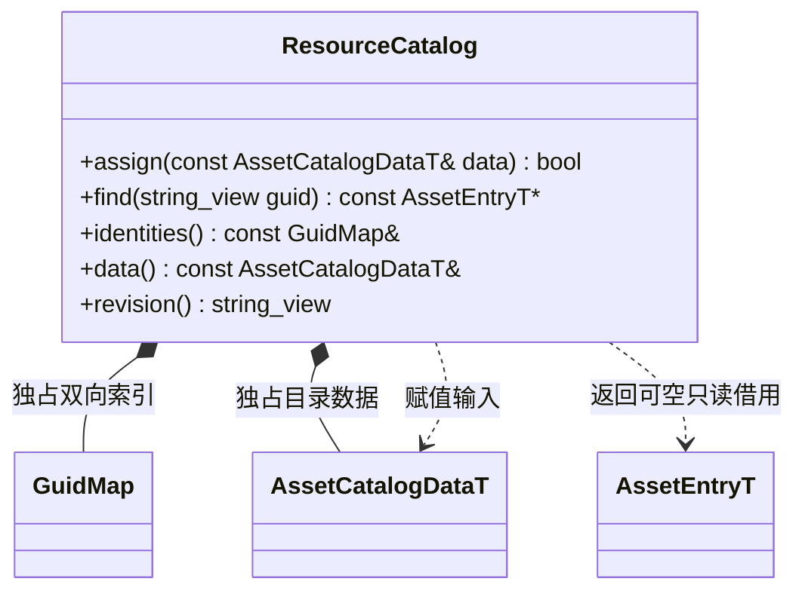
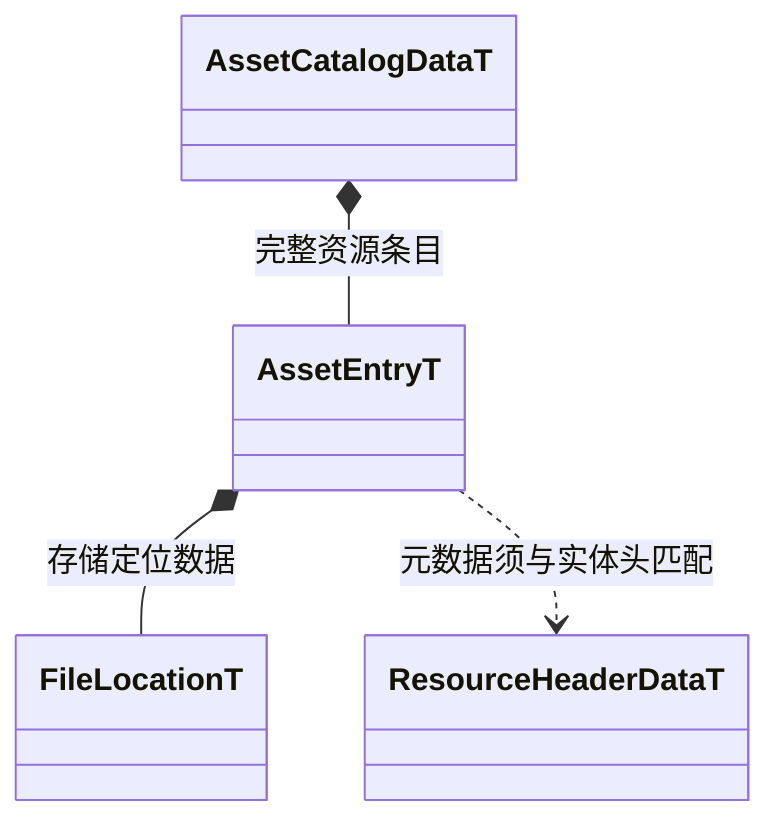

# 资源元数据目录

[类图索引](../../class-diagrams/index.md) · [设计说明](../resource-loading.md) · [资源系统](resource-system.md)

ResourceCatalog 只保存元数据和索引，不保存产物载荷。

- `assign()` 校验并复制元数据、建立 GUID/路径索引和必要依赖关系；失败保留旧值。不读取实体、不扫描源目录、不调用转换器。
- `find()` 缺失返回空指针。查询均为 const，借用在下次成功更新前有效；已加载对象不得长期借用清单条目。
- 元数据查询不增加使用引用。目录不存 JS、网格、Shader 字节码或包载荷，不创建 GPU 资源。
- 编辑器源资产的导入状态和构建依赖留在编辑器数据库；核心运行目录消费可用产物和必要运行依赖。未经转换的资源不能标记为可加载。

## 序列化模型

持久字段由 asset_catalog.fbs 和 resource_header.fbs 定义并由 FlatBuffers 生成。目录格式版本为 2，实体格式版本为 1。

| 模型 | 内容 |
| --- | --- |
| AssetCatalogData | 格式版本、目标平台、目录修订、资源条目和被引用的存储文件信息 |
| AssetEntry | GUID、虚拟路径、类型、格式版本、内容哈希、实体头大小、存储定位、必要运行依赖；脚本保留模块名 |
| FileLocation | 挂载名称、相对文件路径、实体起始偏移、实体总长度；散文件起始为零，合并包为成员范围 |
| ResourceHeaderData | GUID、类型、格式版本和载荷边界；独立校验实体，不携带全部载荷 |

GUID 是稳定身份，内容哈希用于校验和增量判断；偏移与长度使用明确宽度的无符号整数。散文件与包成员使用相同实体格式。头部长度受上限和文件边界校验，读取头不需要读取整份载荷。

清单须完整自洽，缺失必要依赖或循环均失败。源码/include 等构建输入不进入运行依赖数组；后续才使用的软引用不自动加载，打包时通过明确入口或保留项覆盖。

实体文件由 `ERS1`、32 位小端头部长度、标识为 `ERSH` 的 FlatBuffers 头和原始载荷组成。目录中的大小与 FNV-1a 64 位摘要覆盖完整实体，header_size 包含前 8 字节。合并包直接拼接完整实体，目录记录各实体偏移和长度。
