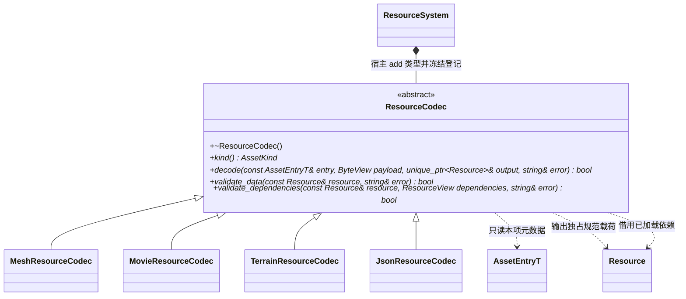
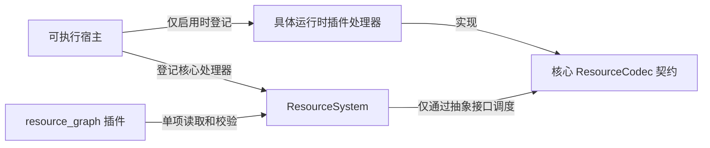
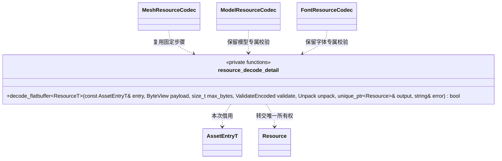

# 逐类型资源处理器

[类图索引](../../class-diagrams/index.md) · [统一生命周期](resource-lifecycle.md) · [资源对象](resource.md) · [核心读取](resource-system.md) · [资源插件](../../plugins/runtime/class-diagrams/resource-graph.md)

**状态：统一资源契约及业务接入补充已按确认类图实现；验证范围见测试文档。** 覆盖当前 asset_catalog.fbs 的全部 21 种 AssetKind。生命周期一致；数据表示和合法性规则由各自类型处理器负责。

## 最小扩展接口

- 公共虚析构 noexcept；kind 为 const noexcept，其他方法为 const，状态标注 nodiscard。无状态处理器可并行使用；有第三方解析上下文时每次调用独占，不共享可变解析器。
- decode 只转换本项载荷，失败 output 为空；validate_data 检查本项数据、声明的依赖集合及规范类型。文件读取固定调用 decode → validate_data，内存候选跳过 decode，复用 validate_data。
- validate_dependencies 检查调用方提供的同代际数据，例如材质与 Shader 参数契约、影片与音频时长/身份、模型骨架匹配。无依赖的类型也必须拒绝与其契约不符的声明，不默认略过校验。
- ResourceView 为 span<const Resource* const>，仅本次调用借用；不得保留指针、加载依赖、获取业务引用、触发 GPU/VM 或访问活动 ECS。
- 单项信封、哈希、目录身份和范围由核心负责；类型格式、FlatBuffers 校验、语义边界及真实依赖由具体处理器负责。插件组织 DAG 和生命周期，不重复各类格式分支。
- 不保留集中 store(SceneDataT)/store(MeshDataT)… 重载和 BinaryResourceCodec 包办所有类型的分支。通用字节复制可作为私有函数复用，语义校验仍归对应类型。
- 错误通过 bool 与独立字符串输出，不用异常。核心将本项失败归 invalid_data、跨实体失败归 dependency_failed，并补充 GUID/路径上下文。

## 全类型承载与登记

本节及以下表格保持现行公开契约；私有步骤的合并见[解码实现精简目标](#解码实现精简目标)。

表中列出已登记的规范类型与处理器。T 表示 ResourceValue<DataT, Kind> 的载荷类型，所有资源均经同一 ResourceLoader 获取/释放。

| AssetKind | 规范 DataT | 处理器 | 实现归属与主要校验 |
| --- | --- | --- | --- |
| source | ByteBuffer | SourceResourceCodec | 核心；明确的原始字节资源，不负责离线导入 |
| script | ByteBuffer | ScriptResourceCodec | 核心；已发布脚本载荷编码和依赖，VM 编译/执行归 script 插件 |
| scene | SceneDataT | SceneResourceCodec | 核心；节点/组件持久结构、稳定局部身份与声明引用 |
| mesh | MeshDataT | MeshResourceCodec | 核心；顶点/索引布局、范围、子网格 |
| shader | ShaderDataT | ShaderResourceCodec | 核心；目标平台字节码和参数/贴图声明，不创建设备程序 |
| material | MaterialDataT | MaterialResourceCodec | 核心；Shader 身份、命名参数类型、纹理引用 |
| texture | TextureDataT | TextureResourceCodec | 核心；尺寸、mip、压缩载荷与颜色空间，设备转码归渲染 |
| audio | AudioClipDataT | AudioResourceCodec | 核心；采样率、声道、PCM 长度与时长 |
| model | ModelDataT | ModelResourceCodec | 核心；独立子资源引用和层级，不按同源关系扩大依赖 |
| skeleton | SkeletonDataT | SkeletonResourceCodec | 核心；骨骼层级、绑定姿态与索引 |
| animation | AnimationDataT | AnimationResourceCodec | 核心；轨道、采样、时长及骨架引用 |
| font | FontDataT | FontResourceCodec | 核心；字形/度量/轮廓数据，运行时不依赖离线字体解析器 |
| ui | UiDocumentDataT | UiResourceCodec | 核心；文档、多字体绑定、Shader 和纹理引用 |
| effect | EffectAssetDataT | EffectResourceCodec | plugins/runtime/effects；FlatBuffers、特效载荷和资源绑定 |
| terrain | TerrainAssetDataT | TerrainResourceCodec | plugins/runtime/terrain；网格维度、采样量、数值与范围 |
| destruction | DestructionAssetDataT | DestructionResourceCodec | plugins/runtime/destruction；碎片网格、连接索引和物理参数 |
| json | ByteBuffer | JsonResourceCodec | 核心；UTF-8 与完整 JSON 语法，业务解释另属调用方 |
| light_probe | LightProbeDataT | LightProbeResourceCodec | 核心；探针采样、尺寸与系数范围 |
| prefab | PrefabDataT | PrefabResourceCodec | 核心；模板身份、局部引用和声明依赖 |
| animation_retarget_profile | AnimationRetargetProfileDataT | AnimationRetargetResourceCodec | 核心；源/目标骨架身份与映射合法性 |
| movie | MovieDataT | MovieResourceCodec | 核心；视频封装、帧信息、颜色元数据和独立音频依赖 |

只读载荷声明随类型放独立头文件；插件类型声明和处理器留在该运行时插件。资源核心的基类、登记器和源文件不 include 插件头。核心类型逐文件位于 runtime/resource/codecs/；插件用自身 codecs/，由可执行宿主在所选插件依赖闭包内显式 add<TCodec>()。

处理器缺失必须返回 unsupported_type；未知 Kind 同样失败，不能降级成 bytes 后宣称 ready。未选择某个插件时，其格式实现与第三方依赖不能被链接进核心。

扩展新类型时只增加该类型的 schema/规范载荷声明（若是新持久模型）、独立处理器和显式登记；新增 AssetKind 按现有序列化兼容规则追加。Resource、ResourceLoader、ResourceGraphSystem 的接口及计数算法不随类型数量增长。

## 解码实现精简目标

**状态：15 个核心 FlatBuffers Codec 已复用本节解码流程；ResourceCodec 公开接口及各类型规则不变。** 核心 FlatBuffers Codec 复用固定步骤：输出前置条件、kind/大小检查、调用格式验证、UnPack 与独占资源构造。类型文件提供原大小上限及验证和解包适配；验证适配负责 Verifier、原错误说明以及必须在解包前执行的类型专属检查。

resource_decode_detail 是核心 Codec 的内部函数组，不是新增类或公开解码接口；ValidateEncoded/Unpack 为具体格式的无捕获适配，ResourceT 由具体 Codec 显式指定。成功输出规范资源；非空输出拒绝且保留原值，合法空输出失败仍为空，错误类别和文本保持。调用者继续按 decode → validate_data → 已加载依赖校验的原流程执行，辅助函数不加载依赖、不建立缓存、不操作业务计数。

ValidateEncoded 的签名为 `bool(ByteView payload, std::string& error)`，须先完成对应 FlatBuffers 验证，再执行本类型的解包前限制；Font 的字形、曲线和 kerning 数量限制仍在 UnPack 前，失败保留其专用错误。Unpack 只接收已验证字节并返回本类型独占生成数据。不同大小上限、文件标识和附加格式检查不统一成一套宽松规则；若某类型的检查顺序不同，只复用行为一致的子步骤。非 FlatBuffers 字节资源保留自身规则。可选插件继续通过 ResourceCodec 契约实现类型，不依赖核心 src 私有头；本轮不为共享少量语句新增跨插件基础框架。

## 与运行模块的界限

资源处理器保证不可变数据可用，不保证设备/运行实例可创建。例如合法 VP9 影片仍可能因解码器初始化失败而播放失败，合法 Shader 仍可能因设备能力或 GPU 创建失败而使用失败。模块必须明确返回自己的错误，不让资源层提前创建领域实例以掩盖这个边界。
