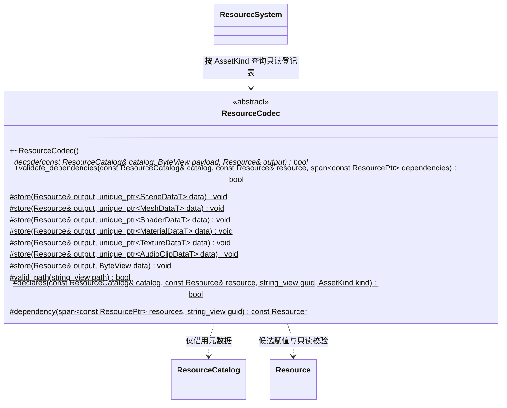
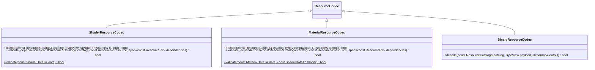

# 资源解码器

[类图索引](../../class-diagrams/index.md) · [资源系统](resource-system.md) · [已加载资源](resource.md)

ResourceSystem 负责目录、VFS、资源信封、代际和单项读取；每种资源的 FlatBuffers 解码、自身字段与声明引用校验、跨实体校验由对应 ResourceCodec 实现。解码器不加载依赖、不持有资源、不判断编辑器或运行宿主身份。

## 通用接口与登记

`find_resource_codec(kind)` 查询 `resource_codecs.cpp` 的固定登记表，未知 kind 返回空；登记表中的解码器均无状态、静态存活。添加类型时新增解码器并登记一次，不增加 Manager、RTTI 或运行时插件策略。`script` 与 `source` 均登记 BinaryResourceCodec。

Resource 的构造、身份与代际赋值仍由 ResourceSystem 私有控制。ResourceCodec 仅通过受保护的 `store` 重载保存 FlatBuffers 生成的模型或原始字节，没有第二套数据模型。load 创建私有候选，信封、类型和引用元数据全部成功后才发布 const ResourcePtr；任何失败输出为空，外部旧引用不变。

## 逐类型实现

```mermaid
classDiagram
    class ResourceCodec
    class SceneResourceCodec {
        +decode(const ResourceCatalog& catalog, ByteView payload, Resource& output) bool
        +validate_dependencies(const ResourceCatalog& catalog, const Resource& resource, span~const ResourcePtr~ dependencies) bool
    }
    class MeshResourceCodec {
        +decode(const ResourceCatalog& catalog, ByteView payload, Resource& output) bool
        +validate(const MeshDataT& data) bool$
    }
    class TextureResourceCodec {
        +decode(const ResourceCatalog& catalog, ByteView payload, Resource& output) bool
        +validate(const TextureDataT& data) bool$
    }
    class AudioResourceCodec {
        +decode(const ResourceCatalog& catalog, ByteView payload, Resource& output) bool
        +validate(const AudioClipDataT& data) bool$
    }
    ResourceCodec <|-- SceneResourceCodec
    ResourceCodec <|-- MeshResourceCodec
    ResourceCodec <|-- TextureResourceCodec
    ResourceCodec <|-- AudioResourceCodec
```

- Scene 校验 FlatBuffers 场景、节点和组件结构及资源引用，跨实体校验接收已加载网格与材质。
- Mesh 复用 MeshUtils 的拓扑与数据校验；Texture 校验像素、Basis 文件、尺寸、格式与 mip 元数据，不创建 GPU 对象。
- Audio 只校验并保存 `AudioClipDataT`：版本为 1、采样率 8000–192000、1/2 声道、非零帧数、交错样本数精确匹配帧数与声道，所有样本有限且在 [-1,1]，PCM 大小不超过 64 MiB 减 128 KiB。失败不发布候选；不创建音频设备或决定播放行为。
- Shader 校验参数、Uniform、Sampler 和默认贴图声明；Material 校验结构与声明引用，跨实体校验材质参数是否匹配 Shader。
- Binary 原样保存脚本和通用 source 载荷，脚本执行或具体二进制解释由使用者负责。
- 内置与项目数据使用同一类型校验。内置注册调用对应解码器的静态 validate；内置读取复制已注册定义，不执行 VFS I/O。

ResourceSystem 在调用类型跨实体校验前统一验证当前目录代际、元数据一致性、直接依赖数量及唯一身份。解码器只校验调用方提供的实体，不读取文件或保留引用；依赖遍历、共享缓存及反向释放继续归运行时资源依赖图插件。
