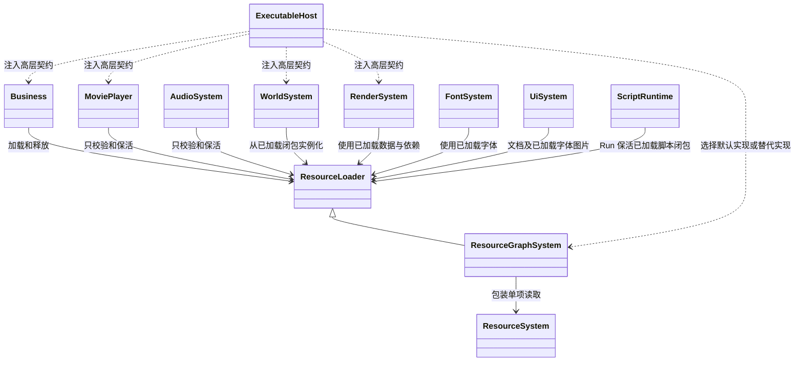
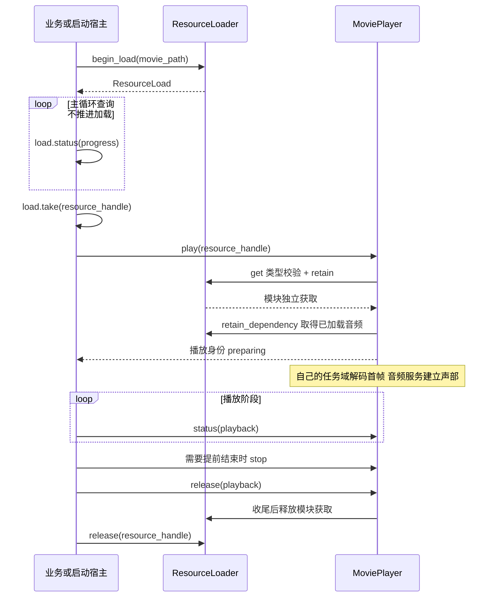
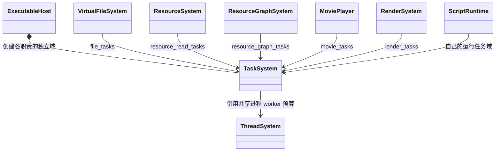
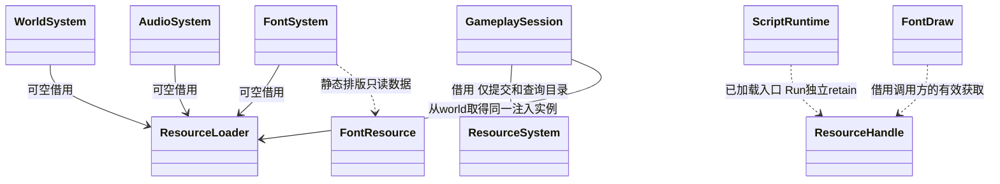

# 资源业务调用与模块任务

[类图索引](../../class-diagrams/index.md) · [统一生命周期](resource-lifecycle.md) · [高层加载契约](resource-loader.md) · [默认资源插件](../../plugins/runtime/class-diagrams/resource-graph.md) · [影片播放器](movie-player.md)

**状态：统一资源契约及业务接入补充已按确认类图实现；验证范围见测试文档。** 所有资源消费路径迁移到“显式加载 → 使用 → 结束实例 → 释放”。本页定义跨模块关系和迁移约束；各模块完整方法继续在所属类图维护。

## 依赖与注入

**内部精简已实现：** 接受路径的组件原生入口只获取一次资源，从该次获取的 info 读取 GUID 并保留同一个获取；消除“临时获取 GUID → 释放 → 按 GUID 再获取”的重复步骤。仍复用已有绑定作用域：场景恢复时从所属根的依赖闭包取得资源，普通业务从当前已加载索引获取，不能因合并查找而改用另一代资源。类型校验和提交顺序保持；失败释放临时获取，原组件绑定不变。ResourceReference 统一负责 C++ 所有者的成对释放，不增加隐式 I/O。 路径入口与 set_settings 通过类型内部的私有提交函数共用校验和状态更新，临时获取按值转交；同 GUID 的既有绑定继续保留原版本及运行状态。脚本层只转换 GUID 的入口仍委托相应组件的公开 set_settings，不向脚本暴露内部资源引用。

这些类只借用高层契约，不向下转型为默认插件，不通过 ResourceSystem::instance/loader、VFS、静态 find_* 或路径 setter 偷偷加载。无资源加载器时，相应入口返回 unavailable；不得宣称资源业务可用。宿主可继续建立不使用资源的基础系统。

同一运行上下文使用同一个注入实例；加载器必须覆盖业务、领域实例及其任务的生命期。组件自身仍是值句柄，资源获取保存在对应 ECS Runtime 列，不往 Component 添加逐实例指针/虚函数或另建 Manager。

## 业务完整流程

同步调用把 begin_load/status/take 替换为 load，其余流程完全一致。资源加载失败不调用 play；模块准备失败仍要释放该模块终态和业务获取。若业务选择在 play 受理后立即释放自己的获取，播放器已取得独立获取，因此继续安全；流程中的释放顺序不是靠共享裸指针碰巧存活。

未加载传入空句柄返回 not_loaded；加载中还没有可交付句柄，必须等待资源 ready；已释放、跨实例或错误类型均明确失败，输出实例身份为空。失败不替换当前正常运行实例，不发起资源或文件 I/O。

播放身份与资源句柄不是一回事：MoviePlayer::release 结束一个播放结果，ResourceLoader::release 结束一次资源获取。音频声部、场景实例、UI 文档同样各自清理，不把“释放资源”定义为偷偷停止所有使用者。

## 全部资源类型的使用边界

| 类型 | 使用者与操作 | 必须移出的隐式加载 |
| --- | --- | --- |
| source / json | 调用方借用 bytes；JSON 语法已在资源层校验 | Json.Load(path) 等直读业务旁路迁入显式资源加载；不为简单数据新建 System |
| script | ScriptRuntime/Run 编译和执行已加载脚本闭包 | VM import 只能解析已加载声明依赖，动态新模块先显式加载 |
| scene / prefab / model | WorldSystem/Scene 从已加载模板组装 ECS 候选并发布 | 场景实例化不自行读文件；子资源按根闭包取得 |
| mesh / material / shader / texture | MeshRenderer/Material/RenderSystem 绑定数据及创建 GPU 表示 | set_mesh/set_shader/材质贴图设置不能因传路径而加载 |
| skeleton / animation / animation_retarget_profile | AnimationSystem 绑定骨架、采样与重定向 | 播放动画或替换 profile 不隐式加载资源 |
| audio / movie | AudioSource/AudioSystem/MoviePlayer 创建声部或播放 | play 和 set_settings 不承担资源读取 |
| font / ui | FontSystem/UiSystem 生成字形布局和文档实例 | 文档打开不临时加载字体、Shader 或图片 |
| effect / terrain / destruction | 各运行时插件建立实例、生成派生网格、模拟 | 组件 settings 不读资源文件，使用已加载规范载荷 |
| light_probe | 场景环境/RenderSystem 绑定预计算数据 | 环境应用不因路径变化读取探针文件 |

Scene/Prefab 的持久字段仍保存路径/GUID，不把进程句柄序列化进 schema。加载根资源时插件已完成必要依赖；实例化时模块从根获取闭包引用，再填入 ECS Runtime 列。编辑器恢复、撤销、热重载也必须先显式准备所需资源，失败保留旧实例。

对动态组件修改，调用方先加载新资源，再调用绑定操作；模块取得新引用并准备候选，成功后替换并释放旧引用。对象的路径/配置 setter 可用于记录持久属性，但实际使用不能通过它隐式读文件；涉及立即应用的操作，资源未准备就返回错误。不得保留一条路径接口暗中加载、另一条句柄接口显式加载的双重语义。

同一原则覆盖内置 Shader/默认纹理及运行时生成 Mesh/Texture：先经 load 或 load_memory 接纳，再给模块使用。业务不需要自己序列化生成资源。GPU/声部/VM 就绪属于模块自身状态，资源 ready 不能替代它们。

## 各模块自己的任务

图中的 TaskSystem 表示多个独立实例，不是所有模块借用一个 loading_tasks。已有线程/任务 API 不变；宿主通过构造/配置传入领域专用域，每个域有自己的并发额度、优先度、取消与完成预算，底层 worker 仍由 ThreadSystem/oneTBB 统一管理。

| 域 | 工作 | 不能代做 |
| --- | --- | --- |
| 文件 | 路径校验、打开、I/O 完成组织；实际传输交 SDL AsyncIO | 解码资源、加载依赖 |
| 核心读取 | 单项信封校验、解析与类型校验 | 引用计数、业务实例 |
| 资源插件 | 依赖计划、请求合并、组织调度、发布与回收 | 影片解码、GPU 或 VM 工作 |
| 影片 | VP9 解码、帧转换和队列 | 文件读取、依赖加载、独立音频设备 |
| 渲染 | CPU 准备、转码及自身提交流程 | 隐式补读资源；worker 直接操作需协调线程的设备 |
| 其他有后台任务的模块 | 该模块的运行工作 | 借用另一个模块的任务预算隐藏耦合 |

纯同步查询不强建空任务域；不为每种 ResourceValue 新增 TaskSystem。音频回调继续实时消费已驻留数据，不在回调中访问加载器、等待任务或分配资源。

宿主统一派发 TaskSystem 完成委托，各模块只消费自己的结果；公开 status/get 纯查询。后台任务捕获独立输入和保活身份，不捕获活动组件列/系统裸借用。取消先使发布目标失效，收尾后再释放输入；正常帧不等待，关闭边界才等待。模块构造/注入细节在各自类图中随实现前评审同步。

## 业务接入契约（2026-11-06 确认，2026-11-07 收敛引用）

本页只维护跨模块注入和所有权关系。公开签名分别见 [WorldSystem](world-system.md)、[AudioSystem](audio-system.md)、[FontSystem](font-system.md)、[GameplaySession](gameplay-session.md) 和 [ScriptRuntime](script-runtime.md)，不在跨模块图重复定义。

- `WorldSystem`、`AudioSystem`、`FontSystem` 的加载器指针可空，默认空；无加载器仍可启动不使用资源的基础系统，所有资源使用入口明确失败。指针非空时有效期覆盖系统及任务。此处将原音频图的必需引用改为可空借用，避免禁用资源插件后必须创建一个虚假的加载实现。
- `WorldSystem::resource_loader()` 为 const noexcept，只返回宿主注入的借用。`load_scene(path)` 保留名称，但只 `acquire_loaded` 并恢复；不读文件。恢复请求独立 retain 根资源，分帧只恢复 ECS，不推进加载。
- `FontSystem::load_font` 删除。调用方使用统一 `ResourceLoader` 加载。`FontDraw::shader` 与字体 draw 输入均为已有获取；调用方须让字体及 Shader 获取覆盖绘制；字体 GPU 缓存只保存可校验身份和 GPU 副本，每帧清理失效身份，不延长 CPU 资源寿命。
- `MeshRenderer::mesh_resource/lightmap_resource`、`Material::texture`、`UiComponent::document`、`TextComponent::font/shader`、`LightProbeVolumeComponent::resource` 改为返回 `ResourceHandle` 身份副本，查询不加计数；调用方不得释放模块持有的身份，跨调用使用必须 retain。原共享指针返回类型删除。
- 场景、Prefab、Model 恢复使用私有的恢复作用域，把当前根获取传入组件绑定链；作用域只覆盖同步恢复步骤。组件持久字段仍为 GUID/路径，ECS Runtime 列保存独立获取。恢复从根闭包查找，动态 setter 从当前已加载索引获取，二者均无读取回退。
- `RenderSystem` 保留世界注入关系，通过世界取得同一加载器；无世界的影片呈现只使用已解码帧。`UiSystem` 同样通过已注入世界取得加载器，不增加另一条资源来源。
- `ScriptSystem` 构造增加首个 `ResourceLoader* resources` 参数；其余可空系统借用保持原顺序。入口和 VM import 只使用 Run 持有的已加载闭包；独立项目脚本由会话先显式加载再传入 `execute_project_script`。
- `RuntimeHost::initialize` 与 `initialize_presentation` 在 `ResourceSystem* resources` 后增加 `ResourceLoader* loader` 参数。宿主只借用高层接口；资源核心不再提供 `loader()`，无注入时不构造 MoviePlayer。可执行宿主负责资源核心与插件的 tick 和反序关闭；RuntimeHost 不驱动借用资源服务。
- `GameplaySession` 在提交新目录后，显式准备本轮内置资源、脚本入口和场景根，再调用对应使用模块；候选失败不替换已运行实例。内置内存候选使用 `load_memory`，当前目录已有物理实体则显式加载该实体，不回退内存副本。
- `RuntimeParallelConfig` 的通用 `loading` 任务配置拆成 `file`、`resource_read`、`resource_graph`、`movie`、`render`；资源预算类型更新为 `ResourceReadConfig`。这些只是已有 TaskSystem 的独立配置，不另建线程池。

脚本服务同步升级：`Resources.Load(path)` 返回可释放的 `ResourceHandle`；`Resources.BeginLoad(path)` 返回独占的请求外观，提供 `Status/Progress/Take/Cancel/Error`；`Resources.Retain/Release` 对获取操作。句柄为不透明值，归属和有效性由原生加载器校验，请求与未释放获取随脚本上下文清理。`Movie.Play` 改接收资源句柄；`Json.Load(path)` 删除，改为 `Json.ParseResource(handle)` 解析已加载 JSON。组件路径 setter 保留，只使用已加载资源。

1. 核心 ResourceSystem 从 ResourceLoader 分离；单项读取交付 unique_ptr。
2. resource_graph 实现完整高层契约、内部计数及合并在途请求。
3. 宿主显式注入同一加载器；资源插件可替换，核心不保留具体实现回退。
4. 先迁移业务预加载，再迁移每个消费入口及其 Runtime 引用，禁止留下隐式加载旁路。
5. 场景恢复、脚本绑定、启动片头、编辑器预览、内置与生成资源使用相同流程。
6. 按总图验收同步/异步、全类型、取消、换代、关闭与插件替代；公开契约已由用户确认，实际结果与限制集中记录在测试文档。
