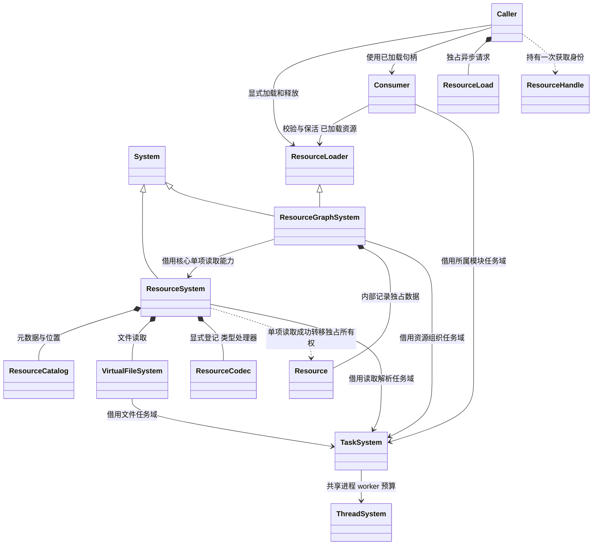
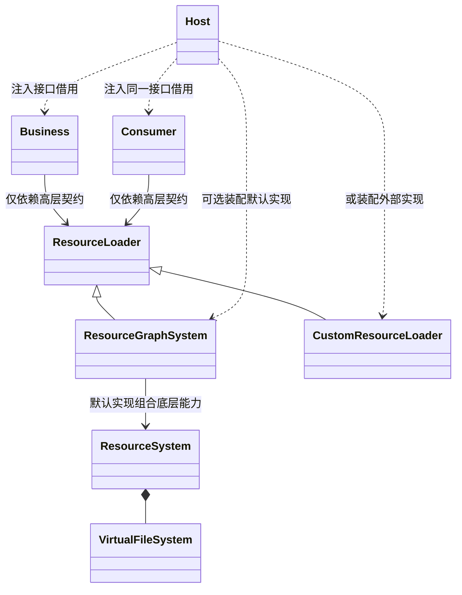
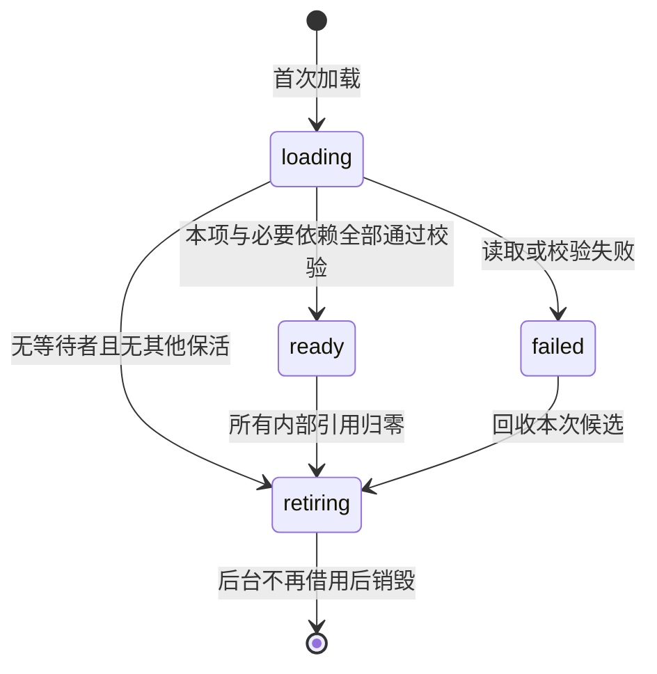
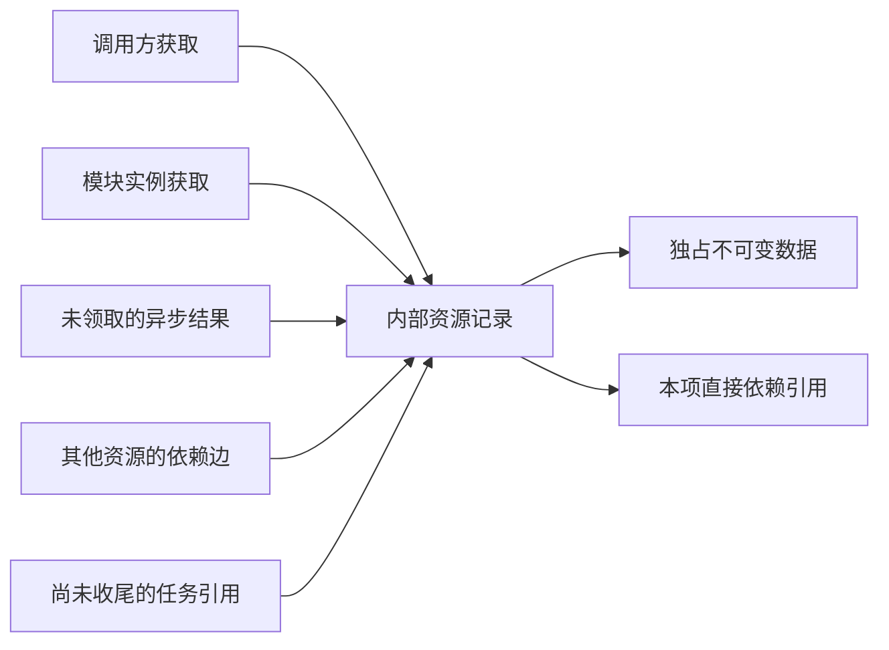

# 统一资源生命周期

[类图索引](../../class-diagrams/index.md) · [核心读取](resource-system.md) · [生命周期插件](../../plugins/runtime/class-diagrams/resource-graph.md) · [资源对象](resource.md) · [加载接口](resource-loader.md) · [类型处理器](resource-codecs.md) · [业务与任务](resource-consumers.md)

**状态：统一资源契约及业务接入补充已按确认类图实现；验证范围见测试文档。** 本组类图响应“所有资源都显式加载、使用、释放”的要求；核心、插件与业务按下述接口一次迁移；实际验证结果集中记录在测试文档。

## 分层与职责

| 层 | 负责 | 结果 |
| --- | --- | --- |
| 文件层 VirtualFileSystem | 挂载、定位、范围读取、同步/异步 I/O、取消与文件错误 | 独占字节缓冲，不理解资源类型或依赖 |
| 核心资源读取 ResourceSystem | 目录查询、单项读取、类型选择、解析与校验 | 独占单项资源数据，不加载依赖、不缓存 |
| 资源插件 ResourceGraphSystem | 依赖加载、并发请求合并、共享、内部计数、发布与卸载 | 已加载资源句柄 |
| 领域模块 | 播放、GPU 上传、VM 执行、场景实例化及各自任务 | 模块自己的实例/状态/错误 |
| 调用方 | 选择何时加载、等待、使用、停止和释放 | 完整业务流程 |

**按用户本轮确认，核心提供文件类与资源读取类；插件提供引用计数、组织读取和卸载；业务通过加载接口使用。** 资源读取类沿用 ResourceSystem，不再增加同职责门面。ResourceLoader 是核心声明的最小契约，ResourceGraphSystem 是插件实现；核心系统和领域模块都不包含具体插件。

此划分保留 [AGENTS.md](../../../AGENTS.md) 的单向依赖与资源插件边界。变化是统一显式加载/释放、完整类型抽象、异步操作和内部计数，取消核心单项读取冒充业务加载器的回退。宿主没有注入加载器时，资源使用入口返回不可用错误；不悄悄降级为没有依赖和计数的单项读取。

## 高层能力可替换

ResourceLoader 的声明放在核心，是为避免业务依赖具体插件；它表达的是高层加载契约，不是单项读取接口。默认 ResourceGraphSystem 组合核心能力实现这套契约，其他人也可以提供自己的实现。宿主选择和注入，业务及领域模块无需因此改变。

CustomResourceLoader 仅代表外部扩展位置，本仓库不新增该实现类或第二个 Manager。替代实现必须遵守相同的就绪、类型、句柄、依赖、释放、异步和错误语义；内部缓存及调度可不同。业务不能通过向下转型、单例或具体插件头绕过接口。宿主装配是唯一知道所选具体实现的位置；任何加载器借用都必须在实现销毁前解除。

## 统一状态与完成语义

以上是私有资源记录状态；公开异步请求状态见[加载句柄](resource-loader.md)。句柄只在 ready 后交付，不向业务暴露半成品。

资源 ready 表示本项不可变数据和必要依赖已加载、解析并校验完成。它不表示纹理已上传 GPU、脚本已编译、节点已发布、影片已解出首帧。使用资源的模块分别返回自己的 preparing/ready/failed 等状态；它们只处理已加载数据，不发起隐式文件加载。

- `load` 成功返回时已经 ready；失败输出空句柄。首次同步调用可以执行必要读取与解码。
- `begin_load` 返回表示请求已受理，由插件及底层系统推进；查询只读，业务不用 `step`。
- 同一目录代际、同一 GUID 的后台请求合并为一份工作，各请求独立完成、取消和取结果。
- 同步请求若命中仍在异步加载的必要闭包，返回 `busy`。不等待协调线程自己的完成委托，不递归 tick，不启动重复读取；调用方可继续异步等待或稍后重试。
- 同步和异步最终经过相同的实体校验、类型处理器、依赖校验与原子发布规则。文件错误不会被包装成“成功但空数据”。

## 内部计数与释放

引用计数属于 ResourceGraphSystem 插件，核心读取层和业务没有计数器，也不以 `shared_ptr::use_count` 代替生命周期规则。

1. 每次成功加载、`retain` 或 `retain_dependency` 获得独立获取身份；`release` 只结束该身份。句柄按值复制不增加计数，释放后其所有副本一起失效。
2. 已完成但尚未取出的异步请求持有一次获取；`take` 转交它，不再次加计数。取消/销毁请求释放尚未转交的结果。
3. 每个资源记录对每条去重后的直接依赖持有一个内部引用，与根资源有多少业务使用者无关。拒绝依赖环，不用循环计数维持泄漏。
4. 模块接收句柄后，先校验并获取自己的引用，再发布运行实例。调用方随后释放自己的句柄，不会使正在播放、渲染或执行的实例悬空。模块停止/替换/销毁时释放其引用。
5. 任务仅通过私有任务引用保活不可变输入，直到完成或取消收尾；不能跨任务保存活动系统、ECS 列或临时视图的裸借用。
6. 总引用归零先移出可命中集合，再销毁本项并释放其依赖边，沿依赖关系反向卸载。无隐藏常驻缓存；引擎内置默认资源由引擎显式持有引用至关闭。

取消一个请求只撤销该请求的等待/获取；其他等待者和已就绪使用者不受影响。没有任何需求的候选请求取消底层 I/O 和任务；取消返回不阻塞，实际内存等待任务收尾后释放。

## 目录、来源与模块边界

- 目录提交成功整体换代；失败保留旧目录。新加载只读当前目录，不从旧包回退。
- 已交付的旧代际句柄及完整旧依赖闭包继续有效，直到最后一次释放。`retain_dependency` 沿所属记录查询，不能误取新代际同 GUID 对象。
- 换代时仍未完成的旧请求以 `generation_changed` 失败；就绪但未领取的结果已经完成，可以领取旧代际。旧任务结果不能发布到新代际。
- 散文件、合并包、Android APK assets 都经过同一 VFS；引擎内置定义与运行时生成数据通过内存入口进入相同校验、计数和释放过程，不写临时文件绕行。
- 每种资源都使用相同生命周期；不同类型保留自己的数据与使用方式。source 只提供原始字节，并不承诺能在运行时导入 FBX 等源文件。未登记的类型返回 `unsupported_type`。
- 资源模块不创建播放实例、GPU 对象、VM 或场景节点，不加入编辑器模式、自动扫描或项目策略。模型虚拟分组不产生运行时聚合依赖，只加载真实引用。

关闭顺序：调用方停止提交 → 各模块取消任务、销毁实例并释放获取 → 插件取消加载、收尾任务并卸载资源 → 核心 ResourceSystem 收尾文件/解析并销毁处理器 → 关闭任务域 → 关闭 ThreadSystem。只有显式关闭边界允许等待收尾。

## 后续实现的验收条件

以下是待实现验收，不代表当前代码已通过。

| 条件 | 必须观察到的结果 |
| --- | --- |
| 全部 21 种 AssetKind，同步及异步 | 相同发布/错误语义；类型处理器缺失明确失败 |
| 未加载、加载中、释放后、错误类型的句柄 | 使用接口返回错误，不发生 I/O，不改变原运行实例 |
| 多次加载同一资源 | 复用同一份就绪数据，得到独立获取；释放一个不影响另一个 |
| 多个并发请求，取消其中一个 | 单份读取/解码；其他请求仍可完成 |
| 菱形依赖、共享根、依赖环、部分失败 | 去重计数、无泄漏、拒绝环、失败回滚自己的引用 |
| 句柄复制、槽复用、服务重建 | 重复释放不减其他引用，旧句柄不能复活 |
| 业务释放后模块仍在使用 | 模块保活有效，最后一个实例结束后可回收 |
| 资源 ready 与首帧/GPU/VM 未就绪 | 两套状态明确，无假完成 |
| 取消、关闭、晚到完成委托 | 无悬空访问、无重复完成、未领取结果被回收 |
| 换代及换代失败 | 旧 ready 闭包可继续用，新请求不混代，失败保留旧目录 |
| 文件/内存/内置及异步预算 | 相同类型校验和释放；超额明确返回错误，查询不推进任务 |

实现验收仍遵循 [测试文档](../../testing.md) 的 Debug 编译、Release 编译与运行测试约定。
