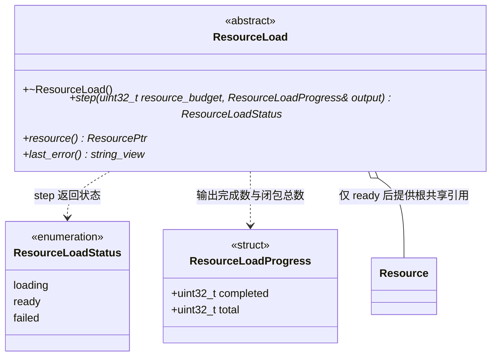

# 资源加载接口

[类图索引](../../class-diagrams/index.md) · [单项资源系统](resource-system.md) · [依赖图插件](../../plugins/runtime/class-diagrams/resource-graph.md)

- 接口归 `runtime/resource/`，不引用任何具体插件。虚析构为 noexcept；`find` 为 const noexcept，`last_error` 为 const noexcept；状态和查询标注 nodiscard。
- `load` 显式同步加载一个请求目标，失败清空输出；是否组合依赖由所选实现决定。
- `find` 只查询实现已缓存的当前代际对象，不触发文件读取。命中返回共享引用，未命中返回空；核心单项实现不缓存，始终返回空。
- `ResourcePtr` 是 `std::shared_ptr<const Resource>` 的别名。接口不引入异步队列、优先级、引用计数包装或编辑器身份。
- `last_error` 借用最近失败原因，随后操作可能改变其内容；返回状态仍是成功或失败的依据。

具体实现的公开契约分别维护在资源系统与资源依赖图插件图；此图只维护共同接口。

## 单线程分步操作

`begin_load` 返回由调用方显式推进的操作，允许跨帧加载目标的必要资源。`load` 和 `Scene.Load` 保留同步语义。

- `ResourceLoad`、`ResourceLoadStatus`、`ResourceLoadProgress` 归核心 `engine` 命名空间。核心声明操作与计数结构；具体依赖遍历和缓存策略归所选加载器。
- `begin_load(guid, output)` 先清空输出，成功后转交尚未推进的操作，由调用方用 `unique_ptr` 独占。准备阶段只读取目标及依赖的目录元数据，不读取实体载荷。基础接口默认返回 false，表示不支持分步加载；同步加载不要求启用依赖图插件。
- 操作固定目标 GUID 和创建时的目录 generation。loading 期间目录换代、加载器变化或读取/校验失败，进入 `failed` 并释放候选引用。ready 后保留完整旧代快照，终态重复 step 不改变状态、计数或缓存；提交方仍须核对 generation。
- `step(resource_budget, output)` 每次最多完成预算数量的唯一资源；缓存命中或通过读取、解码和依赖校验均计一个完成项。预算 0 检查当前状态但不读取实体。返回时总是填写 `completed/total`；total 创建后固定，completed 单调且不超过 total。
- `resource()` 为 `const noexcept`，只在 ready 时返回完整根 ResourcePtr 的共享副本，其引用保持必要依赖闭包；loading/failed 返回空。`last_error()` 为 `const noexcept`，借用本操作独立保存的错误，ready 时为空。
- 析构为公共虚析构且 `noexcept`；未完成时取消，完成后释放本操作的根引用，不强制卸载其他使用者持有的资源。操作不可复制或移动，方法和销毁均在同一运行线程调用；借用的加载器与资源核心必须覆盖操作生命周期。状态和查询标注 `[[nodiscard]]`。

## 加载阶段与限制

| 阶段 | 完成依据 | 执行边界 |
| --- | --- | --- |
| 资源读取 | `completed == total` 且状态为 ready | 调用方每帧推进 step；计数只覆盖请求时声明的资源闭包 |
| 场景恢复 | `WorldSystem::load_scene(path)` 成功 | 同步恢复完整候选场景，成功才替换旧场景 |
| 图形准备 | 新场景首帧成功 | 渲染器准备 GPU 资源，不计入资源读取进度 |

提交场景时保持 ready 操作或根引用，使 `load_scene` 复用已驻留闭包；Scene 接管根资源后再释放操作。恢复失败保留旧活动场景。

计数表示资源项数，不代表耗时或字节百分比。单项读取/解码、场景恢复和 GPU 准备仍是同步工作，不承诺毫秒预算或全过程持续刷新。调用方在 step 之间返回正常主循环，不重入 tick/render；只有新场景首帧成功后才能报告整体就绪。取消只在 step 之间及提交前生效，不能中断正在执行的单项读取或场景恢复。

当前没有后台线程或自动调度；依赖加载算法、缓存发布与所有权实现见[依赖图插件](../../plugins/runtime/class-diagrams/resource-graph.md#单线程分步复用)。
