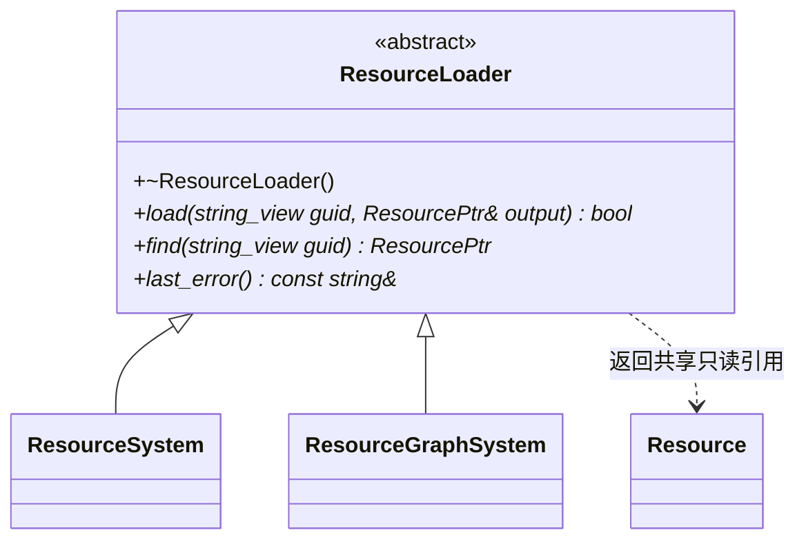

# 资源加载接口

[类图索引](../../class-diagrams/index.md) · [单项资源系统](resource-system.md) · [依赖图插件](../../plugins/runtime/class-diagrams/resource-graph.md)

- 接口归 `runtime/resource/`，不引用任何具体插件。虚析构为 noexcept；`find` 为 const noexcept，`last_error` 为 const noexcept；状态和查询标注 nodiscard。
- `load` 显式同步加载一个请求目标，失败清空输出；是否组合依赖由所选实现决定。
- `find` 只查询实现已缓存的当前代际对象，不触发文件读取。命中返回共享引用，未命中返回空；核心单项实现不缓存，始终返回空。
- `ResourcePtr` 是 `std::shared_ptr<const Resource>` 的别名。接口不引入异步队列、优先级、引用计数包装或编辑器身份。
- `last_error` 借用最近失败原因，随后操作可能改变其内容；返回状态仍是成功或失败的依据。

具体实现的公开契约分别维护在资源系统与资源依赖图插件图；此图只维护共同接口。
