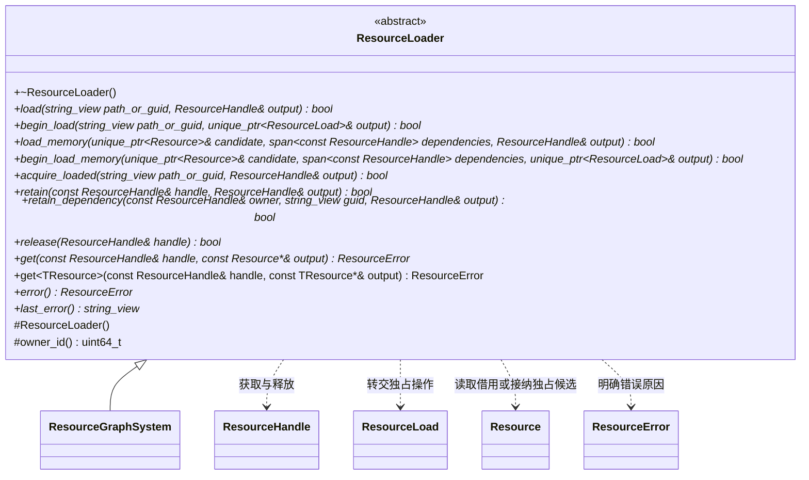
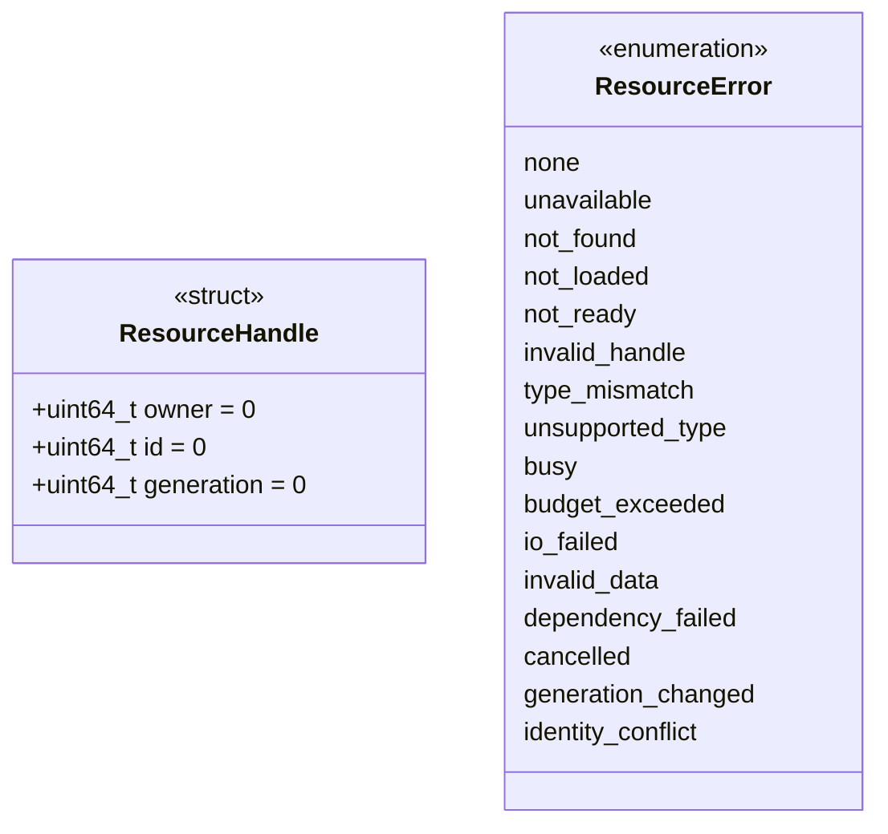
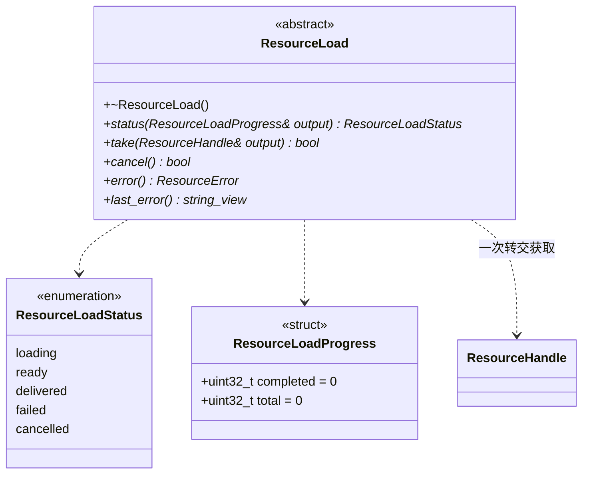
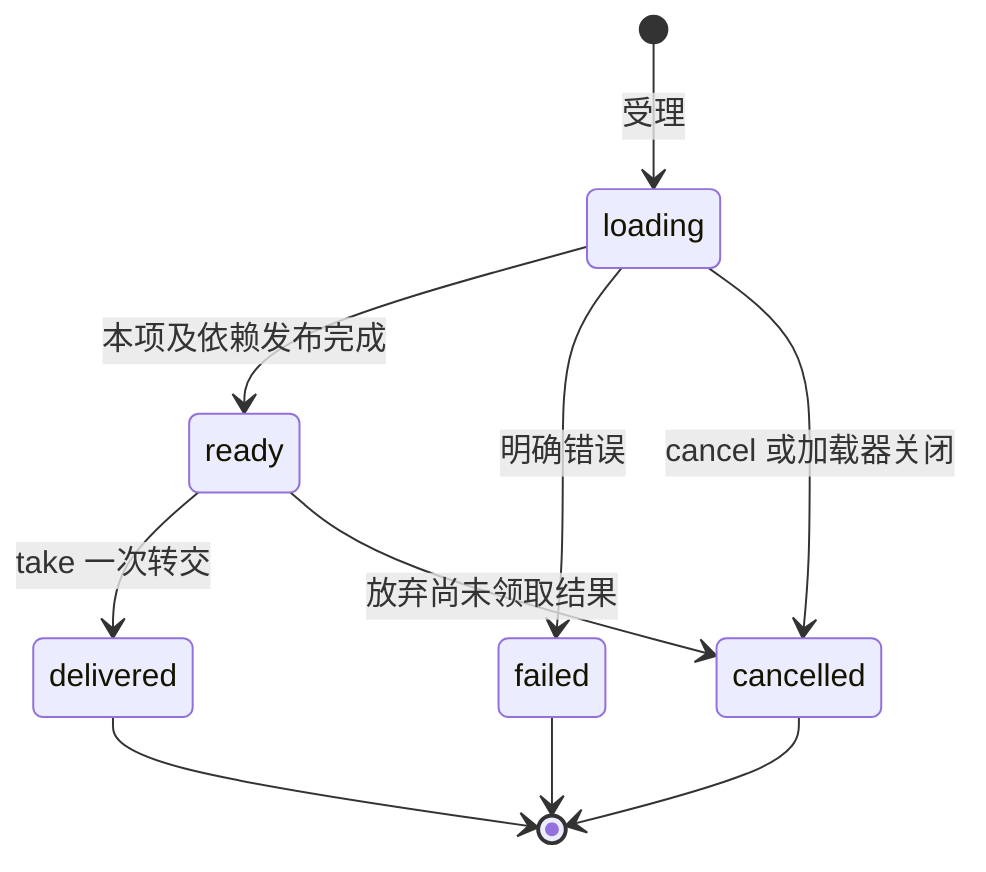

# 资源加载契约与获取句柄

[类图索引](../../class-diagrams/index.md) · [统一生命周期](resource-lifecycle.md) · [核心读取](resource-system.md) · [插件实现](../../plugins/runtime/class-diagrams/resource-graph.md)

**状态：统一资源契约及业务接入补充已按确认类图实现；验证范围见测试文档。** 本文件只定义核心契约；依赖、共享、引用计数和卸载由资源插件实现。业务只依赖 ResourceLoader，不直接调用单项读取接口。

## 加载接口

- 基类构造与公共虚析构 noexcept，禁止复制/移动。状态与查询标注 nodiscard；get、error、last_error 为 const，get 模板只校验规范类型后转交借用，不使用 RTTI。实例只在宿主协调线程操作，不承诺任意线程并发调用。
- load/begin_load 按目录唯一逻辑路径或完整 GUID 定位，不接收物理文件路径；同步/异步完成语义见总图。所有获取/操作输出应以空值传入；非空时拒绝且保留原值，不能覆盖而泄漏。在合法空输出前提下，失败保持空值。retain/take 同样遵守此规则。
- retain 只复制已就绪的使用权，成功得到不同获取身份；不读取文件。retain_dependency 只在 owner 的已加载闭包中查找（包含传递依赖），缺失失败，不以当前目录另行加载。
- release 消耗该获取并清空传入句柄。全零句柄重复清理返回成功；非零但已失效或来自其他加载器的句柄返回 invalid_handle，清空本地值，不减少其他引用。它不等价于强制按 GUID 销毁资源。
- get 成功返回 ResourceError::none，失败输出 nullptr；全零句柄返回 not_loaded，失效/跨服务句柄返回 invalid_handle，模板类型不符返回 type_mismatch。它不加引用、不发起 I/O、不推进状态，也不修改 last_error。
- error/last_error 保存最近一次命令失败的上下文；下一次命令可覆盖，不用于异步请求的独立错误查询。异步失败归 ResourceLoad。字符串借用不能跨下一次命令保存。
- 不保留 find(path) 取得裸数据的旁路。访问必须证明一次有效获取；所需依赖通过 owner 的闭包访问。禁用资源插件时宿主明确报告 unavailable，不回退核心单项读取。

## 获取身份与错误

owner 标识加载器实例，id 标识一次获取槽，generation 是该槽的代数；它们不是资源 GUID 或目录代际。ResourceLoader 基类从核心私有的进程唯一序列分配 owner，受保护的 owner_id() 为 const noexcept，供每种实现生成及校验句柄；禁止实现自行使用从 1 重置的局部实例号。基类只提供身份，不存资源或引用计数，也不增加公共 ID Manager。

槽复用、插件销毁重建及整数耗尽都不能令旧句柄重新有效。owner 空间耗尽时基类保持 0 安全状态，该实例初始化/加载必须失败；槽代数耗尽则弃用该槽，不能回绕。全零是唯一空句柄，其他不完整值无效。

复制 ResourceHandle 不增加引用；所有副本代表同一次获取，一处释放后全部失效。独立使用者必须 retain；一个原始业务句柄的多份结构副本不能分别 release。运行模块内部以 RAII 清理自己取得的身份，公共接口不引入另一套智能指针。

## 异步加载操作

插件的私有实现持有独立请求状态；业务用 unique_ptr 独占操作。析构 noexcept；status/error/last_error 为 const noexcept 纯查询，所有状态返回标注 nodiscard。无 step、wait 或在查询中泵系统的入口。

- 缓存命中可以在 begin_load 返回时已经 ready；受理仍不等价于完成，调用方检查 status。
- total 是去重后的必要闭包资源数，completed 是本请求已确认就绪的数量；不包含 GPU、首帧或 VM 工作，不承诺等同字节或耗时比例。计数溢出必须拒绝请求。
- ready 请求拥有一次获取；take 仅第一次成功，转交而不增加计数。非 ready 时失败输出空，不能取得半成品；不会吞掉已有失败原因。取出后请求变为 delivered。
- cancel 在 loading/ready 时成功撤销本请求，重复取消成功；已 delivered/failed 时返回 false，不影响已转交的业务获取或其他请求。析构等同放弃未领取结果，不阻塞等待。
- 操作可以晚于插件销毁：关闭时共享的私有请求状态被终结/失效，未领取获取被回收。之后查询/取消/析构不能解引用已销毁插件。该控制状态使用内部 shared_ptr 不代表向业务公开资源共享所有权。
- 尚在加载的旧代际请求在换代时 failed/generation_changed；已经 ready 的旧结果可领取。错误文本保存在请求状态中，不借用插件的临时 last_error。

## 内存资源入口

load_memory/begin_load_memory 接纳带元数据的规范 ResourceValue 候选，不先序列化到临时文件。核心执行单项数据校验，插件验证依赖、发布并纳入同一计数规则。

- candidate 必须非空，具备合法 GUID/逻辑路径/Kind，且没有物理位置。若当前目录含该身份，元数据和依赖必须一致且不能覆盖有物理位置的条目；不存在时作为当前代际的临时内存身份。
- dependencies 显式提供全部直接依赖的已加载句柄，必须属于同一加载器和目录代际，GUID/类型与声明一致。插件先取得自己的依赖引用；不隐式读取未提供的依赖。
- 同一代际已有相同 GUID 或逻辑路径记录时返回 identity_conflict，不通过替换数据改变已有实例。需要共享时调用 load 或 retain；修改内容要创建新身份或提交新目录代际。
- 同步成功、异步受理成功才消费 candidate（置空）；未受理/同步失败保留其所有权，但不承诺其内部校验暂存状态不变。异步受理后失败/取消由操作回收候选。
- 内存记录 ready 后支持普通 load(guid/path) 获取。最后一次引用释放即卸载；临时身份不再可加载，需要调用方重新提供候选。目录换代不把旧内存数据自动注册到新代际。
- 内置默认定义也走该入口，由宿主在选定目录之后初始化并持有获取。外置同身份资源只按当前目录读取，损坏时不能回退内存定义。没有项目时可提交引擎基线目录并加载必要内置数据。

## 资源与使用阶段

资源 ready 只表示不可变数据和必要依赖就绪。场景恢复、GPU、VM、影片首帧是各模块的准备工作，其状态和进度单独报告，见[业务与模块任务](resource-consumers.md)。旧文档中的 ResourceLoad::step 不属于目标契约；场景节点等模块自己的分步恢复接口也不能借机推进资源加载。

## 已加载资源获取

**2026-11-06 用户已确认增加 acquire_loaded。** MeshRenderer、Material、AudioSource、字体/UI 及插件组件保留路径或持久 GUID 设置资源，使用 acquire_loaded 获取已经加载的资源，严格禁止隐式 I/O。签名统一维护于本页加载接口图。

它只查询当前代际已发布的记录并创建独立获取：ready 时加计数返回句柄；已知但未加载返回 not_loaded，在途返回 not_ready，未知目录/内存身份返回 not_found。失败不读取文件、不提交任务、不推进状态，空输出规则与 retain 一致。默认插件和替代实现必须保持同一语义。

这不是原 find 返回裸数据的旁路，而是一次必须 release 的获取。业务仍先显式 load/begin_load；组件的路径设置仅绑定预加载对象，未加载就返回错误。影片等已明确的句柄接口保持不变。

场景/预制体/模型恢复继续从根句柄调用 retain_dependency，固定同代际闭包；不能为缺失依赖回退 acquire_loaded 而混代。它只用于调用方独立预加载后，模块按当前目录路径绑定的场景。
